# Design — desktop-ui

## 1.6 Rough Mockups

Wireframes de baixa fidelidade, só estrutura e fluxo (cores, tipografia e ícones fecham em 2.5). Referência de estilo: barra lateral fixa à esquerda com o item ativo em destaque, área de conteúdo em cartões com cantos arredondados, rodapé com atalhos, tema claro e escuro. [src: requirements.md § 1.1]

### Casca (todas as telas)

```text
+------------------------------------------------------------------------------+
| MIND                                                          [_] [o] [x]    |  barra de título nativa
+----------------+-------------------------------------------------------------+
|  [logo] MIND   |                                                             |
|  Workspace  v  |   Título da tela                         [ação principal]   |
|                |                                                             |
|  > Hoje        |   +----------------+  +----------------+  +--------------+  |
|    Biblioteca  |   |  cartão        |  |  cartão        |  |  cartão      |  |
|    Gerar       |   +----------------+  +----------------+  +--------------+  |
|    Estudar     |                                                             |
|    Estatísticas|   +-------------------------------------------------------+ |
|    Erros       |   |  cartão largo (lista, gráfico ou formulário)          | |
|    Chat        |   +-------------------------------------------------------+ |
|                |                                                             |
|  Configurações |                                                             |
+----------------+-------------------------------------------------------------+
| v0.x            Buscar Ctrl+K   Tema ◐   Chave do provedor: ok               |  rodapé de status
+------------------------------------------------------------------------------+
```

Decisões de estrutura: a barra lateral lista as 8 seções atuais (`SECTIONS`); o seletor de workspace fica no topo dela; o botão de tema e o estado do provedor vão para o rodapé; "Revisar" e "Praticar" continuam sendo subtelas alcançadas por "Gerar" e "Estudar".

### Hoje

```text
+----------------------------------------------------------------------+
| Hoje                                         [ Estudar agora (23) ]  |
+----------------+----------------+----------------+-------------------+
| Vencidos   12  | Aprendendo  5  | Novos      6   | Feitos hoje   14  |
+----------------+----------------+----------------+-------------------+
| Meta diária                                                          |
| [██████████░░░░░░]  14 / 20                                          |
+-----------------------------------+----------------------------------+
| Questões para praticar: 8         | Pontos fracos                    |
| [ Praticar ]                      |  Tópico A  ░░░ 42%  [ Treinar ]  |
|                                   |  Tópico B  ░░░░ 55% [ Treinar ]  |
+-----------------------------------+----------------------------------+
```

### Estudar (cartão em foco)

```text
+----------------------------------------------------------------------+
| Estudar   Filtro: [Todos v]                          12 restantes    |
+----------------------------------------------------------------------+
|                                                                      |
|     Pergunta (Markdown e fórmulas)                                   |
|                                                                      |
|     [ Mostrar resposta ]   (Espaço)                                  |
|                                                                      |
|  Fonte: arquivo.pdf, p. 12  "citação exata do trecho"                |
+----------------------------------------------------------------------+
|  [ Errei 1 ]   [ Difícil 2 ]   [ Bom 3 ]   [ Fácil 4 ]               |
+----------------------------------------------------------------------+
```

### Biblioteca

```text
+----------------------------------------------------------------------+
| Biblioteca                       [ Importar arquivo ] [ Importar URL ]|
+----------------------------------------------------------------------+
| Buscar... [______________]                                           |
+----------------------------------------------------------------------+
| Nome do material        Tipo   Páginas   Status    Cards    ...      |
| apostila.pdf            PDF    120       indexado    34     [Abrir]  |
| notas.md                MD     -         indexado    12     [Abrir]  |
+----------------------------------------------------------------------+
```

### Gerar e Revisar

```text
Gerar:    [ Material v ] [ Tópico/páginas ] [ Tipo: cards | questões ] [ Qtd ]
          Estimativa de custo: ~US$ 0,02      [ Gerar ]

Revisar:  +--------------------------+--------------------------------+
          | item gerado (editável)   | trecho de origem destacado     |
          | [Aprovar] [Editar] [Descartar]                            |
          +--------------------------+--------------------------------+
```

### Estatísticas, Erros, Chat e Configurações

- **Estatísticas:** cartões de retenção, sequência e acerto por tópico; gráfico de revisões por dia; botão "Treinar pontos fracos".
- **Erros:** lista filtrável de itens errados com a fonte ao lado e ação "Treinar".
- **Chat:** conversa à esquerda, citações da fonte em painel lateral recolhível; mensagem "não encontrei suporte" quando não há fonte.
- **Configurações:** abas Provedor, Workspace (exportar e importar backup), Aparência (tema), Meta diária.

### Fluxo principal

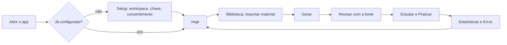

### Assumptions & open questions

- A7 (1.6): Manter as 8 seções atuais na barra lateral, sem acrescentar seções novas. — confirmed: yes
- A8 (1.6): O botão de tema e o estado do provedor migram para o rodapé. — confirmed: yes
- A9 (1.6): Atalhos de teclado (Espaço e 1 a 4 no estudo, Ctrl+K para buscar) entram como "Should". — confirmed: yes

## 2.1 Codebase analysis

Resumo do mapa completo em `.aidlc/codekb/MIND/` (commit 7a16826, validado com o autor em 2026-11-14).

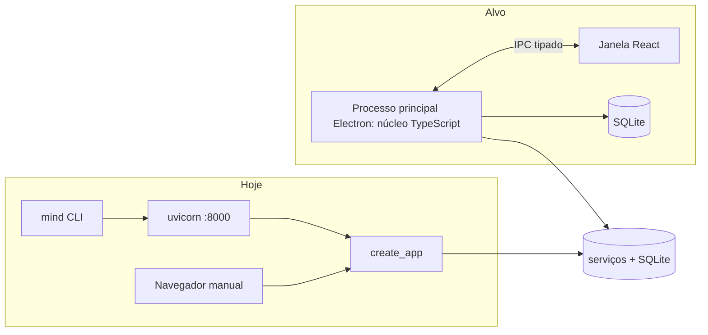

**Fatos que condicionam a mudança.**

- Monólito modular: serviços independentes de HTTP; web e API são bordas finas sobre eles, então trocar a casca não toca o núcleo. [src: codekb/architecture.md]
- Na reescrita, o kb e os testes Python são a especificação do comportamento; `security.py` e `config.py` não têm equivalente direto (sem HTTP). [src: codekb/quality-and-risks.md]
- Camada visual a reescrever em React: 35 templates, `app.css` (557 linhas), `theme.js`, `study.js`, `practice.js`; KaTeX é reaproveitado, HTMX sai. [src: codekb/code-structure.md]
- Já existem barra lateral e alternância de tema; o redesenho parte deles. [src: src/mind/web/templates/base.html]
- Ao final (S-7) todo o código Python, o `Dockerfile`, a API e o trecho `uvx` do README são removidos. [src: requirements.md § 1.4]
- Sem dados reais em uso e sem consumidores externos da API: liberdade para mudar caminhos e portas `[user]`.

**Baseline de testes.** 642 passam, 6 desmarcados, cobertura 97,38% em 67 s, sem falhas pré-existentes (commit 7a16826, 2026-11-14).

**Padrões a seguir.** ruff + mypy strict + pytest com LLM mockado, textos de UI em `web/strings.py`, cabeçalho de arquivo, Conventional Commits, dependências compatíveis com AGPL. [src: codekb/conventions.md]

### Assumptions & open questions

- A10 (2.1): Novas dependências (Electron, mupdf, tesseract.js, transformers.js etc.) são aceitáveis desde que a licença seja compatível com AGPL (M-6). — confirmed: no

## 2.2 Team practices

> Revisado (v2) para a stack TypeScript + Electron. Versão anterior em `archive/design.v1-pywebview.md`.

**Mantidas (independem da linguagem).** Conventional Commits direto na `main`, commits atômicos, nenhum `git push` sem pedido (M-5, M-7); código, comentários, logs e commits em inglês, UI em pt-BR, cabeçalho `Filename/Created on/Author` em todo arquivo novo (M-8); dependências compatíveis com AGPL (M-6); LLM sempre mockado nos testes (M-5); acessibilidade e contraste testados (hoje em `tests/web`). [src: .aidlc/memory/project.md, codekb/conventions.md]

**Novas (afirmadas pelo autor no gate 2.2 v2).**

| Prática | Escolha | Substitui |
|---|---|---|
| Linguagem | TypeScript com `strict`, sem `any` implícito | mypy strict (M-4) |
| Lint e formato | ESLint (com regras de React e de segurança) + Prettier | ruff |
| Testes | Vitest + Testing Library; cobertura V8 mínima de 80% | pytest (M-5) |
| E2E da janela | Playwright para Electron (com xvfb no CI), mesmo fluxo do teste e2e atual | `tests/e2e` |
| Pacotes | pnpm com lockfile e `--frozen-lockfile` no CI | uv |
| Build | Vite (renderer) + electron-builder (`.deb`) | hatchling |
| Pacote `.deb` no CI | Build, verificação de metadados (`dpkg-deb`, `lintian`) e instalação em contêiner descartável só para teste | (novo) |
| Validação nas bordas | zod no IPC e nas saídas do LLM | Pydantic |
| CI | GitHub Actions: lint, formato, `tsc`, testes, E2E, build do `.deb` | `ci.yml` atual |

**Verification command proposto (a aprovar em 2.9).** `pnpm lint && pnpm format:check && pnpm typecheck && pnpm test --coverage`; o E2E e o `.deb` rodam como etapas separadas do CI.

### Assumptions & open questions

- A11 (2.2): As práticas mantidas e as novas valem para todo o código novo. — confirmed: yes
- A13 (2.2): As memórias M-4 (Python/uv/mypy) e M-5 (pytest) serão substituídas por equivalentes TypeScript na retrospectiva da Inception. — confirmed: no

## 2.5 Refined Mockups

Protótipo estático navegável em `mockups/mind-ui.html` (abrir no navegador só para ver; não faz parte do produto): casca com barra de título, barra lateral verde com as 8 seções, rodapé de status, telas Hoje, Biblioteca, Estudar (com revelar por Espaço) e esboços das demais, tema escuro Dracula por padrão e tema claro por alternador. Os wireframes de 1.6 continuam valendo para estrutura e fluxo. [src: requirements.md FR-25..FR-32, US-19, US-20]

### Tokens de design

| Token | Escuro (padrão, Dracula) | Claro | Uso |
|---|---|---|---|
| `--bg` | #1e1f29 | #f3f5f7 | Fundo da janela |
| `--panel` | #282a36 | #ffffff | Cartões |
| `--line` | #44475a | #d8dde3 | Bordas e divisores |
| `--fg` / `--muted` | #f8f8f2 / #a4a9c3 | #1f2328 / #5b6472 | Texto principal e secundário |
| `--side` | #2f9e5b | #2f9e5b | Barra lateral (referência: verde) |
| `--accent` | #50fa7b | #1f8f4f | Ação principal, progresso |
| `--danger` `--warn` `--info` `--purple` | #ff5555 #ffb86c #8be9fd #bd93f9 | #c62828 #b26a00 #0b6e99 #6f42c1 | Erros, atenção, informação, fonte |

Raio 12 px nos cartões, botões em pílula, sombras suaves, fonte Inter e JetBrains Mono locais (já vendorizadas no app atual, licenças livres). [src: src/mind/web/static/vendor/fonts]

### Especificação de interação

| Elemento | Comportamento |
|---|---|
| Barra lateral | 8 seções; item ativo com fundo translúcido e `aria-current="page"`; seletor de workspace no topo |
| Rodapé | Versão, estado do provedor, alternador de tema, dica de Ctrl+K |
| Hoje | 4 indicadores, meta diária, atalho para praticar e pontos fracos com "Treinar" |
| Estudar | Pergunta, "Mostrar resposta" (Espaço), fonte com citação, 4 botões de avaliação (1 a 4) |
| Biblioteca | Tabela com status (indexado, OCR com confiança) e ações de importar arquivo e URL |
| Tema | Escuro por padrão; alternador salva a escolha |
| Teclado | Espaço e 1 a 4 em Estudar e Praticar; Ctrl+K busca global; Ctrl+, Configurações |

### Estados

| Tela | Vazio | Carregando | Erro |
|---|---|---|---|
| Hoje | Convite para importar o primeiro material | Esqueleto dos cartões | Cartão com mensagem e "Tentar de novo" |
| Biblioteca | "Nenhum material ainda" com os dois botões | Linha com barra de progresso do job | Linha com status "falhou" e motivo |
| Gerar | Aviso de chave/consentimento pendente (FR-20) | Progresso da geração e cancelar | Mensagem com custo não cobrado |
| Estudar | "Nada para estudar hoje" | Esqueleto do card | Mensagem e voltar para Hoje |
| Chat | Sugestões de perguntas | Resposta em streaming | "Não encontrei suporte" ou erro do provedor |

### Acessibilidade

- Contraste mínimo AA nos dois temas, verificado em teste (como o atual `test_theme_contrast`).
- Foco visível, ordem de tabulação lógica, atalhos documentados na tela; `prefers-reduced-motion` respeitado.
- Rótulos pt-BR em todos os controles, textos longos sem corte; tamanho mínimo da janela 960x600.

### Assumptions & open questions

- A20 (2.5): O verde da barra lateral e a paleta Dracula são a tradução proposta do visual de referência, a validar pelo autor ao abrir o mockup. — confirmed: yes
- A21 (2.5): Biblioteca de gráficos e de ícones do renderer ficam para a ADR em 2.6. — confirmed: no

## 2.6 Domain & components

### Visão de componentes

Pacote único com quatro alvos de compilação. O núcleo (`src/core`) não conhece o Electron e é testável com Vitest puro; o processo principal só o compõe e o expõe por IPC. [src: ADR-3, ADR-5]

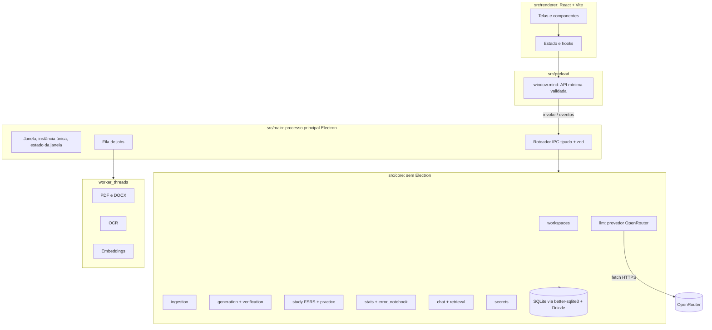

### Mapa Python → TypeScript (especificação a portar)

| Pacote Python (kb) | Destino | Observação |
|---|---|---|
| `workspaces`, `db`, `jobs` | `src/core/workspaces`, `db`, `jobs` | `app.db` + um `workspace.db` por workspace, migrações Drizzle |
| `ingestion`, `retrieval` | `src/core/ingestion`, `retrieval` | mupdf, DOCX, Markdown, web, OCR; busca por palavras e semântica |
| `generation`, `verification` | `src/core/generation`, `verification` | prompts e conferência de citação idênticos |
| `study`, `practice` | `src/core/study`, `practice` | ts-fsrs |
| `stats`, `error_notebook`, `review`, `chat` | `src/core/*` | mesmas regras |
| `llm`, `secrets`, `redaction`, `config` | `src/core/llm`, `secrets`, `redaction`, `config` | `fetch` no lugar de httpx |
| `web`, `api` | `src/renderer` (React) e IPC | `api` não é portada (T-6) |

### Decisões (ADR)

**ADR-1 — SQLite com better-sqlite3 + Drizzle.** Contexto: sem servidor, o processo principal acessa o banco direto. Decisão: driver síncrono better-sqlite3 e esquema e migrações tipados em Drizzle; um `app.db` e um `workspace.db` por workspace. Alternativas: `node:sqlite` + Kysely (menos maduro, não validado no Electron). Consequências: módulo nativo precisa de rebuild para o Electron e de `asarUnpack`; validar no esqueleto e no `.deb`. [src: gate 2.6, NFR-17, R-3]

**ADR-2 — Chave da API cifrada em disco.** Decisão: AES-256-GCM com uma chave local gerada pelo app; chave e credenciais em arquivos separados no diretório de dados, ambos com permissão 0600; o modelo escolhido é preferência não sensível. A chave nunca vai ao renderer nem aos logs (redação mantida). Consequência honesta: protege contra leitura casual e contra vazamento acidental do arquivo de credenciais, mas não contra quem lê os dois arquivos como o mesmo usuário. [src: gate 2.6, NFR-7]

**ADR-3 — Layout.** Pacote único com `src/main`, `src/preload`, `src/renderer`, `src/core`; um `tsconfig` por alvo; o Python vai para `legacy/` até a paridade e é apagado no fim. [src: gate 2.6, T-4]

**ADR-4 — Renderer.** React + Vite + TypeScript, Recharts, Lucide e CSS próprio sobre os tokens de 2.5; sem kit de componentes. [src: gate 2.6]

**ADR-5 — Modelo de processos e IPC.** O núcleo roda no processo principal; o renderer só fala por `window.mind` (preload com `contextBridge`), com canais `invoke` para comandos e eventos push para progresso de jobs. Toda mensagem é validada com zod nas duas pontas. Tarefas pesadas (PDF, OCR, embeddings) rodam em `worker_threads` com a fila de jobs e o limite de concorrência atuais. Sem porta de rede. [src: FR-31, NFR-15, NFR-18, C-8]

**ADR-6 — Paridade por fixtures dos testes Python.** Antes de apagar o Python, extrair valores de referência (intervalos FSRS, divisão em trechos, prompts, conferência de citação, estatísticas) para fixtures JSON versionadas, e portar os testes como especificação. [src: R-1, SC-4]

**ADR-7 — Bibliotecas do núcleo (candidatas, validadas por protótipo).** PDF: `mupdf` oficial (T-8). OCR: tesseract.js com dados de pt e en embutidos (T-7). Embeddings: transformers.js, modelo baixado sob demanda. DOCX: mammoth. Página web: Readability + jsdom. FSRS: ts-fsrs. Valores a confirmar nos protótipos de 2.9 antes de portar cada módulo. [src: 1.3, R-2]

**ADR-8 — Empacotamento.** electron-builder com alvo `deb` (amd64), `asar` com módulos nativos fora do asar, `depends` mínimas do sistema, ícone e entrada de menu, dados fora do diretório de instalação. [src: FR-30, NFR-16, NFR-17]

### Assumptions & open questions

- A22 (2.6): O `legacy/` guarda o Python só como referência e não roda mais no CI depois do esqueleto. — confirmed: yes
- A23 (2.6): O nome do script de avaliação SM-1 vira um comando de desenvolvimento (`pnpm sm1`), fora do app. — confirmed: yes

## 2.7 Units of work

Cada FR e NFR tem um Unit dono. Cada Unit é verificável sozinho com o verification command (ou, no esqueleto, com o E2E). O esqueleto ambulante é a sequência UNIT-1, UNIT-2, UNIT-3, UNIT-5 e UNIT-6: uma janela empacotada em `.deb`, com barra lateral e a tela Hoje lendo o banco. [src: T-5, requirements.md § 2.3]

| Unit | Nome | Depende de | Escopo | FR/NFR donos | Definition of Done |
|---|---|---|---|---|---|
| UNIT-1 | Fundação do repositório e ferramentas | — | Colapsar o histórico Python em 1 commit; mover o Python para `legacy/`; pnpm, TypeScript strict, ESLint, Prettier, Vitest, cobertura, CI básico; extrair fixtures de referência do Python (ADR-6) | NFR-10 | Todos os comandos do verification command passam em um projeto vazio; fixtures versionadas; CI verde |
| UNIT-2 | Casca Electron e IPC | UNIT-1 | Janela nativa (barra de título do sistema, mínimo 960x600), instância única, estado da janela, preload `window.mind`, roteador IPC com zod, opções seguras da janela, sem porta de rede | FR-25, FR-26, FR-27, FR-31, NFR-14, NFR-15 | Playwright abre a janela em até 3 s; teste das opções de segurança; `ss -ltnp` sem listener |
| UNIT-3 | Dados, workspaces e jobs | UNIT-1 | better-sqlite3 + Drizzle, `app.db` e `workspace.db`, migrações, registro de workspaces (criar, renomear, trocar, excluir), fila de jobs com `worker_threads` e limite de concorrência, configuração e diretório de dados | FR-1, NFR-12, NFR-18 | Testes portados de workspaces e jobs; migração entre versões; tarefa longa não trava o processo principal |
| UNIT-5 | Casca de UI, tema e atalhos | UNIT-2, UNIT-3 | React + Vite, tokens, barra lateral com 8 seções, seletor de workspace, rodapé, tema escuro padrão com alternador salvo, atalhos, tela Hoje com dados reais do banco, renderização de fórmulas (KaTeX) e fontes | FR-23, FR-28, FR-29, FR-32, NFR-11 | Testing Library e Playwright percorrem as seções; contraste AA nos dois temas; fórmula inválida mostra texto bruto |
| UNIT-6 | Pacote `.deb` (esqueleto ambulante) | UNIT-2, UNIT-3, UNIT-5 | electron-builder alvo deb, módulos nativos fora do asar, dependências de sistema, ícone, entrada de menu, dados fora da instalação, teste de instalação, atualização e remoção em contêiner descartável | FR-30, NFR-9, NFR-16, NFR-17 | `apt install ./mind.deb` abre o app; dados sobrevivem a atualização e remoção; tamanho dentro do limite |
| UNIT-4 | Provedor LLM, configurações e custo | UNIT-3 | Interface de provedor (OpenRouter por `fetch`), chave cifrada (ADR-2), consentimento, modelos, custo estimado, limite mensal, redação de log, telas de Configurações e setup | FR-19, FR-20, FR-21, NFR-6, NFR-7 | Testes portados com provedor falso; chave ausente de logs, banco e renderer; envio só após o aceite |
| UNIT-7 | Ingestão, busca e biblioteca | UNIT-3, UNIT-5 | PDF (mupdf em worker), Markdown e texto, divisão em trechos, busca por palavras, tela Biblioteca, importação com progresso | FR-2, FR-5, NFR-1 | PDF de 100 páginas em menos de 60 s; fixtures de trechos iguais às do Python |
| UNIT-8 | OCR, URL e DOCX | UNIT-7 | tesseract.js com dados pt e en embutidos, importação de URL (Readability + jsdom) e de DOCX, confiança do OCR | FR-3, FR-4 | Amostras escaneada, web e DOCX importadas; qualidade comparada com as do Python |
| UNIT-9 | Flashcards com fonte e revisão | UNIT-4, UNIT-7 | Geração por tipo (P/R, lacuna, comparativo, V/F), conferência de citação, descarte sem fonte, telas Gerar e Revisar (aprovar, editar, descartar, lote), relatório da geração | FR-6, FR-7, FR-8, NFR-2, NFR-8 | Testes portados; geração de 20 itens com provedor falso sem travar a janela; script `pnpm sm1` |
| UNIT-10 | Estudo FSRS | UNIT-9 | ts-fsrs, fila do dia, tela Estudar, avaliação, desfazer, meta diária e filtro | FR-12, FR-13 | Intervalos iguais aos valores de referência do Python; Espaço e 1 a 4 funcionam |
| UNIT-11 | Questões verificadas e prática | UNIT-9 | Geração de questões C/E e múltipla escolha, segunda verificação por LLM, perfil de prova, tela Praticar, tentativas com tempo | FR-9, FR-10, FR-11, FR-14 | Questão sem sustentação na fonte é descartada; tentativa gravada com resultado e tempo |
| UNIT-12 | Caderno de erros e estatísticas | UNIT-10, UNIT-11 | Erros viram cards, tópicos, estatísticas (retenção, sequência, acerto por tópico), telas Erros e Estatísticas com gráficos | FR-15, FR-16 | Estatísticas iguais às fixtures do Python; "virar card" cria o card com fonte |
| UNIT-13 | Treino de pontos fracos | UNIT-12 | Escolha de tópicos de menor acerto e geração pré-configurada | FR-17 | Clicar em "Treinar" abre a geração com o tópico selecionado |
| UNIT-14 | Chat e busca semântica | UNIT-4, UNIT-7 | Chat com citações, resposta "não encontrei suporte", busca por palavras e semântica opcional (transformers.js, modelo sob demanda) | FR-18 | Pergunta fora do material responde sem suporte; ativar a busca semântica baixa o modelo e a usa |
| UNIT-15 | Backup do workspace | UNIT-3 | Exportar e importar workspace em `.zip` | FR-22 | Exportar e importar em outra instalação restaura materiais, cards e histórico |
| UNIT-16 | Fechamento e remoção do Python | UNIT-6, UNIT-8, UNIT-12, UNIT-13, UNIT-14, UNIT-15 | Remover `legacy/`, Dockerfile, API e `uvx` do README; README novo; E2E Playwright do fluxo de amostra; CI com E2E e `.deb`; verificação de latência, offline, memória e idioma | NFR-3, NFR-4, NFR-5, NFR-13, SC-5 | `git ls-files "*.py"` vazio; E2E, cobertura e `.deb` verdes; checklist de paridade por tela concluído |

### Dependency order

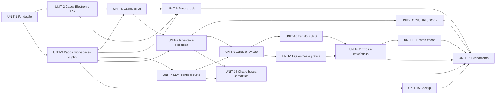

Ordem topológica: UNIT-1, 2, 3, 5, 6, 4, 7, 8, 9, 10, 11, 12, 13, 14, 15, 16. O grafo é acíclico.

### Story → Unit map

| Story | Unit dono | Observação |
|---|---|---|
| US-1 | UNIT-3 | Seletor na UI vem de UNIT-5 |
| US-2 | UNIT-7 | |
| US-3 | UNIT-8 | |
| US-4, US-5 | UNIT-9 | Custo (FR-21) vem de UNIT-4 |
| US-6, US-8 | UNIT-11 | |
| US-7 | UNIT-10 | |
| US-9, US-10 | UNIT-12 | |
| US-11 | UNIT-13 | |
| US-12 | UNIT-14 | |
| US-13, US-14 | UNIT-4 | |
| US-15 | UNIT-15 | |
| US-16, US-21 | UNIT-6 | |
| US-17, US-20 | UNIT-5 | |
| US-19, US-22 | UNIT-2 | |

### Assumptions & open questions

- A24 (2.7): UNIT-5 já inclui a renderização de fórmulas (FR-23), pois todas as telas dependem dela. — confirmed: yes
- A25 (2.7): UNIT-6 (`.deb`) vem logo após o esqueleto para descobrir cedo problemas de módulo nativo e tamanho (R-3, R-4). — confirmed: yes
- A26 (2.7): Cada Unit portado usa o Python em `legacy/` e as fixtures como especificação até o UNIT-16. — confirmed: yes

## 2.8 Contracts

Contratos entre o renderer e o núcleo (IPC), o modelo de erro e a persistência. Não há API HTTP (T-6, C-8). Os esquemas de mensagem vivem em `src/core/contracts` (zod) e são importados pelo renderer, pelo preload e pelo núcleo, de modo que o tipo TypeScript é inferido do mesmo esquema. [src: ADR-5, FR-31]

### Convenções do IPC

- Canais `invoke` com nome `<domínio>:<ação>` (por exemplo `workspace:list`, `material:import`, `study:next`, `study:rate`, `generation:start`, `settings:save`). Um canal por operação; nenhum canal genérico.
- Toda resposta é um envelope `Result<T>`.
- Eventos push do núcleo para a janela: `job:progress`, `job:finished`, `provider:status`, `window:focus-requested`.
- Mensagens são validadas com zod ao entrar no preload e ao entrar no núcleo; entrada inválida vira `VALIDATION_ERROR`. O preload expõe apenas `window.mind.invoke(channel, payload)` e `window.mind.on(event, handler)` tipados por uma tabela de canais.
- Versionamento: o contrato muda junto com o app (a janela e o núcleo são do mesmo pacote); `contracts` carrega um `CONTRACT_VERSION` conferido no arranque.

```ts
// src/core/contracts/result.ts (esboço)
export type Result<T> =
  | { ok: true; data: T }
  | { ok: false; error: { code: ErrorCode; message: string; fields?: FieldError[] } };
```

### Canais por domínio (resumo)

| Domínio | Canais principais | Unit |
|---|---|---|
| `window` | `window:getState`, `window:setLastRoute`, evento `window:focus-requested` | UNIT-2 |
| `workspace` | `list`, `create`, `rename`, `delete`, `export`, `import` | UNIT-3, UNIT-15 |
| `settings` | `get`, `save`, `saveKey`, `clearKey`, `setConsent`, `refreshModels`, `getCost` | UNIT-4 |
| `material` | `list`, `get`, `import`, `importUrl`, `delete`, `search` | UNIT-7, UNIT-8 |
| `generation` | `estimate`, `start`, `cancel`, `listRuns` | UNIT-9, UNIT-11, UNIT-13 |
| `review` | `list`, `approve`, `approveAll`, `discard`, `edit` | UNIT-9 |
| `study` | `today`, `next`, `rate`, `undo`, `setGoal`, `setFilter` | UNIT-10 |
| `practice` | `next`, `answer`, `makeErrorCard` | UNIT-11, UNIT-12 |
| `stats` | `overview`, `topics`, `renameTopic`, `mergeTopics`, `deleteTopic` | UNIT-12 |
| `chat` | `ask`, `history`, `enableEmbeddings`, `disableEmbeddings` | UNIT-14 |

Todos os nomes de canais e payloads finais são fixados no esqueleto de cada Unit; este resumo define só a fronteira por domínio.

### Modelo de erro

`ErrorCode` estável, igual ao do Python, sem status HTTP: `VALIDATION_ERROR`, `WORKSPACE_NOT_FOUND`, `JOB_NOT_FOUND`, `JOB_NOT_ACTIVE`, `PROVIDER_KEY_MISSING`, `CONSENT_REQUIRED`, `MONTHLY_LIMIT_REACHED`, `PROVIDER_ERROR`, `UNSUPPORTED_FILE`, `EXTRACTION_FAILED`, `OCR_UNAVAILABLE`, `MATERIAL_NOT_FOUND`, `ITEM_NOT_FOUND`, `TOPIC_NOT_FOUND`, `RUN_NOT_FOUND`, `ARCHIVE_INCOMPATIBLE`, `ARCHIVE_INVALID`, `INTERNAL_ERROR`. A mensagem é pt-BR e segura para exibir; o detalhe técnico vai ao log com a chave redigida. [src: src/mind/errors.py]

### Dados

Esquema Drizzle com as mesmas entidades do kb (`Workspace, Setting, Consent, CostEntry, ModelPrice` no `app.db`; `Job, Material, Chunk, Topic, GenerationRun, Item, CardState, ReviewLog, Meta, Attempt, ChatMessage, ChunkEmbedding` no `workspace.db`), migrações versionadas em `src/core/db/migrations`. Arquivos no diretório de dados do usuário (`app.db`, `workspaces/<id>/workspace.db`, `ai/credentials.enc`, `ai/keystore.key`), nunca no diretório de instalação (NFR-17). [src: codekb/data-model.md, ADR-1, ADR-2]

### Contrato do backup

`.zip` com `manifest.json` (`CONTRACT_VERSION`, versão do esquema, data), `workspace.db` e os arquivos dos materiais; a importação valida o manifesto antes de gravar. Não lê o `.zip` do Python (A1). [src: FR-22]

### Assumptions & open questions

- A27 (2.8): Os códigos de erro do Python são mantidos sem o status HTTP. — confirmed: yes
- A28 (2.8): `contracts` é a fonte única dos tipos; o renderer não declara tipos próprios para dados do núcleo. — confirmed: yes

## 3.x Per-Unit design

> Modo Standard: design funcional, NFR e infraestrutura de cada Unit em uma nota curta por Unit (3.1 a 3.4 fundidos), com gate. 3.4 só detalha o `.deb` no UNIT-6.

### UNIT-1 — Fundação do repositório e ferramentas (nota de design)

**Objetivo.** Deixar o repositório pronto para a reescrita: histórico Python colapsado, Python isolado em `legacy/`, toolchain TypeScript com o verification command funcionando, fixtures de referência extraídas do Python e CI básico. [src: tasks.md UNIT-1, ADR-3, ADR-6]

**Estrutura alvo.**

```text
legacy/                 Python intacto (src, tests, pyproject.toml, uv.lock, Dockerfile, samples, .python-version, .env.example, .dockerignore)
samples/                cópia neutra dos materiais de amostra (usada pelos testes novos)
fixtures/               valores de referência extraídos do Python (JSON versionado)
scripts/extract-fixtures/   scripts Python que geram fixtures (rodam com o ambiente de legacy/)
src/main src/preload src/renderer src/core   (criados vazios com .gitkeep; preenchidos nos Units seguintes)
package.json tsconfig*.json eslint.config.js .prettierignore vitest.config.ts
.github/workflows/ci.yml   (novo, pnpm)
```

**Decisões.**

| Tema | Decisão |
|---|---|
| Squash | `git tag pre-squash` no HEAD atual; novo commit-raiz com a árvore do HEAD (`git commit-tree`), `main` aponta para ele; `.aidlc/` não commitado fica como está; sem push |
| Gerenciador | pnpm 10 via corepack (`packageManager` em `package.json`); o `pnpm` não está no PATH desta máquina, então os comandos usam `corepack pnpm` |
| Node | 22 (o ambiente tem 22.22.1); versão do Electron fixada no UNIT-2 |
| TypeScript | `strict`, `noUncheckedIndexedAccess`, um `tsconfig` por alvo (`main`, `preload`, `renderer`, `core`) herdando de `tsconfig.base.json`; módulos ESM |
| Lint e formato | ESLint 9 (flat config, typescript-eslint, regras de React, `eslint-plugin-security`) e Prettier; script que verifica o cabeçalho `Filename/Created on/Author` em arquivos de código |
| Testes | Vitest com cobertura V8; limiar de 80% só ativado a partir do UNIT-3, quando há código de produto (no UNIT-1 há só o teste de fumaça e o de fixtures) |
| Fixtures | Scripts Python em `scripts/extract-fixtures/` leem `legacy/` e gravam `fixtures/*.json`: intervalos FSRS por sequência de avaliações, divisão em trechos de `samples/`, prompts de geração, conferência de citação, estatísticas; teste Vitest valida o esquema das fixtures |
| CI | GitHub Actions com pnpm: instalar com lockfile congelado, lint, formato, tipos, testes; E2E e `.deb` entram nos Units 2 e 6 |

**Fluxo da extração de fixtures.**

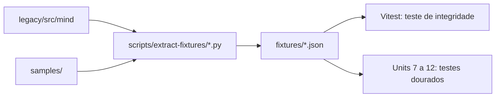

**NFR (nota).** NFR-10: os quatro comandos do verification command passam; o cabeçalho é verificado por script. Sem requisito de desempenho ou segurança neste Unit.

**Riscos.** `uv` precisa estar disponível para rodar o Python legado na extração (A26); o histórico antigo só é recuperável pela tag `pre-squash`.

### Assumptions & open questions

- A29 (3.1 UNIT-1): Mover o Python inteiro para `legacy/` e deixar uma cópia de `samples/` na raiz. — confirmed: no
- A30 (3.1 UNIT-1): O limiar de cobertura de 80% só é imposto a partir do UNIT-3. — confirmed: no

### UNIT-2 — Casca Electron e IPC (nota de design)

**Objetivo.** Janela nativa do MIND com instância única, estado de janela lembrado, canal IPC tipado e validado, opções de segurança do Electron e nenhuma porta de rede. A UI real vem no UNIT-5; aqui o renderer é um React mínimo que prova o IPC. [src: FR-25, FR-26, FR-27, FR-31, NFR-14, NFR-15, ADR-5]

**Decisões.**

| Tema | Decisão |
|---|---|
| Versões | Electron 45.3.2 (fixado com `~`), electron-vite 6.0.0, Vite 8.3.8, React 19.3.1, zod 4.6.7, Playwright 1.65.1 (versões do npm em 2026-11-14) |
| Build | electron-vite: `src/main/index.ts`, `src/preload/index.ts`, `src/renderer/index.html` em `out/` |
| Janela | `BrowserWindow` com barra de título nativa, `minWidth` 960, `minHeight` 600, padrão 1280x800, `show: false` até `ready-to-show` |
| Instância única | `app.requestSingleInstanceLock()`; a segunda instância sai e a primeira restaura e foca a janela (evento `second-instance`) |
| Estado | electron-store (`window-state`): `bounds`, `maximized`, `lastRoute`; os limites são validados contra os monitores conectados, e se estiverem fora de qualquer um a janela abre centralizada no padrão |
| Segurança | `contextIsolation: true`, `sandbox: true`, `nodeIntegration: false`, `webSecurity: true`; `setWindowOpenHandler` nega tudo; `will-navigate` bloqueia fora do próprio app; pedidos de permissão negados; CSP por cabeçalho e `<meta>` |
| IPC | `src/core/contracts` (zod): `Result<T>`, `ErrorCode`, tabela de canais com esquema de entrada e saída, `CONTRACT_VERSION`; o roteador (`src/main/ipc/router.ts`, sem importar Electron) valida entrada e saída e converte exceções em `INTERNAL_ERROR`; o preload só encaminha canais da lista permitida |
| Canais deste Unit | `window:getState` → `{ route, contractVersion }`, `window:setLastRoute` ← `{ route }` |
| Preload | `window.mind.invoke(channel, payload)` e `window.mind.on(event, handler)`; nada de `ipcRenderer` exposto |
| Diretório de dados | Definido no UNIT-3; aqui o electron-store usa o `userData` padrão do Electron |
| Rede | Nenhum servidor no app; o servidor de desenvolvimento do electron-vite só existe em `pnpm dev` |

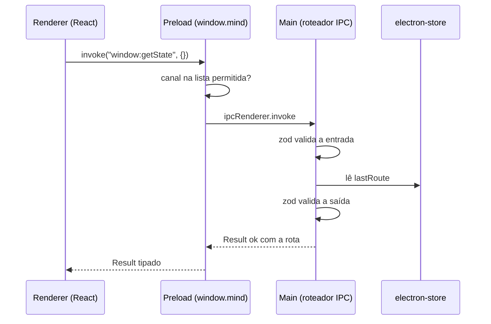

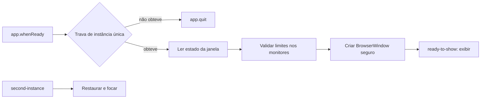

**NFR (nota).** NFR-14: tempo até a janela visível medido pelo E2E (alvo 3 s); NFR-15: teste confere as `webPreferences` e o bloqueio de navegação e de novas janelas; C-8/SC-2: o E2E confere que o processo do app não escuta em nenhuma porta TCP.

**Testes.** Vitest (puro, sem Electron): roteador IPC (entrada inválida, saída inválida, exceção, canal desconhecido), esquemas, ajuste de limites da janela. Playwright para Electron (`pnpm e2e`, fora do verification command): abre a janela, tamanho mínimo, instância única, `webPreferences`, nenhuma porta, tempo de abertura.

**Riscos.** (1) Ubuntu com restrição de user namespaces pode exigir `--no-sandbox` no E2E local; no `.deb` o `chrome-sandbox` é tratado no UNIT-6. (2) O pnpm 10 bloqueia scripts de build: `electron` e `esbuild` entram em `pnpm.onlyBuiltDependencies`. (3) O E2E precisa de display (Xvfb no CI).

### Assumptions & open questions

- A31 (3.1 UNIT-2): "Última tela" do FR-27 cobre a última rota e o monitor (pelas coordenadas salvas). — confirmed: no
- A32 (3.1 UNIT-2): O E2E não entra no verification command; roda como `pnpm e2e` e como etapa de CI. — confirmed: no

### UNIT-3 — Dados, workspaces e jobs (nota de design)

**Objetivo.** Camada de dados do núcleo (sem Electron): dois esquemas SQLite com migrações, registro de workspaces com isolamento, fila de jobs com concorrência limitada e um *pool* de `worker_threads` para o trabalho pesado, e os canais `workspace:*` no IPC. [src: FR-1, NFR-12, NFR-18, ADR-1, ADR-5; Python de referência: `workspaces/registry.py`, `jobs/`, `db/`]

**Decisões.**

| Tema | Decisão |
|---|---|
| Binário nativo | `better-sqlite3` 13.2.0 traz um binário N-API por plataforma; foi verificado que o mesmo binário carrega no Node 22 (Vitest) e no Node 24 do Electron 45, então não há troca de ABI nem rebuild. No `.deb` ele entra em `asarUnpack` (UNIT-6) |
| Esquema | Drizzle (`src/core/db/app-schema.ts`, `workspace-schema.ts`) com as mesmas tabelas do kb; datas em texto ISO-8601 UTC; relógio injetável (`Clock`) |
| Migrações | SQL gerado por drizzle-kit (`pnpm db:generate`) em `src/core/db/migrations/{app,workspace}/NNNN_*.sql`, embutido no bundle com `import.meta.glob(..., { query: "?raw" })`; um executor próprio aplica em ordem, cada arquivo em transação, registrando em `_migrations`; banco com migração desconhecida (mais novo que o app) é recusado |
| Pragmas | `foreign_keys=ON` e `journal_mode=WAL` em toda conexão |
| Diretório de dados | O núcleo recebe `dataDir`; o processo principal passa `MIND_DATA_DIR` ou o `userData` do Electron. Layout: `app.db`, `workspaces/<uuid>/workspace.db`, `workspaces/<uuid>/files/` |
| Registro | `WorkspaceRegistry` síncrono: `create`, `list`, `get`, `rename`, `delete`, `open` (com cache e recuperação de jobs interrompidos), `close`; nomes normalizados (espaços colapsados, até 80 caracteres, unicidade sem diferenciar maiúsculas); pasta de workspace nunca sai de `workspaces/`; pastas órfãs removidas ao iniciar |
| Jobs | `JobQueue` assíncrona: estados `queued, running, done, failed, cancelled` persistidos na tabela `job`, progresso limitado a 1 escrita por 250 ms, cancelamento cooperativo (`AbortSignal` e `ctx.checkCancelled()`), limite de concorrência, `wait` e `shutdown`; falhas viram código estável (`AppError` ou `INTERNAL_ERROR`); jobs ativos antes de um reinício viram `failed/INTERRUPTED` |
| Pool de workers | `runInWorker(factory, payload, { signal, onProgress })` sobre `worker_threads`, uma thread por tarefa, com cancelamento e erros propagados; os workers reais (PDF, OCR, embeddings) chegam nos Units 7, 8 e 14 |
| IPC | `workspace:list`, `workspace:create`, `workspace:rename`, `workspace:delete` (export e import no UNIT-15); eventos `job:progress` e `job:finished` declarados em `EVENT_NAMES` |

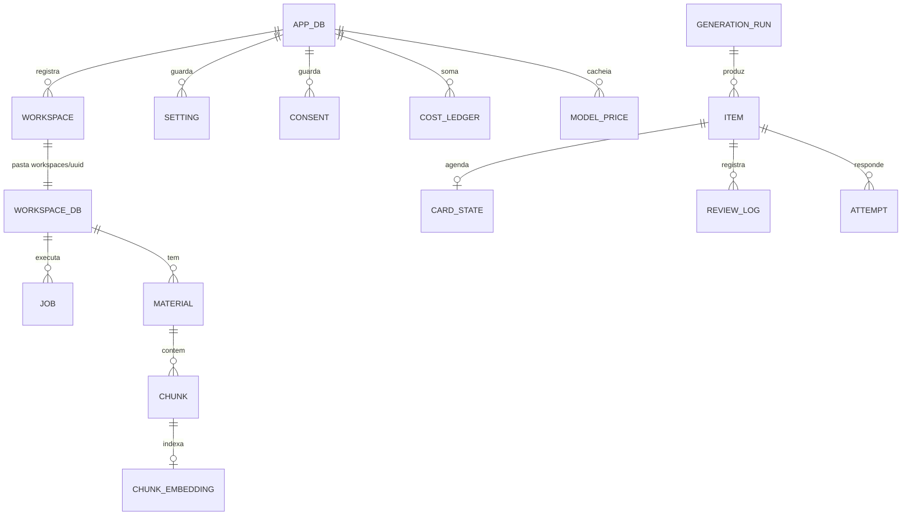

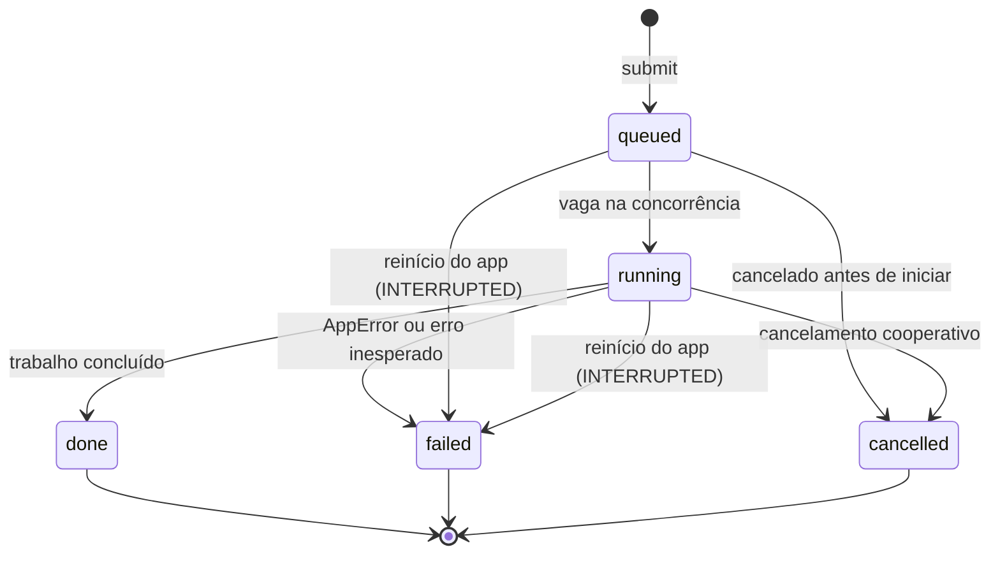

**NFR (nota).** NFR-12: migração a partir de banco vazio, repetida (idempotente) e rejeição de banco mais novo, testadas. NFR-18: teste mede que uma tarefa pesada em worker não atrasa o laço de eventos do processo principal acima de um limite. Sem `sentence-transformers` nem PDF neste Unit.

**Riscos.** (1) `import.meta.glob` com `?raw` depende do Vite; vale no Vitest e no electron-vite, e o teste de migração roda sobre o mesmo mecanismo. (2) `better-sqlite3` é síncrono: consultas longas bloqueiam o processo principal, então operações pesadas (importação, embeddings) usam o pool de workers com conexão própria, e o WAL permite leitura concorrente.

### Assumptions & open questions

- A33 (3.1 UNIT-3): O código de erro `INTERRUPTED` de jobs passa para a lista estável de códigos. — confirmed: yes
- A34 (3.1 UNIT-3): Datas em texto ISO-8601 UTC (o formato do Python era de datetime com fuso), sem necessidade de compatibilidade com bancos antigos (A1). — confirmed: yes

### UNIT-5 — Casca de UI, tema e atalhos (nota de design)

**Objetivo.** A janela passa a ter a casca definitiva do mockup de 2.5: barra lateral com as 8 seções e seletor de workspace, rodapé de status, tema escuro padrão com alternador salvo, atalhos globais, tela Hoje com dados reais, renderização de fórmulas e fontes locais. [src: FR-23, FR-28, FR-29, FR-32, NFR-11, mockups/mind-ui.html]

**Decisões.**

| Tema | Decisão |
|---|---|
| Roteador | Roteador próprio e mínimo em estado React (rotas `/w/:id/:secao` e `/welcome`), sem dependência nova; a rota atual é gravada por `window:setLastRoute` e restaurada por `window:getState` (FR-27) |
| Estado | Contexto React e hooks (`useInvoke` com carregando, dado e erro; `useWorkspaces`); sem biblioteca de estado global |
| Estilo | CSS puro com tokens em `tokens.css` (os de 2.5) e `app.css`; tema por `data-theme` em `<html>`, padrão escuro (Dracula), escolha salva em `localStorage`; barra lateral verde; `prefers-reduced-motion` respeitado |
| Fontes | Inter e JetBrains Mono locais (woff2 e licenças copiados do Python); sem rede |
| Ícones | lucide-react (ADR-4) |
| Fórmulas | `katex` com CSS e fontes empacotados; `splitMath` portado de `math.js` (mesmas regras: `$...$`, `$$...$$`, valores em dinheiro não viram fórmula); fórmula inválida mostra o texto bruto; `cloze` mostra a lacuna como `[termo]` |
| Seletor de workspace | Lista, troca, criar, renomear e excluir com confirmação (US-1); tela de boas-vindas quando não há workspace |
| Hoje | Canal novo `today:summary` (`workspaceId`) devolve contagens reais do banco: materiais, cards aprovados e questões aprovadas; os indicadores de estudo (vencidos, aprendendo, novos, feitos, meta) chegam com o FSRS no UNIT-10 e substituem a faixa de resumo, para não mostrar zeros inventados. Estados: vazio (convite a importar), carregando (esqueleto) e erro (mensagem com "Tentar de novo") |
| Atalhos | Hook `useHotkeys`; `Ctrl+,` abre Configurações e `Ctrl+K` abre o seletor rápido "Ir para..." (as seções; a busca em materiais entra no UNIT-7); Espaço e 1 a 4 de Estudar e Praticar usam o mesmo hook nos Units 10 e 11 |
| Seções sem tela ainda | Mostram um painel "em construção" com o nome da seção, trocado a cada Unit |
| Testes | Vitest com jsdom e Testing Library (`// @vitest-environment jsdom` por arquivo), `window.mind` simulado; teste de contraste WCAG AA dos tokens nos dois temas (porte de `test_theme_contrast`); fixtures de fórmulas do Python; E2E percorre as seções, tema e atalhos |

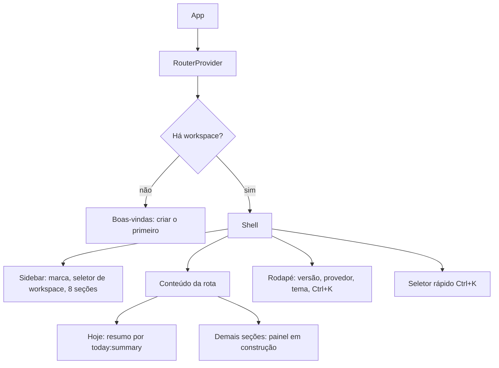

**NFR (nota).** NFR-11: tamanho mínimo da janela já garantido no UNIT-2; contraste AA testado em automático; navegação por teclado (link de pular, `aria-current`, foco visível, diálogo com foco preso e Esc). Tema escuro padrão (FR-29).

**Riscos.** (1) O contraste do verde da barra lateral com texto claro precisa passar AA (o teste cobre os pares usados; ajusto tokens se falhar). (2) KaTeX aumenta o bundle do renderer (~300 kB); aceito, offline é requisito.

### Assumptions & open questions

- A35 (3.1 UNIT-5): Os indicadores de estudo de Hoje só aparecem no UNIT-10; até lá Hoje mostra o resumo da biblioteca. — confirmed: yes
- A36 (3.1 UNIT-5): O tema é salvo em `localStorage` do renderer, não no banco. — confirmed: yes

### UNIT-6 — Pacote `.deb` (nota de design, inclui 3.4 Infrastructure Design)

**Objetivo.** Gerar e verificar o `.deb` amd64 do MIND com electron-builder: entrada de menu, ícone, dependências de sistema, módulo nativo fora do asar, dados do usuário fora da instalação, sandbox do Chromium configurado, medida de tamanho e teste de instalação, atualização e remoção. [src: FR-30, NFR-9, NFR-16, NFR-17, ADR-8]

**Decisões.**

| Tema | Decisão |
|---|---|
| Identidade | Pacote `mind-study`, comando `mind`, nome exibido MIND, `appId` `io.github.mind-study`, categoria Education, licença AGPL-3.0-or-later, Maintainer com o nome e o e-mail do autor (escolha explícita dele; o repositório já os traz nos cabeçalhos de arquivo), homepage no GitHub |
| Ferramenta | `electron-builder` com `electron-builder.yml`; alvo `deb`, arquitetura x64 (amd64), compressão xz |
| Conteúdo | `out/**` e `package.json`; só dependências de produção entram em `node_modules` (`better-sqlite3`, `drizzle-orm`, `electron-store`, `zod`); `react`, `react-dom`, `katex` e `lucide-react` passam a `devDependencies`, pois o Vite as embute no renderer |
| Módulo nativo | `asar: true` com `asarUnpack` de `node_modules/better-sqlite3/**` (binário N-API por plataforma, sem rebuild) |
| Instalação | App em `/opt/MIND/`, atalho `/usr/bin/mind`, `.desktop` em `/usr/share/applications`, ícones PNG de 16 a 512 px em `/usr/share/icons/hicolor` |
| Sandbox | O script pós-instalação padrão do electron-builder aplica modo 4755 root ao `chrome-sandbox`; o teste confere isso no pacote (a máquina de desenvolvimento não o tem setuid, por isso o `pnpm dev` e o E2E usam `--no-sandbox`) |
| Dados | Ficam em `~/.config/mind` (o `userData` do Electron), nunca sob `/opt`; o pacote não declara `conffiles` nem toca em `$HOME`, então `apt remove` e `apt purge` não apagam dados (NFR-17) |
| Ícone | `build/icon.svg` próprio (quadrado verde arredondado com a letra M) convertido em PNGs por `rsvg-convert`; o autor aprova ou troca |
| Dependências do sistema | As do electron-builder para Electron (GTK 3, NSS, libnotify, xdg-utils, libsecret etc.); a lista gerada é conferida no teste para aceitar os nomes com `t64` do Ubuntu 24.04 e do Debian 13 |
| Verificação local | `scripts/verify-deb.sh`: `dpkg-deb` (metadados, arquivos, permissões do `chrome-sandbox`, scripts), `lintian` e limites de tamanho (`.deb` ≤ 500 MB, instalado ≤ 1 GB); E2E do Playwright contra o app empacotado (`MIND_E2E_EXECUTABLE`) |
| Verificação no CI | Job `package`: build do `.deb`, `verify-deb.sh`, `sudo apt-get install ./mind.deb`, `mind` aparece no PATH e abre sob Xvfb, E2E contra `/usr/bin/mind`, atualização por cima, `apt remove` e conferência de que `~/.config/mind` continua |

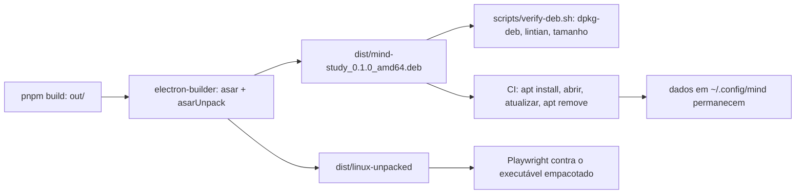

**NFR (nota).** NFR-9: instalação sem passos manuais, verificada no CI (e à mão pelo autor com `sudo apt install ./dist/*.deb`); NFR-16: `.deb` ≤ 500 MB e instalado ≤ 1 GB, medido e registrado; NFR-17: nenhum arquivo do pacote em `$HOME`, dados em `~/.config/mind`.

**Riscos.** (1) A instalação real em contêiner não é possível nesta máquina (docker exige sudo com terminal): a verificação local é estática mais E2E do binário desempacotado, e a instalação, atualização e remoção reais rodam no CI. (2) O pnpm pode exigir `node-linker=hoisted` para o electron-builder coletar `node_modules`; se necessário, adiciono `.npmrc`. (3) O electron-builder baixa binários auxiliares (fpm) na primeira execução.

### Assumptions & open questions

- A37 (3.4 UNIT-6): O alvo mínimo do `.deb` (Ubuntu 22.04+/Debian 12+) é aceito porque o Electron embute Node e Chromium; a compatibilidade exata de bibliotecas é validada no CI. — confirmed: no
- A38 (3.4 UNIT-6): O ícone gerado é provisório até o autor aprovar ou trocar. — confirmed: no

### UNIT-4 — Provedor LLM, configurações e custo (nota de design)

**Objetivo.** A única porta para modelos de linguagem, com consentimento, limite mensal e registro de custo; configurações do provedor; chave cifrada em disco; telas de setup e de Configurações. Porta o comportamento de `llm/`, `secrets.py`, `redaction.py` e `settings_service.py` do Python. [src: FR-19, FR-20, FR-21, NFR-6, NFR-7, ADR-2, codekb]

**Decisões.**

| Tema | Decisão |
|---|---|
| Interface | `Provider` com `name`, `requiresConsent` e `complete(messages, schema, { model, maxRetries })` que devolve `{ value, usage }`; o esquema é um zod e o JSON Schema enviado ao modelo vem de `z.toJSONSchema` |
| OpenRouter | `OpenRouterProvider` sobre `fetch` injetável: `response_format` JSON Schema com recuo para instrução no prompt quando o modelo não suporta, tolerância a cerca de código, reenvio com a mensagem de erro de validação (até `maxRetries`), 1 nova tentativa em 429 e 5xx, erros estáveis (`PROVIDER_ERROR`, `PROVIDER_KEY_MISSING`), uso e custo acumulados |
| Proteções | `GuardedProvider`: sem consentimento não há envio (`CONSENT_REQUIRED`); gasto do mês ≥ limite bloqueia (`MONTHLY_LIMIT_REACHED`); toda chamada é registrada no `cost_ledger`; custo informado pelo provedor tem prioridade, senão tokens vezes preço |
| Catálogo | `PriceCatalog` em `app.db`, atualizado do catálogo público (24 h de validade, falha branda), estimativa a 4 caracteres por token |
| Configurações | `SettingsService` com os mesmos padrões do Python: modelos `anthropic/claude-haiku-5.5` (gerar) e `anthropic/claude-sonnet-5.5` (verificar), limite US$ 5; validação por campo; nunca contém a chave |
| Chave | `SecretStore` (ADR-2): AES-256-GCM, chave local gerada pelo app em `ai/keystore.key` e credenciais em `ai/credentials.enc`, ambos 0600, escrita atômica; a variável de ambiente `OPENROUTER_API_KEY` tem precedência (origem `environment`, senão `stored`); só a camada LLM chama `apiKey()` |
| Log | `redact` e `installLogRedaction` trocam a chave e qualquer `sk-or-...` por `***` em `console.*` |
| IPC | `settings:get`, `settings:save`, `settings:clearKey`, `settings:setConsent`, `settings:refreshModels`, `settings:getCost`; a resposta nunca inclui a chave |
| Teste sem rede | `createCore` aceita um provedor interno; o processo principal usa o `FakeProvider` quando `MIND_E2E_FAKE_LLM=1` e o app não está empacotado |
| UI | Rotas `/setup/1` (chave, modelos, limite) e `/setup/2` (privacidade e aceite); faixa no topo avisando enquanto faltar chave ou aceite; Configurações com painéis Provedor, Privacidade e Custo do mês (total e linhas); textos em pt-BR iguais aos do app Python |

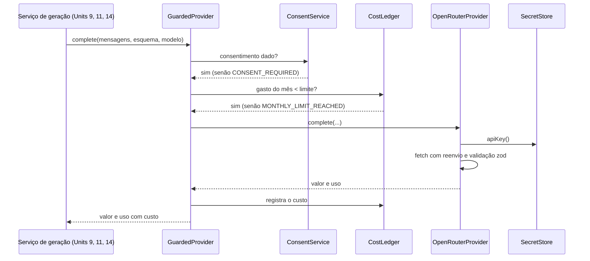

**NFR (nota).** NFR-6: testes provam que sem aceite nada é enviado e que não há telemetria; NFR-7: a chave não aparece em log, banco, resposta IPC nem arquivo de dados além de `credentials.enc` (cifrado); o E2E procura a chave nos arquivos do perfil.

**Riscos.** (1) A cifra protege contra leitura casual, não contra quem lê os dois arquivos como o mesmo usuário (ADR-2). (2) O formato de resposta do OpenRouter e o catálogo de preços podem mudar; falhas de catálogo são brandas e o custo cai para zero quando o preço é desconhecido, como no Python.

### Assumptions & open questions

- A39 (3.1 UNIT-4): O `maxRetries` e a nova tentativa em 429/5xx seguem os valores do Python (2 e 1). — confirmed: yes
- A40 (3.1 UNIT-4): O E2E usa o `FakeProvider` por `MIND_E2E_FAKE_LLM=1`, só fora do app empacotado. — confirmed: yes
