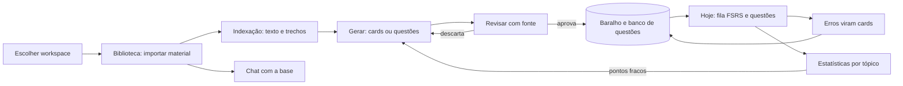
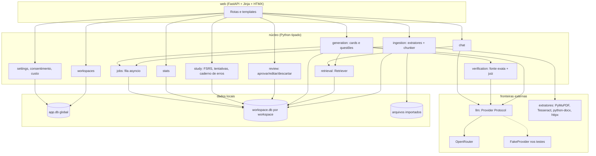
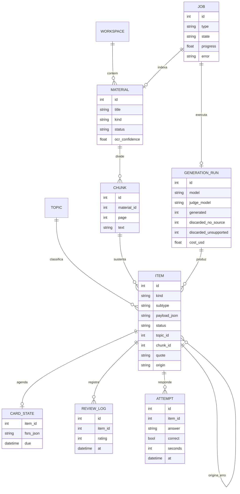
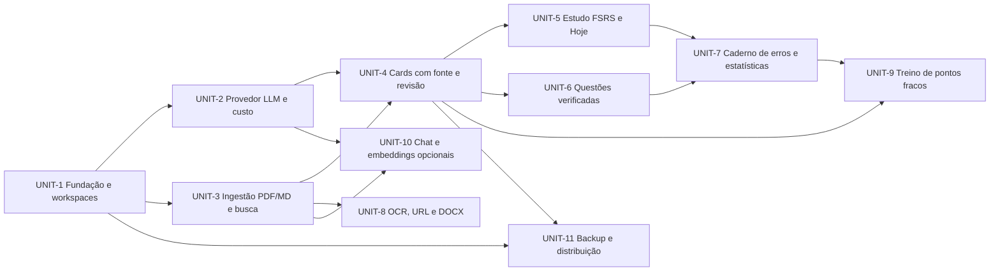
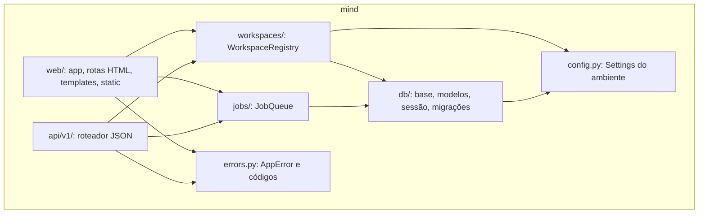
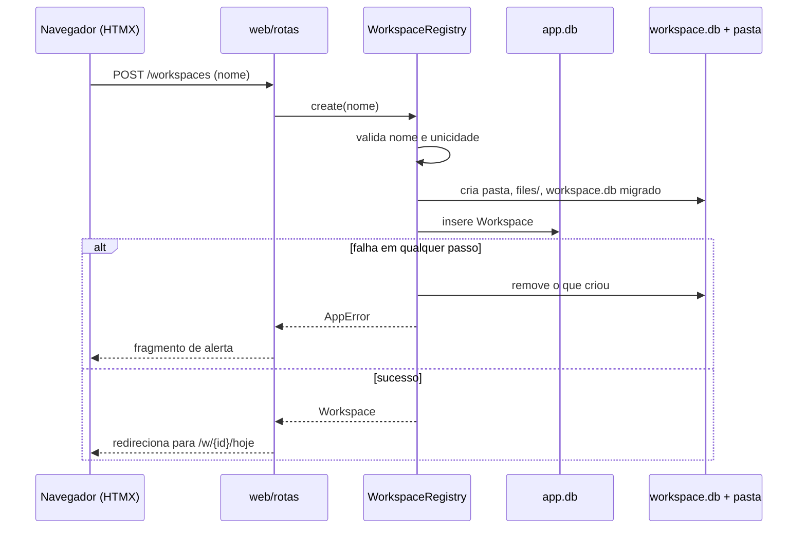
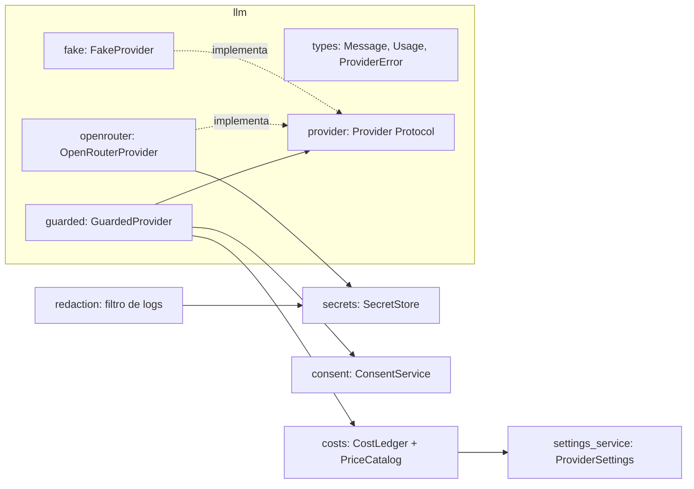
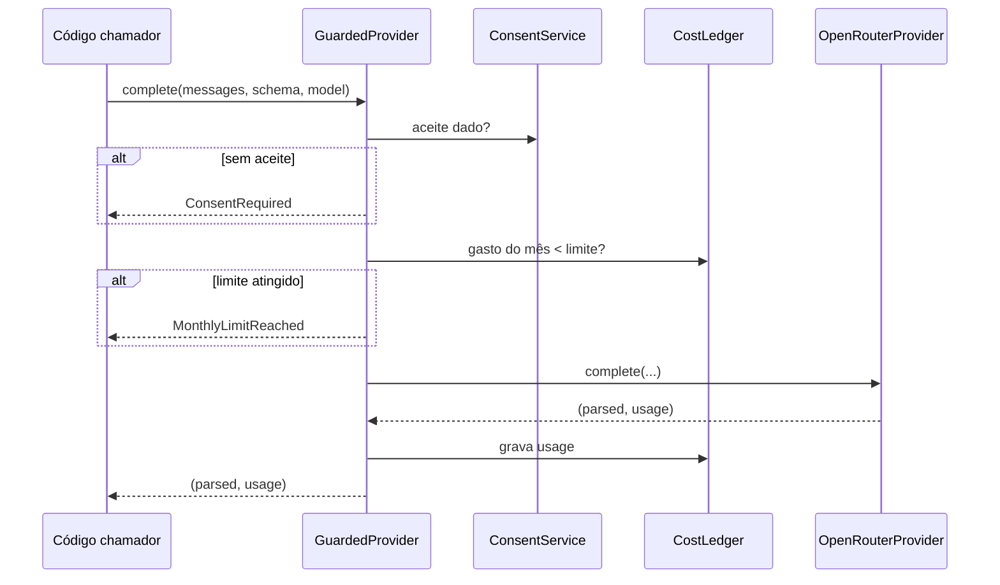
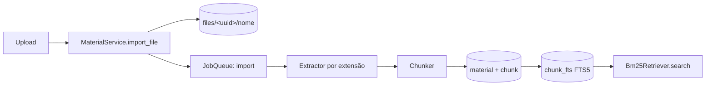
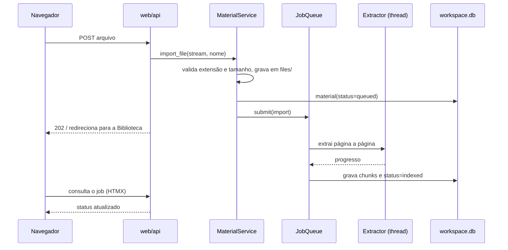

# Design — mind-study-tool

## 1.6 Rough mockups

Decisões de UI (confirmadas): [src: Q13–Q16]
- Barra lateral com seções fixas **e seletor de workspace** no topo. Workspace = base de conhecimento isolada (ex.: "Biologia", "Cálculo"), com materiais, cards, questões, estatísticas e chat próprios. Não é conta de usuário: multiusuário segue fora do escopo.
- Estudo de flashcards: atalhos de teclado **e** botões clicáveis.
- Revisão de itens gerados: lista com aprovar/editar/descartar ao lado do trecho fonte.
- Tema claro/escuro; o escuro usa a paleta **Dracula**. Minimalista, HTMX + CSS próprio.
- No celular (mesma rede), a barra lateral vira menu inferior.

### Fluxo principal



### Wireframe — Hoje (tela inicial)

```
┌────────────┬──────────────────────────────────────────────┐
│ MIND       │  Hoje                          ⚙  ☾/☀        │
│ [Biologia ▾]│  ──────────────────────────────────────────  │
│            │  Cards vencidos   42     [ Estudar agora ]   │
│ ▸ Hoje     │  Questões sugeridas  10  [ Praticar ]        │
│   Biblioteca│  Meta do dia  ████████░░░░  28/40            │
│   Gerar    │                                              │
│   Estudar  │  Pontos fracos                               │
│   Estatíst.│   • Genética                54%  [Treinar]  │
│   Chat     │   • Ecologia                61%  [Treinar]  │
└────────────┴──────────────────────────────────────────────┘
```

### Wireframe — Biblioteca

```
┌────────────┬──────────────────────────────────────────────┐
│ (sidebar)  │  Biblioteca            [ + Importar ]        │
│            │  Formatos: PDF · PDF escaneado · MD · URL · DOCX │
│            │  ┌────────────────────────────────────────┐  │
│            │  │ aula_03.pdf   120 pág.  indexado  ✓    │  │
│            │  │ resumo.md      12 pág.  indexado  ✓    │  │
│            │  │ scan_lei.pdf   40 pág.  OCR 71%  ⚠ [ver]│ │
│            │  └────────────────────────────────────────┘  │
└────────────┴──────────────────────────────────────────────┘
```

### Wireframe — Gerar e revisar

```
┌────────────┬─────────────────────────────────────────────────────┐
│ (sidebar)  │ Gerar:  (•) Cards  ( ) Questões   Material: aula_03 ▾ │
│            │ Págs 10–25   Qtd [20]   Tipo [Cloze+P/R ▾]  [Gerar]  │
│            │ Custo estimado: US$ 0,02                              │
│            │ ─────────────────────────────────────────────────── │
│            │ Revisar (20)         [Aprovar todos] [Aprovar sel.]   │
│            │ ┌──────────────────────┬────────────────────────┐   │
│            │ │ ☑ P: O que é …?      │ Trecho fonte (p.12):    │   │
│            │ │   R: …               │ "…texto destacado…"     │   │
│            │ │   [Editar] [Descartar]│ aula_03.pdf · pág. 12   │   │
│            │ └──────────────────────┴────────────────────────┘   │
└────────────┴─────────────────────────────────────────────────────┘
```

### Wireframe — Estudar flashcard

```
┌──────────────────────────────────────────────────────────┐
│  Cards: 12/42                          Tópico: Genética    │
│                                                          │
│     Qual o processo biológico que …?                    │
│                                                          │
│              [ Mostrar resposta ]  (Espaço)              │
│  ──────────────────────────────────────────────────────  │
│  (após revelar)  Resposta: …      Fonte: aula_03 p.12    │
│  [1 Errei] [2 Difícil] [3 Bom] [4 Fácil]                 │
└──────────────────────────────────────────────────────────┘
```

### Wireframe — Questão (Certo/Errado e múltipla escolha)

```
┌──────────────────────────────────────────────────────────┐
│  Questão 3/10                         ⏱ 01:12            │
│  "Julgue o item: …"                                      │
│   ( ) Certo   ( ) Errado     [ Responder ]               │
│  (após responder) ✔/✘ Gabarito · Comentário · Fonte      │
│  [ Erro → virar card ]  [ Próxima ]                      │
└──────────────────────────────────────────────────────────┘
```

### Wireframe — Estatísticas e Chat

```
Estatísticas:                         Chat com a base:
 Acerto por tópico  ▇▇▇▇▇▇░░ 78%      Você: o que diz o art. X?
 Retenção (curva)   ╱‾‾‾╲___          IA:  … [fonte: aula_03 p.12]
 Streak: 9 dias  Custo do mês: $1,40  [ Pergunte à base…        ]
```

### Estados a cobrir em 2.5
Vazio (workspace sem material), carregando/gerando (com progresso e custo), erro de chave de API ausente/inválida, OCR de baixa confiança, geração sem itens aprovados, fila do dia vazia.

### Assumptions & open questions
- A8: "Workspace" é uma base isolada dentro de um único usuário local, sem relação com contas; adicionado como S-8 na seção 1.4. (confirmed: yes, pedido do autor)
- A9: Paleta Dracula (#282a36 fundo, #f8f8f2 texto, #bd93f9 destaque) no tema escuro; tema claro a definir em 2.5. (confirmed: no)
- A10: Layout responsivo no celular é desejável mas não verificado como requisito; entra em 2.3 como NFR. (confirmed: no)

## 2.2 Team practices

Projeto greenfield: as práticas abaixo são **decididas**, não descobertas no código. [src: Q17–Q20]

| Tema | Prática afirmada |
|---|---|
| Linguagem e ambiente | Python 3.12+, gerenciado com **uv** (`pyproject.toml` + `uv.lock`; execução por `uv run`, instalação por terceiros via `uvx`/`pipx`) |
| Tipagem | **Python totalmente tipado**: toda função e método com anotações; `mypy --strict` (ou pyright em modo strict) sem erros; modelos de dados e saídas do LLM em Pydantic v2; interface `Provider` como `Protocol` tipado. Sem `Any` implícito; `# type: ignore` só com comentário justificando |
| Lint e formato | **ruff** (lint + format) com regras de imports, bugs, simplificações e docstrings públicas; sem pre-commit obrigatório no MVP, mas o CI barra |
| Testes | **pytest**; o LLM é **sempre mockado** (provedor falso determinístico); SQLite em memória; um teste de qualidade com modelo real fica fora do CI, em script opcional |
| Git | Trunk na `main` (projeto solo), commits pequenos e **convencionais** (`feat:`, `fix:`, `chore:`, `docs:`, `test:`, `refactor:`) |
| CI | **GitHub Actions** a cada push/PR: `ruff check`, `ruff format --check`, `mypy`, `pytest`. Detalhado em 3.7 |
| Segredos | Chave de API só por variável de ambiente ou arquivo `.env` local (ignorado pelo git); nunca em log, banco ou repositório |
| Documentação | `README` em pt-BR para instalação e uso; decisões em ADRs dentro de `design.md` |

Não há práticas a promover para `team.md` (projeto solo); as regras de projeto afirmadas aqui valem como convenções de Construction.

### Assumptions & open questions
- A11: Python 3.12 como versão mínima (compatibilidade com uvx e libs-alvo). Confirmar em 3.5 se alguma lib exige outra. (confirmed: no)
- A12: Escolha entre mypy e pyright strict fica para 3.5; o critério é o que roda melhor no CI sem plugin. (confirmed: no)
## 2.5 Refined mockups

Decisões (confirmadas): [src: Q25–Q27]
- **Tema claro: Alucard** (variante clara oficial do Dracula); **tema escuro: Dracula**. Segue a preferência do sistema, com alternância manual.
- **Tipografia:** Inter (texto) e JetBrains Mono (cloze e código), **com ligaduras ativas** (`font-variant-ligatures: common-ligatures`, `font-feature-settings: "calt" 1`). As fontes são empacotadas localmente (sem CDN), para funcionar offline (NFR-5). Texto de card em 20–22 px; interface em 15–16 px.
- **Fórmulas LaTeX:** renderizadas com **KaTeX**, empacotado localmente (FR-23). Delimitadores `$…$` e `$$…$$`. Erro de fórmula não quebra a tela: mostra o texto bruto.
- **Tela inicial: Hoje.** Com o workspace vazio, mostra o passo a passo da primeira importação.

### Tokens de design

| Token | Escuro (Dracula) | Claro (Alucard) |
|---|---|---|
| `--bg` | #282a36 | #fffbeb |
| `--surface` | #44475a | #cfcfde |
| `--fg` | #f8f8f2 | #1f1f1f |
| `--muted` | #6272a4 | #6c664b |
| `--accent` | #bd93f9 | #644ac9 |
| `--ok` | #50fa7b | #14710a |
| `--warn` | #ffb86c | #a34d14 |
| `--danger` | #ff5555 | #cb3a2a |
| `--info` | #8be9fd | #036a96 |

Os valores do Alucard devem ser conferidos contra a especificação oficial na Construction (A20). Contraste mínimo de 4,5:1 para texto; se um par não passar, ajustar o token.

### Componentes e interação
- **Barra lateral:** logo, seletor de workspace (lista + "novo"), links Hoje, Biblioteca, Gerar, Estudar, Estatísticas, Chat, Configurações. Abaixo de 768 px vira menu inferior com os mesmos ícones.
- **Card de estudo:** frente centralizada; `Espaço` ou botão "Mostrar resposta" revela; `1–4` ou botões Errei/Difícil/Bom/Fácil avaliam, mostrando o intervalo previsto em cada botão; `E` edita; `Z` desfaz a última avaliação. Dica de atalhos visível no rodapé.
- **Questão:** `A–E`/`C`/`E` (Certo/Errado) selecionam, `Enter` envia; após responder, mostra gabarito, comentário por alternativa, fonte e o botão "Virar card".
- **Gerar:** formulário em uma coluna: material, intervalo de páginas, tipo de card ou formato de questão, quantidade, custo estimado; botão "Gerar" fica desabilitado sem chave ou com o limite do mês atingido.
- **Revisão:** duas colunas (item e trecho-fonte com o texto citado em destaque); barra fixa com "Aprovar selecionados", "Aprovar todos" e contagem; relatório de itens descartados (sem fonte ou não verificados) recolhível.
- **Biblioteca:** tabela de materiais com status (importando, indexado, OCR com confiança, erro), prévia do texto e ação de reindexar.
- **Chat:** lista de mensagens, citações como chips clicáveis que abrem o trecho; aviso quando não há suporte no material.
- **Primeiro uso:** assistente em 3 passos (chave e modelo, aviso de privacidade, primeira importação), reaproveitando as telas de Configurações e Biblioteca.

### Estados

| Tela | Estados cobertos |
|---|---|
| Hoje | workspace vazio (passo a passo), fila vazia ("tudo em dia"), meta atingida |
| Biblioteca | vazia, importando (progresso), OCR de baixa confiança (aviso), falha de extração (motivo e tentar de novo) |
| Gerar | sem chave (link para Configurações), custo acima do limite, gerando (progresso e cancelar), nenhum item aprovado, falha do provedor (erro legível e tentar de novo) |
| Revisão | nenhum item sustentado, itens descartados, edição com salvamento pendente |
| Estudar/Questões | fila acabou (resumo da sessão), sem rede (estudo segue funcionando) |
| Chat | sem material, sem suporte para a pergunta, sem rede |

### Acessibilidade
Navegação completa por teclado; foco visível; rótulos em todos os controles; não depender só de cor (ícone ou texto junto a certo/errado); respeitar `prefers-reduced-motion`; fórmulas com texto alternativo (MathML do KaTeX).

### Assumptions & open questions
- A20: Os valores de cor do Alucard citados são os da paleta clássica; conferir na especificação oficial na Construction e ajustar o contraste. (confirmed: no)
- A21: Inter e JetBrains Mono têm licença livre (OFL) e podem ser redistribuídas; confirmar no 3.7 antes da publicação. (confirmed: no)
- A22: Os atalhos de questão (`A–E`, `C`, `E`) podem conflitar entre si (`E` para Errado e para editar); decidir na Construction qual contexto prevalece. (confirmed: no)

## 2.6 Domain & components

Decisões novas (confirmadas): [src: Q28–Q31] busca híbrida, fila em processo, SQLAlchemy 2 + Alembic, um SQLite por workspace.

### Visão de componentes



### Componentes

| Componente | Responsabilidade | Interfaces principais | Dados que possui | Atende |
|---|---|---|---|---|
| `web` | Rotas, templates Jinja e fragmentos HTMX; só orquestra, sem regra de negócio | HTTP em `127.0.0.1` | nenhum | FR-13, FR-16, NFR-3, NFR-11 |
| `workspaces` | Cria, lista, renomeia, exclui e abre workspaces; exporta e importa | `WorkspaceRegistry` | registro em `app.db`; pasta do workspace | FR-1, FR-22 |
| `ingestion` | Extrai texto por página de PDF, OCR, MD/texto, DOCX e URL; divide em trechos com metadados | `Extractor` (Protocol por formato), `Chunker` | `material`, `chunk` | FR-2 a FR-5, FR-23 (texto preservado) |
| `retrieval` | Busca trechos por BM25 (FTS5) e, se habilitado, por embeddings locais; mescla resultados | `Retriever` (Protocol) | índice FTS5 e vetores | FR-5, FR-6, FR-18 |
| `llm` | Única porta de saída para modelos; saída estruturada validada por Pydantic, repetição com limite, medição de tokens e custo | `Provider` (Protocol) | nada (usa `settings`) | FR-19, FR-21, NFR-6 |
| `generation` | Monta prompts, pede itens ao LLM, normaliza e grava como rascunho | `CardGenerator`, `QuestionGenerator` | `generation_run`, `item` (rascunho) | FR-6, FR-9, FR-11, FR-17, FR-23 |
| `verification` | 1) confere que a citação existe no trecho (comparação textual normalizada); 2) juiz LLM confere que o gabarito é sustentado | `SourceChecker`, `Judge` | contadores em `generation_run` | FR-7, FR-10 |
| `review` | Aprovar, editar, descartar em lote; só aprovados entram no baralho | `ReviewService` | `item.status` | FR-8 |
| `study` | Fila do dia, FSRS, tentativas de questões, caderno de erros | `Scheduler` (py-fsrs), `StudyService` | `card_state`, `review_log`, `attempt` | FR-12 a FR-15 |
| `stats` | Acerto por tópico, retenção, meta diária, sequência | `StatsService` | consultas sobre `review_log` e `attempt` | FR-16 |
| `chat` | Responde com trechos recuperados e citações; recusa sem suporte | `ChatService` | `chat_message` | FR-18 |
| `jobs` | Fila asyncio com estado persistido; progresso, cancelamento e retomada | `JobQueue` | `job` | NFR-2, NFR-3 |
| `settings` | Provedor, chave (ambiente), modelos, consentimento, custo mensal e limite | `SettingsService`, `CostLedger` | `app.db` | FR-19 a FR-21, NFR-7 |

### Modelo de dados



Os dados globais ficam em `app.db`: `workspace` (id, nome, pasta), `setting`, `consent`, `cost_ledger` (data, provedor, modelo, tokens, custo). Os demais ficam no `workspace.db` de cada workspace. `ITEM.kind` é `card` ou `question`; `subtype` é `qa`, `cloze`, `compare`, `true_false`, `certo_errado` ou `multiple_choice`; `origin` é `generated`, `manual` ou `error_note`.

### Decisões de arquitetura (ADRs)

**ADR-1 Um SQLite por workspace e um banco global** · [Q31] · atende FR-1, FR-22, NFR-12
- Contexto: isolamento forte, exportação simples e exclusão limpa.
- Decisão: `app.db` (registro, configurações, consentimento, custo) e `workspace.db` + pasta `files/` por workspace, em diretório de dados configurável (`MIND_DATA_DIR`, padrão do sistema via `platformdirs`). Modo WAL.
- Alternativas: banco único com `workspace_id` (vazamento por filtro esquecido; exportar exige extração).
- Consequências: migrações rodam em cada banco ao abrir; consultas entre workspaces não existem no MVP (e não são requisito); o custo é global e por isso fica em `app.db`.

**ADR-2 Busca híbrida atrás de `Retriever`** · [Q28] · atende FR-5, FR-6, FR-18
- Decisão: BM25 por FTS5 sempre ativo; embeddings **locais e opcionais** (extra `mind[embeddings]`, sentence-transformers + sqlite-vec) mesclados por fusão de ranking (RRF) quando instalados e habilitados no workspace.
- Alternativas: só FTS5 (chat fraco em perguntas parafraseadas); embeddings por provedor (custo, envia todo o texto, exige rede).
- Consequências: o caminho sem embeddings é o padrão e fica determinístico nos testes; o caminho com embeddings tem teste próprio com modelo pequeno ou falso; o tamanho do modelo local respeita NFR-4 apenas quando habilitado.

**ADR-3 Fila de tarefas em processo com estado no SQLite** · [Q29] · atende NFR-2, NFR-3
- Decisão: `JobQueue` com `asyncio` (limite de concorrência configurável) e tabela `job` com estado (`queued`, `running`, `done`, `failed`, `cancelled`) e progresso; a UI consulta por polling HTMX ou SSE. CPU pesada (PDF, OCR) em `ProcessPoolExecutor`/thread.
- Consequências: ao reiniciar, jobs `running` viram `failed` com mensagem clara e podem ser reexecutados; sem Redis nem Celery.

**ADR-4 SQLAlchemy 2 tipado + Alembic + Pydantic** · [Q30] · atende NFR-10, NFR-12
- Decisão: modelos ORM tipados (`Mapped[...]`), esquemas Pydantic nas fronteiras (HTTP, LLM), migrações Alembic aplicadas na abertura de cada banco, SQL cru só para FTS5.
- Consequências: `mypy --strict` com o plugin do SQLAlchemy ou tipos nativos; mais código que SQL manual, porém com migrações versionadas.

**ADR-5 Citação exata como verificação determinística, antes do juiz** · atende FR-7, FR-10, NFR-8
- Decisão: todo item carrega `quote` (texto) e `chunk_id`; a verificação normaliza espaços e quebras e exige que `quote` seja substring do trecho. Só depois o juiz LLM avalia se o gabarito/resposta é sustentado pela citação. Falhas contam em `generation_run`.
- Consequências: itens inventados são barrados sem custo de LLM; PDFs com extração ruidosa podem gerar falsos descartes, mitigado pela normalização e pela prévia do texto extraído.

**ADR-6 `Provider` como Protocol; OpenRouter como implementação padrão** · [1.3] · atende FR-19, NFR-6, NFR-7
- Decisão: `Provider.complete(messages, schema) -> parsed` com saída estruturada validada por Pydantic, repetição limitada em caso de saída inválida, e retorno de uso de tokens para o `CostLedger`. `OpenRouterProvider` por HTTP com `httpx`; `FakeProvider` determinístico para testes. Nenhum outro código chama HTTP de LLM.
- Consequências: trocar de provedor (Anthropic direto, Ollama) exige só uma nova implementação.

**ADR-7 FSRS por biblioteca (`py-fsrs`)** · atende FR-12
- Decisão: usar a biblioteca, com o estado serializado em `card_state.fsrs_json` e parâmetros padrão; sem implementar o algoritmo à mão.
- Consequências: dependência a acompanhar; a otimização de parâmetros por usuário fica para depois.

**ADR-8 Interface renderizada no servidor, sem etapa de build de frontend** · [C-5, Q25–Q27] · atende NFR-5, NFR-9, NFR-11
- Decisão: Jinja + HTMX + CSS próprio com os tokens de 2.5; KaTeX e fontes empacotados em `static/`; JavaScript apenas para atalhos de teclado e renderização de fórmulas.
- Consequências: instalação por um comando, sem Node; interações muito ricas ficam limitadas ao que o HTMX permite.

### Assumptions & open questions
- A23: Embeddings locais ficam como extra opcional e desligados por padrão; o autor escolheu "híbrido com embeddings locais opcionais". (confirmed: yes)
- A24: Exportar um workspace gera um `.zip` com `workspace.db` e `files/`; importar valida a versão do esquema e migra. (confirmed: no)
- A25: OCR usa Tesseract instalado no sistema (ou no contêiner); se ausente, a importação de escaneados falha com instrução clara. Isso afeta SM-3 e deve ser documentado no README. (confirmed: no)
- A26: O juiz usa um modelo diferente (e normalmente mais forte) do gerador; ambos configuráveis em FR-19. (confirmed: no)
## 2.7 Units of work

Onze Units, ordenadas por dependência e por risco: o risco de qualidade da geração (SM-1) é atacado cedo, em UNIT-4, logo após a fundação, e os formatos de entrada mais custosos (OCR, URL, DOCX) ficam depois do núcleo de estudo, como definido em 1.4.

### Grafo de dependências



**Ordem topológica:** UNIT-1, UNIT-2, UNIT-3, UNIT-4, UNIT-5, UNIT-6, UNIT-7, UNIT-8, UNIT-9, UNIT-10, UNIT-11. UNIT-2 e UNIT-3 são independentes entre si (podem ser feitas em qualquer ordem); o mesmo vale para UNIT-5/UNIT-6 e para UNIT-8/UNIT-9/UNIT-10 depois de suas dependências.

### Units

#### UNIT-1 Fundação e workspaces
- **Propósito:** projeto executável de ponta a ponta (walking skeleton): estrutura do pacote, ferramentas de qualidade, banco global, workspaces, shell da interface.
- **Cobre:** FR-1, FR-23, FR-24 · US-1, US-17, US-18 · NFR-3 (base), NFR-5 (ativos locais), NFR-10, NFR-11, NFR-12, NFR-13
- **Escopo:** `pyproject.toml` com uv, ruff, mypy strict, pytest; app FastAPI com Jinja e HTMX; `app.db` e `workspace.db` com Alembic; `WorkspaceRegistry`; barra lateral com seletor; tokens Dracula/Alucard, Inter e JetBrains Mono com ligaduras, KaTeX local e renderização de fórmulas com fallback; fila `JobQueue` base; diretório de dados configurável; esqueleto de CI.
- **Interfaces:** `WorkspaceRegistry`, `JobQueue`, `render_math()` (template).
- **DoD:** `/api/v1` com OpenAPI, modelo de erro `problem+json` e teste de contrato do recurso `workspaces`; criar, trocar e excluir workspaces com isolamento testado; fórmula válida renderiza e inválida mostra texto bruto; `ruff`, `mypy --strict` e `pytest` passam; migração aplicada em banco novo e em banco de versão anterior; tema alterna e respeita o sistema; servidor escuta só em `127.0.0.1`.

#### UNIT-2 Provedor LLM, configurações e custo
- **Propósito:** única porta de saída para modelos, com consentimento e controle de gasto.
- **Cobre:** FR-19, FR-20, FR-21 · US-13, US-14 · NFR-6, NFR-7
- **Escopo:** `Provider` (Protocol), `OpenRouterProvider`, `FakeProvider`; saída estruturada com Pydantic e repetição limitada; `SettingsService`; leitura da chave só do ambiente/`.env`; aviso de privacidade e consentimento; `CostLedger`, estimativa antes de gerar e limite mensal; tela de Configurações e assistente do primeiro uso (passos 1 e 2).
- **Interfaces:** `Provider.complete(...)`, `CostLedger`, `ConsentService`.
- **DoD:** fluxo funciona com `FakeProvider` sem chave; o bloqueio por limite funciona; a chave nunca aparece em log, banco ou resposta (teste automatizado); sem consentimento nada é enviado.

#### UNIT-3 Ingestão de PDF nativo e Markdown, busca e biblioteca
- **Propósito:** transformar materiais em trechos pesquisáveis com referência de origem.
- **Cobre:** FR-2, FR-5 · US-2 · NFR-1, NFR-4
- **Escopo:** extratores de PDF (PyMuPDF) e Markdown/texto; `Chunker` por seção e página; índice FTS5; `Retriever` BM25; job de importação com progresso; tela Biblioteca com status e prévia.
- **Interfaces:** `Extractor`, `Chunker`, `Retriever`.
- **DoD:** PDF de 100 páginas indexado em < 60 s e com ≤ 4 GB de memória (medido); busca devolve trechos com arquivo e página; importação falha com mensagem legível em PDF corrompido.

#### UNIT-4 Flashcards com fonte e revisão
- **Propósito:** o núcleo de valor e a validação de SM-1: do trecho ao card revisado, com fonte conferida.
- **Cobre:** FR-6, FR-7, FR-8 · US-4, US-5 · NFR-2, NFR-8
- **Escopo:** `CardGenerator` para P/R, cloze, comparativo e V/F (tipo escolhido na solicitação); prompts com orientação de LaTeX; `SourceChecker` (citação exata); `generation_run` e relatório de descartes; tela Gerar (custo estimado, progresso, cancelar) e tela de Revisão (item + trecho-fonte, aprovar/editar/descartar, lote); script de avaliação de qualidade (SM-1) fora do CI.
- **Interfaces:** `CardGenerator`, `SourceChecker`, `ReviewService`.
- **DoD:** item cuja citação não existe é descartado e contado; só itens aprovados chegam ao baralho; 20 itens gerados em < 60 s com provedor falso de latência controlada, UI sem travar; script de SM-1 roda e produz relatório com taxa de aprovação.

#### UNIT-5 Estudo com FSRS e tela Hoje
- **Propósito:** revisar cards no momento certo, com fluxo rápido por teclado e clique.
- **Cobre:** FR-12, FR-13 · US-7 · NFR-3, NFR-5 (verificação offline)
- **Escopo:** `Scheduler` com py-fsrs; fila do dia; tela Estudar com atalhos e botões, intervalo previsto por botão, desfazer; tela Hoje (fila, meta, estados vazios) e assistente do primeiro uso (passo 3).
- **Interfaces:** `Scheduler`, `StudyService`.
- **DoD:** o agendamento segue o FSRS em casos de teste; atalhos e botões produzem o mesmo resultado; estudo funciona com a rede desligada; resposta das telas < 300 ms (p95).

#### UNIT-6 Questões verificadas
- **Propósito:** treino no formato de prova, com gabarito sustentado pela fonte.
- **Cobre:** FR-9, FR-10, FR-11, FR-14 · US-6, US-8
- **Escopo:** `QuestionGenerator` (Certo/Errado e múltipla escolha com 4 ou 5 alternativas) e perfis de prova; `Judge` (segunda chamada); comentário por alternativa; tela de Questão com cronômetro, correção e "Virar card"; gravação de `attempt`.
- **Interfaces:** `QuestionGenerator`, `Judge`.
- **DoD:** gabarito não sustentado é descartado antes da revisão; toda tentativa é gravada com resultado e tempo; formato obedece ao perfil escolhido.

#### UNIT-7 Caderno de erros e estatísticas
- **Propósito:** transformar erros em revisão e mostrar onde o usuário está.
- **Cobre:** FR-15, FR-16 · US-9, US-10
- **Escopo:** criação de card a partir de erro (com tópico e fonte) e de avaliação "Errei"; atribuição e edição de tópicos; `StatsService` com acerto por tópico, retenção, meta diária e sequência; tela Estatísticas.
- **Interfaces:** `StatsService`, `ErrorNotebook`.
- **DoD:** cada erro confirmado vira um card com fonte; o acerto por tópico bate com um conjunto de tentativas conhecido; a meta diária e a sequência refletem o dia corrente.

#### UNIT-8 OCR, URL e DOCX
- **Propósito:** completar os formatos de entrada.
- **Cobre:** FR-3, FR-4 · US-3 · NFR-1 (para escaneados)
- **Escopo:** extrator OCR (Tesseract) com confiança e prévia; extrator de URL (httpx + extração do texto principal); extrator DOCX; mensagens quando o Tesseract estiver ausente.
- **Interfaces:** novos `Extractor`.
- **DoD:** escaneado mostra a confiança e a prévia; URL e DOCX viram trechos pesquisáveis; ausência do Tesseract gera instrução clara, sem quebrar o app.

#### UNIT-9 Treino de pontos fracos
- **Propósito:** direcionar a geração para onde o usuário erra.
- **Cobre:** FR-17 · US-11
- **Escopo:** seleção de tópicos de menor acerto; atalho "Treinar" em Hoje e Estatísticas que abre Gerar pré-configurado; recuperação de trechos do tópico.
- **Interfaces:** `WeakTopicSelector`.
- **DoD:** com um tópico de acerto baixo conhecido, "Treinar" abre a geração configurada para ele; a seleção respeita um limite mínimo de tentativas.

#### UNIT-10 Chat com a base e embeddings opcionais
- **Propósito:** responder dúvidas com fonte e permitir melhor recuperação semântica.
- **Cobre:** FR-18 · US-12
- **Escopo:** `ChatService` com recuperação, citações clicáveis e recusa sem suporte; extra `mind[embeddings]` com sentence-transformers + sqlite-vec e fusão por RRF; tela Chat.
- **Interfaces:** `ChatService`, `EmbeddingRetriever`.
- **DoD:** pergunta coberta devolve resposta com arquivo e página; pergunta sem suporte devolve "não encontrei"; sem o extra instalado, o chat funciona só com BM25.

#### UNIT-11 Backup e distribuição
- **Propósito:** preparar o projeto para ser usado por outras pessoas.
- **Cobre:** FR-22 · US-15, US-16 · NFR-9
- **Escopo:** exportar e importar workspace (`.zip`); README em pt-BR; execução por `uvx`/`pipx`; `.env.example`; Dockerfile com Tesseract (opcional); revisão de licenças das fontes e de KaTeX; teste de instalação limpa.
- **Interfaces:** `WorkspaceArchive`.
- **DoD:** exportar e importar restaura materiais, cards e histórico; o README leva um terceiro de zero a um primeiro baralho de amostra; instalação limpa testada em Linux e uma segunda plataforma (macOS ou Windows).

### Mapa história → Unit

| US | Unit | US | Unit |
|---|---|---|---|
| US-1 | UNIT-1 | US-10 | UNIT-7 |
| US-2 | UNIT-3 | US-11 | UNIT-9 |
| US-3 | UNIT-8 | US-12 | UNIT-10 |
| US-4 | UNIT-4 | US-13 | UNIT-2 |
| US-5 | UNIT-4 | US-14 | UNIT-2 |
| US-6 | UNIT-6 | US-15 | UNIT-11 |
| US-7 | UNIT-5 | US-16 | UNIT-11 |
| US-8 | UNIT-6 | US-17 | UNIT-1 |
| US-9 | UNIT-7 | US-18 | UNIT-1 |

### Mapa FR → Unit (dono único)

| FR | Unit | FR | Unit | FR | Unit |
|---|---|---|---|---|---|
| FR-1 | 1 | FR-9 | 6 | FR-17 | 9 |
| FR-2 | 3 | FR-10 | 6 | FR-18 | 10 |
| FR-3 | 8 | FR-11 | 6 | FR-19 | 2 |
| FR-4 | 8 | FR-12 | 5 | FR-20 | 2 |
| FR-5 | 3 | FR-13 | 5 | FR-21 | 2 |
| FR-6 | 4 | FR-14 | 6 | FR-22 | 11 |
| FR-7 | 4 | FR-15 | 7 | FR-23 | 1 |
| FR-8 | 4 | FR-16 | 7 | FR-24 | 1 |

### Dono de cada NFR

| NFR | Unit (DoD) | NFR | Unit (DoD) |
|---|---|---|---|
| NFR-1 | UNIT-3 (e UNIT-8 para escaneados) | NFR-8 | UNIT-4 |
| NFR-2 | UNIT-4 | NFR-9 | UNIT-11 |
| NFR-3 | UNIT-1 e UNIT-5 | NFR-10 | UNIT-1 (vale para todas) |
| NFR-4 | UNIT-3 | NFR-11 | UNIT-1 |
| NFR-5 | UNIT-1 e UNIT-5 | NFR-12 | UNIT-1 |
| NFR-6 | UNIT-2 | NFR-13 | UNIT-1 |
| NFR-7 | UNIT-2 | | |

### Assumptions & open questions
- A27: A ordem difere ligeiramente da sugerida em 1.4 (questões antes do caderno de erros) porque o caderno de erros depende de ambos, estudo e questões; a lógica de risco (cards primeiro, formatos extras depois) foi mantida. (confirmed: no)
- A28: O corte natural caso o tempo aperte é UNIT-8, UNIT-9 e UNIT-10 (nesta ordem de prioridade para cortar: UNIT-10, UNIT-9, UNIT-8), mantendo UNIT-1 a UNIT-7 e UNIT-11 como o MVP mínimo. (confirmed: no)
- A29: O assistente do primeiro uso é dividido entre UNIT-2 (passos 1 e 2) e UNIT-5 (passo 3), para não depender do fluxo todo em uma só Unit. (confirmed: no)
## 2.8 Contracts

Decisões (confirmadas): [src: Q32–Q33] HTML + API JSON versionada em `/api/v1`; saída estruturada do LLM por JSON Schema com validação Pydantic e fallback de parse. A decisão da API gerou FR-24 (Should) e US-18 em `requirements.md`, sob a UNIT-1; cada Unit expõe seus próprios recursos em `/api/v1` e inclui teste de contrato no seu DoD (A30).

### 1. HTTP

**Princípio:** as rotas HTML (HTMX) e a API JSON chamam os mesmos serviços do núcleo; nenhuma regra de negócio vive nas rotas. As rotas HTML não são um contrato público; a API é.

**Versionamento da API:** prefixo `/api/v1`; mudanças compatíveis (campo novo opcional, recurso novo) ficam na `v1`; mudanças incompatíveis exigem `/api/v2`, com `v1` mantida por pelo menos uma versão menor do app. OpenAPI em `/api/openapi.json` e documentação em `/api/docs`. O servidor escuta só em `127.0.0.1` (NFR-7); a API não tem autenticação no MVP e isso é dito no README.

**Recursos (todos escopados por workspace, exceto `workspaces` e `settings`):**

| Recurso | Método e caminho | Descrição | Unit |
|---|---|---|---|
| Workspaces | `GET/POST /api/v1/workspaces`, `GET/PATCH/DELETE /api/v1/workspaces/{id}` | CRUD de workspaces | 1 |
| Jobs | `GET /api/v1/workspaces/{id}/jobs`, `GET .../jobs/{job_id}`, `POST .../jobs/{job_id}/cancel`, `GET .../jobs/{job_id}/events` (SSE) | Estado e progresso | 1 |
| Settings | `GET/PATCH /api/v1/settings`, `POST /api/v1/settings/consent` | Provedor, modelos, limite e consentimento; **nunca devolve a chave** | 2 |
| Custo | `GET /api/v1/costs?month=YYYY-MM`, `POST /api/v1/costs/estimate` | Custo acumulado e estimativa | 2 |
| Materiais | `GET/POST .../materials`, `GET/DELETE .../materials/{id}`, `GET .../materials/{id}/chunks`, `GET .../search?q=` | Importar (multipart ou URL), listar, buscar | 3, 8 |
| Geração | `POST .../generations` (cria job), `GET .../generations/{id}` | Cards e questões; devolve rascunhos e o relatório de descartes | 4, 6 |
| Itens | `GET .../items?status=&kind=&topic=`, `PATCH .../items/{id}`, `POST .../items:review` (aprovar, descartar em lote) | Revisão e edição | 4 |
| Estudo | `GET .../study/queue`, `POST .../study/reviews`, `POST .../study/attempts` | Fila do dia, avaliações e respostas | 5, 6 |
| Erros | `POST .../items/{id}/error-card` | Virar card a partir de erro | 7 |
| Estatísticas | `GET .../stats/topics`, `GET .../stats/summary` | Acerto por tópico, retenção, meta e sequência | 7 |
| Treino | `POST .../generations:weak-topics` | Geração a partir dos pontos fracos | 9 |
| Chat | `POST .../chat` | Pergunta com resposta e citações | 10 |
| Backup | `POST .../export`, `POST /api/v1/workspaces:import` | Arquivo do workspace | 11 |

### 2. Modelo de erro (RFC 9457, `application/problem+json`)

```json
{
  "type": "https://mind.local/errors/monthly-limit-reached",
  "title": "Limite mensal de custo atingido",
  "status": 402,
  "code": "MONTHLY_LIMIT_REACHED",
  "detail": "Gasto de US$ 5,02 de US$ 5,00 em 2026-11.",
  "instance": "/api/v1/workspaces/3/generations",
  "errors": []
}
```

`code` é estável e faz parte do contrato; `title` e `detail` são texto para humanos em pt-BR. `errors[]` lista falhas de validação por campo (`{ "field": "count", "message": "..." }`). As rotas HTML mostram o mesmo `title`/`detail` em um fragmento de alerta.

| `code` | HTTP | Quando |
|---|---|---|
| `VALIDATION_ERROR` | 422 | Entrada inválida |
| `WORKSPACE_NOT_FOUND` / `MATERIAL_NOT_FOUND` / `ITEM_NOT_FOUND` / `JOB_NOT_FOUND` | 404 | Recurso inexistente |
| `PROVIDER_KEY_MISSING` | 409 | Sem chave de API configurada |
| `CONSENT_REQUIRED` | 409 | Envio ao provedor sem aceite (FR-20) |
| `MONTHLY_LIMIT_REACHED` | 402 | Limite de custo atingido (FR-21) |
| `PROVIDER_ERROR` | 502 | Falha do provedor após as tentativas |
| `GENERATION_EMPTY` | 200 com relatório | Nenhum item sustentado (não é erro HTTP; vem no relatório) |
| `UNSUPPORTED_FILE` / `EXTRACTION_FAILED` | 415 / 422 | Arquivo ilegível ou formato não suportado |
| `OCR_UNAVAILABLE` | 424 | Tesseract ausente (A25) |
| `ARCHIVE_INCOMPATIBLE` | 422 | Arquivo de backup de versão de esquema não suportada |

### 3. Interface `Provider` (Python, tipada)

```python
from typing import Protocol, TypeVar
from pydantic import BaseModel

T = TypeVar("T", bound=BaseModel)

class Usage(BaseModel):
    prompt_tokens: int
    completion_tokens: int
    cost_usd: float

class Message(BaseModel):
    role: Literal["system", "user", "assistant"]
    content: str

class Completion(Protocol[T]):
    parsed: T
    usage: Usage

class Provider(Protocol):
    async def complete(
        self,
        messages: list[Message],
        schema: type[T],
        *,
        model: str,
        max_retries: int = 2,
    ) -> tuple[T, Usage]: ...
```

Regras: tenta o modo estruturado do provedor (JSON Schema em `response_format` ou ferramenta) quando o modelo o suporta; senão pede JSON no prompt; valida com Pydantic; em falha de validação repete até `max_retries` com a mensagem de erro e depois lança `ProviderError`. O `usage` alimenta o `CostLedger`. O `FakeProvider` devolve respostas determinísticas por chave de cenário.

### 4. Esquemas de saída do LLM (Pydantic)

```python
class Source(BaseModel):
    chunk_id: int
    quote: str            # texto exato presente no trecho

class CardOut(BaseModel):
    subtype: Literal["qa", "cloze", "compare", "true_false"]
    front: str            # cloze usa {{c1::texto}}; LaTeX em $...$
    back: str
    topic: str | None
    source: Source

class CardBatch(BaseModel):
    cards: list[CardOut]

class Option(BaseModel):
    key: str                  # "A".."E"
    text: str
    why: str                  # por que está certa ou errada

class QuestionOut(BaseModel):
    subtype: Literal["certo_errado", "multiple_choice"]
    statement: str
    options: list[Option]    # certo_errado usa duas opções: "C" e "E"
    answer: str              # chave correta
    explanation: str
    topic: str | None
    source: Source

class QuestionBatch(BaseModel):
    questions: list[QuestionOut]

class Judgement(BaseModel):
    supported: bool
    reason: str
```

Validações adicionais: `multiple_choice` com 4 ou 5 opções e exatamente uma correta; `answer` deve existir em `options`; `quote` não vazia. A checagem de que `quote` é substring do trecho é feita pelo `SourceChecker` (ADR-5), depois do parse.

### 5. Persistência: conteúdo de `item.payload_json`
É o próprio `CardOut`/`QuestionOut` sem `source` (a fonte vai em `item.chunk_id` e `item.quote`). Esse formato é versionado por `payload_version` em `item` para permitir migrar tipos novos.

### 6. Jobs
Estados: `queued → running → done | failed | cancelled`. Evento SSE: `event: progress` com `{"job_id": 7, "state": "running", "progress": 0.42, "message": "página 42 de 100"}`; `event: done` e `event: failed` (este com o `code` do erro). Reinício do app transforma jobs `running` em `failed` com `code: "INTERRUPTED"`.

### 7. Arquivo de backup do workspace (`.zip`)
Conteúdo: `manifest.json`, `workspace.db`, `files/…`. O `manifest.json` contém `{"format": "mind-workspace", "format_version": 1, "app_version": "x.y.z", "schema_revision": "<revisão Alembic>", "created_at": "ISO-8601"}`. Importar recusa `format` diferente ou `format_version` maior que a suportada (`ARCHIVE_INCOMPATIBLE`) e migra o banco se `schema_revision` for anterior.

### 8. Configuração por ambiente
`MIND_DATA_DIR`, `MIND_HOST` (padrão `127.0.0.1`), `MIND_PORT`, `OPENROUTER_API_KEY`, `MIND_LOG_LEVEL`. Nenhuma chave em arquivo versionado; `.env.example` lista as variáveis sem valores.

### Assumptions & open questions
- A30: Cada Unit expõe seus recursos em `/api/v1` e inclui um teste de contrato no seu DoD; a tabela de recursos acima é o contrato de partida e pode receber campos compatíveis na Construction. (confirmed: no)
- A31: A API não tem autenticação no MVP porque o servidor só escuta em `127.0.0.1`; quem a expor na rede assume o risco, e o README avisa. (confirmed: no)
- A32: O `Completion` mostrado no snippet de `Provider` é ilustrativo; a assinatura final (`tuple[T, Usage]`) é a normativa e o tipo auxiliar será removido na Construction. (confirmed: no)
- A33: Perfis de prova (FR-11) são configurações de prompt e de formato, sem entidade própria no MVP; o campo escolhido por requisição é um enum (`certo_errado`, `multiple_choice_4`, `multiple_choice_5`). (confirmed: no)

## 3.1 Functional design (por Unit)

Nota única por Unit (funde 3.1, 3.2 e 3.3; 3.4 é `[S]`). Cada nota traz comportamento, regras, erros, NFR com mecanismo e decisões de implementação.

### UNIT-1 — Fundação e workspaces

**Estrutura do pacote** (`src/mind/`)



Banco: `db/app/` (modelos e migrações do `app.db`) e `db/workspace/` (modelos e migrações do `workspace.db`), cada um com seu ambiente Alembic. Os arquivos de migração ficam em `src/mind/db/migrations/{app,workspace}/` e são aplicados programaticamente na abertura de cada banco.

**Entidades da UNIT-1**
- `Workspace` (`app.db`): `id` (int), `name` (1–80 caracteres, único sem diferenciar maiúsculas), `folder` (nome opaco de pasta, `uuid4().hex`), `created_at`.
- `Job` (`workspace.db`): `id`, `type`, `state`, `progress` (0–1), `message`, `error_code`, `error_detail`, `created_at`, `started_at`, `finished_at`.

**Regras e comportamentos**
- Criar workspace: valida o nome, cria a pasta `<data_dir>/workspaces/<folder>/` com `files/`, cria e migra `workspace.db`, insere a linha. Se qualquer passo falhar, desfaz o que foi criado (pasta e linha) e devolve o erro.
- Renomear: valida a unicidade; não mexe na pasta.
- Excluir: exige confirmação (rota HTML pede o nome; API aceita `DELETE`); remove a linha e depois a pasta; falha ao apagar a pasta deixa um aviso no log e a pasta órfã é removida na próxima abertura do app.
- Isolamento: nenhuma sessão de `workspace.db` é aberta sem passar por `registry.open(workspace_id)`; os caminhos são sempre derivados de `folder` e verificados para ficarem dentro de `<data_dir>/workspaces/`.
- URL de HTML: `/` redireciona para `/w/{id}/today` do primeiro workspace (ou para `/welcome` sem workspaces); `/w/{id}/today` é a tela Hoje vazia do esqueleto; o seletor da barra lateral lista os workspaces e leva a `/w/{id}/today`. Os caminhos de URL e os nomes de arquivo de template ficam em inglês (regra global de código); só os textos exibidos são pt-BR.
- Job: estados `queued → running → done | failed | cancelled`; concorrência máxima configurável (padrão 2); cancelamento cooperativo (o trabalho consulta `ctx.cancelled`); no arranque, `running` vira `failed` com `INTERRUPTED`; progresso é gravado com limite de frequência para não saturar o SQLite.
- Erros: `AppError(code, status, title, detail)` e subclasses (`WorkspaceNotFound`, `ValidationFailed`…). A API devolve `application/problem+json`; as rotas HTML devolvem um fragmento de alerta (HTMX) ou a página de erro.

**Fluxo: criar workspace**



**NFR e mecanismos**

| NFR | Mecanismo na UNIT-1 | Verificação |
|---|---|---|
| NFR-3 | Rotas simples, sessões curtas, sem trabalho pesado no ciclo de requisição | Teste de latência (T-5.8 cobre as telas de estudo; aqui, só o esqueleto) |
| NFR-5 | HTMX, KaTeX, fontes e CSS em `static/`; nenhuma URL externa nos templates | Teste que varre templates e CSS em busca de `http://`/`https://` externos |
| NFR-7 | Bind em `127.0.0.1` por padrão; cabeçalho `Content-Security-Policy: default-src 'self'`; sem CORS aberto | `tests/test_config.py`, `tests/web/test_security_headers.py` |
| NFR-10 | `mypy --strict`, ruff, cobertura ≥ 80% | Comando de verificação |
| NFR-11 | Variáveis CSS, contraste ≥ 4,5:1, foco visível, link de salto, `prefers-reduced-motion` | `tests/web/test_theme_contrast.py`, `test_a11y_basics.py` |
| NFR-12 | Alembic por banco; abrir sempre aplica `upgrade head` | `tests/db/test_migrations_*.py` |
| NFR-13 | Textos em pt-BR centralizados em `web/strings.py` | `test_a11y_basics.py` verifica a ausência de textos soltos em inglês nos templates |

**Decisões de implementação (desvios ou escolhas dentro da UNIT)**
- **mypy** (não pyright) para a tipagem estrita, resolvendo A12: o SQLAlchemy 2 tem tipagem nativa com `Mapped[...]`, sem plugin.
- **Dependências de execução:** `fastapi`, `uvicorn`, `jinja2`, `sqlalchemy>=2`, `alembic`, `pydantic>=2`, `platformdirs`, `python-multipart`. **Desenvolvimento:** `pytest`, `pytest-cov`, `pytest-asyncio`, `httpx`, `ruff`, `mypy`.
- **Ativos estáticos empacotados no repositório** (`src/mind/web/static/vendor/`): HTMX, KaTeX (CSS, JS e fontes), Inter e JetBrains Mono, com os arquivos de licença ao lado. Baixados de pacotes npm com versão fixada e checksum registrado em `vendor/README.md`; nada é buscado em tempo de execução.
- **Seleção do workspace** pela URL (`/w/{id}/...`), sem cookie nem estado de servidor.
- **Tema:** atributo `data-theme` no `<html>` (`light`/`dark`/ausente = sistema), guardado em `localStorage`, com os tokens de 2.5 como variáveis CSS.
- **Renderização de fórmulas:** o servidor entrega o texto com `$…$`/`$$…$$` escapado; o KaTeX roda no navegador sobre elementos marcados (`data-math`), com `throwOnError: false` e fallback para o texto bruto. `render_math` no servidor só protege os delimitadores durante o escape do HTML.
- **Teste de contraste:** calcula a razão de contraste WCAG entre os pares de tokens (`--fg/--bg`, `--accent/--bg`, `--muted/--bg`, etc.) e falha abaixo de 4,5:1; se um par oficial do Alucard falhar, o token é ajustado e a diferença é anotada em A20.

**Critérios de aceitação → comportamento:** US-1 AC1 (isolamento) e AC2 (exclusão com confirmação) ← criar/excluir/isolar; US-17 AC1–AC2 ← `data-math` com fallback (AC3, ligaduras, ← CSS `font-variant-ligatures`); US-18 AC1–AC2 ← OpenAPI em `/api/docs` e `problem+json`.

### Assumptions & open questions
- A37: Os ativos de terceiros serão baixados de `npm pack` ou GitHub Releases; se algum não estiver acessível sem credenciais, peço o arquivo ao autor. (confirmed: no)
- A38: Nenhuma ação destrutiva roda no diretório de dados do usuário durante os testes: todos os testes usam `tmp_path` (`MIND_DATA_DIR` apontado a ele). (confirmed: no)

### UNIT-2 — Provedor LLM, configurações e custo

Decisões confirmadas: [src: Q34–Q35] a chave é gravada pela tela no `.env` local (permissão 600) e nunca devolvida; modelos padrão sugeridos: gerar com `anthropic/claude-haiku-5.5` e verificar com `anthropic/claude-sonnet-5.5` (slugs validados contra o catálogo do OpenRouter quando houver rede).

**Estrutura** (`src/mind/llm/` e módulos de configuração)



**Entidades novas em `app.db`** (migração `0002`): `setting(key, value)`; `consent(provider, accepted_at)`; `cost_ledger(id, at, provider, model, purpose, prompt_tokens, completion_tokens, cost_usd)`; `model_price(model, prompt_usd_per_token, completion_usd_per_token, fetched_at)`. A chave de API **não** tem tabela.

**Regras e comportamentos**
- **Segredo:** `SecretStore` lê `OPENROUTER_API_KEY` do ambiente e, se ausente, de `<data_dir>/.env`. `save_api_key` reescreve só a linha da chave nesse arquivo, preserva as demais, grava de forma atômica e define permissão 600. Nenhum método devolve a chave à UI ou à API; só `is_configured()`.
- **Provider:** `complete(messages, schema, *, model, max_retries=2) -> (parsed, usage)`. O `OpenRouterProvider` chama `POST https://openrouter.ai/api/v1/chat/completions` com `response_format` de JSON Schema (não estrito) e `usage: {include: true}`; se o modelo não aceitar o modo estruturado (HTTP 400 mencionando `response_format`), refaz a chamada pedindo JSON no prompt com o esquema embutido. A saída é validada por Pydantic; em falha, repete até `max_retries` anexando o erro de validação; esgotadas as tentativas, `ProviderError`. Falhas de rede, 429 e 5xx têm uma nova tentativa com espera curta (injetável nos testes); 401/403 vira `ProviderError` com texto "chave inválida ou sem permissão". Sem chave: `ProviderKeyMissing`.
- **Consentimento (FR-20):** `ConsentService.is_given(provider)`/`give(provider)`. O `GuardedProvider` (decorador de qualquer `Provider`) bloqueia chamadas sem aceite com `ConsentRequired` **antes** de qualquer acesso à rede. O `FakeProvider` não exige consentimento por não enviar dados, mas passa pelo mesmo `GuardedProvider` nos testes de fluxo, com `requires_consent = False`.
- **Custo (FR-21):** após cada chamada o `GuardedProvider` grava `usage` no `CostLedger` (custo = `usage.cost_usd` informado pelo provedor, ou tokens × preço do `model_price` se ausente). Antes de cada chamada, `GuardedProvider` recusa com `MonthlyLimitReached` se o gasto do mês corrente já atingiu o limite (`monthly_limit_usd`, padrão 5,00). `PriceCatalog` busca `GET /api/v1/models` (público), grava os preços e só atualiza se o registro tiver mais de 24 h; sem rede usa o último valor; sem nenhum valor a estimativa devolve `None` (a interface mostra "indisponível" e não bloqueia).
- **Estimativa:** `estimate(model, prompt_text_chars, max_completion_tokens)` usa ≈ 4 caracteres por token e o preço do catálogo.
- **Redação de logs:** uma fábrica de `LogRecord` substitui a chave atual e o padrão `sk-or-[A-Za-z0-9_-]+` por `***` na mensagem e nos argumentos de qualquer log, instalada na criação do app.
- **Telas:** `/setup` (assistente: passo 1 chave e modelos, passo 2 aviso de privacidade e aceite), `/settings` (provedor, modelos, limite mensal, custo do mês, consentimento) com link para as configurações do workspace; a página Hoje mostra um aviso "Configure o provedor" enquanto faltar chave ou aceite.
- **API:** `GET/PATCH /api/v1/settings` (provedor, modelos, limite e `key_configured: bool`, sem chave), `POST /api/v1/settings/consent`, `GET /api/v1/costs?month=YYYY-MM` (total, limite e lançamentos) e `POST /api/v1/costs/estimate`.

**Fluxo: chamada protegida**



**NFR e mecanismos**

| NFR | Mecanismo | Verificação |
|---|---|---|
| NFR-6 | `GuardedProvider` sem aceite não toca a rede; nenhum cliente HTTP além do `OpenRouterProvider` e do `PriceCatalog` | `test_consent_guard.py` com transporte que falha se for chamado |
| NFR-7 | `SecretStore` sem retorno de chave; `.env` com permissão 600; filtro de redação; respostas da API sem segredo | `test_settings.py`, `test_log_redaction.py`, contrato da API |
| FR-21 | Limite checado antes de cada chamada; custo registrado depois | `test_cost_ledger.py` |
| NFR-10 | Tipos estritos (`Protocol`, Pydantic); testes com `httpx.MockTransport` | CI |

**Decisões de implementação**
- Cliente HTTP: `httpx.AsyncClient` (passa de dependência de desenvolvimento para dependência de execução). Os testes injetam `httpx.MockTransport`.
- O `Provider` é um `Protocol` assíncrono; `GuardedProvider` tem a mesma interface (composição, sem herança).
- A migração `0002` do `app.db` é a primeira que parte de uma revisão anterior, o que valida de fato o teste de migração a partir de `0001`.
- Slugs de modelo padrão são sugestões não verificadas nesta sessão (A39); a tela valida contra o catálogo quando há rede e mostra aviso se o slug não existir.

**Critérios de aceitação → comportamento:** US-13 AC1 (aviso e aceite) ← `/setup` passo 2 + `ConsentRequired`; US-13 AC2 (fluxo sem chave real) ← `FakeProvider`; US-14 AC1 (limite) ← `MonthlyLimitReached` e tela `/settings` com gasto do mês.

### Assumptions & open questions
- A39: Os slugs `anthropic/claude-haiku-5.5` e `anthropic/claude-sonnet-5.5` são suposições sobre o catálogo do OpenRouter; podem diferir (ex.: `claude-5.5-haiku`). A validação contra o catálogo e a opção de editar na tela cobrem o erro. (confirmed: no)
- A40: O campo `usage.cost` retornado com `usage: {include: true}` é a fonte primária do custo; se o formato divergir, o cálculo por tokens × preço serve de fallback. (confirmed: no)

### UNIT-3 — Ingestão de PDF/Markdown, busca e biblioteca

**Estrutura:** `src/mind/ingestion/` (`extractors.py` com `Extractor` Protocol, `PdfExtractor`, `TextExtractor`; `chunker.py`; `service.py` com `MaterialService`) e `src/mind/retrieval/` (`retriever.py` com o Protocol e `Bm25Retriever`). Telas em `web/library_pages.py`; API em `api/v1/materials.py`.



**Entidades em `workspace.db`** (migração `0003`): `material(id, title, kind, filename, stored_path, status, page_count, char_count, ocr_confidence, job_id, error_code, error_detail, created_at)`; `chunk(id, material_id, ordinal, page, section, text)` com `ON DELETE CASCADE`; tabela virtual `chunk_fts` (FTS5, `content='chunk'`, `content_rowid='id'`, tokenizador `unicode61 remove_diacritics 2`) mantida por gatilhos de insert, update e delete.

**Regras e comportamentos**
- **Formatos aceitos nesta Unit:** `.pdf` (texto nativo), `.md`/`.markdown` e `.txt`. Outras extensões: `UNSUPPORTED_FILE` (415). Tamanho máximo 200 MB por arquivo (`MIND_MAX_UPLOAD_MB`, padrão 200), contado durante a gravação em disco; acima disso `UNSUPPORTED_FILE` com mensagem de tamanho.
- **Importação:** o arquivo é copiado em blocos para `<workspace>/files/<uuid>/<nome saneado>`; cria o `material` com status `queued` e um job `import`; o job roda a extração em uma thread (`asyncio.to_thread`), atualiza o progresso por página, divide em trechos, grava `chunk`, marca `indexed` e `page_count`/`char_count`. Qualquer falha marca `failed` com `EXTRACTION_FAILED` (PDF corrompido, protegido por senha ou sem texto extraível) e deixa o arquivo para inspeção; excluir o material apaga a pasta.
- **PDF:** PyMuPDF, texto por página (`get_text("text", sort=True)`), normalizando quebras de linha dentro de parágrafos e removendo hifenização de fim de linha. Página sem texto não gera trecho; se **nenhuma** página tiver texto, o material falha com a dica de que pode ser um PDF escaneado (suportado na UNIT-8).
- **Markdown/texto:** divide por títulos (`#`) mantendo o caminho do título em `section`; texto puro vira um único fluxo sem `section`. `page` é `null`.
- **Chunker:** nunca atravessa páginas; junta parágrafos curtos consecutivos da mesma página/seção até ~1 200 caracteres e divide parágrafos longos em frases até esse limite (máximo ~1 500). Sem sobreposição, de modo que uma citação exata sempre cabe em um único trecho (premissa do `SourceChecker`, ADR-5). Os trechos preservam o texto original, com quebras de linha normalizadas.
- **Busca (BM25):** `Bm25Retriever.search(query, *, material_ids, page_from, page_to, limit)` monta uma consulta OR de termos entre aspas (neutraliza a sintaxe do FTS5), ordena por `bm25()` e devolve `RetrievedChunk(chunk_id, material_id, material_title, page, section, text, score)`. Termos com acento casam sem acento. Consulta vazia devolve lista vazia.
- **Tela Biblioteca** (`/w/{id}/library`): tabela com título, tipo, páginas, status e progresso (HTMX consulta o job a cada 2 s enquanto houver `queued`/`importing`), botão "Importar" (formulário multipart), prévia do texto (`/w/{id}/library/{material_id}`, com paginação por página/trecho) e exclusão com confirmação. Falhas mostram a mensagem do erro e a opção de excluir.
- **API:** `POST /materials` (multipart, 202 com `material` e `job_id`), `GET /materials`, `GET/DELETE /materials/{id}`, `GET /materials/{id}/chunks?page=&offset=&limit=`, `GET /search?q=&material_id=&limit=`.

**Fluxo: importar um PDF**



**NFR e mecanismos**

| NFR | Mecanismo | Verificação |
|---|---|---|
| NFR-1 | Extração em thread, inserção de trechos em lote, FTS por gatilho | `tests/perf/test_import_100_pages.py` (marcador `perf`): PDF sintético de 100 páginas em < 60 s |
| NFR-4 | Processar uma página por vez e liberar o documento ao fim; sem carregar o arquivo inteiro em memória | Mesmo teste mede o pico de memória (`ru_maxrss`) ≤ 4 GB |
| NFR-5 | Biblioteca e busca funcionam sem rede | Testes sem provedor |
| NFR-7 | Nome de arquivo saneado, pasta derivada de UUID, sem caminhos fornecidos pelo cliente | Teste de nome malicioso (`../../x.pdf`) |
| NFR-10 | Tipagem estrita; PyMuPDF sem stubs → `ignore_missing_imports` para `fitz`/`pymupdf` | CI |

**Decisões de implementação**
- Dependência nova: `pymupdf` (AGPL-3.0, compatível com a licença escolhida, C-6). PDFs de teste são gerados com o próprio PyMuPDF; não há PDFs versionados no repositório.
- A tabela virtual FTS5 e os gatilhos são criados por SQL cru na migração `0003` (o Alembic não modela FTS5).
- `MaterialService` recebe o `OpenWorkspace`, a `JobQueue` e as configurações; a decisão de executar a extração em thread mantém o laço de eventos livre (NFR-3).

**Critérios de aceitação → comportamento:** US-2 AC1 (progresso e status "indexado") ← job `import` com progresso e `status`; US-2 AC2 (busca devolve trechos com arquivo e página) ← `Bm25Retriever` e `GET /search`.

### Assumptions & open questions
- A41: PDFs de duas colunas podem sair com ordem de leitura imperfeita mesmo com `sort=True`; avaliado na amostra do BOLT-2 (SM-1) e tratado como melhoria se pesar. (confirmed: no)
- A42: O limite de 200 MB por arquivo e o chunk de ~1 200 caracteres são valores iniciais ajustáveis por configuração e medição. (confirmed: no)
