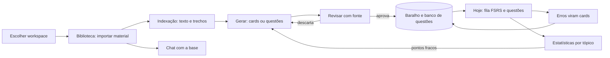

# Design — mind-study-tool

## 1.6 Rough mockups

Decisões de UI (confirmadas): [src: Q13–Q16]
- Barra lateral com seções fixas **e seletor de workspace** no topo. Workspace = base de conhecimento isolada (ex.: "Biologia", "Cálculo"), com materiais, cards, questões, estatísticas e chat próprios. Não é conta de usuário: multiusuário segue fora do escopo.
- Estudo de flashcards: atalhos de teclado **e** botões clicáveis.
- Revisão de itens gerados: lista com aprovar/editar/descartar ao lado do trecho fonte.
- Tema claro/escuro; o escuro usa a paleta **Dracula**. Minimalista, HTMX + CSS próprio.
- No celular (mesma rede), a barra lateral vira menu inferior.

### Fluxo principal



### Wireframe — Hoje (tela inicial)

```
┌────────────┬──────────────────────────────────────────────┐
│ MIND       │  Hoje                          ⚙  ☾/☀        │
│ [Biologia ▾]│  ──────────────────────────────────────────  │
│            │  Cards vencidos   42     [ Estudar agora ]   │
│ ▸ Hoje     │  Questões sugeridas  10  [ Praticar ]        │
│   Biblioteca│  Meta do dia  ████████░░░░  28/40            │
│   Gerar    │                                              │
│   Estudar  │  Pontos fracos                               │
│   Estatíst.│   • Genética                54%  [Treinar]  │
│   Chat     │   • Ecologia                61%  [Treinar]  │
└────────────┴──────────────────────────────────────────────┘
```

### Wireframe — Biblioteca

```
┌────────────┬──────────────────────────────────────────────┐
│ (sidebar)  │  Biblioteca            [ + Importar ]        │
│            │  Formatos: PDF · PDF escaneado · MD · URL · DOCX │
│            │  ┌────────────────────────────────────────┐  │
│            │  │ aula_03.pdf   120 pág.  indexado  ✓    │  │
│            │  │ resumo.md      12 pág.  indexado  ✓    │  │
│            │  │ scan_lei.pdf   40 pág.  OCR 71%  ⚠ [ver]│ │
│            │  └────────────────────────────────────────┘  │
└────────────┴──────────────────────────────────────────────┘
```

### Wireframe — Gerar e revisar

```
┌────────────┬─────────────────────────────────────────────────────┐
│ (sidebar)  │ Gerar:  (•) Cards  ( ) Questões   Material: aula_03 ▾ │
│            │ Págs 10–25   Qtd [20]   Tipo [Cloze+P/R ▾]  [Gerar]  │
│            │ Custo estimado: US$ 0,02                              │
│            │ ─────────────────────────────────────────────────── │
│            │ Revisar (20)         [Aprovar todos] [Aprovar sel.]   │
│            │ ┌──────────────────────┬────────────────────────┐   │
│            │ │ ☑ P: O que é …?      │ Trecho fonte (p.12):    │   │
│            │ │   R: …               │ "…texto destacado…"     │   │
│            │ │   [Editar] [Descartar]│ aula_03.pdf · pág. 12   │   │
│            │ └──────────────────────┴────────────────────────┘   │
└────────────┴─────────────────────────────────────────────────────┘
```

### Wireframe — Estudar flashcard

```
┌──────────────────────────────────────────────────────────┐
│  Cards: 12/42                          Tópico: Genética    │
│                                                          │
│     Qual o processo biológico que …?                    │
│                                                          │
│              [ Mostrar resposta ]  (Espaço)              │
│  ──────────────────────────────────────────────────────  │
│  (após revelar)  Resposta: …      Fonte: aula_03 p.12    │
│  [1 Errei] [2 Difícil] [3 Bom] [4 Fácil]                 │
└──────────────────────────────────────────────────────────┘
```

### Wireframe — Questão (Certo/Errado e múltipla escolha)

```
┌──────────────────────────────────────────────────────────┐
│  Questão 3/10                         ⏱ 01:12            │
│  "Julgue o item: …"                                      │
│   ( ) Certo   ( ) Errado     [ Responder ]               │
│  (após responder) ✔/✘ Gabarito · Comentário · Fonte      │
│  [ Erro → virar card ]  [ Próxima ]                      │
└──────────────────────────────────────────────────────────┘
```

### Wireframe — Estatísticas e Chat

```
Estatísticas:                         Chat com a base:
 Acerto por tópico  ▇▇▇▇▇▇░░ 78%      Você: o que diz o art. X?
 Retenção (curva)   ╱‾‾‾╲___          IA:  … [fonte: aula_03 p.12]
 Streak: 9 dias  Custo do mês: $1,40  [ Pergunte à base…        ]
```

### Estados a cobrir em 2.5
Vazio (workspace sem material), carregando/gerando (com progresso e custo), erro de chave de API ausente/inválida, OCR de baixa confiança, geração sem itens aprovados, fila do dia vazia.

### Assumptions & open questions
- A8: "Workspace" é uma base isolada dentro de um único usuário local, sem relação com contas; adicionado como S-8 na seção 1.4. (confirmed: yes, pedido do autor)
- A9: Paleta Dracula (#282a36 fundo, #f8f8f2 texto, #bd93f9 destaque) no tema escuro; tema claro a definir em 2.5. (confirmed: no)
- A10: Layout responsivo no celular é desejável mas não verificado como requisito; entra em 2.3 como NFR. (confirmed: no)

## 2.2 Team practices
## 2.6 Domain & components
## 2.7 Units of work
## 2.8 Contracts
