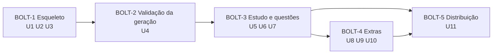

# Tasks — mind-study-tool

## 2.9 Delivery plan

### Comando de verificação (aprovado em 2026-11-14)

```
uv run ruff check . && uv run ruff format --check . && uv run mypy && uv run pytest --cov --cov-fail-under=80
```

- Roda ao fim de cada Unit e no CI (NFR-10). O pytest exclui por padrão os testes marcados `perf` e `real_llm` (rodam sob demanda no gate do bolt correspondente).
- Na UNIT-1 (T-1.1) cria-se a configuração (`pyproject.toml`, `mypy` strict, ruff); antes disso o comando não existe e o primeiro teste da UNIT-1 é a sua própria criação.
- Avaliação de qualidade (SM-1) não faz parte do comando: é um script manual, executado no gate do BOLT-2.

### Walking skeleton
**Sim.** UNIT-1 é o esqueleto: o app sobe em `127.0.0.1`, cria um workspace, abre a tela Hoje com tema e barra lateral e tem CI verde antes de qualquer outra Unit começar.

### Bolts



| Bolt | Units | Meta (Definition of Done) | Hipótese de confiança |
|---|---|---|---|
| BOLT-1 Esqueleto | UNIT-1, UNIT-2, UNIT-3 | App abre no navegador com workspaces e tema; `FakeProvider` e OpenRouter atrás da interface; PDF e Markdown importados e pesquisáveis; CI verde; verificação passa | Alta (≈85%): são peças padrão da stack |
| BOLT-2 Validação da geração | UNIT-4 | Do material ao baralho revisado, com fonte conferida; relatório de descartes; script de SM-1 executado com modelo real em amostra de 3 materiais e resultado registrado | Média (≈60%): ≥90% de aprovação sem edição depende de prompts e modelo. **Ponto de decisão:** se SM-1 < 90%, ajustar prompts, chunking ou modelo antes de abrir o BOLT-3 |
| BOLT-3 Estudo e questões | UNIT-5, UNIT-6, UNIT-7 | Fila FSRS, questões verificadas, caderno de erros e estatísticas; estudo funciona offline; telas respondem em < 300 ms | Alta (≈80%) |
| BOLT-4 Extras | UNIT-8, UNIT-9, UNIT-10 | OCR, URL, DOCX, treino de pontos fracos e chat com a base; embeddings opcionais | Média (≈65%): OCR e embeddings dependem do ambiente. **Cortável** na ordem UNIT-10, UNIT-9, UNIT-8 (A28) |
| BOLT-5 Distribuição | UNIT-11 | Backup e restauração, README, instalação limpa em duas plataformas, licenças revisadas | Média (≈70%): instalação multiplataforma tende a revelar surpresas |

### Dependências externas

| Dependência | Para quê | Risco e tratamento |
|---|---|---|
| Chave do OpenRouter e rede | SM-1, testes `real_llm` | Só no gate do BOLT-2 e nos scripts opcionais; o CI não usa |
| Tesseract no sistema | UNIT-8 | Ausência tratada com `OCR_UNAVAILABLE`; testes reais marcados e opcionais |
| PyMuPDF | UNIT-3 | **Licença AGPL-3.0:** afeta a licença do MIND ao publicar. Ver A34 |
| py-fsrs, sentence-transformers, sqlite-vec, trafilatura, python-docx | UNIT-5, 8, 10 | Fixadas no `uv.lock`; verificar licenças em T-11.5 |
| Fontes Inter e JetBrains Mono, KaTeX | UNIT-1 | Licenças livres (OFL, MIT); confirmar em T-11.5 (A21) |
| GitHub Actions | CI | Disponível; workflow criado em T-1.2 |

### Assumptions & open questions
- A34: PyMuPDF é AGPL-3.0. Se o MIND usar PyMuPDF, o projeto publicado deve ser compatível com AGPL (a licença escolhida vira AGPL-3.0 ou o extrator troca para `pypdf`/`pdfminer.six`, permissivos, com perda de velocidade e qualidade). Decisão do autor em 2026-11-14: **MIND em AGPL-3.0 e uso de PyMuPDF**. (confirmed: yes)
- A35: As tarefas estimam cerca de 1 hora cada; algumas (marcadas com ≈2 h) podem ser divididas na execução sem alterar o plano. (confirmed: no)
- A36: Testes `perf` e `real_llm` ficam fora do comando de verificação por serem lentos, dependentes de ambiente ou pagos; seus resultados entram nos gates de bolt. (confirmed: no)

## Tasks

Convenção: `T-<unit>.<n>` · IDs servidos · teste nomeado. Todos os testes que envolvem LLM usam o `FakeProvider`.

### UNIT-1 Fundação e workspaces — Status: pending
- [x] T-1.1 Criar o projeto com uv: `pyproject.toml`, pacote `src/mind`, `tests/`, ruff, mypy strict e pytest-cov (≥80%). · NFR-10 · teste: `tests/test_smoke.py` e o comando de verificação passando · files: pyproject.toml, uv.lock, .python-version, src/mind/__init__.py, tests/test_smoke.py, README.md
- [x] T-1.2 Workflow de CI no GitHub Actions com o comando de verificação. · NFR-10 · teste: execução do workflow verde após o push · files: .github/workflows/ci.yml (execução remota só após o push final; ver nota)
- [x] T-1.3 Configuração por ambiente (`MIND_DATA_DIR`, `MIND_HOST`, `MIND_PORT`, `MIND_LOG_LEVEL`) com `platformdirs` e padrão `127.0.0.1`. · NFR-7 · teste: `tests/test_config.py` (padrões e sobreposição) · files: src/mind/config.py, tests/test_config.py
- [x] T-1.4 Banco global `app.db` com SQLAlchemy 2 tipado e Alembic; tabela `workspace`. · NFR-12 · teste: `tests/db/test_migrations_app.py` (banco novo e a partir de revisão anterior) · files: src/mind/db/{base,app_models,migrate}.py, src/mind/db/migrations/{_env.py,app/}, tests/test_db_app.py
- [x] T-1.5 `WorkspaceRegistry`: criar, listar, renomear, excluir; cria `workspace.db` (Alembic próprio) e `files/`. · FR-1, US-1 · teste: `tests/workspaces/test_registry.py` (isolamento entre dois workspaces; exclusão remove só o do workspace) · files: src/mind/workspaces/registry.py, src/mind/db/migrations/workspace/, tests/test_workspace_registry.py
- [x] T-1.6 `JobQueue` base: asyncio, tabela `job`, estados, cancelamento; reinício marca `running` como `failed` com `INTERRUPTED`. · NFR-3 · teste: `tests/jobs/test_queue.py` · files: src/mind/jobs/{store,queue}.py, src/mind/workspaces/registry.py, tests/test_jobs.py
- [x] T-1.7 App FastAPI + Jinja + HTMX: layout, barra lateral, seletor de workspace, rota Hoje vazia, bind em `127.0.0.1`. · FR-1, US-1, NFR-7 · teste: `tests/web/test_shell.py` · files: src/mind/web/{__init__,app,strings}.py, src/mind/web/templates/, tests/conftest.py, tests/web/test_shell.py
- [x] T-1.8 Tokens Dracula/Alucard, Inter e JetBrains Mono empacotadas com ligaduras, alternância de tema (sistema e manual). · NFR-11, US-17 · teste: `tests/web/test_theme_contrast.py` (contraste ≥ 4,5:1 para os pares de tokens) · files: src/mind/web/static/{app.css,theme.js}, tests/web/test_theme_contrast.py
- [x] T-1.9 KaTeX empacotado e `render_math` com fallback para texto bruto. · FR-23, US-17, NFR-5 · teste: `tests/web/test_math.py` (delimitadores, escape) + verificação manual no navegador de fórmula válida e inválida, registrada no gate · files: src/mind/web/{math.py,static/math.js}, tests/web/test_math.py (browser check of valid/invalid formulas pending, see unit summary)
- [ ] T-1.10 `/api/v1`: roteador, OpenAPI em `/api/docs`, manipulador `problem+json`, recursos `workspaces` e `jobs`. · FR-24, US-18 · teste: `tests/api/test_workspaces_contract.py` (snapshot do OpenAPI; `WORKSPACE_NOT_FOUND` em `problem+json`)
- [ ] T-1.11 Textos da interface em pt-BR, rótulos e foco por teclado (link de salto, foco visível). · NFR-11, NFR-13 · teste: `tests/web/test_a11y_basics.py`
- [ ] T-1.12 Teste ponta a ponta do esqueleto: sobe o app, cria workspace, abre Hoje. · FR-1, US-1 · teste: `tests/e2e/test_walking_skeleton.py`

### UNIT-2 Provedor LLM, configurações e custo — Status: pending
- [ ] T-2.1 `Provider` (Protocol), `Message`, `Usage` e `FakeProvider` com cenários. · FR-19 · teste: `tests/llm/test_fake_provider.py`
- [ ] T-2.2 `OpenRouterProvider` (httpx): modo estruturado com fallback de parse, até 2 repetições, `ProviderError`, uso de tokens. ≈2 h · FR-19 · teste: `tests/llm/test_openrouter.py` com transporte HTTP simulado (sucesso, JSON inválido que repete, falha final)
- [ ] T-2.3 `SettingsService`: provedor, modelos de geração e de juiz; chave só de ambiente/`.env`; nenhum campo de chave no GET/PATCH. · FR-19, NFR-7 · teste: `tests/settings/test_settings.py`
- [ ] T-2.4 Filtro de redação de segredos nos logs. · NFR-7 · teste: `tests/settings/test_log_redaction.py`
- [ ] T-2.5 `ConsentService` e guarda que bloqueia envio sem aceite (`CONSENT_REQUIRED`). · FR-20, US-13, NFR-6 · teste: `tests/llm/test_consent_guard.py` (sem aceite, nenhuma chamada sai)
- [ ] T-2.6 `CostLedger`: registro por chamada, estimativa antes de gerar, soma mensal, limite com `MONTHLY_LIMIT_REACHED`. · FR-21, US-14 · teste: `tests/llm/test_cost_ledger.py`
- [ ] T-2.7 Tela Configurações e passos 1–2 do assistente de primeiro uso. · FR-19, FR-20, US-13 · teste: `tests/web/test_settings_pages.py`
- [ ] T-2.8 API `settings`, `consent`, `costs`, `costs/estimate`. · FR-24 · teste: `tests/api/test_settings_contract.py` (a chave nunca é devolvida)

### UNIT-3 Ingestão de PDF/Markdown, busca e biblioteca — Status: pending
- [ ] T-3.1 Modelos `material` e `chunk`, migração do `workspace.db` e tabela virtual FTS5. · FR-5 · teste: `tests/db/test_migrations_workspace.py`
- [ ] T-3.2 `PdfExtractor` (PyMuPDF; ver A34): texto por página; PDF corrompido gera `EXTRACTION_FAILED`. · FR-2 · teste: `tests/ingestion/test_pdf.py`
- [ ] T-3.3 Extratores de Markdown e texto. · FR-2 · teste: `tests/ingestion/test_text.py`
- [ ] T-3.4 `Chunker` por seção e página com metadados (arquivo, página, seção) e tamanho-alvo. · FR-5 · teste: `tests/ingestion/test_chunker.py`
- [ ] T-3.5 `Retriever` (Protocol) com BM25 via FTS5, filtros por material e intervalo de páginas. · FR-5, US-2 · teste: `tests/retrieval/test_bm25.py`
- [ ] T-3.6 Job de importação com progresso (extrair, dividir, indexar) e falha legível. · FR-2, US-2 · teste: `tests/ingestion/test_import_job.py`
- [ ] T-3.7 Tela Biblioteca: lista, status, prévia do texto, importar, excluir. · US-2 · teste: `tests/web/test_library.py`
- [ ] T-3.8 API `materials`, `chunks`, `search`. · FR-24 · teste: `tests/api/test_materials_contract.py`
- [ ] T-3.9 Medição de desempenho: PDF de 100 páginas em < 60 s e ≤ 4 GB. · NFR-1, NFR-4 · teste: `tests/perf/test_import_100_pages.py` (marcador `perf`)

### UNIT-4 Flashcards com fonte e revisão — Status: pending
- [ ] T-4.1 Modelos `item`, `topic`, `generation_run` e migração. · FR-6 · teste: `tests/db/test_items_migration.py`
- [ ] T-4.2 Prompts e esquema `CardBatch` para P/R, cloze, comparativo e V/F, com orientação de LaTeX. ≈2 h · FR-6, FR-23 · teste: `tests/generation/test_card_prompts.py`
- [ ] T-4.3 `SourceChecker`: citação como substring normalizada (espaços, quebras, hifenização). · FR-7 · teste: `tests/verification/test_source_checker.py`
- [ ] T-4.4 `CardGenerator`: seleciona trechos por material e intervalo, gera em lotes, descarta sem fonte e produz o relatório. ≈2 h · FR-6, FR-7 · teste: `tests/generation/test_card_generator.py` (item inventado é descartado e contado)
- [ ] T-4.5 Job de geração: estimativa de custo antes, registro no `CostLedger`, progresso e cancelamento. · FR-6, FR-21, US-4 · teste: `tests/generation/test_generation_job.py`
- [ ] T-4.6 `ReviewService`: aprovar, editar, descartar, em lote; só aprovados entram no baralho. · FR-8, US-5 · teste: `tests/review/test_review_service.py` (15 aprovados, 5 descartados)
- [ ] T-4.7 Tela Gerar: material, intervalo, tipo, quantidade, custo, progresso, cancelar. · FR-6, US-4 · teste: `tests/web/test_generate_page.py`
- [ ] T-4.8 Tela Revisão: item ao lado do trecho com a citação destacada, lote, relatório de descartes. ≈2 h · FR-8, US-5 · teste: `tests/web/test_review_page.py`
- [ ] T-4.9 API `generations` e `items` (`:review`). · FR-24 · teste: `tests/api/test_generation_contract.py`
- [ ] T-4.10 Script de avaliação de SM-1: amostra fixa, relatório de taxa de aprovação sem edição. · NFR-8 · teste: `tests/eval/test_sm1_script.py` com `FakeProvider`; execução real (`real_llm`) no gate do BOLT-2
- [ ] T-4.11 Desempenho: 20 itens em < 60 s com latência controlada, sem travar a UI. · NFR-2 · teste: `tests/perf/test_generation_latency.py` (marcador `perf`)

### UNIT-5 Estudo com FSRS e Hoje — Status: pending
- [ ] T-5.1 Modelos `card_state` e `review_log` e migração. · FR-12 · teste: `tests/db/test_study_migration.py`
- [ ] T-5.2 `Scheduler` com py-fsrs atrás de interface. · FR-12 · teste: `tests/study/test_scheduler.py` ("Bom" avança o vencimento; "Errei" o reduz)
- [ ] T-5.3 `StudyService`: fila do dia, avaliação, desfazer. · FR-12, FR-13 · teste: `tests/study/test_study_service.py`
- [ ] T-5.4 Tela Estudar: revelar, avaliar com 1–4, intervalo previsto por botão, atalhos e botões. ≈2 h · FR-13, US-7 · teste: `tests/web/test_study_page.py` (atalho e botão produzem o mesmo efeito) + verificação manual do teclado
- [ ] T-5.5 Tela Hoje (fila, meta, estados vazios) e passo 3 do assistente. · US-7 · teste: `tests/web/test_today_page.py`
- [ ] T-5.6 Estudo sem rede: nenhuma rota de estudo depende do provedor. · NFR-5 · teste: `tests/study/test_offline.py` (provedor que falha)
- [ ] T-5.7 API `study/queue` e `study/reviews`. · FR-24 · teste: `tests/api/test_study_contract.py`
- [ ] T-5.8 Latência p95 < 300 ms nas telas de estudo e navegação. · NFR-3 · teste: `tests/perf/test_ui_latency.py` (marcador `perf`)

### UNIT-6 Questões verificadas — Status: pending
- [ ] T-6.1 Prompts e esquema `QuestionBatch`: Certo/Errado e múltipla escolha de 4 ou 5 alternativas; perfil de prova como enum. · FR-9, FR-11 · teste: `tests/generation/test_question_schema.py` (uma correta, 4–5 opções, resposta existente)
- [ ] T-6.2 `QuestionGenerator` reaproveitando `SourceChecker`. ≈2 h · FR-9, FR-7 · teste: `tests/generation/test_question_generator.py`
- [ ] T-6.3 `Judge` (segunda chamada, modelo configurável) e descarte de gabarito não sustentado. · FR-10 · teste: `tests/verification/test_judge.py`
- [ ] T-6.4 Modelo `attempt`, migração e `StudyService.answer`. · FR-14 · teste: `tests/study/test_attempts.py` (grava resultado e tempo)
- [ ] T-6.5 Tela Questão: cronômetro, correção, comentário por alternativa, fonte. ≈2 h · FR-9, FR-14, US-6, US-8 · teste: `tests/web/test_question_page.py`
- [ ] T-6.6 Revisão passa a aceitar questões. · US-6 · teste: `tests/review/test_review_questions.py`
- [ ] T-6.7 API de geração de questões e `study/attempts`. · FR-24 · teste: `tests/api/test_questions_contract.py`

### UNIT-7 Caderno de erros e estatísticas — Status: pending
- [ ] T-7.1 `ErrorNotebook`: card (`origin=error_note`) a partir de erro de questão e de avaliação "Errei", com tópico e fonte. · FR-15 · teste: `tests/study/test_error_notebook.py`
- [ ] T-7.2 Botão "Virar card" funcional em Questão. · US-9 · teste: `tests/web/test_error_to_card.py`
- [ ] T-7.3 Tópicos: extração pelo LLM na geração e edição manual. · FR-16 · teste: `tests/topics/test_topics.py`
- [ ] T-7.4 `StatsService`: acerto por tópico, retenção, meta diária, sequência. ≈2 h · FR-16 · teste: `tests/stats/test_stats.py` (conjunto de tentativas conhecido)
- [ ] T-7.5 Tela Estatísticas. · US-10 · teste: `tests/web/test_stats_page.py`
- [ ] T-7.6 Meta diária configurável e progresso em Hoje. · US-10 · teste: `tests/web/test_daily_goal.py`
- [ ] T-7.7 API `items/{id}/error-card` e `stats`. · FR-24 · teste: `tests/api/test_stats_contract.py`

### UNIT-8 OCR, URL e DOCX — Status: pending
- [ ] T-8.1 Extrator OCR (Tesseract) com confiança e prévia. ≈2 h · FR-3 · teste: `tests/ingestion/test_ocr.py` (Tesseract simulado; versão real em `tests/ingestion/test_ocr_real.py`, marcador opcional)
- [ ] T-8.2 Detecção de Tesseract ausente (`OCR_UNAVAILABLE`) e mensagem clara. · FR-3, US-3 · teste: `tests/ingestion/test_ocr_missing.py`
- [ ] T-8.3 `UrlExtractor` (httpx + extração do texto principal); só `http`/`https`. · FR-4 · teste: `tests/ingestion/test_url.py` (HTML de amostra; esquema inválido recusado)
- [ ] T-8.4 `DocxExtractor` (python-docx). · FR-4 · teste: `tests/ingestion/test_docx.py`
- [ ] T-8.5 Interface de importação para os novos formatos e alerta de OCR de baixa confiança. · US-3 · teste: `tests/web/test_import_formats.py`
- [ ] T-8.6 API aceita URL e novos arquivos. · FR-24 · teste: `tests/api/test_materials_new_formats.py`

### UNIT-9 Treino de pontos fracos — Status: pending
- [ ] T-9.1 `WeakTopicSelector` com mínimo de tentativas e ordenação por acerto. · FR-17 · teste: `tests/stats/test_weak_topics.py`
- [ ] T-9.2 Recuperação de trechos do tópico e pré-configuração da geração. · FR-17 · teste: `tests/generation/test_weak_topic_generation.py`
- [ ] T-9.3 Atalho "Treinar" em Hoje e Estatísticas. · US-11 · teste: `tests/web/test_train_shortcut.py`
- [ ] T-9.4 API `generations:weak-topics`. · FR-24 · teste: `tests/api/test_weak_topics_contract.py`

### UNIT-10 Chat com a base e embeddings opcionais — Status: pending
- [ ] T-10.1 `ChatService`: recupera trechos, responde com citações e recusa sem suporte. ≈2 h · FR-18, US-12 · teste: `tests/chat/test_chat_service.py`
- [ ] T-10.2 Tela Chat com citações clicáveis que abrem o trecho. · US-12 · teste: `tests/web/test_chat_page.py`
- [ ] T-10.3 `EmbeddingRetriever` opcional (extra `mind[embeddings]`, sqlite-vec) e fusão por RRF com o BM25. ≈2 h · FR-18 · teste: `tests/retrieval/test_embeddings.py` (embeddings falsos; ignorado se o extra não estiver instalado)
- [ ] T-10.4 Degradação para BM25 quando o extra não está instalado. · FR-18 · teste: `tests/retrieval/test_no_extra.py`
- [ ] T-10.5 API `chat`. · FR-24 · teste: `tests/api/test_chat_contract.py`

### UNIT-11 Backup e distribuição — Status: pending
- [ ] T-11.1 `WorkspaceArchive`: exportar e importar `.zip` com `manifest.json`; recusa e migra versões. ≈2 h · FR-22, US-15 · teste: `tests/workspaces/test_archive.py` (ida e volta; `ARCHIVE_INCOMPATIBLE`)
- [ ] T-11.2 Interface e API de backup. · FR-22, FR-24, US-15 · teste: `tests/api/test_backup_contract.py`
- [ ] T-11.3 README em pt-BR, `.env.example`, instruções com `uv`/`uvx` e Tesseract; aviso sobre a API sem autenticação. · NFR-9, US-16 · teste: revisão por lista de conferência registrada no gate
- [ ] T-11.4 Dockerfile opcional com Tesseract. · NFR-9 · teste: build da imagem e execução do `/api/docs`
- [ ] T-11.5 Revisão de licenças (fontes, KaTeX, dependências, A34), `LICENSE` e `NOTICE`. · A21, A34 · teste: lista de conferência registrada
- [ ] T-11.6 Material de amostra para o primeiro baralho. · US-16 · teste: `tests/e2e/test_sample_deck.py` com `FakeProvider`
- [ ] T-11.7 Instalação limpa em Linux e em uma segunda plataforma. · SM-3, NFR-9 · teste: execução manual registrada em `construction/`

### Cobertura de tarefas (rastreabilidade)

Todas as Units têm tarefas e cada tarefa nomeia o ID que atende e o teste. Cobertura de FR por tarefas: FR-1 (T-1.5, 1.7), FR-2 (T-3.2, 3.3, 3.6), FR-3 (T-8.1, 8.2), FR-4 (T-8.3, 8.4), FR-5 (T-3.4, 3.5), FR-6 (T-4.2, 4.4, 4.5, 4.7), FR-7 (T-4.3, 4.4), FR-8 (T-4.6, 4.8), FR-9 (T-6.1, 6.2, 6.5), FR-10 (T-6.3), FR-11 (T-6.1), FR-12 (T-5.2, 5.3), FR-13 (T-5.3, 5.4), FR-14 (T-6.4, 6.5), FR-15 (T-7.1), FR-16 (T-7.3, 7.4), FR-17 (T-9.1, 9.2), FR-18 (T-10.1, 10.3), FR-19 (T-2.1 a 2.3), FR-20 (T-2.5), FR-21 (T-2.6, 4.5), FR-22 (T-11.1), FR-23 (T-1.9, 4.2), FR-24 (T-1.10 e as tarefas de API de cada Unit). Cada NFR aparece no DoD de sua Unit (2.7), e os de desempenho têm tarefa própria (T-3.9, T-4.11, T-5.8).
