# Design — study-time-pdf-viewer

## 1.6 Rough mockups

Wireframes de baixa fidelidade, no padrão atual (barra lateral, cartões, barra de status). Nomes e textos são provisórios; os refinados vêm em 2.5. [src: FR provisórios de 1.4]

### Fluxo

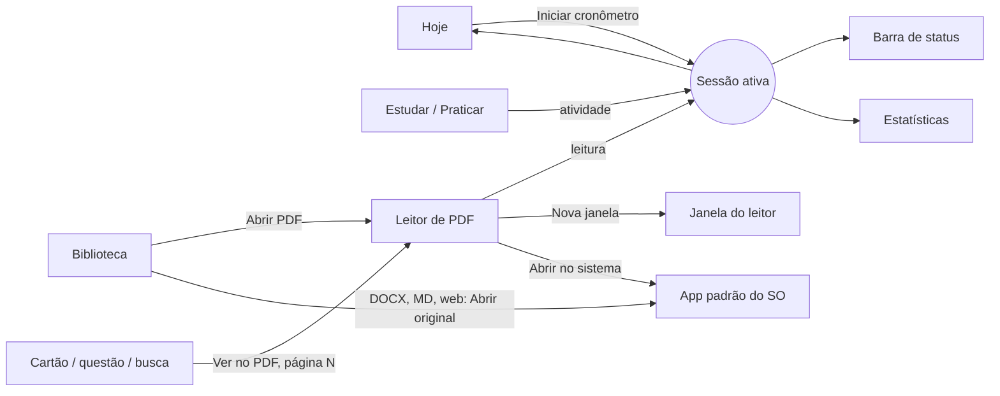

### M1 — Hoje com tempo de estudo

```text
+------------------------------------------------------------+
| Hoje                                   [ Estudar agora (12) ]|
| +----------+ +----------+ +----------+ +----------+        |
| | 8 vencem | | 3 apren. | | 5 novos  | | 20 feitos|        |
| +----------+ +----------+ +----------+ +----------+        |
| +--------------------------------------------------------+ |
| | Tempo de estudo hoje        01:12:40   Meta: 02:00     | |
| | [#################------------]  60%                   | |
| | [ Iniciar cronômetro ]  (auto: ligado)   Sessões: 4    | |
| +--------------------------------------------------------+ |
| Tópicos mais fracos ...                                    |
+------------------------------------------------------------+
```

### M2 — Barra de status com cronômetro ativo

```text
v0.1.0 | Provedor ok |  (o) 00:23:15  Álgebra  [ || ] [ ■ ]  ........ Tema  Ctrl+K
                         ^ pulsa quando contando; cinza quando pausado por ociosidade
```

### M3 — Estatísticas: tempo

```text
+------------------------------------------------------------+
| Estatísticas      [ Retenção | Tópicos | Tempo ]           |
| Período: [7 dias v]   Total: 9 h 40 min   Média/dia: 1 h 23|
|  min                                                       |
|  120 |        ##                                           |
|   90 |  ##    ##       ##                                  |
|   60 |  ## ## ##    ## ##                                  |
|      +--seg-ter-qua-qui-sex-sab-dom--                      |
| Por tópico:  Álgebra 3h10 | Probabilidade 2h05 | ...  |
| Por material: Apostila.pdf 4h20 | ...                      |
+------------------------------------------------------------+
```

### M4 — Biblioteca com ações de abrir

```text
| Nome          | Tipo | Págs | Status   | Ações                     |
| Apostila.pdf  | pdf  | 212  | indexado | [Ler] [Nova janela] [Sist]|
| Resumo.docx   | docx |  14  | indexado | [Prévia] [Abrir original] |
| Notas.md      | md   |   -  | indexado | [Prévia] [Abrir original] |
```

### M5 — Leitor de PDF (janela do app e janela separada)

```text
+------------------------------------------------------------+
| < Biblioteca   Apostila.pdf            [Nova janela][Sistema]|
| [<] [ 37 ] / 212 [>]   [-] 120% [+]  [Ajustar]  [Buscar... ]|
| +---------------------+  +-----------------------------+   |
| | miniaturas / índice |  |                             |   |
| |  1                  |  |   página renderizada        |   |
| | >37                 |  |   (texto selecionável)      |   |
| |  38                 |  |                             |   |
| +---------------------+  +-----------------------------+   |
|  (o) lendo 00:04:10 neste material                         |
+------------------------------------------------------------+
```

### M6 — Abrir na página citada

```text
Cartão: "O que é ...?"          Fonte: Apostila.pdf, p. 37
                                [ Ver no PDF ]  --> abre o leitor em 37,
                                                    destacando o trecho citado (se possível)
```

### Estados e vazios

- Sem sessões hoje: "Nenhum tempo registrado hoje" e botão Iniciar.
- Sessão pausada por ociosidade: ícone cinza e texto "pausado (sem atividade)"; volta ao interagir.
- PDF ausente ou corrompido: mensagem com botão "Abrir pasta do arquivo" desativado e opção de reimportar.
- PDF protegido por senha: aviso; sem leitor, só "Abrir no sistema".

### Assumptions & open questions

- A6 (1.6): Miniaturas/índice lateral do leitor são desejáveis, mas podem ficar para depois se encarecerem o MVP. — confirmed: no
- A7 (1.6): Destacar o trecho citado dentro da página é "se possível"; o mínimo é abrir na página certa. — confirmed: no
## 2.1 Codebase analysis

Codekb atualizado em 2026-11-14 (commit 101d3e6): `.aidlc/codekb/MIND/` (a versão Python anterior está em `archive/codekb-python/`). Arquitetura e modelo de dados confirmados pelo autor; as demais áreas estão em rascunho.

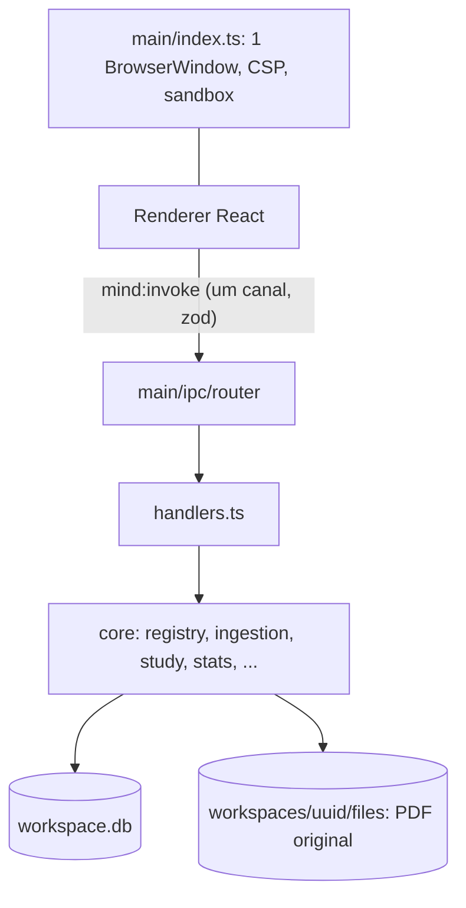

**O que importa para este intent.**

- O PDF original já está em `workspaces/<uuid>/files/` (`material.stored_path`) e já entra no backup; hoje a janela só vê os chunks de texto (`material:chunks`). [src: workspace-schema.ts; MaterialPreviewPage.tsx]
- Não há tabela de sessões de estudo; só `review_log.duration_ms` e `attempt.seconds` por item. `material` não tem `topic_id`; tópico vem de `item`. [src: workspace-schema.ts]
- O app tem uma só `BrowserWindow`, com `setWindowOpenHandler` negando janelas novas, CSP sem `blob:` e canal IPC único validado com zod; ver restrições C-1 e C-3. [src: index.ts:56; security.ts]
- A meta diária atual é em cartões (`study settings.dailyGoal`); a nova meta de tempo precisa conviver com ela. [src: TodayPage.tsx]
- Estatísticas têm `StatsPage`, `stats:overview` e `WeakTopics`; Hoje tem `today:summary` e `study:today`. [src: src/core/stats; src/core/today]
- `mupdf` já está no projeto (extração e render para OCR em worker). [src: src/core/ingestion/pdf.ts]

**Baseline.** lint, format, typecheck e testes verdes: 66 arquivos, 614 testes, linhas 95,52% (limite 80%). e2e não rodado.

### Assumptions & open questions

- A8 (2.1): As regras de convenção marcadas [inferred] em `codekb/MIND/conventions.md` valem para este intent. — confirmed: no
## 2.2 Team practices

Levantadas do repositório e afirmadas pelo autor em 2026-11-14.

| Prática | Evidência | Afirmada? |
|---|---|---|
| Testes unitários ao lado do código (Vitest + Testing Library), LLM sempre mockado, cobertura mínima 80% | `vitest.config.ts`; 66 arquivos de teste | sim |
| Fluxos de UI cobertos por e2e Playwright dirigindo o Electron (CI com `xvfb`) | `tests/e2e`; `.github/workflows/ci.yml` | sim (rodado ao fim de cada bolt, fora do comando de verificação) |
| Cabeçalho `Filename/Created on/Author` em todo arquivo novo; textos da UI em pt-BR; código em inglês | `scripts/check-headers.mjs`; `strings.ts` | sim |
| Commits convencionais, atômicos, na `main`, sem push | `git log`; [mem: M-7] | não reafirmada para este intent; política de commits decidida em 2.9 |
| Verificação local: `pnpm lint && pnpm format:check && pnpm typecheck && pnpm test --coverage` | `package.json`; CI | herdada (confirmada em 2.9) |
| Construção **autônoma até o fim**: paro só em falha ou ação irreversível | resposta do autor | sim |

As práticas afirmadas já constam de [mem: M-4, M-5, M-8]; nada novo vai para `.aidlc/memory/`.

### Assumptions & open questions

- A9 (2.2): "Autônomo até o fim" não dispensa os gates de Inception; vale só na Construction. — confirmed: no
## 2.5 Refined mockups

Refinam M1–M6 de 1.6 usando os componentes e tokens existentes (cartões `.card`, `.stat`, `progress.goal-bar`, `.btn`, `.pill`, tema claro/escuro, ícones lucide, gráficos Recharts já usados em Estatísticas). Textos em pt-BR vão em `strings.ts`. [src: src/renderer/src/styles; pages/StatsPage.tsx; FR-7, FR-8, FR-10, FR-15..22]

### R1 — Hoje (US-4, FR-7, FR-9)

Novo cartão "Tempo de estudo" entre as métricas e "Meta diária" de cartões, que permanece.

```text
+-- Tempo de estudo -------------------------------------------+
| 01:12:40                          Meta: 60 min  [Editar]     |
| [###########################--------]  121%  (barra cheia em verde)|
| Hoje: 4 sessões · cartões 38 min · prática 14 min · leitura 20 min |
| [ ▶ Iniciar cronômetro ]  Tópico: [Nenhum v]   Auto: ligado   |
+--------------------------------------------------------------+
```

- Sessão ativa: o botão vira `⏸ Pausar` e `■ Encerrar`; o tempo atualiza a cada segundo (`aria-live="off"` no contador; resumo falado só ao pausar/encerrar).
- Sem tempo hoje: "Nenhum tempo registrado hoje" + botão iniciar.
- Meta atingida: barra preenchida e texto "Meta do dia cumprida"; sem meta definida (valor 0): a barra some e fica o link "Definir meta".

### R2 — Barra de status (US-5, FR-8)

```text
v0.1.0 · Provedor ok · ● 00:23:15 · tópico T · [⏸] [■]            Tema · Ctrl+S
```

- Ponto verde pulsante = contando; cinza + texto "pausado" = ocioso, sem foco ou pausado a mão; o texto acompanha a cor (NFR-6).
- Clicar no tempo leva a Hoje; sem sessão, nada aparece.

### R3 — Estatísticas > Tempo (US-6, FR-10, FR-14)

Nova aba "Tempo" ao lado das atuais, com seletor de período (7 / 30 dias).

- Cartões: Total no período, Média por dia, Melhor dia.
- Gráfico de barras por dia (Recharts `BarChart`, barras empilhadas por origem: cartões, prática, leitura, manual; legenda com texto).
- Tabelas "Por tópico" e "Por material" (nome, tempo, % do total); itens sem tópico aparecem como "Sem tópico".
- Lista "Sessões recentes" (início, duração, origem, tópico/material) com `Excluir` e confirmação (FR-14, Could).
- Vazio: "Ainda não há tempo registrado neste período".

### R4 — Biblioteca (US-8, US-10, US-11)

Coluna de ações por material, por tipo:

| Tipo | Ações |
|---|---|
| PDF indexado | **Ler** (primário), Nova janela, Abrir no sistema, Prévia do texto, Excluir |
| DOCX, MD, texto, web | Prévia do texto, **Abrir original** (sistema), Excluir |
| Importando ou com erro | só Excluir; "Ler" desativado até indexar |

- Ícones lucide com `aria-label`; botões icon-only têm `title`.
- Falha ao abrir (arquivo ausente) mostra alerta no topo da página com "Reimportar".

### R5 — Leitor de PDF (US-8, US-9, FR-15..18, FR-24)

Rota nova `/w/:id/library/:materialId/read?page=N` na janela principal; a mesma rota abre na janela separada, sem barra lateral.

```text
+--------------------------------------------------------------+
| ← Biblioteca   Apostila.pdf          [↗ Nova janela] [Sistema]|
| [‹] [ 37 ] / 212 [›]  [−] 120% [+] [Largura]   [🔍 Buscar…]   |
| +------------+  +------------------------------------------+ |
| | Páginas    |  |  página renderizada com camada de texto  | |
| | ▸ 36       |  |  (selecionável)                          | |
| | ▸ 37 (atual)|  |                                         | |
| +------------+  +------------------------------------------+ |
| ● lendo 00:04:10 neste material                    p. 37/212 |
+--------------------------------------------------------------+
```

- Teclado: `←/→` ou `PgUp/PgDn` mudam de página; `Ctrl+F` foca a busca; `Enter`/`Shift+Enter` próximo/anterior; `Ctrl+=`/`Ctrl+-`/`Ctrl+0` zoom; `Ctrl+C` copia a seleção.
- Barra de busca mostra "3 de 12 ocorrências"; ocorrência atual realçada na página.
- Painel de páginas à esquerda é o **mínimo** (lista de números; miniaturas só depois, A6).
- Carregando: esqueleto na área da página e "Abrindo…"; erro: alerta com causa (ausente, corrompido, senha) e botões "Abrir no sistema" e "Reimportar".
- Página citada: faixa amarela sobre o trecho (quando localizado) e rótulo "Trecho citado" para leitores de tela.

### R6 — Ver no PDF (US-12, FR-22)

Botão `Ver no PDF` (ícone livro) ao lado de "Fonte: arquivo, p. N" em Revisão, Estudo, Prática, Erros, resultados de busca e citações do Chat; só aparece se o material for PDF e tiver página. Abre o leitor na `source_page` com `?quote=` para o destaque.

### R7 — Configurações (FR-4, FR-9)

Seção "Tempo de estudo": meta diária em minutos (0 a 600, 0 = sem meta), limite de ociosidade em segundos (30 a 600) e interruptor "Contar automaticamente".

### Estados e acessibilidade

- Foco visível padrão (`:focus-visible`), contraste dos tokens atuais, sem dependência só de cor, rótulos `aria-label` nos controles de ícone; o contador não é anunciado a cada segundo.
- Tema claro e escuro herdados dos tokens; o leitor mostra a página sobre fundo neutro e não inverte as cores do PDF.

### Assumptions & open questions

- A17 (2.5): "Contar automaticamente" desligado desativa só a contagem automática; o cronômetro manual continua. — confirmed: no
- A18 (2.5): Meta 0 significa sem meta. — confirmed: no
## 2.6 Domain & components

Todos os componentes ficam nas camadas existentes: regras no `core` (sem Electron), janelas e diálogos no `main`, telas no `renderer`, tudo ligado pelo canal IPC único validado com zod. [mem: M-9; src: codekb/MIND/architecture.md]

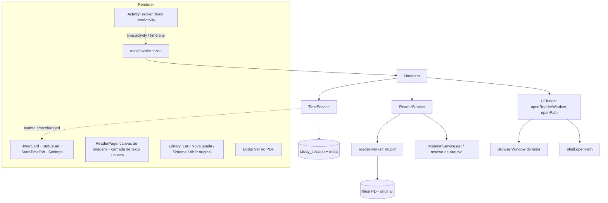

### Componentes

| Componente | Responsabilidade | Interfaces | Dados que possui |
|---|---|---|---|
| `TimeService` (`core/time`) | Máquina de estados da sessão (ociosa, contando, pausada, manual), fecha intervalos, grava a cada ≤ 30 s, calcula resumos e estatísticas; relógio injetável | `start/pause/resume/stop`, `activity`, `blur`, `summary(dia)`, `stats(período)`, `deleteSession`, `settings` | tabela `study_session`; chaves `time.*` em `meta` |
| `ActivityTracker` (`renderer/hooks`) | Detecta interação (teclado, mouse, rolagem) e foco da janela; envia pings com a origem (cartões, prática, leitura) e o contexto (item, material) | `useActivity(source, context)` | nenhum |
| `ReaderService` (`core/reader`) | Abre o PDF de um material com checagem de caminho; devolve metadados, página como PNG, texto posicionado e resultados de busca; guarda cache pequeno de páginas | `info`, `page`, `text`, `search` | cache em memória |
| Reader worker (`core/reader/reader.worker.ts`) | Mantém o documento mupdf aberto fora da thread principal | mensagens do worker (padrão de `pdf.worker.ts`) | documento aberto, LRU de documentos |
| `UiBridge` (estendido) | `openReaderWindow(workspaceId, materialId, page)` e `openPath(caminho resolvido)`; não aceita caminho vindo do renderer | métodos no `main` | janelas do leitor abertas |
| Telas | `TimerCard`, `StatusBar` (timer), `StatsPage` aba Tempo, `ReaderPage`, ações da Biblioteca, `SeeInPdfButton`, seção em Configurações | `useInvoke`, `useActivity` | estado de UI |

### Modelo de dados (migração `workspace/0003`)

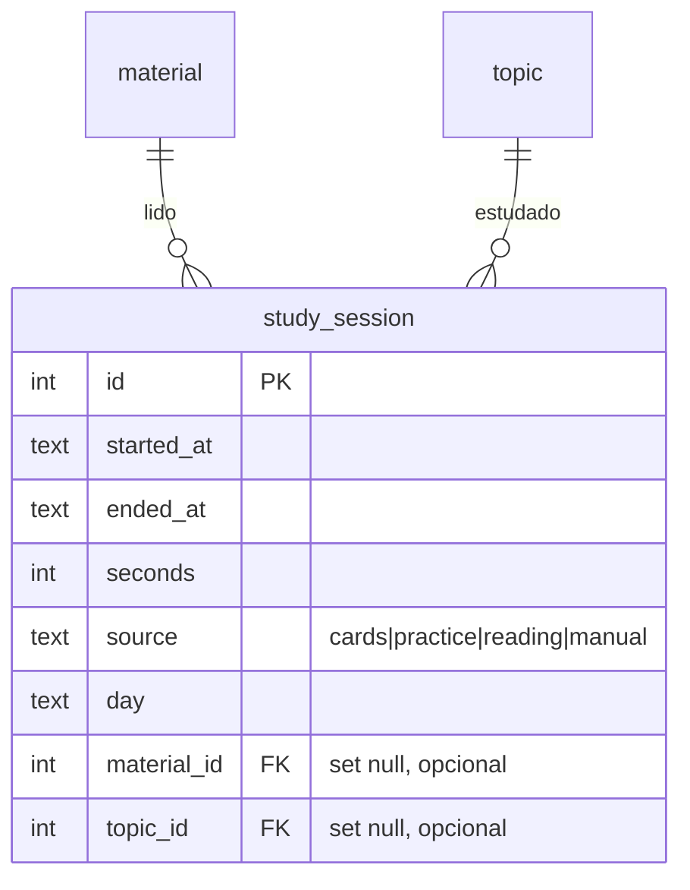

`seconds` é a soma do intervalo ativo (sem ociosidade); `day` segue a mesma regra de `review_log.day`. Índices em `day` e `(source)`. Configurações em `meta`: `time.dailyGoalMin` (60), `time.idleSeconds` (120), `time.autoEnabled` (1). A sessão aberta é gravada com `ended_at` parcial a cada 30 s e fechada ao encerrar.

### Decisões (ADRs)

**ADR-1 — Motor do leitor: `mupdf` no núcleo, sem pdf.js.** *Contexto:* o renderer não pode receber os bytes do PDF sem relaxar M-9 e a CSP (sem `blob:`), e `mupdf` já está no projeto. *Decisão:* o worker renderiza a página com `toPixmap` em PNG (data URL, permitido por `img-src data:`), o texto vem de `toStructuredText` com caixas de cada linha/trecho e a busca de `page.search`; a UI desenha a imagem e uma camada de texto transparente para seleção e cópia. *Alternativas:* pdf.js no renderer (nova dependência grande, worker/WASM sob CSP, bytes por IPC); mupdf WASM no renderer (exige `wasm-unsafe-eval`). *Consequências:* CSP e dependências ficam iguais; a seleção é um pouco menos refinada; renderizamos sob demanda e cacheamos. [src: Q-ADR1; FR-15..18; NFR-2, NFR-3, NFR-9; mem: M-6, M-9]

**ADR-2 — Tempo medido no núcleo, guiado por pings do renderer.** *Decisão:* o renderer envia `time:activity` (no máximo 1 a cada 5 s, só com interação) e `time:blur`; o `TimeService` fecha o intervalo na última atividade se passar o limite de ociosidade, sem contar a espera. Várias janelas enviam ao mesmo serviço (uma sessão ativa, FR-5). *Alternativas:* contar no renderer (perde dados ao fechar), usar ociosidade do sistema (`powerMonitor`, mede o computador e não o app). *Consequências:* testável com relógio simulado; perda máxima de 60 s se travar (gravação a cada 30 s). [src: FR-3..6; NFR-1, NFR-7]

**ADR-3 — Sessões em tabela própria `study_session`.** *Alternativa:* reaproveitar `review_log.duration_ms` e `attempt.seconds`, que são por item e não cobrem leitura nem manual. *Consequência:* migração aditiva (`0003`), entra no backup junto do banco e backups antigos continuam válidos. [src: FR-1, FR-11; NFR-8]

**ADR-4 — Janela do leitor: segunda `BrowserWindow` com o mesmo bundle e a rota do leitor.** O renderer pede `reader:openWindow`; o `main` cria a janela com as mesmas `secureWebPreferences`, no máximo uma por material (reutiliza e foca). `setWindowOpenHandler` segue negando `window.open`. *Consequência:* o estado do leitor (página, zoom) é por janela; o tempo conta uma vez (ADR-2). [src: FR-19; A14; mem: M-9]

**ADR-5 — Abrir no sistema por identificador, nunca por caminho.** `reader:openExternal` e `material:openOriginal` recebem `workspaceId` e `materialId`; o `core` resolve o caminho dentro do workspace (rejeita `..` e absolutos) e o `main` chama `shell.openPath`. Materiais web sem arquivo salvo não mostram "Abrir original". [src: FR-20, FR-21; NFR-4; A13]

**ADR-6 — Renderização sob demanda e cache.** O leitor pede a página visível e as vizinhas na escala atual × `devicePixelRatio`, com teto de pixels por página e cache LRU de poucas páginas; o documento fica aberto no worker enquanto o leitor existir. [src: NFR-2]

### Assumptions & open questions

- A19 (2.6): A camada de texto usa as caixas por trecho do `mupdf`, suficiente para selecionar e copiar frases; seleção caractere a caractere perfeita não é requisito. — confirmed: no (validar no spike da primeira Unit)
- A20 (2.6): A CSP atual permite `data:` em `img-src` e basta; sem mudança. — confirmed: yes (código)
## 2.7 Units of work

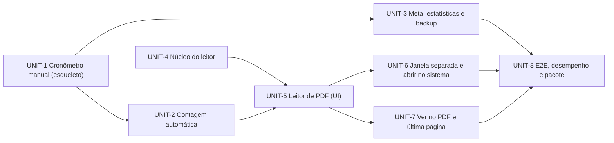

Ordem topológica: UNIT-1, UNIT-4, UNIT-2, UNIT-3, UNIT-5, UNIT-6, UNIT-7, UNIT-8. O **esqueleto ambulante** é a UNIT-1 (menor fatia completa: migração, serviço, canais, cartão em Hoje, barra de status).

| Unit | Propósito e escopo | FR / NFR dono | Histórias | Depende de |
|---|---|---|---|---|
| UNIT-1 | Migração `0003` (`study_session`), `TimeService` com cronômetro manual (iniciar, pausar, retomar, encerrar), gravação a cada 30 s e fecho seguro, canais `time:*`, cartão em Hoje, cronômetro na barra de status | FR-1, FR-2, FR-6, FR-7, FR-8, FR-12; NFR-5, NFR-8 | US-1, US-5 | n/a |
| UNIT-2 | Contagem automática: `ActivityTracker`, pings, ociosidade e perda de foco, uma sessão ativa, atribuição de tópico/material, ligação em Estudar, Praticar e prévia de texto, interruptor "Contar automaticamente" | FR-3, FR-4, FR-5, FR-13; NFR-1 | US-2, US-3 | UNIT-1 |
| UNIT-3 | Meta diária de minutos e seção de Configurações, barra de progresso em Hoje, aba Estatísticas > Tempo, excluir sessão, sessões no backup e na restauração | FR-9, FR-10, FR-11, FR-14 | US-4, US-6, US-7 | UNIT-1 |
| UNIT-4 | `ReaderService` e worker `mupdf`: metadados, página em PNG, texto posicionado, busca, resolução segura do arquivo, cache | NFR-4 (e base de NFR-2) | n/a (habilitadora) | n/a |
| UNIT-5 | Rota e `ReaderPage`: navegação, zoom, busca, seleção e cópia, erros, ação **Ler** na Biblioteca, contagem de leitura | FR-15, FR-16, FR-17, FR-18, FR-24; NFR-6 | US-8, US-9 | UNIT-4, UNIT-2 |
| UNIT-6 | Janela separada do leitor (`reader:openWindow`, uma por material) e abrir no sistema (PDF) e **Abrir original** (outros formatos) por identificador | FR-19, FR-20, FR-21 | US-10, US-11 | UNIT-5 |
| UNIT-7 | **Ver no PDF** em cartões, questões, erros, busca e chat, com destaque do trecho; lembrar a última página | FR-22, FR-23 | US-12, US-13 | UNIT-5 |
| UNIT-8 | E2E dos fluxos, medições de NFR-2, conferência de CSP e licenças, tamanho do `.deb`, documentação | NFR-2, NFR-3, NFR-9, NFR-10 (verificação) | n/a | UNIT-3, UNIT-6, UNIT-7 |

**Definition of Done (todas as Units).** Código com testes (unidade e, onde há UI, componente), verificação aprovada verde, cobertura ≥ limite, cabeçalhos de arquivo, textos pt-BR em `strings.ts`, NFR-7 (relógio/atividade injetáveis) e NFR-6 nos controles novos, contrato IPC com esquema zod e `CONTRACT_VERSION` ajustado se incompatível.

**Mapa história → Unit.** US-1 U1 · US-2 U2 · US-3 U2 · US-4 U3 · US-5 U1 · US-6 U3 · US-7 U3 · US-8 U5 · US-9 U5 · US-10 U6 · US-11 U6 · US-12 U7 · US-13 U7.

**Cobertura de FR.** FR-1,2,6,7,8,12 U1 · FR-3,4,5,13 U2 · FR-9,10,11,14 U3 · FR-15,16,17,18,24 U5 · FR-19,20,21 U6 · FR-22,23 U7. O FR-7 (tempo de hoje e controle) vem na U1; a barra de meta que o completa em US-4 vem na U3.

**NFR.** NFR-1 U2 · NFR-2 U4/U5 (U8 mede) · NFR-3 U8 (todas respeitam) · NFR-4 U4 · NFR-5 U1 · NFR-6 U1/U5 · NFR-7 todas · NFR-8 U1 · NFR-9 U8 · NFR-10 U8.

### Assumptions & open questions

- A21 (2.7): UNIT-4 pode rodar em paralelo à UNIT-2/3 pela ordem, mas a construção é serial (unit-major). — confirmed: no
## 2.8 Contracts

Mudanças **aditivas** no canal único `mind:invoke`: canais novos e um evento novo; nenhum canal existente muda de forma incompatível, então `CONTRACT_VERSION` continua em 1. Cada canal novo entra em `channel-names.ts` (preload sandbox) e em `channels.ts` com esquemas zod `strict`, e em `handlers.ts`. [src: codekb/MIND/api.md; mem: M-9]

### Canais de tempo (UNIT-1 a UNIT-3)

| Canal | Entrada | Saída | Unit |
|---|---|---|---|
| `time:state` | `{ workspaceId }` | `TimeState` | 1 |
| `time:start` | `{ workspaceId, topicId? }` | `TimeState` | 1 |
| `time:pause` / `time:resume` / `time:stop` | `{ workspaceId }` | `TimeState` | 1 |
| `time:activity` | `{ workspaceId, source: "cards"\|"practice"\|"reading", itemId?, materialId? }` | `{}` | 2 |
| `time:blur` | `{ workspaceId }` | `{}` | 2 |
| `time:getSettings` / `time:saveSettings` | `{}` / `{ dailyGoalMin?, idleSeconds?, autoEnabled? }` | `TimeSettings` | 3 |
| `time:stats` | `{ workspaceId, days: 7\|30 }` | `TimeStats` | 3 |
| `time:sessions` | `{ workspaceId, limit? }` | `{ sessions: SessionInfo[] }` | 3 |
| `time:deleteSession` | `{ workspaceId, id }` | `{}` | 3 |

```ts
// shapes (zod, resumidas)
TimeState = {
  status: "idle" | "running" | "paused",
  mode: "auto" | "manual" | null,
  source: "cards" | "practice" | "reading" | "manual" | null,
  pausedReason: "manual" | "idle" | "blur" | null,
  startedAt: string | null,         // ISO, início do intervalo aberto
  activeSeconds: number,            // da sessão corrente
  topicId: number | null, materialId: number | null,
  todaySeconds: number, goalMinutes: number,   // 0 = sem meta
  bySource: { cards: number, practice: number, reading: number, manual: number },
}
TimeSettings = { dailyGoalMin: number /*0..600*/, idleSeconds: number /*30..600*/, autoEnabled: boolean }
TimeStats = { totalSeconds, avgPerDaySeconds, bestDay: {day, seconds}|null,
  byDay: { day: string, cards: number, practice: number, reading: number, manual: number }[],
  byTopic: { topicId: number|null, name: string|null, seconds: number }[],
  byMaterial: { materialId: number, title: string, seconds: number }[] }
SessionInfo = { id, startedAt, endedAt, seconds, source, day, topicName|null, materialTitle|null }
```

**Evento novo:** `time:changed` `{ workspaceId }` (adicionado a `EVENT_NAMES`), enviado quando a sessão muda; a UI refaz `time:state`.

**Regras.** `topicId` e `materialId` de `time:activity` são resolvidos no núcleo a partir de `itemId` (tópico do item) ou `materialId`; o renderer nunca informa tópico para auto. Limite de taxa: pings além de 1 a cada 5 s são ignorados. Chamadas com workspace desconhecido → `WORKSPACE_NOT_FOUND`.

### Canais do leitor (UNIT-4 a UNIT-7)

| Canal | Entrada | Saída | Unit |
|---|---|---|---|
| `reader:info` | `{ workspaceId, materialId }` | `{ title, pageCount, pages: {width,height}[], lastPage: number\|null }` (pontos PDF) | 4 |
| `reader:page` | `{ workspaceId, materialId, page, scale }` (`scale` 0.25..4) | `{ dataUrl: "data:image/png;base64,…", width, height }` | 4 |
| `reader:text` | `{ workspaceId, materialId, page }` | `{ width, height, lines: { text, x, y, width, height }[] }` | 4 |
| `reader:search` | `{ workspaceId, materialId, query }` (1..200 caracteres) | `{ hits: { page, rects: {x,y,width,height}[] }[], truncated }` (limite 500) | 4 |
| `reader:locate` | `{ workspaceId, materialId, page, quote }` | `{ rects: {x,y,width,height}[] }` | 7 |
| `reader:savePosition` | `{ workspaceId, materialId, page }` | `{}` | 7 |
| `reader:openWindow` | `{ workspaceId, materialId, page?, quote? }` | `{}` | 6 |
| `reader:openExternal` | `{ workspaceId, materialId }` | `{}` | 6 |
| `material:openOriginal` | `{ workspaceId, materialId }` | `{}` | 6 |

Coordenadas em **pontos PDF** com origem no canto superior esquerdo; a UI multiplica pelo zoom. `reader:page` é limitado a ~16 megapixels por página (teto de `scale`). `dataUrl` só `image/png`.

**Rotas do renderer (aditivas).** `/w/:id/library/:materialId/read?page=N&quote=<texto>` (janela principal e janela separada); o analisador de rotas aceita `read` e as chaves `page` (inteiro) e `quote` (≤ 300 caracteres) apenas nessa rota. [src: src/renderer/src/router.tsx]

### Novos códigos de erro

| Código | Quando | Mensagem (pt-BR) |
|---|---|---|
| `FILE_MISSING` | arquivo do material não existe no disco | "O arquivo original não foi encontrado." |
| `PDF_PROTECTED` | PDF com senha | "O PDF está protegido por senha." |
| `OPEN_FAILED` | o sistema não abriu o arquivo | "Não foi possível abrir o arquivo no aplicativo padrão." |
| `SESSION_NOT_FOUND` | sessão inexistente | "Sessão não encontrada." |

PDF corrompido usa `EXTRACTION_FAILED`; material inexistente usa `MATERIAL_NOT_FOUND`; página fora do intervalo usa `VALIDATION_ERROR`.

### Banco e backup

- `workspace/0003_study_session.sql` (aditiva): tabela `study_session` com índices `ix_study_session_day` e `ix_study_session_source`; chaves `time.*` e `reader.lastPage.<materialId>` em `meta`.
- O backup leva o `workspace.db` inteiro; importar um `.zip` anterior à `0003` roda a migração ao abrir. Verificar em UNIT-3 que `ARCHIVE_INCOMPATIBLE` não rejeita o formato antigo. [src: src/core/workspaces/archive.ts]

### Ponte do `main` (`UiBridge`)

`openReaderWindow({ workspaceId, materialId, page?, quote? })` e `openPath(absolutePath)`; o caminho absoluto só vem do `core` (ADR-5).

### Assumptions & open questions

- A22 (2.8): Aceitar que `time:state` retorna dados de hoje junto do estado (um único round-trip para a UI). — confirmed: no


## 3.1 Functional design (por Unit)

> Autonomia "até o fim" (state.md): as notas de design por Unit são escritas sem gate próprio; falhas e decisões novas ainda param.

### UNIT-1 — Functional design

**Regras.** Um `TimeService` por workspace (singleton em `Core`, criado sob demanda). Cada **intervalo** vira uma linha de `study_session`; pausar fecha o intervalo e retomar abre outro. A linha aberta é regravada a cada 30 s (`flush`), então um travamento perde no máximo o último intervalo parcial. O `flush` também divide o intervalo quando o dia de estudo muda (FR-12). `seconds` = arredondamento de (fim − início). O estado mostrado ao usuário é a soma do que está gravado no dia com o tempo ao vivo do intervalo aberto.

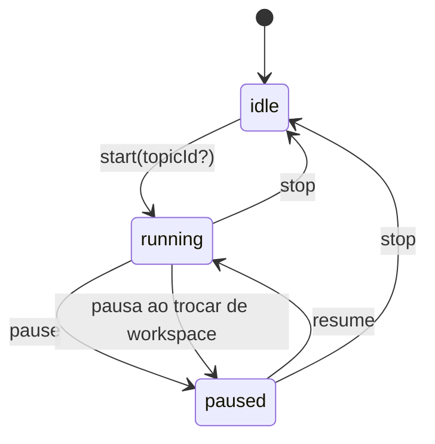

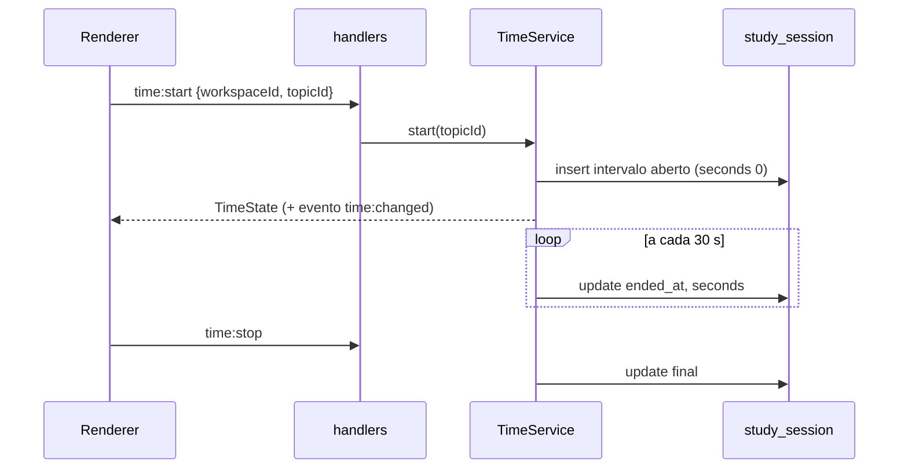

**Erros.** Tópico inexistente → `TOPIC_NOT_FOUND`; `start` com sessão ativa devolve o estado atual (idempotente); `pause`/`resume`/`stop` fora do estado certo devolvem o estado atual sem erro.

**Interface.** `Core.time(workspaceId)`; `Core.close()` fecha todas as sessões abertas; `workspace:delete` descarta o serviço do workspace. Evento `time:changed` via `onTimeEvent` das opções do `Core`.

**UI.** `useTimeState(workspaceId)` busca `time:state`, escuta `time:changed` e calcula o tempo ao vivo no cliente (estado + diferença do relógio local) sem novas chamadas por segundo. Cartão em Hoje e rodapé usam o hook. Ao trocar de workspace o `Shell` pausa a sessão do anterior (FR-6).

### UNIT-2 — Functional design

**Regras.** `activity(source, contexto)` abre, mantém ou troca o intervalo automático; o fim de um intervalo automático é a **última interação**, não o momento em que a ociosidade foi percebida. Um `tick` a cada 5 s (e qualquer chamada de `state`/`activity`) aplica o limite de ociosidade (padrão 120 s, `time.idleSeconds`, 30 a 600) e grava o intervalo a cada 30 s. `blur` pausa; o próximo ping retoma na mesma sessão. Uma sessão automática pausada por mais de 10 min termina e a próxima atividade abre outra. O cronômetro manual absorve os pings (conta uma vez) e, pausado à mão, ignora-os. Tópico vem do item (cartões e prática), material vem da leitura; ids inexistentes viram nulos.

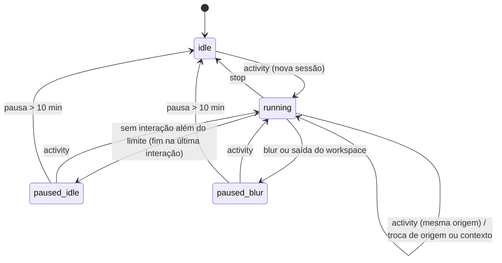

**Limite de taxa.** O hook `useActivity` reporta ao abrir/mudar o contexto e no máximo a cada 5 s com interação (teclado, ponteiro, rolagem, foco); o núcleo aceita todo ping (barato, só memória) em vez de ignorá-los, para não atrasar `lastActivity`. Ping no `blur` da janela e no foco.

**Interface.** `time:activity` e `time:blur` (aditivos). O interruptor "Contar automaticamente" e o limite de ociosidade já são lidos de `meta`; a tela de Configurações que os grava entra na UNIT-3.

### UNIT-3 — Functional design

**Regras.** Meta, limite de ociosidade e interruptor automático ficam em `meta` por workspace (`time.dailyGoalMin` 0..600, `time.idleSeconds` 30..600, `time.autoEnabled`); `saveSettings` valida tudo antes de gravar e devolve `VALIDATION_ERROR` com os campos. As estatísticas cobrem os últimos 7 ou 30 dias de estudo (hoje incluso), fazem `flush` antes para contar o intervalo aberto, e devolvem total, média por dia (total ÷ dias do período), melhor dia, tempo por dia e origem, por tópico (inclui "sem tópico") e por material. O histórico lista os 10 intervalos mais recentes; só intervalos fechados podem ser excluídos (`SESSION_NOT_FOUND` se não existir). O backup já leva o banco inteiro; importar um `.zip` anterior à migração `0003` aplica a migração na abertura.

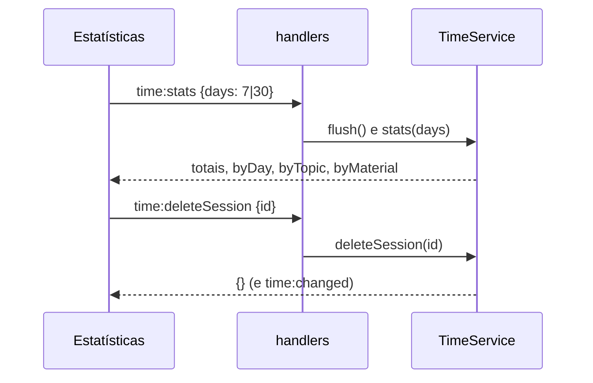

**UI.** A barra de meta fica no cartão "Tempo de estudo" de Hoje (meta 0 vira o link "Definir meta"); a seção "Tempo de estudo" de Configurações edita as três opções; **Estatísticas** ganha a seção "Tempo de estudo" (seletor de período, cartões de resumo, gráfico empilhado com tabela equivalente, tabelas por tópico e material e lista de intervalos recentes). Desvio do mockup R3: seção na mesma página em vez de aba, para não reorganizar a tela existente.

### UNIT-4 — Functional design

**Regras.** O leitor é um serviço do núcleo com três camadas: `materialFile` (resolve o arquivo **somente** dentro de `files/` do workspace, rejeitando `..`, caminhos absolutos e links que escapam; `FILE_MISSING`), `PdfReader` (mupdf: informações, página em PNG, linhas de texto com caixas, busca) e um *backend* (`WorkerReader` mantém **uma** thread viva e conversa por mensagens com id; `InProcessReader` roda na mesma thread, nos testes). A página renderizada tem teto de 16 megapixels (a escala é reduzida), o serviço limita `scale` a 0,25–4 e guarda as 12 últimas imagens em cache. A busca ignora maiúsculas, acentos e tipo de espaço, devolve **uma entrada por ocorrência** (uma caixa por linha ocupada, até 500, com `truncated`). Contrato ajustado em relação a 2.8: `hits[]` = ocorrências, não páginas.

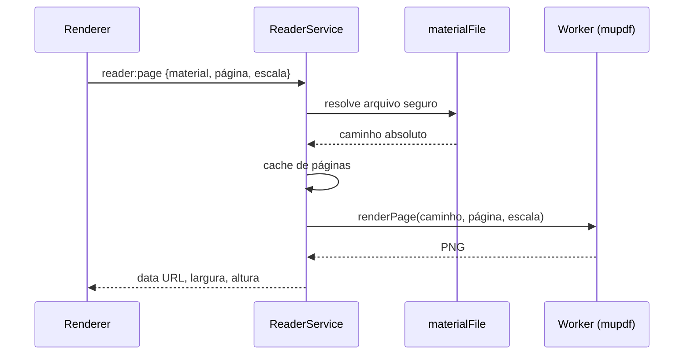

**Spike A19 (resultado).** As caixas de linha do mupdf coincidem com onde a página desenha o texto: o teste lê os pixels da página e acha tinta dentro da caixa e nenhuma fora dela. A camada de texto da UNIT-5 usa uma caixa por linha (suficiente para selecionar e copiar frases); ADR-1 permanece.

### UNIT-5 — Functional design

**Rota e telas.** `/w/:id/library/:materialId/read?page=N` abre o `ReaderPage` dentro do `Shell` (somente em `library` com id; qualquer outra combinação é rota desconhecida); a Biblioteca ganha a ação **Ler** (só PDF indexado). O leitor mostra uma página por vez: a imagem renderizada pelo núcleo, uma **camada de texto** transparente (uma `span` por linha, esticada com `scaleX` até a caixa da linha, selecionável e copiável), os realces da busca e um painel de números de página.

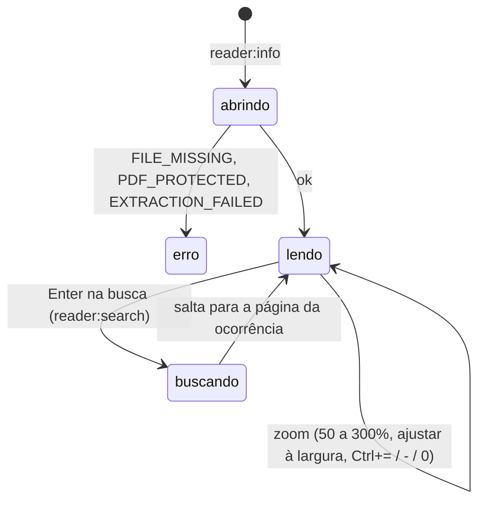

**Zoom e nitidez.** O zoom efetivo (padrão: ajustar à largura, entre 50% e 300%) define o tamanho em pontos; a imagem é pedida em `zoom × devicePixelRatio` (em passos de 0,05) e a página seguinte é pré-carregada. Enquanto a página nova carrega, a imagem anterior fica na tela.

**Busca.** `reader:search` devolve uma entrada por ocorrência; o leitor mostra "i de n ocorrências", salta para a página de cada uma e realça a atual com outra cor; setas (aqui, botões) ciclam. **Acessibilidade.** Barra de ferramentas com rótulos, foco visível, `aria-current` na página do painel, imagem com texto alternativo "Página N". **Tempo.** `useActivity("reading", { materialId })` reporta leitura; o rodapé mostra "Lendo há …" quando a sessão é de leitura.

### UNIT-6 — Functional design

**Janela separada (ADR-4).** `reader:openWindow` valida no núcleo que o material é um PDF legível e pede ao `main` (`UiBridge.openReaderWindow`) uma segunda `BrowserWindow` com as mesmas `secureWebPreferences`, `setWindowOpenHandler` negando janelas e `will-navigate` restrito (função `hardenWindow` compartilhada). O `ReaderWindows` guarda **uma janela por material**: abrir de novo foca (e, se houver página, recarrega nela); fechar a principal fecha todas. A janela carrega o mesmo bundle com `?route=/w/…/read`; o renderer só aceita esse parâmetro se for uma rota de leitor (`standaloneRoute`). Nessa janela não há barra lateral nem "Nova janela", a rota não é gravada como última rota e fechar não pausa a sessão de tempo (os pings das duas janelas vão ao mesmo `TimeService`, que conta uma vez).

**Abrir no sistema (ADR-5).** `material:openOriginal` recebe só `workspaceId` e `materialId`; o núcleo resolve o caminho dentro de `files/` (`materialFile`) e o `main` chama `shell.openPath`; texto de erro do sistema vira `OPEN_FAILED`. Serve a PDF ("Abrir no sistema") e aos demais tipos ("Abrir original"). Materiais web abrem a página salva.

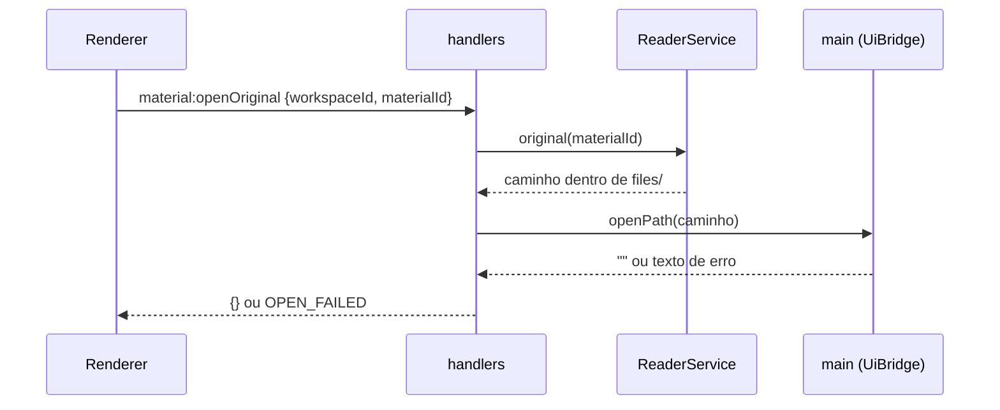

## 3.2–3.4 NFR e infraestrutura (todas as Units)

- **3.2 NFR requirements:** os NFR de 2.3 valem como estão; por Unit, cada Definition of Done cita os que a Unit possui (2.7).
- **3.3 NFR design:** precisão (NFR-1) por relógio injetável e fechamento na última atividade; privacidade (NFR-5) sem nomes de arquivo nem tempos em logs ou prompts; segurança de caminhos (NFR-4) em um único resolvedor no núcleo; compatibilidade de dados (NFR-8) por migração aditiva.
- **3.4 Infrastructure design:** [S] sem infraestrutura nova (app desktop local; nenhum serviço, porta ou IaC).
