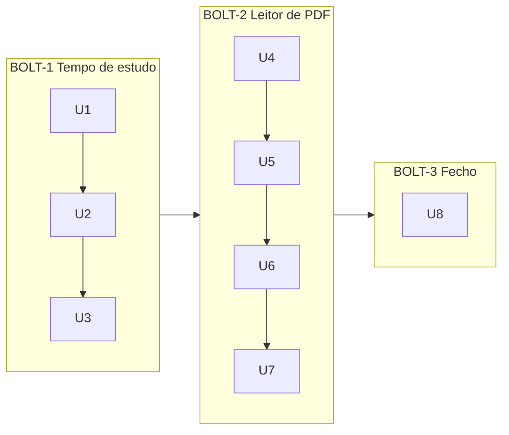

# Tasks — study-time-pdf-viewer

## 2.9 Delivery plan

**Verification command** (aprovado em 2026-11-14): `pnpm lint && pnpm format:check && pnpm typecheck && pnpm test --coverage`. Linha de base: 66 arquivos, 614 testes, linhas 95,52% (limite 80%). `pnpm e2e` (Playwright com `xvfb-run -a`) roda ao fim de cada bolt e na UNIT-8, fora do comando por Unit. Nesta máquina o `pnpm` está em `~/.local/share/pnpm/bin` e precisa entrar no `PATH`.

**Commits** (aprovado): um commit convencional por Unit, só depois de verificada; sem `git push` (M-7).

**NFR-7 (testabilidade)** vale como Definition of Done de toda Unit (relógio e atividade injetáveis; cobertura ≥ limite), verificada na tarefa de verificação de cada Unit.

**Autonomia:** construção autônoma até o fim; paro em falha, em ação irreversível ou se uma decisão de design nova aparecer. [state.md]

**Esqueleto ambulante:** UNIT-1 (migração + serviço + canais + cartão em Hoje + barra de status).

**Ordem:** UNIT-1 → UNIT-2 → UNIT-3 → UNIT-4 → UNIT-5 → UNIT-6 → UNIT-7 → UNIT-8 (respeita o DAG de 2.7; U5 só começa depois de U2 e U4).

### Bolts

| Bolt | Units | Definition of Done | Hipótese de confiança |
|---|---|---|---|
| BOLT-1 | UNIT-1, 2, 3 | Cronômetro manual e automático funcionam em Hoje, barra de status e Estatísticas; meta; backup leva as sessões; verificação verde; `pnpm e2e` verde | Alta: padrão de serviço + canal + página já repetido 50 vezes no código |
| BOLT-2 | UNIT-4, 5, 6, 7 | PDF abre fiel no app, na janela separada e no sistema; "Ver no PDF" leva à página; verificação e e2e verdes | Média: camada de texto do mupdf (A19) e janela extra (ADR-4) são os pontos novos |
| BOLT-3 | UNIT-8 | NFR-2 medido (< 2 s), CSP/licenças/pacote conferidos, e2e dos fluxos completos, README atualizado | Alta |

**Dependências externas:** nenhuma nova dependência npm prevista; `mupdf` e `recharts` já existem. Se o spike da UNIT-4 mostrar que a seleção de texto é inaceitável, reabrir ADR-1 com o autor (única razão para parar o bolt).

## Tasks

Cada tarefa: ≤ ~1 h, estado final observável, FR/US servido e teste. Marque `[x]` ao concluir.

### UNIT-1 — Cronômetro manual (esqueleto)  `Status: verified (2026-11-14), commit pendente da aprovação do esqueleto`

- [x] T1.1 Migração `workspace/0003_study_session` e tabela `studySession` no Drizzle (`pnpm db:generate`); teste de migração com dados existentes preservados. [FR-1, NFR-8; test: db.test.ts]
- [x] T1.2 `TimeService` com máquina de estados manual (start, pause, resume, stop), relógio injetável, soma sem tempo pausado e `day` local. [FR-1, FR-2, FR-12, US-1; test: time.test.ts]
- [x] T1.3 Gravação parcial a cada 30 s e fecho no `core.close()`/troca de workspace; teste que mata no meio e preserva ≤ 60 s. [FR-6; test: time.test.ts]
- [x] T1.4 Esquemas zod e canais `time:state/start/pause/resume/stop`, evento `time:changed`, `UiBridge`/handlers; atualizar preload e `channel-names`. [FR-2; test: time-handlers.test.ts, channels.test.ts]
- [x] T1.5 Cartão "Tempo de estudo" em Hoje: tempo de hoje, botões, seletor de tópico; textos em `strings.ts`. [FR-7, US-1; test: today.test.tsx]
- [x] T1.6 Cronômetro na barra de status com pausar/encerrar, estados com texto, acessível. [FR-8, US-5, NFR-6; test: statusbar.test.tsx]
- [x] T1.7 Garantir que logs não incluem conteúdo/nome de arquivo e que o tempo não vai ao LLM. [NFR-5; test: privacy-log.test.ts ampliado]
- [x] T1.8 Verificação da Unit e commit `feat(time): add manual study timer`.

**Resumo da UNIT-1 (2026-11-14).** Verificação: `pnpm lint` 0 · `pnpm format:check` 0 · `pnpm typecheck` 0 · `pnpm test --coverage`: 69 arquivos, 629 testes, todos passam; cobertura: instruções 94,43% · ramos 86,24% · funções 93,61% · linhas 95,63% (baseline 614 testes, 95,52%).

- Arquivos: `src/core/db/workspace-schema.ts` (+`studySession`), `migrations/workspace/0003_study_session.sql` + snapshot/journal, `src/core/time/service.ts`, `src/core/core.ts` (`time`, `releaseTime`, `onTimeEvent`), `contracts/{channels,channel-names}.ts` (5 canais + evento `time:changed`), `main/ipc/handlers.ts`, `main/index.ts`, `renderer/src/{time.tsx,components/TimerCard.tsx,components/StatusBar.tsx,components/Shell.tsx,pages/TodayPage.tsx,strings.ts,styles/app.css}`, fakes e testes (`time.test.ts`, `time-handlers.test.ts`, `time.test.tsx`, `db.test.ts`, `router.test.ts`, `fake-mind.ts`).
- Como rodar: `export PATH=$HOME/.local/share/pnpm/bin:$PATH; pnpm dev`, abrir Hoje e iniciar o cronômetro.
- Desvios: (1) os testes ficaram em `time.test.ts`, `time-handlers.test.ts` e `time.test.tsx` (nomes um pouco diferentes dos planejados); (2) T1.7 foi coberto por teste de que o serviço não escreve em `console`, já que ele não registra nada; (3) o tempo ao vivo é calculado no cliente (sem chamadas por segundo); (4) a barra de meta de Hoje fica para a UNIT-3.

### UNIT-2 — Contagem automática  `Status: verified (2026-11-14)`

- [x] T2.1 `TimeService.activity/blur`: abre intervalo na primeira atividade, fecha na última se passar a ociosidade, retoma, uma sessão ativa (manual absorve o auto). [FR-3, FR-4, FR-5, US-2, US-3; test: time.test.ts com relógio simulado]
- [x] T2.2 Atribuição: `itemId`→tópico do item, `materialId`→material, manual→tópico escolhido. [FR-13; test: time.test.ts]
- [x] T2.3 Canais `time:activity` e `time:blur` com limite de 1 ping/5 s e validação. [FR-3; test: time-handlers.test.ts]
- [x] T2.4 Hook `useActivity(source, context)` com teclado, mouse, rolagem e foco/blur da janela. [FR-3, FR-4; test: activity.test.tsx]
- [x] T2.5 Ligar o hook em Estudar, Praticar e na prévia de texto. [FR-3, US-2; test: study.test.tsx, training.test.tsx, library.test.tsx]
- [x] T2.6 Teste de precisão: sequência simulada de 1 h com pausas confere ±1 min. [NFR-1; test: time-precision.test.ts]
- [x] T2.7 Verificação, `pnpm e2e` do Bolt ainda não (fim do Bolt 1 na U3), commit `feat(time): count study time automatically`.

**Resumo da UNIT-2 (2026-11-14).** Verificação: lint 0 · format 0 · typecheck 0 · `pnpm test --coverage`: 71 arquivos, 648 testes, todos passam; instruções 94,59% · ramos 86,47% · funções 93,71% · linhas 95,77%.

- Arquivos: `src/core/time/service.ts` (`activity`, `blur`, `tick`, ociosidade, atribuição), `contracts/{channels,channel-names}.ts` (+`time:activity`, `time:blur`), `main/ipc/handlers.ts`, `renderer/src/time.tsx` (`useActivity`, `ping`, `blur`), `pages/{StudyPage,PracticePage,MaterialPreviewPage}.tsx`, testes `time.test.ts`, `time-precision.test.ts`, `time-handlers.test.ts`, `activity.test.tsx`, `fake-mind.ts`.
- Como rodar: `pnpm dev`; abrir Estudar e interagir; Hoje mostra o tempo "cartões".
- Desvios: (1) o limite de 1 ping/5 s é aplicado pelo hook do renderer, não pelo canal (o núcleo aceita todo ping para manter a última interação exata); (2) o interruptor "Contar automaticamente" na UI fica na UNIT-3 (Configurações); o serviço já respeita `time.autoEnabled`; (3) o teste de precisão de 1 h (NFR-1) usa relógio simulado e erro ≤ 60 s.

### UNIT-3 — Meta, estatísticas e backup  `Status: pending`

- [ ] T3.1 `time:getSettings/saveSettings` (meta, ociosidade, auto) em `meta`, com limites. [FR-9; test: time-handlers.test.ts]
- [ ] T3.2 Seção "Tempo de estudo" em Configurações e barra de meta em Hoje (meta 0 = sem meta). [FR-9, US-4; test: settings.test.tsx, today.test.tsx]
- [ ] T3.3 `TimeService.stats` (total, média, melhor dia, por dia/origem, tópico, material) e `time:stats`. [FR-10; test: time-stats.test.ts]
- [ ] T3.4 Aba Estatísticas > Tempo com Recharts, vazios e "Sem tópico". [FR-10, US-6; test: stats.test.tsx]
- [ ] T3.5 `time:sessions` e `time:deleteSession` com confirmação na UI. [FR-14, US-6; test: time-handlers.test.ts, stats.test.tsx]
- [ ] T3.6 Backup: exportar e importar com sessões; importar `.zip` antigo (sem 0003) migra e funciona. [FR-11, US-7; test: archive.test.ts]
- [ ] T3.7 E2E do Bolt 1: iniciar, pausar, encerrar, ver em Hoje, barra e Estatísticas. [US-1..US-7; test: tests/e2e/time.spec.ts]
- [ ] T3.8 Verificação + `pnpm e2e`, commit `feat(time): add daily goal, time statistics and backup`.

### UNIT-4 — Núcleo do leitor  `Status: pending`

- [ ] T4.1 Resolução segura do arquivo do material (rejeita `..`, absoluto, fora do workspace; `FILE_MISSING`). [NFR-4; test: reader-path.test.ts]
- [ ] T4.2 Worker `reader.worker` com mupdf: abre documento (cache LRU), `info` com tamanhos de página, `PDF_PROTECTED`/`EXTRACTION_FAILED`. [FR-24; test: reader.test.ts com PDFs de fixture]
- [ ] T4.3 `reader:page`: PNG em data URL, teto de pixels, cache de poucas páginas. [FR-15, NFR-2; test: reader.test.ts]
- [ ] T4.4 `reader:text` com linhas e caixas e `reader:search` (limite 500, trunca). [FR-17, FR-18; test: reader.test.ts]
- [ ] T4.5 Spike A19: renderizar uma página e conferir que as caixas de `reader:text` batem com o texto visual (teste de fixture com texto conhecido). [A19; test: reader.test.ts]
- [ ] T4.6 Esquemas, canais e handlers `reader:info/page/text/search`, novos códigos de erro. [FR-15..17; test: reader-handlers.test.ts, channels.test.ts]
- [ ] T4.7 Verificação e commit `feat(reader): add the PDF reading core`.

### UNIT-5 — Leitor de PDF (UI)  `Status: pending`

- [ ] T5.1 Rota `/w/:id/library/:materialId/read?page=` e `ReaderPage` com página única, esqueleto de carga e erros com ações. [FR-15, FR-24, US-8; test: reader.test.tsx, router.test.tsx]
- [ ] T5.2 Navegação (anterior, próxima, ir para N, teclado) e zoom (50–300%, largura). [FR-16, US-8; test: reader.test.tsx]
- [ ] T5.3 Camada de texto transparente para seleção e cópia. [FR-18, US-9; test: reader.test.tsx]
- [ ] T5.4 Busca com contagem, próxima/anterior e realce. [FR-17, US-9; test: reader.test.tsx]
- [ ] T5.5 Painel de páginas simples e rótulos acessíveis, foco e atalhos. [NFR-6; test: reader.test.tsx]
- [ ] T5.6 Ação **Ler** na Biblioteca (PDF indexado) e `useActivity("reading", { materialId })` no leitor. [FR-15, FR-3; test: library.test.tsx]
- [ ] T5.7 Verificação e commit `feat(reader): add the in-app PDF reader`.

### UNIT-6 — Janela separada e abrir no sistema  `Status: pending`

- [ ] T6.1 `UiBridge.openReaderWindow` no `main`: segunda `BrowserWindow` com as mesmas `secureWebPreferences`, uma por material (reaproveita e foca), rota do leitor sem barra lateral. [FR-19, ADR-4; test: security.test.ts, handlers.test.ts]
- [ ] T6.2 `UiBridge.openPath` + `reader:openExternal` e `material:openOriginal` por identificador. [FR-20, FR-21, NFR-4; test: reader-handlers.test.ts]
- [ ] T6.3 Ações na Biblioteca e no leitor: Nova janela, Sistema, Abrir original (só para materiais com arquivo). [US-10, US-11; test: library.test.tsx, reader.test.tsx]
- [ ] T6.4 Tempo de leitura em duas janelas não conta em dobro. [FR-5; test: time.test.ts]
- [ ] T6.5 Verificação e commit `feat(reader): open in a separate window and in the system viewer`.

### UNIT-7 — Ver no PDF e última página  `Status: pending`

- [ ] T7.1 `reader:locate` (caixas do `quote` na página) e destaque no leitor. [FR-22, US-12; test: reader.test.ts, reader.test.tsx]
- [ ] T7.2 `SeeInPdfButton` em Revisão, Estudo, Prática, Erros, busca e citações do Chat (só PDF com página). [FR-22; test: study.test.tsx, chat.test.tsx, library.test.tsx]
- [ ] T7.3 `reader:savePosition` e retomada da última página. [FR-23, US-13; test: reader.test.tsx]
- [ ] T7.4 Verificação e commit `feat(reader): jump to the cited page and resume reading`.

### UNIT-8 — E2E, desempenho e pacote  `Status: pending`

- [ ] T8.1 E2E do leitor: abrir PDF, navegar, buscar, nova janela, "Ver no PDF". [US-8..US-12; test: tests/e2e/reader.spec.ts]
- [ ] T8.2 Medição de NFR-2 em PDF de ~200 páginas e registro em `build-and-test.md`. [NFR-2]
- [ ] T8.3 Conferir CSP inalterada, sem listener de rede e licenças das dependências. [NFR-3, NFR-9; test: security.test.ts + `ss -ltnp`]
- [ ] T8.4 `pnpm package` e verificação do `.deb` (tamanho e `verify-deb.sh`). [NFR-10]
- [ ] T8.5 README e docs do app com tempo de estudo e leitor. [FR-1..24]
- [ ] T8.6 Verificação final, `pnpm e2e`, `build-and-test.md` e commit `docs: document study time and the PDF reader`.

## Gate summary shown to the human

Plano: 3 bolts, 8 Units, 52 tarefas; esqueleto = UNIT-1; verificação `pnpm lint && pnpm format:check && pnpm typecheck && pnpm test --coverage`; um commit por Unit; sem push; construção autônoma.
