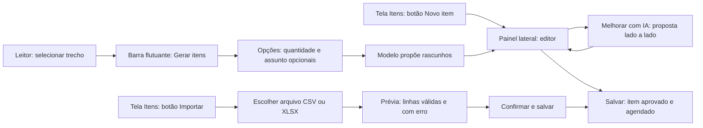
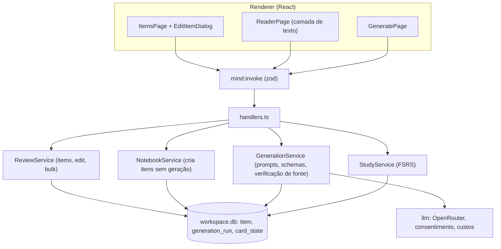
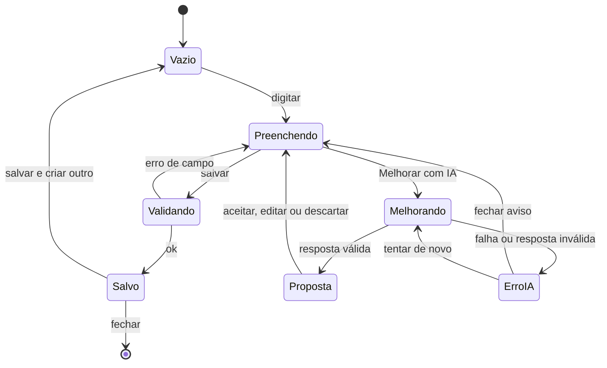
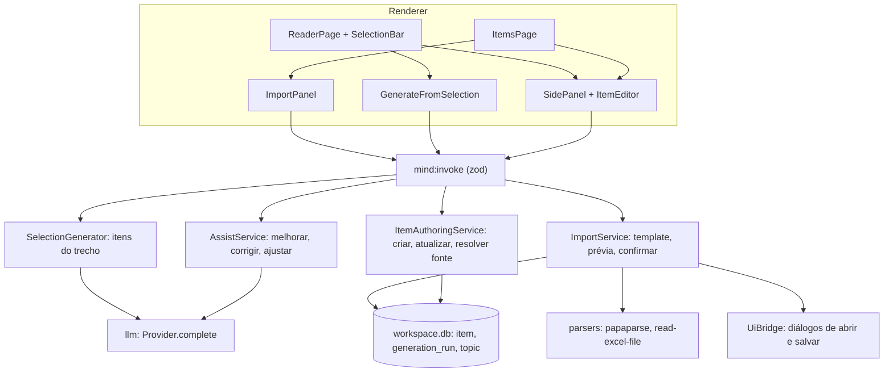
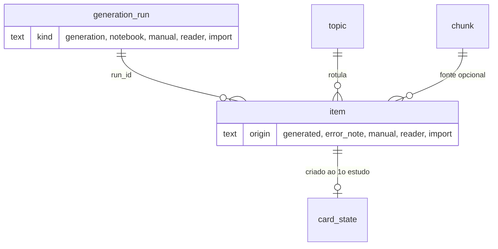
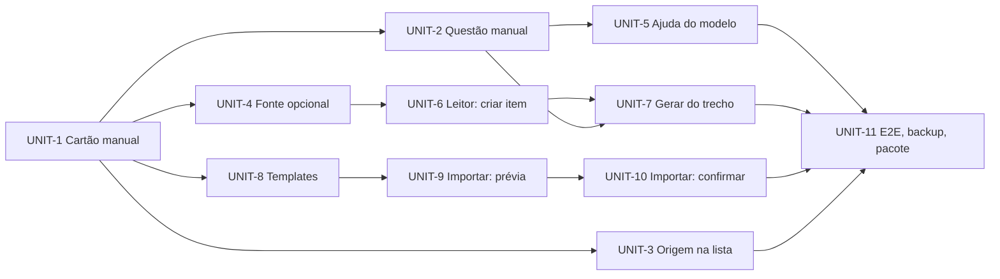
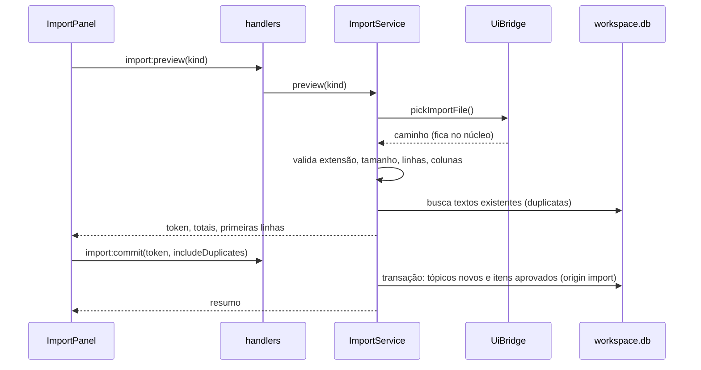
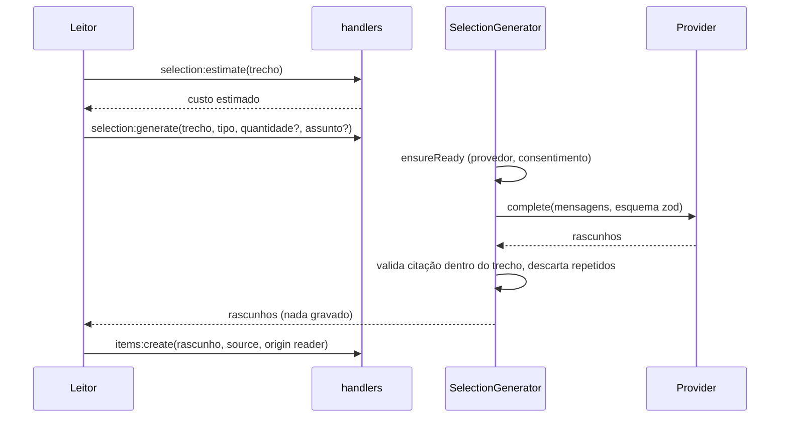
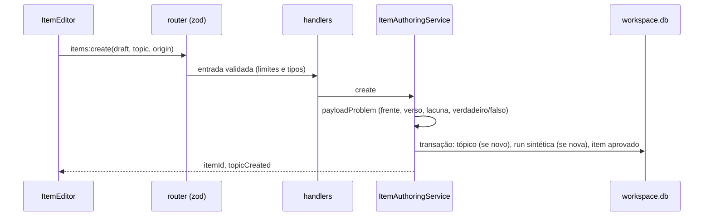

# Design — manual-cards-import

## 1.6 Rough Mockups

Decisão: o editor é um **painel lateral** reaproveitado na tela Itens, no leitor e na revisão pós-importação. [src: Q-editor]

### Fluxos



Caption: três entradas (Itens, leitor, importação) convergem para o mesmo editor ou para a mesma gravação; a ajuda do modelo é um desvio de ida e volta dentro do editor.

### Tela Itens (acréscimos)

```text
Itens                                   [Importar] [Novo item]
Filtros: status | tipo | material | tópico | busca
+--------------------------------------------------------------+
| [ ] Cartão  Qual é ...?          tópico X   manual            |
| [ ] Questão Certo/Errado ...     tópico Y   gerado   p.12     |
+--------------------------------------------------------------+
```

### Leitor: seleção de trecho

```text
+------------------------------------+  +-----------------------+
| ...texto do PDF...                 |  | Gerar itens do trecho |
| [[trecho selecionado ........]]    |  | Tipo: (o) Cartões     |
|    ( Gerar itens )  (Criar item )  |  |       ( ) Questões    |
|                                    |  | Quantidade: [   ] (opc)|
+------------------------------------+  | Assunto:    [   ] (opc)|
                                        | Sem preencher, o modelo|
                                        | decide.                |
                                        | Custo estimado: ~$0.00 |
                                        | [Gerar]                |
                                        +-----------------------+
```

Depois de gerar, o painel mostra os rascunhos um a um (ou em lista) para editar, descartar ou salvar; "Criar item" abre o editor já com o trecho como fonte.

### Editor (painel lateral)

```text
Novo item                                  [x]
Tipo: (o) Cartão  ( ) Questão
Subtipo: [Pergunta/Resposta v]
Frente: [____________________________]
Verso:  [____________________________]
Tópico: [__________]
Fonte:  (nenhuma) | trecho p.12 [remover]
[Melhorar com IA v: Melhorar | Corrigir | Ajustar]
--- proposta do modelo (aparece depois) ---
Original         | Proposta
...              | ...
[Aceitar] [Editar] [Descartar]
[Salvar]   [Salvar e criar outro]
```

Questão de múltipla escolha mostra uma lista de opções (A, B, C...) com gabarito e explicação por opção.

### Prévia da importação

```text
Importar itens
Tipo: (o) Cartões ( ) Questões   [Baixar template CSV] [Baixar template XLSX]
Arquivo: cartoes.xlsx
Resumo: 48 válidas · 2 com erro
+----+------------------------------+-----------------------------+
| #  | Conteúdo                     | Situação                    |
| 3  | Qual é ...?                  | OK                          |
| 17 | (vazio)                      | Erro: coluna "verso" vazia  |
+----+------------------------------+-----------------------------+
[Importar 48 válidas]  [Cancelar]
```

### Estados e acessibilidade

- Vazio, carregando, erro do modelo (com tentar de novo), sem conexão com o provedor, sem consentimento (leva às Configurações).
- Painel com foco gerenciado, `Esc` fecha, rótulos nos campos, tabela de prévia navegável por teclado.

### Assumptions & open questions

- Wireframes são rascunhos; o detalhe visual final sai em 2.5.

## 2.1 Codebase analysis

Resumo do codekb (`.aidlc/codekb/MIND/`, analisado em 240ed43, v0.6.0). Detalhes e fontes ficam lá. [src: .aidlc/codekb/MIND/README.md]



Caption: onde a feature se encaixa: telas de itens e leitor chamam serviços que já existem; a criação sem geração tem precedente em `NotebookService`.

**O que a feature reaproveita.**

- `item` já tem `origin`, `quote`, `chunk_id`, `source_page`, `edited`, `status` e `approved_at`; cartão aprovado sem `card_state` já entra no estudo como novo. [src: src/core/db/workspace-schema.ts:93-113; src/core/study/service.ts:477-505]
- Precedente de item sem geração: `NotebookService.createCard` insere um item aprovado numa run sintética única (`kind="notebook"`), `origin="error_note"`. [src: src/core/notebook/service.ts:86-169]
- Edição de item e opções: `review:edit` e `EditItemDialog`; listagem, filtros e ações em lote: `items:list`, `items:bulk`, `ItemsPage`. [src: src/core/contracts/channels.ts:521-577]
- Geração com prompts, esquemas zod, verificação de fonte, custo e consentimento do LLM: `GenerationService`. [src: src/core/generation/]
- Leitor com camada de texto selecionável por linha e busca. [src: src/renderer/src/pages/ReaderPage.tsx]

**Lacunas.** Nenhuma biblioteca CSV/XLSX; `items:list` não traz fonte nem origem; a seleção do leitor não gera nada hoje; métricas por `generation_run` precisam ignorar runs sintéticas.

**Baseline (2026-11-16).** lint, format e typecheck exit 0; 96 arquivos e 956 testes passam; cobertura de linhas 96,15%. `pnpm e2e` não rodado.

### Assumptions & open questions

- ASSUMPTION A-3: a run sintética por tipo de origem (manual, import) é o caminho de menor custo e será decidida em ADR no 2.6. [user: "Se funcionar, pode seguir esse padrão"]

## 2.2 Practices Discovery

Rascunho a partir de evidências do repositório; as práticas já aprovadas estão na memória do projeto e valem aqui. [mem: M-4, M-5, M-7, M-8]

| Prática | Evidência | Regra para esta feature |
|---|---|---|
| Ramificação | Commits direto na `main`, sem PR | Mesma prática; sem `git push` até pedido [mem: M-7] |
| Commits | Conventional Commits, atômicos (`feat(ui): ...`, `fix: ...`) | Um commit por tarefa ou Unit, em inglês, sem ID de sessão [mem: M-8] |
| Qualidade | `pnpm lint` (ESLint + checagem de cabeçalho), `format:check`, `typecheck` | Os três devem passar a cada Unit [src: package.json:13-16] |
| Testes | Vitest por arquivo ao lado do código, Testing Library, Playwright e2e; LLM sempre mockado; cobertura mínima 80% | Teste por tarefa; e2e para os três fluxos novos [mem: M-5] |
| CI | GitHub Actions: lint, format, tipos, testes com cobertura, e2e com xvfb, empacotamento | Sem mudança de pipeline prevista [src: .github/workflows/ci.yml] |
| Contratos | Canal IPC novo em 4 passos; saídas e entradas validadas com zod | Confirmado pelo autor em 2026-11-16 [user] [mem: M-9] |
| Banco | Drizzle e `pnpm db:generate` para migrações | Só se o ADR de dados pedir migração |
| Textos | UI em pt-BR em `strings.ts`; código em inglês; cabeçalho de arquivo | [mem: M-8] |
| Dependências | Compatíveis com AGPL, sem rede no app | A biblioteca de planilhas passa por ADR [mem: M-6] |

Nenhuma prática nova a promover para a memória: tudo já está coberto por M-4 a M-9.

### Assumptions & open questions

- Nenhuma.

## 2.5 Refined Mockups

Refina o § 1.6 sem mudar as decisões aprovadas (painel lateral compartilhado). **Os mockups são em HTML**: abrir [`mockups/refined.html`](mockups/refined.html) no navegador (abas A a K: Itens, novo cartão, nova questão, proposta do modelo, seleção no leitor, gerar do trecho, rascunhos, importação em três passos e estados de erro; botão Tema alterna escuro e claro). [mem: M-12] [src: Q-mockups-html] Usa os tokens existentes (`--panel`, `--radius`, escala `--space-1` a `--space-5`) e o texto em pt-BR de `strings.ts`. [src: src/renderer/src/styles/tokens.css]

### Componentes de interface

| Componente | Papel | Reuso |
|---|---|---|
| `SidePanel` | Contêiner lateral com título, fechar, foco preso e `Esc` | Novo; segue o comportamento de `Dialog` (foco, rótulo) |
| `ItemEditor` | Formulário de cartão ou questão (modo criar ou editar), seção de fonte e botão "Melhorar com IA" | Extrai e substitui o corpo de `EditItemDialog`; mantém `SearchCombobox` de tópico |
| `ImproveProposal` | Comparação lado a lado e aceitar, editar ou descartar | Novo |
| `SourcePicker` | Escolher material, página e trecho (ou limpar) | Novo; usa `material:list` e `material:search` |
| `SelectionBar` | Barra flutuante "Gerar itens" e "Criar item" sobre a seleção do leitor | Novo; usa a camada `reader-text` |
| `GenerateFromSelection` | Tipo, quantidade, assunto, estimativa de custo e lista de rascunhos | Novo; usa o consentimento e a estimativa existentes |
| `ImportPanel` | Tipo, templates, escolha de arquivo, prévia e confirmação | Novo |

### Fluxo do editor (estados)



Caption: a proposta nunca grava; só o botão Salvar grava.

### Especificação de interação

- **Abrir.** "Novo item" (Itens) e "Criar item" (leitor) abrem o painel à direita; o foco vai ao primeiro campo; fechar devolve o foco ao botão de origem. No leitor, o painel reduz a área do PDF em vez de cobri-la.
- **Tipo e subtipo.** Alternar entre Cartão e Questão troca os campos mantendo tópico e fonte. Subtipos de cartão: pergunta/resposta, cloze (com dica de `{{...}}` conforme o formato já usado pelos cartões gerados), comparar, verdadeiro/falso. Questão: certo/errado ou múltipla escolha com 2 a 5 alternativas (adicionar e remover; letras reatribuídas).
- **Fonte.** Padrão "sem fonte". "Escolher fonte" abre o `SourcePicker`; o trecho é editável; "remover" limpa.
- **Melhorar com IA.** Menu com Melhorar, Corrigir e Ajustar (este abre um campo de instrução de até 500 caracteres). Desabilitado com texto vazio; com provedor ou consentimento ausentes, mostra a explicação e o atalho para Configurações. Durante a chamada, o botão vira "Cancelar".
- **Proposta.** Duas colunas (Original e Proposta) por campo, com diferenças destacadas por palavra; "Aceitar tudo", "Aceitar campo" e "Descartar". Em questões, mostra alternativas e gabarito.
- **Leitor.** Com seleção ativa (e `mouseup` ou `Shift+setas`), a `SelectionBar` aparece junto à seleção; fica oculta em seleção vazia. "Gerar itens" abre o painel `GenerateFromSelection`: tipo, quantidade (1 a 20, vazio = o modelo decide), assunto (opcional, 200), estimativa de custo e "Gerar". Os rascunhos aparecem como lista; cada um abre no `ItemEditor`; "Salvar" aprova.
- **Importação.** Etapas: 1) tipo e templates, 2) escolher arquivo (diálogo nativo), 3) prévia, 4) confirmar. Prévia tem filtro (todas, válidas, erros, duplicadas), caixa "importar mesmo assim" nas duplicadas e resumo fixo no rodapé. Botão "Importar N válidas" desabilitado quando N = 0.

### Estados de tela

| Tela | Vazio | Carregando | Erro | Sem provedor |
|---|---|---|---|---|
| Editor | Campos vazios, dica curta | Botões desabilitados durante salvar | Mensagem por campo | IA desabilitada com explicação; resto funciona |
| Proposta | n/a | "Pedindo ao modelo..." com Cancelar | Erro e "Tentar de novo" | Link para Configurações |
| Rascunhos do leitor | "Nenhum item gerado" | Progresso e custo | Erro do modelo com tentar de novo | Link para Configurações |
| Prévia | "Escolha um arquivo" | Barra de leitura | Arquivo recusado com motivo | n/a (não usa modelo) |

### Acessibilidade

- Painel com `role="dialog"` não modal (`aria-label`), foco preso apenas no painel de criação e `Esc` fecha; atalho `Ctrl+Enter` salva.
- Cada campo tem rótulo visível e erro ligado por `aria-describedby`; mensagens de status em `role="status"`.
- Prévia como tabela com cabeçalhos e navegação por setas; diferenças da proposta não dependem só de cor (sublinhado e riscado).
- `SelectionBar` alcançável por teclado (`Tab` a partir do leitor) e anunciada ao aparecer.

### Assumptions & open questions

- ASSUMPTION A-8: o formato do cloze manual segue o dos cartões gerados (será conferido em `cards.ts` na Construção). [inferred]

## 2.6 Domain & components

### Componentes



Caption: quatro serviços novos no núcleo; o renderer só conversa por IPC; nenhuma rota nova de rede.

| Componente | Responsabilidade | Interfaces | Dados que possui |
|---|---|---|---|
| `ItemAuthoringService` (`src/core/authoring/`) | Validar e gravar itens manuais e do leitor (aprovados, origem), resolver tópico, resolver fonte a partir de material, página e trecho, atualizar itens | `items:create`, `source:resolve`, `review:edit` (existente) | linhas `item` com origem `manual` ou `reader`; runs sintéticas |
| `AssistService` (`src/core/assist/`) | Montar o pedido (melhorar, corrigir, ajustar), chamar o provedor, validar a proposta com zod; nunca grava | `assist:improve` | nada (sem estado) |
| `SelectionGenerator` (`src/core/generation/selection.ts`) | Gerar rascunhos de um trecho com quantidade e assunto opcionais, reaproveitando prompts e esquemas; verifica que a citação está dentro do trecho; nunca grava | `selection:generate`, `selection:estimate` | nada |
| `ImportService` (`src/core/importing/`) | Gerar templates, ler e validar arquivos, guardar a prévia em memória por token, detectar duplicatas, gravar em transação | `import:template`, `import:preview`, `import:commit`, `import:discard` | linhas `item` com origem `import`; prévia em memória (expira) |
| `ItemEditor` e afins (renderer) | Formulários, comparação, prévia, barra de seleção | canais acima | estado de tela |

### Modelo de domínio



Caption: itens sem geração continuam apontando para uma run sintética por tipo, como no caderno de erros.

Regras de domínio: item manual, do leitor e importado nasce `approved` com `approved_at`; fonte opcional; `edited = false`; duplicata = texto normalizado da frente (cartão) ou do enunciado (questão) entre itens não descartados; tópico novo é criado pelo nome normalizado (`cleanTopic`). [src: src/core/generation/cards.ts:50; src/core/notebook/service.ts]

### Decisões

**ADR-1 · Itens sem geração usam uma run sintética por tipo** (FR-3, FR-16, NFR-4, A-3)

- Contexto: `item.run_id` é `NOT NULL`; o caderno de erros já resolve isso com uma run sintética (`kind = "notebook"`, `model = "-"`, `status = "done"`). Decisão do autor: seguir esse padrão se funcionar. [user]
- Decisão: criar, de forma preguiçosa, uma run por tipo (`manual`, `reader`, `import`) e gravar `item.origin` igual ao tipo. Nenhuma migração.
- Alternativas: `run_id` opcional (migração e ajuste de joins em `review`, `stats`, catálogo); uma run única para tudo (perde a distinção na contagem).
- Consequências: contadores de run ficam zerados nessas runs e não entram nas métricas de geração; `stats:materials` só conta itens de runs com `material_id`, então itens do leitor e importados não aparecem por material (aceito; revisitar se o autor pedir).

**ADR-2 · Bibliotecas de planilha: papaparse, read-excel-file, write-excel-file** (FR-13, FR-14, NFR-2, NFR-8)

- Contexto: nenhuma biblioteca instalada; MIT é compatível com AGPL. Tamanhos no npm em 2026-11-16: papaparse 0,27 MB, read-excel-file 2,5 MB, write-excel-file 1,8 MB (depende só de `fflate`), exceljs 21,8 MB. [mem: M-6] [user: escolha no gate 2.6]
- Decisão: papaparse para CSV, read-excel-file para ler XLSX (só valores, sem fórmulas) e write-excel-file para gerar o template XLSX; template CSV por concatenação simples com BOM UTF-8.
- Alternativas: exceljs (peso e superfície), parser CSV próprio.
- Consequências: verificar na primeira tarefa que as três funcionam no processo principal empacotado (`asarUnpack` só se houver nativos; nenhum esperado) e que o `.deb` e o instalador Windows continuam dentro do tamanho verificado por `scripts/verify-deb.sh`.

**ADR-3 · A importação roda no núcleo com prévia em memória e confirmação por token** (FR-14 a FR-18, NFR-2)

- Decisão: `import:preview` abre o diálogo nativo (`UiBridge.pickFiles`), o caminho nunca chega ao renderer, lê o arquivo no núcleo (em worker thread se passar de 1 MB), valida e guarda o resultado em memória com um token (expira em 15 min); `import:commit` recebe só o token e a lista de linhas duplicadas a incluir; o núcleo grava tudo numa transação.
- Alternativas: o renderer ler o arquivo e reenviar as linhas (confia em dados do renderer e duplica 5.000 linhas no IPC).
- Consequências: a prévia devolve no máximo as 500 primeiras linhas de cada situação mais as contagens totais; a gravação não depende do que o renderer devolve.

**ADR-4 · Fonte do trecho do leitor é resolvida no núcleo, em melhor esforço** (FR-6, FR-8, FR-20, M-1)

- Contexto: `item` liga ao material só por `chunk_id`; "Ver no PDF" exige `chunk_id` e página. [src: src/core/reader/source.ts:21-35]
- Decisão: `source:resolve` recebe material, página e texto selecionado, procura o trecho (`locateQuote`) nos chunks da página; se achar, grava `chunk_id`, página e a citação; se não achar o trecho inteiro, tenta o maior prefixo; se nada casar, o item é salvo sem `chunk_id` (mantém título, página e citação como texto) e sem "Ver no PDF".
- Alternativas: exigir chunk sempre (bloqueia seleções que cruzam chunks); mudar o esquema para guardar `material_id` no item (migração).
- Consequências: a maioria dos trechos vira fonte verificável; os demais perdem só o atalho do PDF.

**ADR-5 · Ajuda do modelo é um serviço próprio e sem estado** (FR-10 a FR-12, NFR-3)

- Decisão: `AssistService` usa `Provider.complete` com esquema zod por tipo (cartão ou questão), exige `ensureReady` (provedor e consentimento), envia só o texto do item, o trecho-fonte e a instrução, valida a proposta (campos, gabarito dentro das alternativas, 2 a 5 alternativas) com uma nova tentativa automática, e devolve a proposta sem gravar. [src: src/core/llm/provider.ts]
- Alternativas: reutilizar o pipeline de geração (acoplado a runs e chunks).
- Consequências: cancelar na interface descarta a resposta (o provedor não aceita cancelamento); o custo entra no livro de custos com `purpose = "assist"`.

**ADR-6 · Rascunhos do leitor só existem na tela até serem salvos** (FR-7 a FR-9)

- Decisão: `selection:generate` devolve rascunhos validados (citação dentro do trecho enviado, subtipos permitidos, quantidade limitada a 20); salvar cada um chama `items:create` com origem `reader`. Quantidade e assunto vazios deixam o modelo decidir (o prompt diz para escolher a quantidade que o trecho sustenta, de 1 a 20, e os assuntos). [user: gate 2.6]
- Alternativas: gravar rascunhos como `draft` (precisa de run, contadores e limpeza).
- Consequências: fechar o painel descarta os rascunhos não salvos; sem entrada na fila de gerações.

### Assumptions & open questions

- Pergunta aberta para 3.1: tamanho de chunk típico vs seleção longa (8.000 caracteres) pode cruzar chunks; o prefixo mais longo resolve a maioria dos casos.
- ASSUMPTION A-9: `generation:estimate` não é reaproveitado; `selection:estimate` calcula o custo pelo tamanho do trecho e pela tabela de preços existente. [inferred: src/core/llm/costs.ts]

## 2.7 Units of work

Ordem de construção segue a prioridade aprovada: criação manual (e ajuda do modelo), leitor, importação. UNIT-1 é o esqueleto (a menor fatia ponta a ponta). [src: Q-prioridade]

### UNIT-1 · Cartão manual (esqueleto)

- Propósito: criar um cartão sem fonte e vê-lo na lista e no estudo, do painel ao banco.
- Cobre: FR-1, FR-3, FR-21; US-1.
- Escopo: `ItemAuthoringService` (run sintética `manual`, criação de cartão aprovado), canal `items:create` (cartão), `SidePanel`, `ItemEditor` (cartão), botão "Novo item", textos em `strings.ts`.
- Interfaces: `items:create`.
- DoD: cartão criado entra em `study:next`; frente ou verso vazios dão erro por campo; run sintética criada uma só vez; NFR-4 (contadores de run intactos), NFR-5 e NFR-6 verificados para o painel; teste de unidade, de interface e verificação da 2.9 passam.

### UNIT-2 · Questão manual

- Propósito: criar questões de certo/errado e múltipla escolha.
- Cobre: FR-2; US-2.
- Escopo: `items:create` aceita questão (2 a 5 alternativas, gabarito, explicação, motivo por alternativa), `ItemEditor` modo questão, validação compartilhada com `review:edit`.
- DoD: questão criada entra em `practice:next`; gabarito fora das alternativas e motivo vazio dão erro por campo.

### UNIT-3 · Origem na lista e filtro

- Propósito: mostrar de onde vem cada item.
- Cobre: FR-19; US-9.
- Escopo: `items:list` devolve `origin` e a fonte (página, título); coluna Origem, coluna Fonte e filtro por origem na `ItemsPage`.
- DoD: itens de cada origem aparecem com o selo certo e o filtro isola cada uma; cobertura da `ItemsPage` não cai.

### UNIT-4 · Fonte opcional

- Propósito: ligar um item a material, página e trecho (ou deixá-lo sem fonte).
- Cobre: FR-4, FR-20.
- Escopo: `source:resolve` (ADR-4), `SourcePicker`, fonte em `items:create`, "Ver no PDF" nos itens com `chunk_id`.
- DoD: item com trecho que existe numa página grava `chunk_id`, página e citação; trecho não encontrado grava sem `chunk_id`; item sem fonte não mostra "Ver no PDF"; item gerado sem fonte continua descartado (M-1).

### UNIT-5 · Ajuda do modelo no editor

- Propósito: melhorar, corrigir e ajustar o texto com proposta lado a lado.
- Cobre: FR-10, FR-11, FR-12; US-3.
- Escopo: `AssistService`, canal `assist:improve`, `ImproveProposal`, estados sem provedor e sem consentimento (FR-9 só quanto à mensagem; o pedido do leitor fica na UNIT-7).
- DoD: proposta nunca grava; resposta inválida não altera o formulário; corpo enviado ao LLM mockado contém só o texto do item, o trecho e a instrução (NFR-3); custo registrado com `purpose = "assist"`.

### UNIT-6 · Leitor: seleção e criar item

- Propósito: criar um item a partir do trecho selecionado.
- Cobre: FR-5, FR-6; US-4.
- Escopo: `SelectionBar` na camada de texto do leitor, "Criar item" abre o painel com a fonte preenchida, origem `reader`.
- DoD: a barra aparece e some com a seleção e é alcançável por teclado; o item salvo abre o PDF na página e destaca o trecho.

### UNIT-7 · Gerar itens do trecho

- Propósito: pedir ao modelo itens do trecho, com quantidade e assunto opcionais.
- Cobre: FR-7, FR-8, FR-9; US-5.
- Escopo: `SelectionGenerator`, canais `selection:estimate` e `selection:generate`, `GenerateFromSelection`, lista de rascunhos que salvam por `items:create`.
- DoD: sem quantidade e assunto o pedido não os envia; quantidade acima de 20 ou trecho acima de 8.000 caracteres são recusados; citações fora do trecho são descartadas; estimativa e consentimento antes de gerar; fechar o painel descarta os rascunhos.

### UNIT-8 · Templates de importação

- Propósito: baixar templates de cartões e de questões em CSV e XLSX.
- Cobre: FR-13; US-6; NFR-8.
- Escopo: adicionar papaparse, read-excel-file e write-excel-file (ADR-2), `ImportService.template`, canal `import:template` (diálogo de salvar), botões de download.
- DoD: os quatro arquivos baixam e são relidos pelos mesmos parsers; `pnpm package` e `scripts/verify-deb.sh` continuam passando; licenças registradas.

### UNIT-9 · Importar: arquivo e prévia

- Propósito: ler CSV ou XLSX e mostrar o que entra, o que tem erro e o que é duplicado.
- Cobre: FR-14, FR-15, FR-18; US-7; NFR-2.
- Escopo: `ImportService.preview` (diálogo de abrir, limites de 5.000 linhas e 10 MB, CSV com `,` ou `;`, BOM, só valores do XLSX), token em memória, detecção de duplicatas e de tópicos novos, `ImportPanel` etapas 1 e 2.
- DoD: arquivos de fórmula, gigantes e de extensão falsa são recusados sem execução; erros mostram linha e motivo; prévia de 500 linhas em até 3 s (NFR-1).

### UNIT-10 · Importar: confirmar

- Propósito: gravar as linhas válidas.
- Cobre: FR-16, FR-17; US-8.
- Escopo: `import:commit` e `import:discard`, gravação transacional com origem `import`, criação de tópicos, etapa 3 (resultado), "Ver itens importados".
- DoD: falha injetada não deixa itens; duplicatas são puladas salvo marcação; 500 itens gravam em até 5 s (NFR-1); itens entram em estudo.

### UNIT-11 · Ponta a ponta, backup e pacote

- Propósito: validar os fluxos inteiros e os requisitos transversais.
- Cobre: NFR-1 (interações), NFR-9; sem FR próprio.
- Escopo: testes e2e (criar item, selecionar e gerar com LLM falso, importar), backup e restauração com itens das novas origens, empacotamento.
- DoD: e2e passam em `pnpm e2e`; backup restaura itens manuais, do leitor e importados; critério de sucesso: criar item em até 5 interações.

### Dependências



Caption: grafo acíclico; ordem topológica: UNIT-1, 2, 3, 4, 5, 6, 7, 8, 9, 10, 11.

### Mapa história → Unit

| História | Unit dona | Também depende de |
|---|---|---|
| US-1 | UNIT-1 | UNIT-4 (fonte) |
| US-2 | UNIT-2 | UNIT-4 (fonte) |
| US-3 | UNIT-5 | UNIT-1, UNIT-2 |
| US-4 | UNIT-6 | UNIT-4 |
| US-5 | UNIT-7 | UNIT-2, UNIT-6 |
| US-6 | UNIT-8 | n/a |
| US-7 | UNIT-9 | UNIT-8 |
| US-8 | UNIT-10 | UNIT-9 |
| US-9 | UNIT-3 | UNIT-1 |

### Mapa FR → Unit

| FR | Unit | FR | Unit | FR | Unit |
|---|---|---|---|---|---|
| FR-1 | UNIT-1 | FR-8 | UNIT-7 | FR-15 | UNIT-9 |
| FR-2 | UNIT-2 | FR-9 | UNIT-7 | FR-16 | UNIT-10 |
| FR-3 | UNIT-1 | FR-10 | UNIT-5 | FR-17 | UNIT-10 |
| FR-4 | UNIT-4 | FR-11 | UNIT-5 | FR-18 | UNIT-9 |
| FR-5 | UNIT-6 | FR-12 | UNIT-5 | FR-19 | UNIT-3 |
| FR-6 | UNIT-6 | FR-13 | UNIT-8 | FR-20 | UNIT-4 |
| FR-7 | UNIT-7 | FR-14 | UNIT-9 | FR-21 | UNIT-1 |

### NFR → Unit (Definition of Done)

| NFR | Onde é validado |
|---|---|
| NFR-1 | UNIT-9 e UNIT-10 (tempos), UNIT-11 (interações) |
| NFR-2 | UNIT-9 |
| NFR-3 | UNIT-5, UNIT-7 |
| NFR-4 | UNIT-1 e UNIT-10 |
| NFR-5 | toda Unit que cria canal |
| NFR-6 | UNIT-1, UNIT-5, UNIT-6, UNIT-9 |
| NFR-7 | toda Unit (verificação) |
| NFR-8 | UNIT-8 |
| NFR-9 | UNIT-11 |

### Assumptions & open questions

- Nenhuma nova.

## 2.8 Contracts

Contratos IPC novos e alterados. Todos seguem o padrão existente: esquema zod `.strict()` de entrada e de saída em `channels.ts`, nome em `channel-names.ts`, resposta `Result<T>`, `workspaceId` em toda chamada. Mudanças são **aditivas**, então `CONTRACT_VERSION` continua 1. [mem: M-9] [src: src/core/contracts/channels.ts]

### Tipos compartilhados

```ts
const itemOrigin = z.enum(["generated", "manual", "reader", "import", "error_note"]);

const optionIn = z.object({
  key: z.string().regex(/^[A-E]$/),
  text: z.string().min(1).max(2000),
  why: z.string().min(1).max(2000),
});

/** Same limits as review:edit (5000 and 2000). */
const cardDraft = z.object({
  kind: z.literal("card"),
  subtype: z.enum(["qa", "cloze", "compare", "true_false"]),
  front: z.string().min(1).max(5000),
  back: z.string().min(1).max(5000),
});

const questionDraft = z.object({
  kind: z.literal("question"),
  subtype: z.enum(["certo_errado", "multiple_choice"]),
  statement: z.string().min(1).max(5000),
  options: z.array(optionIn).max(5),        // certo_errado: empty; multiple_choice: 2 to 5
  answer: z.string().max(2),                // "C" | "E" or one of the option keys
  explanation: z.string().min(1).max(2000),
});

const itemDraft = z.discriminatedUnion("kind", [cardDraft, questionDraft]);

const sourceIn = z.object({
  materialId: z.number().int().positive(),
  page: z.number().int().min(1),
  quote: z.string().min(1).max(8000),
});
```

Regra cruzada (validada com `superRefine`): `multiple_choice` exige 2 a 5 alternativas com letras consecutivas a partir de A e `answer` entre elas; `certo_errado` exige `options` vazio e `answer` C ou E.

### Canais novos

| Canal | Entrada | Saída |
|---|---|---|
| `items:create` | `{ workspaceId, draft: itemDraft, topic?: string(≤200)\|null, source?: sourceIn, origin: "manual"\|"reader" }` | `{ itemId, sourceLinked: boolean, topicCreated: boolean }` |
| `source:resolve` | `{ workspaceId, materialId, page, text: string(≤8000) }` | `{ match: "full"\|"partial"\|"none", chunkId: number\|null, page, quote: string }` |
| `assist:improve` | `{ workspaceId, action: "improve"\|"fix"\|"adjust", instruction?: string(≤500), draft: itemDraft, topic?: string\|null, quote?: string(≤8000) }` | `{ proposal: itemDraft, costUsd: number\|null }` |
| `selection:estimate` | `{ workspaceId, materialId, page, text(≤8000), kind: "card"\|"question", quantity?: 1..20, subject?: string(≤200) }` | `{ estimatedUsd: number\|null, chars: number }` |
| `selection:generate` | mesmo da estimativa | `{ drafts: Array<{ draft: itemDraft, topic: string\|null, quote: string }>, discarded: { noSource: number, invalid: number, duplicate: number }, costUsd: number\|null }` |
| `import:template` | `{ workspaceId, kind: "card"\|"question", format: "csv"\|"xlsx" }` | `{ saved: boolean }` (abre o diálogo de salvar; `false` se cancelar) |
| `import:preview` | `{ workspaceId, kind: "card"\|"question" }` | `{ cancelled: true }` ou `{ cancelled: false, token, fileName, totals: { rows, valid, errors, duplicates }, newTopics: string[], rows: PreviewRow[], truncated: boolean }` |
| `import:previewRows` | `{ workspaceId, token, status: "all"\|"valid"\|"error"\|"duplicate", offset: number, limit: 1..500 }` | `{ rows: PreviewRow[], total: number }` |
| `import:commit` | `{ workspaceId, token, includeDuplicates: number[] }` (números de linha) | `{ imported, skippedDuplicates, skippedErrors, topicsCreated }` |
| `import:discard` | `{ workspaceId, token }` | `{}` |

```ts
const previewRow = z.object({
  line: z.number().int(),                  // 1-based, counting the header as line 1
  status: z.enum(["valid", "error", "duplicate"]),
  text: z.string(),                        // front or statement, truncated to 200 chars
  topic: z.string().nullable(),
  topicIsNew: z.boolean(),
  problem: z.string().nullable(),          // pt-BR reason when status is "error"
});
```

### Canais alterados (aditivos)

- `items:list`: cada item ganha `origin: itemOrigin`, `sourceTitle: string`, `sourcePage: number|null` e `hasPdf: boolean`. Entrada inalterada; o filtro por origem é feito no renderer, como os demais filtros da tela.
- `review:edit`, `items:bulk`, `study:*`, `practice:*`: sem mudança; itens das novas origens são tratados como os demais.
- Códigos de erro novos em `ERROR_CODES`: `IMPORT_FILE_INVALID` (colunas ausentes, arquivo ilegível), `IMPORT_LIMIT_EXCEEDED` (mais de 5.000 linhas ou 10 MB), `IMPORT_EXPIRED` (token inválido ou vencido). Reaproveitados: `VALIDATION_ERROR` (com `fields`), `UNSUPPORTED_FILE` (extensão), `MATERIAL_NOT_FOUND`, `ITEM_NOT_FOUND`, `PROVIDER_KEY_MISSING`, `CONSENT_REQUIRED`, `MONTHLY_LIMIT_REACHED`, `PROVIDER_ERROR`.
- `UiBridge` ganha `pickImportFile?(): Promise<string | null>` (filtro `.csv` e `.xlsx`); o salvar do template usa o `pickSavePath` existente.

### Templates de importação

Cabeçalhos em pt-BR e uma linha de exemplo. As instruções ficam numa segunda aba "Instruções" no XLSX e, para o CSV, em texto na tela de importação (o CSV não tem comentários).

| Template | Colunas | Obrigatórias |
|---|---|---|
| Cartões | `subtipo`, `frente`, `verso`, `topico` | `frente`, `verso` |
| Questões | `subtipo`, `enunciado`, `alternativa_a` a `alternativa_e`, `motivo_a` a `motivo_e`, `gabarito`, `explicacao`, `topico` | `enunciado`, `gabarito`, `explicacao`; em múltipla escolha, ao menos A e B com texto e motivo |

Valores de `subtipo`: cartão `pergunta_resposta` (padrão se vazio), `cloze`, `comparar`, `verdadeiro_falso`; questão `multipla_escolha` (padrão se há alternativas) ou `certo_errado`. Os códigos internos (`qa`, `multiple_choice` etc.) também são aceitos. `gabarito` é uma letra A a E, ou C ou E em certo/errado. Cabeçalhos são comparados sem acento e sem diferença de maiúsculas; colunas extras são ignoradas; só a primeira planilha do XLSX é lida; só valores (fórmulas viram o valor em cache ou vazio).

### Modelo de erro e limites

- Erros de campo: `VALIDATION_ERROR` com `fields[{ field, message }]` (por exemplo `options.2.why`); mensagens em pt-BR.
- Limites verificados antes de processar: extensão `.csv` ou `.xlsx`, 10 MB, 5.000 linhas; abaixo disso a prévia devolve no máximo 500 linhas por chamada.
- O token da prévia vale 15 minutos, é descartado após `import:commit` ou `import:discard` e não é aceito em outro workspace.
- Logs nunca recebem conteúdo de itens, trechos ou linhas de arquivo (NFR-3).

### Sequência: importação



Caption: o caminho do arquivo e as linhas parseadas ficam no núcleo; o renderer só recebe a prévia e devolve o token.

### Sequência: gerar do trecho



Caption: só `items:create` grava; a geração devolve rascunhos.

### Assumptions & open questions

- ASSUMPTION A-10: os templates não têm colunas de fonte (material, página, trecho); itens importados nascem sem fonte. A fonte por planilha vai para o backlog. [inferred]

## 3.1 Functional design

### UNIT-1 — Functional design

Nota curta (Standard, perfil mvp). O desenho vem do § 2.6 e do § 2.8; aqui só o que a implementação fixou.



- Campos vazios não são barrados pelo zod, e sim por `payloadProblem`, para devolver uma mensagem por campo (`front`, `back`), igual a `review:edit`. Os limites de tamanho (5.000) ficam no zod.
- `ensureRun(origin)` cria a run sintética na primeira vez e reutiliza depois; `SYNTHETIC_RUN_KINDS` (`notebook`, `manual`, `reader`, `import`) mantém essas runs fora de "Gerações recentes".
- Item criado: `status = approved`, `approved_at` e `created_at` preenchidos, `edited = false`, sem `chunk_id`, `quote = ""`; sem linha em `card_state` até a primeira avaliação (como os demais).
- O tópico é achado sem diferenciar maiúsculas; se for novo, é criado e `topicCreated` é verdadeiro.
- A tela Hoje deixou de exigir material para mostrar o estudo (basta haver cartões ou questões).
