# Design — study-techniques

## 1.6 Rough mockups

Mockup em HTML autocontido, com a paleta e os temas claro e escuro reais, abas por tela e por estado e valores fictícios: [`mockups/rough.html`](mockups/rough.html). [mem: M-12]

### Telas e estados

| Aba | Tela | Prática | O que mostra |
|---|---|---|---|
| 1 | Biblioteca | Pré-teste | Botão "Pré-teste" por material, ativo só com questões aprovadas |
| 2 | Pré-teste, durante | Pré-teste, calibração | Faixa informando que a rodada não conta nas estatísticas; confiança; sem gabarito |
| 3 | Pré-teste, resumo | Pré-teste | Acertos antes de estudar, comentários, atalho para ler o material |
| 4 | Praticar, imediato | Calibração | Confiança antes de responder e comparação com o resultado |
| 5 | Praticar, resposta registrada | Feedback postergado | "Resposta registrada", sem gabarito, e "Ver o feedback agora" |
| 6 | Fim do bloco | Feedback postergado, calibração | Placar, comentários e as respostas seguras que estavam erradas |
| 7 | Hoje, pendentes | Feedback no dia seguinte | Aviso de feedbacks liberados e contador de pendentes |
| 8 | Estudar, intercalação | Intercalação | Opção "Misturar tópicos", alternância por tópico ou material |
| 9 | Estatísticas | Calibração | Confiança contra acerto, com leitura de excesso de confiança |
| 10 | Configurações | As quatro | Modo de feedback, confiança e intercalação por padrão |
| 11 | Estados | Todas | Vazio, carregando, erro, sem pendentes, sem dados de calibração, sem provedor |

### Fluxo do pré-teste

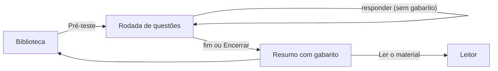

Fluxo do pré-teste: o gabarito só aparece no resumo, e nada da rodada entra em estatísticas, tópicos fracos, treino ou caderno de erros.

### Fluxo do feedback na prática

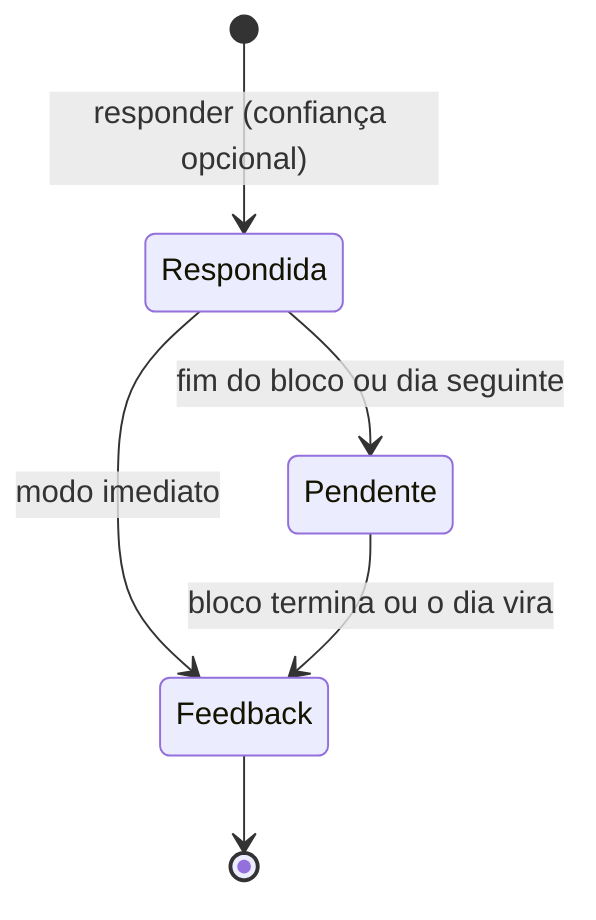

Ciclo de uma resposta: no modo imediato o feedback é instantâneo; nos outros dois ele fica pendente até o fim do bloco ou a virada do dia de estudo.

### Pontos a refinar em 2.5

- Texto e posição do seletor de confiança, com atalhos de teclado (as opções de resposta já têm atalhos 1 a 4).
- Se o resumo do pré-teste abre os comentários na própria tela ou em painel lateral.
- Como "Ver o feedback agora" interage com a fila de pendentes.
- Acessibilidade: foco, `aria-live` no registro da resposta e contraste das faixas informativas nos dois temas.

### Assumptions & open questions

- A9: o mockup de intercalação assume uma opção "Misturar tópicos" por sessão com alternância por tópico ou material; confirmada ou alterada em 2.3 e 2.5. — confirmed: no
- A10: o "bloco" da prática é a fila carregada (até 20 questões), conforme o código atual. — confirmed: no

## 2.1 Codebase analysis

Base de conhecimento: [`.aidlc/codekb/MIND/`](../codekb/MIND/README.md), atualizada de `240ed43` para o HEAD `4e7cc4e` (v0.7.0) em 2026-11-17 e revisada com o usuário (mudanças desde a última análise, baseline e a regra "questões fora do FSRS"). [src: .aidlc/codekb/MIND/README.md]

### Arquitetura em uma imagem

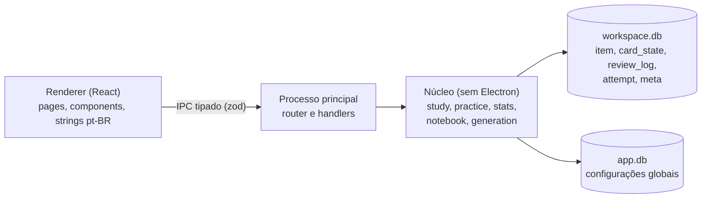

Camadas: o renderer só fala com o núcleo por canais IPC com esquema zod; o núcleo guarda tudo em SQLite (um `workspace.db` por workspace).

### O que importa para esta intent

| Área | Estado atual | Consequência |
|---|---|---|
| Fila de Estudar | Aprendizado vencido, revisões vencidas, depois cards novos por `approved_at, id`; sem mistura de tópicos | Intercalação muda só a ordenação, em `StudyService.queue` |
| Fila de Praticar | Não vistas, erradas na última tentativa, depois "refazer certas" (opcional) | Intercalação e o filtro de fase entram em `PracticeService.queue` |
| Resposta de questão | `practice:answer` grava `attempt` e devolve o gabarito, o comentário e o `why` na mesma chamada | O feedback postergado muda o contrato desse canal |
| Agendamento | Só os cards usam FSRS; as questões não (decisão do autor) | Pré-teste não precisa mexer no FSRS |
| `attempt` | Sem coluna de fase, de confiança nem de momento do feedback; cinco consumidores a leem | Migração `0004` e um filtro único de fase |
| Configurações | `meta` (chave e valor) por workspace, formulário `StudySettingsForm` | Modo de feedback, confiança e intercalação entram em `meta` |
| Dia de estudo | Vira às 4h local (`DAY_ROLLOVER_HOUR`) | O "dia seguinte" do feedback usa a mesma virada |
| Migrações | Workspace em `0003` | A próxima é `0004`, gerada por `pnpm db:generate` |

[src: .aidlc/codekb/MIND/interactions.md, data-model.md; src/core/study/scheduler.ts]

### Baseline (commit `4e7cc4e`)

`pnpm lint`, `format:check` e `typecheck` com exit 0; `pnpm test --coverage` com exit 0, 112 arquivos e 1192 testes (linhas 96,45%, limite 80%). Sem falhas pré-existentes. O `pnpm e2e` não foi rodado. [src: .aidlc/codekb/MIND/quality-and-risks.md]

### Padrões a estender

- Novo canal IPC: esquema zod em `channels.ts`, nome em `channel-names.ts`, handler em `handlers.ts` e chamada por `useInvoke`; mudança incompatível sobe `CONTRACT_VERSION`. [mem: M-9]
- Esquema: Drizzle mais `pnpm db:generate`, com migração aditiva. [mem: M-10]
- Testes ao lado do código, relógio injetável (`clock.ts`) e e2e em `tests/e2e`. [mem: M-5, M-14]

### Assumptions & open questions

- A11: o `pnpm e2e` não foi rodado no baseline; será rodado antes do primeiro commit de código da Construção para saber se há falhas anteriores. — confirmed: no
- A12: o contrato de `practice:answer` pode mudar de forma incompatível (sobe `CONTRACT_VERSION`), porque o renderer e o núcleo são entregues juntos. — confirmed: no
## 2.2 Team practices

Levantadas das evidências do repositório e confirmadas com o usuário nas lacunas (Q11 a Q13).

| Área | Prática | Evidência | Situação |
|---|---|---|---|
| Ramificação | Trabalho direto na `main`; sem branch de feature | `git branch` (só `main`); [mem: M-5] | Seguir |
| Commits | Convencionais, em inglês, atômicos, sem sessão ou ID na mensagem | `git log`; [mem: M-7, M-8] | Seguir |
| Commits nesta intent | Um ou mais commits por Unit verificada, na `main`, sem `git push` até o fim | [src: Q11] | Confirmada |
| Hook de pre-commit | `make install-hooks` ativa Prettier, ESLint e cabeçalhos nos arquivos em stage | `.githooks/pre-commit`; `scripts/pre-commit.ts` | Seguir |
| Qualidade | `pnpm lint` (ESLint e cabeçalhos), `format:check`, `typecheck`; cobertura mínima de 80% | `package.json`; `vitest.config.ts` | Seguir |
| Testes | Vitest e Testing Library ao lado do código, relógio injetável, LLM sempre mockado | [mem: M-5]; `src/core/clock.ts` | Seguir |
| E2E | Playwright dirigindo o Electron; fluxos com seleção, diálogos nativos ou arquivos exigem e2e | [mem: M-14]; `tests/e2e/` | Seguir |
| E2E nesta intent | Um spec e2e por prática, mais testes de unidade e de componente | [src: Q13] | Confirmada |
| CI | GitHub Actions: `verify` (lint, formato, tipos, testes, e2e com xvfb) e `package` | `.github/workflows/ci.yml` | Seguir |
| Esquema do banco | Alteração no Drizzle e `pnpm db:generate`; migração aditiva, sem perder dados | `package.json`; [mem: M-10] | Seguir |
| Contrato IPC | Esquema zod, nome do canal, handler e `useInvoke`; mudança incompatível sobe `CONTRACT_VERSION` | codekb `conventions.md` | Seguir |
| Mockups | HTML autocontido com a paleta e os temas reais | [mem: M-12] | Seguir |
| Release | Tag `vX.Y.Z` dispara `release.yml` (`.deb` e instalador Windows) | `.github/workflows/release.yml` | Fora desta intent |
| Versão nesta intent | Não mexer na versão nem criar tag | [src: Q12] | Confirmada |

### Assumptions & open questions

- Nenhuma nova. A suposição A11 (rodar o e2e antes do primeiro commit de código da Construção) continua aberta.

## 2.5 Refined mockups

Mockup refinado em HTML autocontido, com a paleta e os temas reais, 15 abas de telas e estados: [`mockups/refined.html`](mockups/refined.html). Substitui o rascunho de 1.6 (`mockups/rough.html`), que fica como histórico. [mem: M-12]

### O que mudou em relação a 1.6

| Tela | Mudança | Requisito |
|---|---|---|
| Diálogo do pré-teste | Novo: pede a quantidade (1 a 20, padrão 10), mostra as elegíveis e avisa o limite | FR-2 |
| Pré-teste, durante | "Responder" só habilita depois de escolher a confiança (quando ligada) | FR-17 |
| Praticar, dia seguinte | Novo: "Resposta registrada. O gabarito fica disponível amanhã, a partir das 4h" | FR-9 |
| Feedback pendente | Novo: lista as respostas liberadas, com gabarito, comentário, fonte, confiança e divergência; abrir marca como vistas | FR-10 |
| Estudar, intercalação | Estado desabilitado quando há filtro de tópico ou material | FR-15 |
| Estatísticas | Texto do excesso de confiança com os limiares (80% e 60%) | FR-19, A15 |
| Estados | Novo: "Responder" desabilitado sem confiança escolhida | FR-17 |

### Especificação de interação

| Tela | Interação | Detalhe |
|---|---|---|
| Biblioteca | Botão "Pré-teste" | Habilitado com questões elegíveis; desabilitado com a dica do motivo. Abre o diálogo de quantidade. |
| Diálogo do pré-teste | Quantidade | Número de 1 a 20; valor inválido mostra o erro no campo e não começa; acima das elegíveis, usa as elegíveis e informa. `Enter` começa, `Esc` cancela. |
| Pré-teste e Praticar | Responder | Escolher a alternativa (teclas 1 a N, como hoje) e, com a confiança ligada, o nível (atalhos `Alt`+`1` a `3`); depois **Responder**. A resposta registrada não pode ser alterada. |
| Praticar (fim do bloco) | Registro | Mostra "Resposta registrada", sem gabarito. **Próxima** avança; **Ver o feedback agora** abre o feedback das respondidas até ali e encerra o bloco. |
| Praticar (dia seguinte) | Registro | Mostra "Resposta registrada. Feedback disponível amanhã" e avança. |
| Feedback do bloco e pendente | Lista | Ordem da resposta mais antiga para a mais nova; cada item mostra o resultado, a resposta dada, o gabarito, o comentário, a fonte (com **Ver no PDF**) e a confiança; erradas têm **Fazer um card**. Abrir marca como vistas. |
| Hoje | Aviso de pendentes | Faixa com a contagem de liberadas e o botão **Ver feedback**; some quando o contador zera. |
| Estudar e Praticar | Misturar tópicos | Caixa de marcação, mais "Alternar por: tópico, material". Desabilitada com filtro ativo. O valor inicial vem de Configurações. |
| Configurações | Práticas de estudo | Três opções de feedback (rádio), duas caixas (confiança e intercalação padrão), **Salvar** e **Restaurar padrões**. |

### Estados

| Estado | Onde | Texto ou comportamento |
|---|---|---|
| Vazio | Pré-teste sem elegíveis | Botão desabilitado com a dica de gerar e aprovar questões |
| Vazio | Feedback pendente | "Você não tem respostas aguardando feedback." |
| Vazio | Calibração | Explica como ligar a pergunta em Configurações |
| Carregando | Rodada, feedback | Esqueleto, como as demais telas |
| Erro | Registro da resposta | "Não foi possível registrar sua resposta. Tente de novo; nada foi perdido." |
| Sem provedor | Todas | Funcionam normalmente; só Gerar precisa de provedor |

### Acessibilidade e teclado

- Tudo operável por teclado, com ordem de foco: alternativas, confiança, **Responder**, **Pular**.
- O registro da resposta e a liberação do feedback usam `role="status"` (anúncio sem roubar o foco); o diálogo usa `role="dialog"` com foco inicial no campo de quantidade e retorno do foco ao botão de origem. [src: NFR-5]
- As faixas informativas usam texto e borda, não só cor; contraste mínimo de 4,5:1 nos dois temas. [src: NFR-5]
- O atalho `Alt`+`1` a `3` para a confiança não conflita com os atalhos atuais: o único com `Alt` é `Alt+←` (voltar), em `Shell.tsx`; as teclas numéricas sozinhas escolhem as alternativas. [src: src/renderer/src/components/Shell.tsx:50]

### Assumptions & open questions

- A16: o aviso de pendentes fica em Hoje, e a tela de feedback pendente é aberta a partir dele e de Praticar; não ganha item próprio na barra lateral. — confirmed: no
- A17: **Alternar por: tópico, material** vale só enquanto a sessão durar (não é gravado por padrão). — confirmed: no

## 2.6 Domain & components

### Componentes

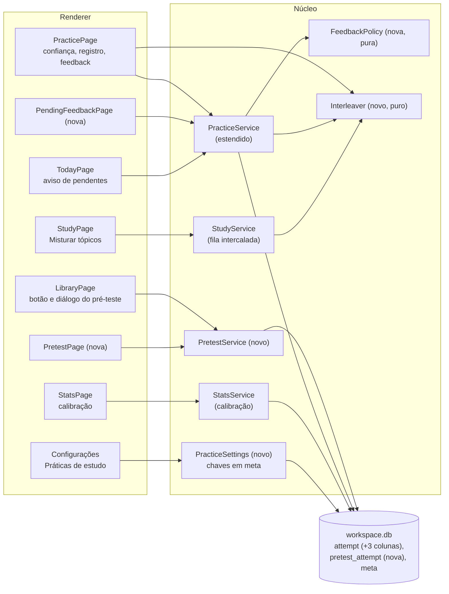

Componentes e dependências: o renderer só alcança o núcleo por IPC (omitido no diagrama); `FeedbackPolicy` e `Interleaver` são funções puras, sem banco nem relógio próprio, o que as deixa testáveis sem Electron.

| Componente | Responsabilidade | Interfaces | Dados que possui |
|---|---|---|---|
| `PracticeService` (estendido) | Grava a resposta com confiança, aplica a política de feedback, libera blocos, lista e marca pendentes, monta a fila (com intercalação opcional) | `answer`, `releaseBlock`, `pending`, `openFeedback`, `queue` | `attempt` |
| `PretestService` (novo) | Lista as questões elegíveis de um material, monta a rodada, grava as respostas e devolve o resumo | `eligible`, `start`, `answer`, `summary` | `pretest_attempt` |
| `FeedbackPolicy` (nova, pura) | Dado o modo, o momento da resposta e a virada do dia, devolve se o feedback é imediato, pertence ao bloco ou quando é liberado | `releaseFor(mode, answeredAt, offset)` | nenhum |
| `Interleaver` (novo, puro) | Rodízio determinístico por uma chave (tópico ou material): escolhe o próximo item a partir da chave do último mostrado, mantendo a ordem dentro de cada chave | `pick(items, keyOf, afterKey)`, `interleave(items, keyOf)` | nenhum |
| `StudyService` (estendido) | Aplica o `Interleaver` dentro de cada parte da fila de cards | `queue(..., { mix })` | `card_state`, `review_log` (sem mudança) |
| `StatsService` (estendido) | Calibração por nível de confiança, excesso de confiança e tópicos com mais respostas seguras erradas | `calibration(days, now)` | leitura de `attempt` |
| `PracticeSettings` (novo) | Lê e grava o modo de feedback, a pergunta de confiança e a intercalação padrão | `get`, `set`, `reset` | chaves em `meta` |

### Modelo de dados

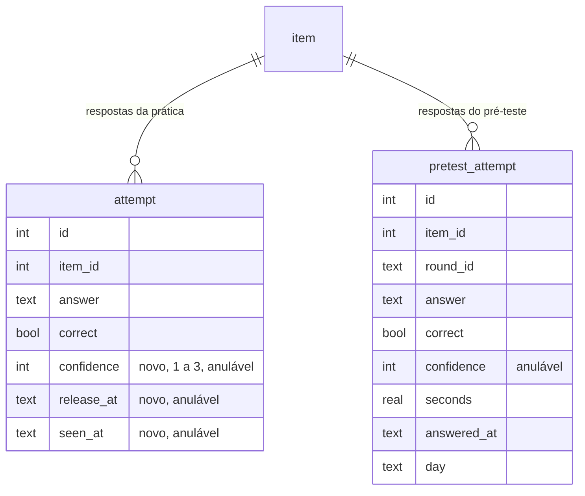

Dados novos: três colunas em `attempt` e a tabela `pretest_attempt`, na migração `0004`; o pré-teste nunca toca `attempt`.

- `release_at` e `seen_at` em `attempt`: o feedback de uma resposta é visível quando `release_at` já passou; é "pendente" quando está visível e `seen_at` é nulo. As respostas antigas ganham `release_at = seen_at = answered_at` na migração (já tinham visto o feedback). [src: NFR-1]
- `pretest_attempt.round_id` agrupa as respostas de uma rodada para o resumo.
- Novas chaves em `meta`: `practice.feedback` (`immediate`, `block`, `next_day`; padrão `immediate`), `practice.confidence` (`0` ou `1`; padrão `0`) e `study.interleave` (`0` ou `1`; padrão `0`). [src: FR-7, FR-16, FR-13]

### Regras de domínio

| Regra | Descrição |
|---|---|
| Elegibilidade do pré-teste | Questões aprovadas do material, sem nenhuma linha em `attempt`; as que ainda não apareceram em nenhuma rodada vêm antes, depois as demais, por ordem de aprovação |
| Liberação do feedback | Imediato: `release_at = answered_at` e visto ao mostrar; bloco: `release_at` nulo até `releaseBlock` ou até a próxima visita a Praticar (bloco abandonado); dia seguinte: `release_at` na próxima virada do dia de estudo (4h) |
| Pendente | `seen_at` nulo e `release_at` não nulo e `release_at <= agora`, só em `attempt` |
| Correção | `correct` é gravado na resposta e não muda; estatísticas contam desde a resposta |
| Rodízio | Para cada parte da fila, agrupa por chave e ordena os grupos pela chave (identificador crescente, o grupo sem chave por último); o próximo item é o primeiro do primeiro grupo cuja chave vem depois da chave do último mostrado, voltando ao início quando acaba; chave de material é a mesma de `filterConditions` |
| Excesso de confiança | "tenho certeza" com acerto abaixo de 80% ou "acho que sei" abaixo de 60%; "chute" sem aviso; só `attempt`, janela de 30 dias, mínimo de 5 respostas por nível para exibir o aviso |

### Decisões

#### ADR-1 Respostas do pré-teste em tabela própria — Status: accepted

- **Contexto:** o pré-teste não pode distorcer estatísticas, tópicos fracos, treino, caderno de erros nem a fila da prática, e cinco consumidores leem `attempt`. [src: R-1, FR-4]
- **Decisão:** gravar o pré-teste em `pretest_attempt`, sem alterar nenhum consumidor de `attempt`. [src: Q18]
- **Alternativas:** coluna `phase` em `attempt` (exige filtro nos cinco consumidores, e um esquecimento vira erro silencioso); tabela própria agora e unificação depois (adiada).
- **Consequências:** R-1 deixa de existir por construção; há duas tabelas com colunas parecidas e código de gravação próprio; uma análise futura de pré-teste contra desempenho lê as duas.
- **Relacionados:** FR-3, FR-4, FR-5, NFR-1.

#### ADR-2 Visibilidade do feedback em `attempt` — Status: accepted

- **Contexto:** o feedback pode ser imediato, ao fim do bloco ou no dia seguinte, e a correção já é gravada na resposta. [src: FR-7 a FR-11]
- **Decisão:** acrescentar `release_at` e `seen_at` a `attempt`; `FeedbackPolicy` calcula `release_at` no registro; o fim do bloco e a visita seguinte a Praticar liberam o que ficou com `release_at` nulo.
- **Alternativas:** tabela `feedback` à parte (um join a mais, sem ganho); calcular a liberação só na leitura a partir do modo (perde o histórico se o modo mudar).
- **Consequências:** o modo vale por resposta, no momento em que ela é dada; mudar a configuração não reescreve respostas antigas; a consulta de pendentes é um índice em `seen_at`.
- **Relacionados:** FR-7 a FR-11, NFR-1.

#### ADR-3 Intercalação como função pura aplicada dentro de cada parte da fila — Status: accepted

- **Contexto:** a ordem tem de ser determinística (sem sorteio) e respeitar as prioridades atuais. [src: Q14, NFR-4, FR-15]
- **Decisão:** `Interleaver.pick(items, keyOf, afterKey)` escolhe o próximo item em rodízio a partir da chave do último mostrado, e `interleave` aplica o mesmo critério a uma lista inteira. As filas de Estudar e de Praticar entregam um item por chamada (`study:next`, `practice:next`) e recalculam a cada resposta, então o rodízio precisa ser sem estado no servidor: o renderer devolve a chave do último item (`mixKey`) na chamada seguinte. `StudyService` e `PracticeService` aplicam o `pick` a cada parte da fila; para cards novos e não vistas, o conjunto candidato traz só id, tópico e material.
- **Alternativas:** embaralhar tudo (viola o determinismo e a prioridade do aprendizado); só novos e não vistas (menos mistura); rodízio recalculado do zero a cada chamada (não alterna, porque o item mostrado sai do conjunto e o primeiro grupo volta a vencer).
- **Consequências:** o custo extra é uma consulta leve de ids e chaves, dentro da meta de 200 ms para 5.000 itens (NFR-3); a função é testada sozinha, com tabelas de casos.
- **Relacionados:** FR-13 a FR-15, NFR-3, NFR-4.

#### ADR-4 Configurações em `meta`, por um módulo próprio — Status: accepted

- **Contexto:** as opções são por workspace e seguem o padrão atual de `StudySettingsForm`. [src: FR-21]
- **Decisão:** `PracticeSettings` lê e grava as três chaves em `meta`, com validação zod e padrões que preservam o comportamento atual; sem nova tabela.
- **Alternativas:** estender `StudySettings` (mistura o agendamento FSRS com a prática de questões); armazenar em `app.db` (global, não por workspace).
- **Consequências:** o backup do workspace leva as opções; restaurar padrões regrava as três chaves.
- **Relacionados:** FR-7, FR-13, FR-16, FR-21, NFR-10.

#### ADR-5 Contrato de resposta com feedback opcional — Status: accepted

- **Contexto:** hoje `practice:answer` devolve `correct`, o gabarito e os comentários na mesma resposta; nos modos adiados o renderer não deve receber essas informações antes da hora. [src: FR-8, FR-9]
- **Decisão:** a resposta passa a trazer `attemptId` e `feedback` (nulo quando o feedback é adiado), mais `releaseAt` (nulo para o fim do bloco); o gabarito e o comentário só chegam por `practice:releaseBlock`, `practice:pending` e `practice:openFeedback`. `CONTRACT_VERSION` sobe de 1 para 2. [src: A12]
- **Alternativas:** devolver tudo e esconder na interface (o dado fica disponível ao renderer, e um defeito de tela revelaria a resposta); um canal novo só para o modo adiado (duplica o fluxo).
- **Consequências:** o renderer e o núcleo precisam mudar juntos e são entregues juntos; os testes e a `fake-mind.ts` mudam com o contrato.
- **Relacionados:** FR-7 a FR-10, NFR-7.

#### ADR-6 Calibração calculada em `StatsService` — Status: accepted

- **Contexto:** a análise compara confiança e acerto nas respostas da prática. [src: FR-19]
- **Decisão:** `StatsService.calibration(days, now)` agrega `attempt` por nível de confiança na janela de 30 dias, sem tabela nova; o aviso de excesso de confiança usa os limiares de 80% e 60% e exige ao menos 5 respostas por nível. [src: Q19, A15]
- **Alternativas:** guardar agregados (dado derivado, desnecessário); incluir o pré-teste (contradiz A6).
- **Consequências:** o cálculo é lido na hora, e ajustar os limiares no futuro não exige migração.
- **Relacionados:** FR-17 a FR-20.

### Assumptions & open questions

- A15 resolvida: limiares de 80% e 60%, com o mínimo de 5 respostas por nível (acrescentado aqui, porque um nível com 1 ou 2 respostas daria um aviso sem sentido). [src: Q19]
- A18: o limite de 5 respostas por nível para exibir o aviso é novo em relação a 2.3; confirmado ou ajustado neste gate. — confirmed: no

## 2.7 Units of work

Sete Units, em ordem de dependência. A primeira é o esqueleto andante: a menor fatia ponta a ponta (tela, IPC, núcleo e banco). Cada Unit entrega as suas funcionalidades por inteiro, com testes de unidade, de componente e, quando é um fluxo de tela, um spec e2e (M-15). [src: 1.4, mem: M-15]

### Dependency order

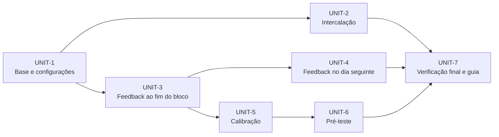

Ordem topológica: UNIT-1, UNIT-2, UNIT-3, UNIT-4, UNIT-5, UNIT-6, UNIT-7. UNIT-2 e UNIT-3 são independentes entre si e podem trocar de ordem; o grafo é acíclico.

### UNIT-1 Base e configurações

- **Purpose:** preparar o esquema e a seção de Configurações, deixando as três opções gravadas por workspace. É o esqueleto andante (tela, IPC, núcleo e banco).
- **Covers:** US-7, FR-21, NFR-1, NFR-10, NFR-8 (parte).
- **Scope in:** migração `0004` (colunas `confidence`, `release_at` e `seen_at` em `attempt`, preenchimento das respostas antigas e tabela `pretest_attempt`), `PracticeSettings` (chaves em `meta`), canais `practice:settings` e `practice:setSettings`, e a seção "Práticas de estudo" em Configurações com restaurar padrões; rodar o `pnpm e2e` do baseline (A11).
- **Scope out:** o comportamento das opções (cada Unit seguinte consome a sua chave).
- **Interfaces:** `PracticeSettings.get/set/reset`; canais de configurações.
- **Depends on:** nenhuma.
- **Definition of Done:** o comando de verificação passa; um banco `0003` populado migra sem perda e as respostas antigas ficam como já vistas (NFR-1); exportar e importar um workspace leva as opções e as novas colunas (NFR-10); as opções persistem após reabrir o app (e2e); e2e baseline registrado.

### UNIT-2 Intercalação

- **Purpose:** misturar tópicos ou materiais nas filas de Estudar e de Praticar.
- **Covers:** US-4, FR-13, FR-14, FR-15, NFR-3, NFR-4.
- **Scope in:** `Interleaver`, uso em `StudyService.queue` e em `PracticeService.queue`, opção "Misturar tópicos" (por tópico ou por material) em Estudar e Praticar, valor inicial vindo da configuração, desabilitada com filtro ativo.
- **Scope out:** mudanças no FSRS e nos limites diários.
- **Interfaces:** `queue(..., { mix })` nos dois serviços; canais `study:next` e `practice:*` com o parâmetro novo.
- **Depends on:** UNIT-1.
- **Definition of Done:** o comando de verificação passa; testes de tabela do rodízio (exemplo A1 B1 A2 B2 A3 A4); fila de 5.000 itens em menos de 200 ms (NFR-3); mesma entrada, mesma ordem (NFR-4); e2e da opção em Estudar e em Praticar; padrões preservam a fila atual (NFR-2).

### UNIT-3 Feedback ao fim do bloco

- **Purpose:** registrar a resposta sem revelar o gabarito e mostrá-lo ao fim do bloco.
- **Covers:** US-2, FR-7, FR-8, FR-11, FR-12, NFR-7, NFR-5 (parte).
- **Scope in:** `FeedbackPolicy` (modos imediato e bloco), contrato novo de `practice:answer` (ADR-5, `CONTRACT_VERSION` 2), `practice:releaseBlock`, tela de registro e de feedback do bloco, "Ver o feedback agora" e "Fazer um card" no feedback.
- **Scope out:** o dia seguinte e a lista de pendentes (UNIT-4); a confiança (UNIT-5).
- **Interfaces:** `PracticeService.answer/releaseBlock`; `FeedbackPolicy.releaseFor`; canais `practice:answer` e `practice:releaseBlock`.
- **Depends on:** UNIT-1.
- **Definition of Done:** o comando de verificação passa; o contrato e a `fake-mind.ts` atualizados e `CONTRACT_VERSION` em 2; o modo imediato idêntico ao atual (NFR-2); estatísticas contam a resposta desde o registro (FR-11); `role="status"` no registro (NFR-5); e2e do bloco completo e do "Ver o feedback agora".

### UNIT-4 Feedback no dia seguinte

- **Purpose:** liberar o gabarito na virada do dia de estudo e reunir os pendentes.
- **Covers:** US-3, FR-9, FR-10.
- **Scope in:** modo "dia seguinte" em `FeedbackPolicy`, `practice:pending` e `practice:openFeedback`, liberação de blocos abandonados na visita a Praticar, tela de feedback pendente e o aviso em Hoje.
- **Scope out:** expiração e limite de pendentes (decidido: nenhum).
- **Interfaces:** `PracticeService.pending/openFeedback`; canais `practice:pending`, `practice:openFeedback`; `today:summary` com a contagem de liberadas.
- **Depends on:** UNIT-3.
- **Definition of Done:** o comando de verificação passa; teste de relógio nas viradas (3h59 sem feedback e 4h00 com); bloco abandonado liberado na visita seguinte; abrir marca como visto e zera o contador; e2e do aviso em Hoje até a tela de feedback.

### UNIT-5 Calibração

- **Purpose:** perguntar a confiança antes de responder e comparar com o acerto.
- **Covers:** US-5, US-6, FR-16, FR-17, FR-18, FR-19, FR-20, NFR-5 (parte).
- **Scope in:** seletor de confiança (componente reutilizável, atalhos `Alt`+`1` a `3`), gravação em `attempt.confidence`, destaque de divergência no feedback, `StatsService.calibration` com os limiares e o mínimo de 5 respostas, seção de calibração em Estatísticas e o estado vazio.
- **Scope out:** o pré-teste, que reutiliza o seletor na UNIT-6.
- **Interfaces:** componente `ConfidencePicker`; `StatsService.calibration`; canal `stats:calibration`.
- **Depends on:** UNIT-3.
- **Definition of Done:** o comando de verificação passa; "Responder" desabilitado sem escolha; cálculo testado nos limiares (79% e 80%, 59% e 60%, menos de 5 respostas); o pré-teste fica de fora dos números; navegável por teclado (NFR-5); e2e da pergunta e da tabela.

### UNIT-6 Pré-teste

- **Purpose:** permitir testar-se antes de ler um material, com os erros fora das estatísticas.
- **Covers:** US-1, FR-1, FR-2, FR-3, FR-4, FR-5, FR-6, NFR-5 (parte).
- **Scope in:** `PretestService` (elegíveis, rodada, resposta, resumo), gravação em `pretest_attempt`, botão e diálogo de quantidade na Biblioteca, tela da rodada, resumo, uso do `ConfidencePicker` com a calibração ligada e o feedback sempre ao fim da rodada.
- **Scope out:** rastrear leitura e sugerir o pré-teste (backlog).
- **Interfaces:** `PretestService.eligible/start/answer/summary`; canais `pretest:*`.
- **Depends on:** UNIT-1 e UNIT-5.
- **Definition of Done:** o comando de verificação passa; testes de que estatísticas, tópicos fracos, treino, caderno de erros e fila de Praticar ignoram `pretest_attempt`; a questão errada no pré-teste continua "não vista"; elegibilidade e limite de 20 testados; e2e da rodada e do resumo.

### UNIT-7 Verificação final e guia

- **Purpose:** garantir que as práticas funcionam juntas, sem internet nem provedor, e atualizar o guia.
- **Covers:** US-8, US-9, FR-22, FR-23, NFR-2, NFR-6, NFR-9.
- **Scope in:** teste de integração das quatro práticas combinadas (feedback adiado com confiança e intercalação; pré-teste com feedback do bloco), execução sem provedor e sem rede, revisão dos textos pt-BR e do contraste nos dois temas, atualização de `docs/guides/study-guide.md` e do `codekb`.
- **Scope out:** novas funcionalidades.
- **Interfaces:** nenhuma nova.
- **Depends on:** UNIT-2, UNIT-4 e UNIT-6.
- **Definition of Done:** o comando de verificação e o `pnpm e2e` completos passam; nenhum teste anterior teve a expectativa alterada, salvo os do contrato (NFR-2); cobertura global de pelo menos 80% (NFR-9); guia e `codekb` atualizados.

### Story → Unit map

| História | Unit | História | Unit |
|---|---|---|---|
| US-1 | UNIT-6 | US-6 | UNIT-5 |
| US-2 | UNIT-3 | US-7 | UNIT-1 |
| US-3 | UNIT-4 | US-8 | UNIT-7 |
| US-4 | UNIT-2 | US-9 | UNIT-7 |
| US-5 | UNIT-5 |  |  |

Todo FR tem uma única Unit: FR-1 a FR-6 em UNIT-6; FR-7, FR-8, FR-11, FR-12 em UNIT-3; FR-9, FR-10 em UNIT-4; FR-13 a FR-15 em UNIT-2; FR-16 a FR-20 em UNIT-5 (o pré-teste de FR-17 é entregue em UNIT-6, que reutiliza o seletor); FR-21 em UNIT-1; FR-22 e FR-23 em UNIT-7.

### Assumptions & open questions

- A19: UNIT-2 e UNIT-3 são independentes e podem trocar de ordem na Construção; a ordem acima começa pela intercalação, a mais barata, depois de validar o esqueleto. — confirmed: no
- A20: o FR-17 (confiança também no pré-teste) é entregue em UNIT-6 e verificado lá, apesar de pertencer a UNIT-5. — confirmed: no

## 2.8 Contracts

Contratos IPC dos canais novos e alterados, no formato de `src/core/contracts/channels.ts` (esquemas zod com `.strict()`, `workspaceId` em todo canal) e a migração `0004`. Canais não citados não mudam. [src: .aidlc/codekb/MIND/api.md]

### Versão do contrato

| Unit | Mudança | Compatível? |
|---|---|---|
| UNIT-1 | Canais novos `practice:settings` e `practice:saveSettings` | Sim (só acréscimos) |
| UNIT-2 | `mix` opcional na entrada e `mixKey` na saída de `study:next` e `practice:next` | Sim (acréscimos opcionais) |
| UNIT-3 | `practice:answer` e `practice:next` mudam de forma; canal novo `practice:releaseBlock` | **Não: `CONTRACT_VERSION` sobe de 1 para 2** |
| UNIT-4 | Canais novos `practice:releaseAbandoned`, `practice:pendingCount`, `practice:openFeedback`; `today:summary` ganha `pendingFeedback` | Sim |
| UNIT-5 | `confidence` opcional em `practice:answer`; canal novo `stats:calibration` | Sim |
| UNIT-6 | Canais novos `pretest:start`, `pretest:answer`, `pretest:summary`; `material:list` ganha `pretestEligible` | Sim |

[src: ADR-5, A12]

### Tipos compartilhados

```ts
const feedbackMode = z.enum(["immediate", "block", "next_day"]);
const confidence = z.number().int().min(1).max(3); // 1 chute, 2 acho que sei, 3 tenho certeza
const mixBy = z.enum(["topic", "material"]);

/** A question as the window sees it BEFORE answering: no answer key, no comments, no quote. */
const questionView = z.object({
  id: z.number().int(),
  statement: z.string(),
  subtype: z.string(),
  topic: z.string().nullable(),
  options: z.array(z.object({ key: z.string(), text: z.string() })),
});

/** What is revealed once the feedback is released. */
const feedback = z.object({
  attemptId: z.number().int(),
  itemId: z.number().int(),
  statement: z.string(),
  correct: z.boolean(),
  answer: z.string(),
  correctKey: z.string(),
  explanation: z.string(),
  options: z.array(z.object({ key: z.string(), text: z.string(), why: z.string() })),
  confidence: confidence.nullable(),
  answeredAt: z.string(),
  sourceTitle: z.string(),
  sourcePage: z.number().int().nullable(),
  quote: z.string(),
  pdfSource, // already defined in channels.ts
});
```

`questionView` e `feedback` são novos; `practice:next` deixa de enviar a chave, o comentário e a fonte antes da resposta (ADR-5).

### Canais

| Canal | Entrada | Saída | Unit |
|---|---|---|---|
| `practice:settings` | `{ workspaceId }` | `{ feedback, confidence: boolean, interleave: boolean, defaults: { … } }` | 1 |
| `practice:saveSettings` | `{ workspaceId, feedback?, confidence?, interleave? }` | as configurações novas | 1 |
| `material:list` (alterado) | sem mudança | cada material ganha `pretestEligible: int ≥ 0` (questões aprovadas do material sem nenhuma linha em `attempt`) | 6 |
| `study:next` e `practice:next` (alterados) | ganham `mix: { by: mixBy, afterKey: string \| null }` opcional | ganham `mixKey: string \| null` (chave do item devolvido) | 2 |
| `practice:next` (alterado) | como hoje | `question: { item: questionView, attempts, lastCorrect } \| null`, `counts` | 3 |
| `practice:answer` (alterado) | `{ workspaceId, itemId, answer, confidence?, seconds? }` | `{ attemptId, feedback: feedback \| null, releaseAt: string \| null }` | 3, 5 |
| `practice:releaseBlock` | `{ workspaceId, attemptIds: int[1..100] }` | `{ entries: feedback[] }` | 3 |
| `practice:releaseAbandoned` | `{ workspaceId }` | `{ released: int }` | 4 |
| `practice:pendingCount` | `{ workspaceId }` | `{ count: int }` | 4 |
| `practice:openFeedback` | `{ workspaceId, limit?: int[1..200] }` | `{ entries: feedback[], remaining: int }` | 4 |
| `today:summary` (alterado) | sem mudança | ganha `pendingFeedback: int` | 4 |
| `stats:calibration` | `{ workspaceId, days?: int[1..365] }` | `{ hasData: boolean, levels: { level, answers, correct, rate: number \| null, flag: "overconfident" \| null }[3], topics: { topicId, name, confidentWrong }[] }` | 5 |
| `pretest:start` | `{ workspaceId, materialId, count: int[1..20] }` | `{ roundId: string, questions: questionView[], available: int }` | 6 |
| `pretest:answer` | `{ workspaceId, roundId, itemId, answer, confidence?, seconds? }` | `{}` (sem feedback) | 6 |
| `pretest:summary` | `{ workspaceId, roundId }` | `{ total, correct, entries: feedback[] }` | 6 |

Regras de cada canal:

- **`practice:answer`**: valida a alternativa (como hoje) e, com a confiança ligada, exige `confidence` (erro `VALIDATION_ERROR` no campo `confidence`). Grava `correct`, `confidence`, `release_at` e `seen_at` conforme `FeedbackPolicy`: no imediato devolve `feedback` e marca `seen_at`; no bloco devolve `feedback: null` e `releaseAt: null`; no dia seguinte devolve `feedback: null` e `releaseAt` na próxima virada. Uma resposta com a questão já respondida no mesmo bloco não é aceita pelo renderer, mas o serviço aceita mais de uma tentativa por questão, como hoje.
- **`practice:releaseBlock`**: libera as respostas dos `attemptIds` que ainda estão sem `release_at`, marca `seen_at` e devolve o feedback na ordem recebida; ids de outro workspace, de outra fase ou inexistentes falham com `VALIDATION_ERROR`.
- **`practice:releaseAbandoned`**: libera, com `release_at = agora`, toda resposta de prática com `release_at` nulo (blocos abandonados); o renderer o chama ao abrir Praticar.
- **`practice:openFeedback`**: devolve o feedback liberado e ainda não visto, da resposta mais antiga para a mais nova, e marca como vistos os devolvidos; `remaining` conta o que ficou para a chamada seguinte.
- **`pretest:start`**: elegíveis conforme a regra de domínio (2.6); `count` acima das elegíveis usa as elegíveis e `available` informa o total; sem elegíveis, `VALIDATION_ERROR` no campo `count`; `MATERIAL_NOT_FOUND` para material inexistente. `roundId` é um UUID gerado no núcleo.
- **`pretest:answer`**: grava em `pretest_attempt` sem devolver correção; `roundId` e `itemId` precisam pertencer a uma rodada iniciada (`VALIDATION_ERROR` caso contrário).
- **`pretest:summary`**: devolve o resumo da rodada, com gabarito, comentário e fonte; pode ser chamado mais de uma vez.
- **`stats:calibration`**: lê só `attempt` da fase de prática, na janela de `days` (padrão 30); `flag` só aparece com ao menos 5 respostas no nível (80% para o nível 3, 60% para o nível 2).

### Modelo de erros

Sem códigos novos: `VALIDATION_ERROR` (com `FieldError` por campo), `ITEM_NOT_FOUND`, `MATERIAL_NOT_FOUND` e `WORKSPACE_NOT_FOUND`, como no resto do contrato. O renderer mostra as mensagens em pt-BR já devolvidas pelo núcleo. [src: src/core/contracts/errors.ts]

### Sequências

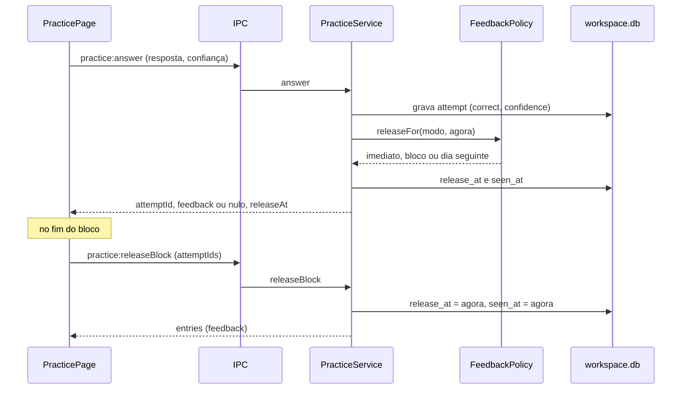

Resposta na prática: o modo decide se o feedback volta na hora, no fim do bloco (liberado pelo renderer com `releaseBlock`) ou na virada do dia.

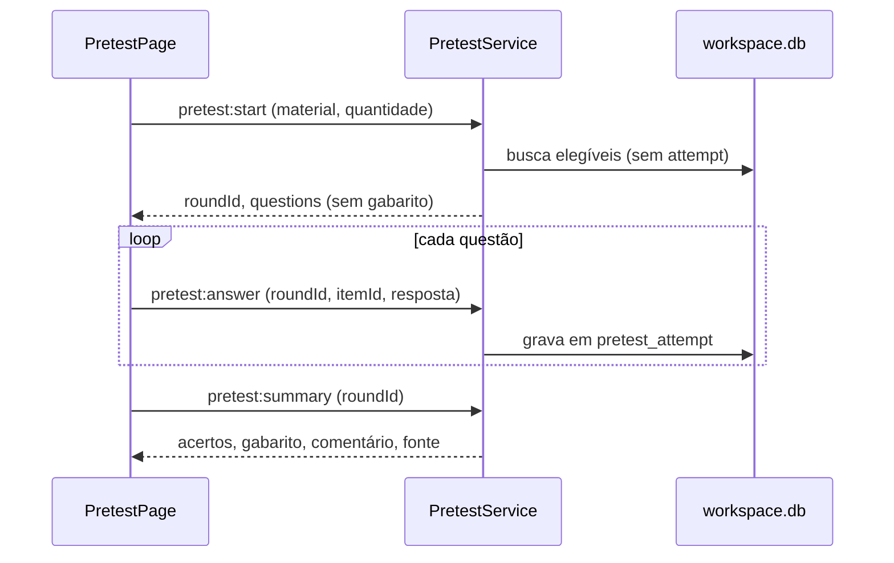

Pré-teste: nenhuma chamada da rodada devolve correção; o gabarito só chega no resumo, e `attempt` nunca é tocada.

### Migração `0004`

Gerada por `pnpm db:generate` a partir do esquema Drizzle e completada à mão com o preenchimento dos dados antigos:

```sql
ALTER TABLE attempt ADD COLUMN confidence integer;
ALTER TABLE attempt ADD COLUMN release_at text;
ALTER TABLE attempt ADD COLUMN seen_at text;
UPDATE attempt SET release_at = answered_at, seen_at = answered_at;
CREATE INDEX ix_attempt_pending ON attempt (seen_at, release_at);

CREATE TABLE pretest_attempt (
  id integer PRIMARY KEY AUTOINCREMENT,
  item_id integer NOT NULL REFERENCES item (id) ON DELETE CASCADE,
  round_id text NOT NULL,
  answer text NOT NULL,
  correct integer NOT NULL,
  confidence integer,
  seconds real,
  answered_at text NOT NULL,
  day text NOT NULL
);
CREATE INDEX ix_pretest_attempt_round ON pretest_attempt (round_id);
CREATE INDEX ix_pretest_attempt_item ON pretest_attempt (item_id);
```

A migração só acrescenta colunas anuláveis e uma tabela, e preenche as respostas antigas como já vistas; não remove nem reescreve dados. A faixa de `confidence` (1 a 3) é garantida pelo zod no núcleo. [src: NFR-1, mem: M-10]

### Contratos de interface interna

- `FeedbackPolicy.releaseFor(mode, answeredAt, offset) → { releaseAt: string | null, seen: boolean }`: `immediate` devolve `{ releaseAt: answeredAt, seen: true }`; `block`, `{ releaseAt: null, seen: false }`; `next_day`, `{ releaseAt: <próxima virada às 4h>, seen: false }`.
- `Interleaver.pick(items, keyOf, afterKey) → item | null`; para a mesma entrada devolve sempre o mesmo item (NFR-4).
- `PracticeSettings.get/set/reset`: chaves `practice.feedback`, `practice.confidence`, `study.interleave` em `meta`; valor inválido grava `VALIDATION_ERROR` e mantém o anterior.

### Assumptions & open questions

- A21: `practice:next` deixa de enviar a chave, o comentário, o `why` e a citação antes da resposta, em todos os modos (e não só nos adiados); isso amplia a UNIT-3 (a `PracticePage` passa a ler esses dados do feedback). — confirmed: no
- A22: o rodízio sem estado usa `mixKey` devolvido pelo servidor e repassado pelo renderer; trocar de aba ou recarregar reinicia o rodízio pela primeira chave. — confirmed: no
- A23: `material:list` passa a calcular `pretestEligible` com uma contagem por material; para 100 materiais a consulta continua abaixo de 50 ms. — confirmed: no


## 3.x Per-Unit design

Nota por Unit (perfil Standard, estágios 3.1 a 3.3 reunidos; 3.4 pulado, sem infraestrutura). [src: state.md]

### UNIT-1 — Functional design / NFR requirements / NFR design

**Fluxo.** A seção "Práticas de estudo" segue o padrão de `StudySettingsForm`: carrega os valores por `practice:settings`, edita o formulário em memória e grava por `practice:saveSettings`; "Restaurar padrões" volta o formulário aos padrões e o salvamento é um passo à parte.

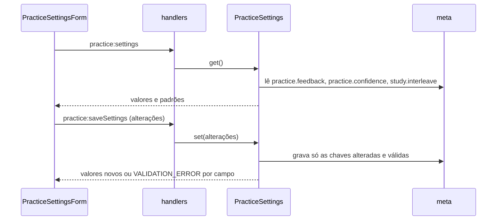

Leitura e gravação das opções: o núcleo valida cada campo e só grava o que for válido.

**Regras.**

| Regra | Detalhe |
|---|---|
| Chaves e padrões | `practice.feedback` = `immediate` (aceita `immediate`, `block`, `next_day`), `practice.confidence` = `0` (aceita `0`, `1`), `study.interleave` = `0` (aceita `0`, `1`) |
| Validação | Valor fora da lista: `VALIDATION_ERROR` no campo (`feedback`, `confidence`, `interleave`), sem gravar nenhum campo do mesmo pedido |
| Leitura | Valor ausente ou corrompido em `meta` volta ao padrão, sem erro |
| Restaurar padrões | Preenche o formulário com os padrões devolvidos por `practice:settings`; gravar continua sendo um passo à parte |
| Migração `0004` | Gerada por `pnpm db:generate` a partir do esquema Drizzle e completada à mão com o `UPDATE` das respostas antigas; cada instrução separada por `--> statement-breakpoint` |

**NFR desta Unit.**

| NFR | Como a Unit atende | Verificação |
|---|---|---|
| NFR-1 | Migração aditiva; as respostas antigas ganham `release_at = seen_at = answered_at` | Teste de banco: aplica `0000` a `0003`, insere respostas, aplica `0004` e confere as linhas |
| NFR-7 | Dois canais novos com esquema zod `.strict()` | Testes de contrato e do roteador |
| NFR-8 | Textos pt-BR em `strings.ts` | Teste de componente |
| NFR-10 | As colunas e as chaves de `meta` entram no snapshot do banco | Teste de exportar e importar um workspace com dados novos |

**Arquivos.** Novos: `src/core/practice/settings.ts` e `settings.test.ts`, `src/renderer/src/components/PracticeSettingsForm.tsx`, `tests/e2e/practice-settings.spec.ts` e a migração `0004_*.sql`. Alterados: `workspace-schema.ts`, `channels.ts`, `channel-names.ts`, `handlers.ts`, `core.ts`, `SettingsPage.tsx`, `strings.ts`, `fake-mind.ts` e `db.test.ts`.

### Assumptions & open questions

- A26: "Restaurar padrões" só preenche o formulário (como em Estudar); o usuário clica em Salvar para gravar. — confirmed: no

### UNIT-2 — Functional design / NFR requirements / NFR design

**Rodízio.** `Interleaver.pick(items, keyOf, afterKey)` recebe a lista de uma parte da fila já na ordem de prioridade e devolve o próximo item em rodízio: ordena as chaves distintas (identificador numérico crescente, o grupo sem chave por último), escolhe a primeira chave maior que `afterKey` (volta à primeira quando não há), e devolve o primeiro item daquela chave. `afterKey = null` começa pela primeira. A chave é uma string opaca (`t:<id>`, `m:<id>`, `none`), que o servidor devolve como `mixKey` e o renderer repassa. O exemplo de FR-14 (A1 B1 A2 B2 A3 A4) sai assim: depois de A vem B, e quando B acaba o rodízio volta a A.

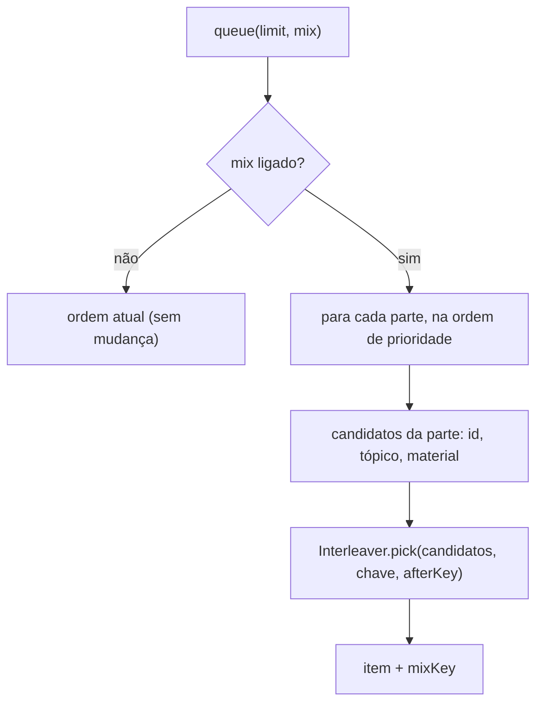

Aplicação do rodízio: sem a opção a fila fica como hoje; com ela, o `pick` age dentro de cada parte, sem trocar as prioridades.

| Regra | Detalhe |
|---|---|
| Partes em Estudar | aprendizado vencido, revisões vencidas, novos (como hoje); o `pick` vale em cada parte, e os limites diários continuam |
| Partes em Praticar | não vistas, erradas na última tentativa, refazer (quando ligado) |
| Chave de tópico | `item.topic_id` (nulo vira `none`) |
| Chave de material | `generation_run.material_id` do item, o mesmo critério de `filterConditions` (nulo vira `none`) |
| Filtro ativo | com filtro de tópico ou material a opção fica desabilitada e o `mix` não é enviado |
| Sem estado | o servidor não guarda nada; recarregar a tela volta ao começo do rodízio (A22) |

**NFR.** NFR-3: `pick` sobre 5.000 candidatos em menos de 200 ms (busca de chaves numa só consulta); NFR-4: mesma entrada, mesma saída, sem `Math.random` (teste com 100 repetições). **Arquivos.** Novos: `src/core/study/interleave.ts` e `.test.ts`, `src/renderer/src/components/MixControl.tsx`, `tests/e2e/interleave.spec.ts`. Alterados: `study/service.ts`, `practice/service.ts`, `channels.ts`, `handlers.ts`, `StudyPage.tsx`, `PracticePage.tsx`, `strings.ts`, `fake-mind.ts`.

### UNIT-3 — Functional design / NFR requirements / NFR design

**Resposta e feedback.** `FeedbackPolicy.releaseFor(mode, answeredAt, offset)` devolve `{ releaseAt, seen }`: `immediate` → `{ answeredAt, true }`; `block` → `{ null, false }`. `PracticeService.answer` grava `attempt` com `release_at` e `seen_at = release_at` quando visto na hora, e devolve `{ attemptId, feedback, releaseAt }`. `practice:releaseBlock` recebe os `attemptIds` do bloco (guardados no renderer), define `release_at` onde está nulo, marca `seen_at` e devolve `feedback[]` na ordem recebida.

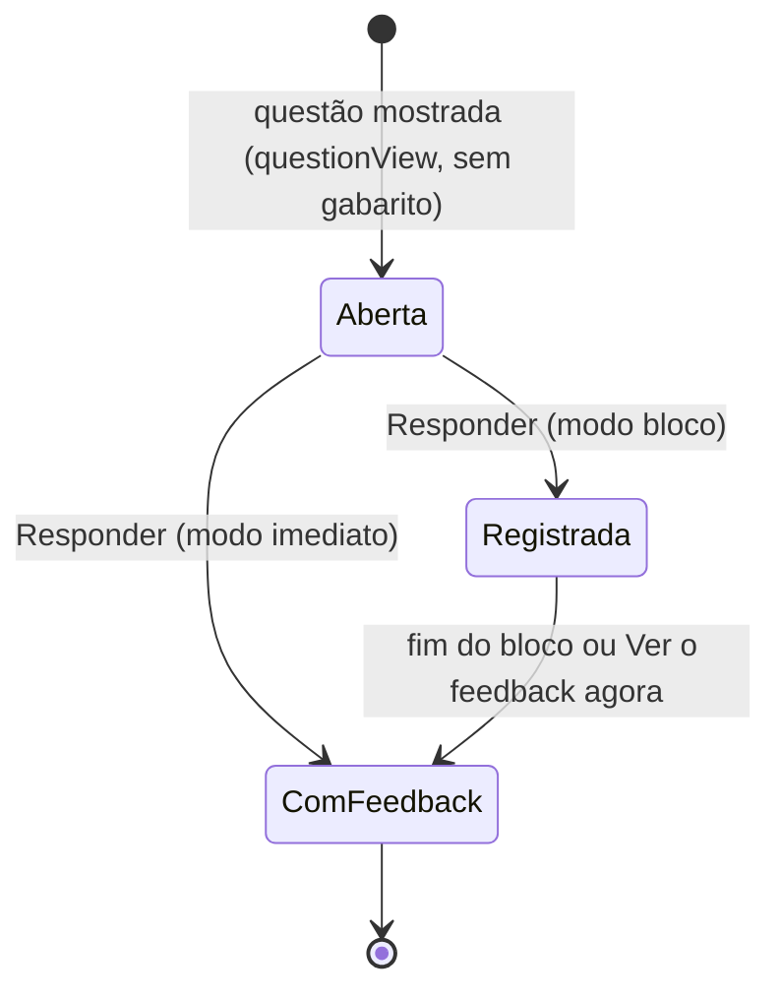

Ciclo de uma questão na prática: no modo imediato o feedback vem junto da resposta; no modo bloco a questão fica "registrada" até o `releaseBlock`.

| Regra | Detalhe |
|---|---|
| Fim do bloco | o renderer chama `releaseBlock` quando a fila acaba ou o estudante pede "Ver o feedback agora"; o bloco vira a tela de feedback (`FeedbackList`) |
| Modo imediato | o resultado aparece como hoje, agora vindo de `feedback` |
| `practice:next` | passa a devolver `questionView` (sem chave, comentário, `why` nem citação); `ItemActions` (editar e descartar) leem o que precisam do item por outros canais já existentes |
| Resposta repetida | o serviço aceita, como hoje; a tela não oferece mudar uma resposta registrada |
| Estatísticas | `correct` é gravado na resposta e as contagens (`practice:counts`, `stats:*`) não mudam |

**NFR.** NFR-7: `CONTRACT_VERSION` 2 e esquemas zod; NFR-5: `role="status"` no registro e foco ao abrir o feedback; NFR-2: com o padrão imediato, o fluxo e os testes existentes seguem iguais (só o formato interno do contrato muda). **Arquivos.** Novos: `src/core/practice/feedback-policy.ts` e `.test.ts`, `src/renderer/src/components/FeedbackList.tsx`, `tests/e2e/feedback-block.spec.ts`. Alterados: `practice/service.ts`, `channels.ts`, `handlers.ts`, `PracticePage.tsx`, `strings.ts`, `fake-mind.ts`, `practice-session.test.tsx` e os specs e2e que leem o resultado.

### UNIT-4 — Functional design / NFR requirements / NFR design

**Dia seguinte e pendentes.** No modo `next_day`, `releaseFor` devolve `releaseAt = dayEnd(answeredAt)` (próxima virada às 4h) e `seen = false`. `practice:pendingCount` conta as linhas de `attempt` com `seen_at` nulo e `release_at <= agora`; `practice:openFeedback` devolve até `limit` delas, da mais antiga, e marca `seen_at`; `practice:releaseAbandoned` define `release_at = agora` nas respostas com `release_at` nulo (blocos abandonados), e o renderer o chama ao abrir Praticar. `today:summary` ganha `pendingFeedback`. Hoje mostra a faixa quando o contador é maior que zero, e a rota nova `/w/:id/feedback` abre a `PendingFeedbackPage`.

| Regra | Detalhe |
|---|---|
| Virada | usa `dayEnd` e o relógio injetável (`tzOffset`); 3h59 sem feedback, 4h00 com |
| Ordem | `answered_at` crescente; `remaining` informa o que sobrou além do `limit` |
| Vazio | "Você não tem respostas aguardando feedback." |
| Pré-teste | nunca entra aqui (outra tabela) |

**NFR.** NFR-5 (aviso anunciado e navegável por teclado); NFR-1 (índice `ix_attempt_pending` cobre a contagem). **Arquivos.** Novos: `src/renderer/src/pages/PendingFeedbackPage.tsx`, `tests/e2e/feedback-pending.spec.ts`. Alterados: `feedback-policy.ts`, `practice/service.ts`, `today/summary.ts`, `channels.ts`, `handlers.ts`, `router.tsx`, `TodayPage.tsx`, `PracticePage.tsx`, `strings.ts`, `fake-mind.ts`.

### UNIT-5 — Functional design / NFR requirements / NFR design

**Confiança e calibração.** `ConfidencePicker` oferece três opções (chute, acho que sei, tenho certeza) e os atalhos `Alt`+`1` a `3`; com `practice.confidence` ligado a `PracticePage` o mostra entre as alternativas e "Responder" e mantém o botão desabilitado até a escolha. `answer` exige `confidence` com a opção ligada (`VALIDATION_ERROR` no campo) e o grava. O feedback destaca a divergência (errada com `confidence = 3`). `StatsService.calibration(days, now)` agrega `attempt` por nível na janela (padrão 30 dias): por nível devolve respostas, acertos e taxa; `flag = "overconfident"` quando o nível 3 tem taxa abaixo de 0,80 ou o nível 2 abaixo de 0,60, com ao menos 5 respostas; `topics` lista os tópicos com mais respostas de nível 3 erradas.

| Regra | Detalhe |
|---|---|
| Janela | `days` dias de estudo até a data atual; só `attempt` (o pré-teste fica de fora) |
| Estado vazio | `hasData = false` mostra como ligar a pergunta |
| Fronteiras | 80% e 60% valem como "não é excesso" (aviso só abaixo) |

**NFR.** NFR-5: o seletor tem `role="radiogroup"` e rótulos, é operável por teclado e o contraste das faixas passa 4,5:1 nos dois temas. **Arquivos.** Novos: `components/ConfidencePicker.tsx`, `tests/e2e/calibration.spec.ts`. Alterados: `practice/service.ts`, `stats/service.ts`, `channels.ts`, `handlers.ts`, `PracticePage.tsx`, `FeedbackList.tsx`, `StatsPage.tsx`, `strings.ts`, `fake-mind.ts`.

### UNIT-6 — Functional design / NFR requirements / NFR design

**Pré-teste.** `PretestService.eligible(materialId)` lista as questões aprovadas do material (via `generation_run.material_id`) sem nenhuma linha em `attempt`, as que ainda não apareceram em nenhuma rodada primeiro, por ordem de aprovação. `start` pega até `count` (1 a 20), cria o `roundId` (UUID) e devolve `questionView[]`; `answer` grava em `pretest_attempt` sem devolver correção; `summary(roundId)` devolve acertos e o `feedback[]` completo. `material:list` ganha `pretestEligible`. A Biblioteca mostra o botão e o diálogo de quantidade; a `PretestPage` mostra a faixa, as questões (com pular e encerrar e, se ligada, o `ConfidencePicker`) e o resumo.

| Regra | Detalhe |
|---|---|
| Elegíveis | aprovadas, do material, sem `attempt`; as demais questões não entram |
| Limite | `count` acima das elegíveis usa as elegíveis e informa `available`; sem elegíveis, `VALIDATION_ERROR` no campo `count` |
| Isolamento | nenhum consumidor de `attempt` lê `pretest_attempt` (ADR-1); testes provam isso nos cinco |
| Feedback | sempre ao fim da rodada, no resumo, qualquer que seja o modo configurado |

**NFR.** NFR-5 (diálogo com `role="dialog"`, foco inicial no campo e retorno do foco); NFR-1 (tabela já criada na `0004`). **Arquivos.** Novos: `src/core/practice/pretest.ts` e `.test.ts`, `src/renderer/src/pages/PretestPage.tsx`, `tests/e2e/pretest.spec.ts`. Alterados: `ingestion/service.ts` (contagem), `channels.ts`, `handlers.ts`, `router.tsx`, `LibraryPage.tsx`, `strings.ts`, `fake-mind.ts`.

### UNIT-7 — Functional design / NFR requirements / NFR design

**Integração e fecho.** Testes de integração no núcleo combinam as práticas (feedback em bloco com confiança e intercalação; pré-teste com a configuração de bloco); verifica-se que nenhum código novo faz chamada de rede (a rede só existe em Gerar, Chat e atualização, como antes) e que as quatro práticas rodam sem provedor; revisam-se os textos pt-BR e o contraste das faixas nos temas claro e escuro; atualizam-se `docs/guides/study-guide.md` e o `codekb`. **NFR.** NFR-2, NFR-6, NFR-8 e NFR-9 fecham aqui. **Arquivos.** Novos: `src/core/practice/practices.integration.test.ts`. Alterados: `docs/guides/study-guide.md`, `.aidlc/codekb/MIND/`.

### Assumptions & open questions (UNIT-2 a UNIT-7)

- A27: a chave de material do rodízio vem de `generation_run.material_id`, por isso itens manuais, do leitor e importados (que apontam para runs sintéticas sem material) formam o grupo `none` quando o rodízio é por material. — confirmed: no
- A28: `ItemActions` (editar e descartar) continua funcionando em Praticar com `questionView`, porque lê o item pelos canais de `review` e `items`; confirmado na implementação da UNIT-3. — confirmed: no
