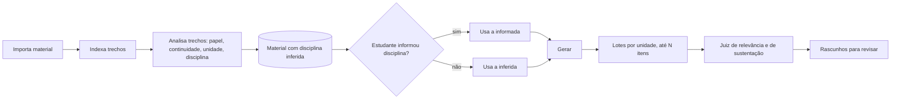
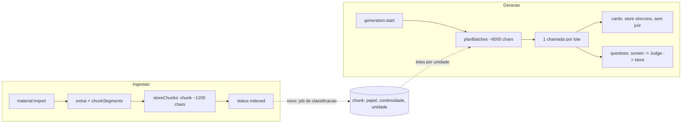
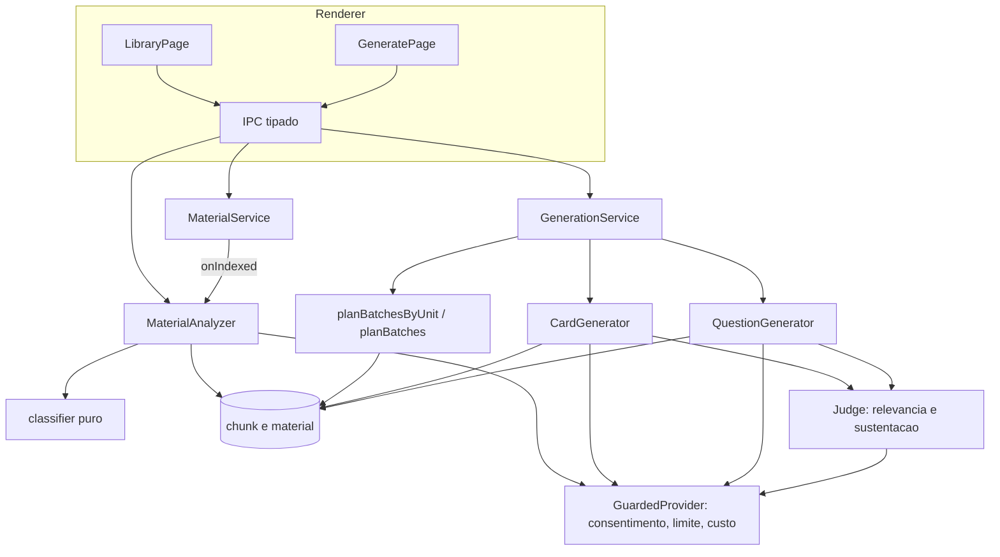
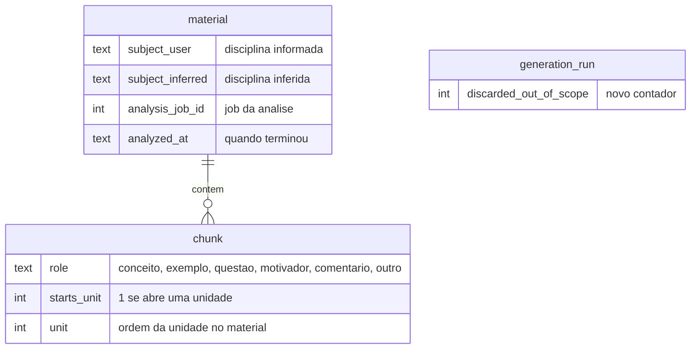
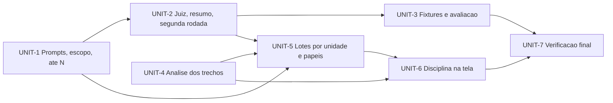
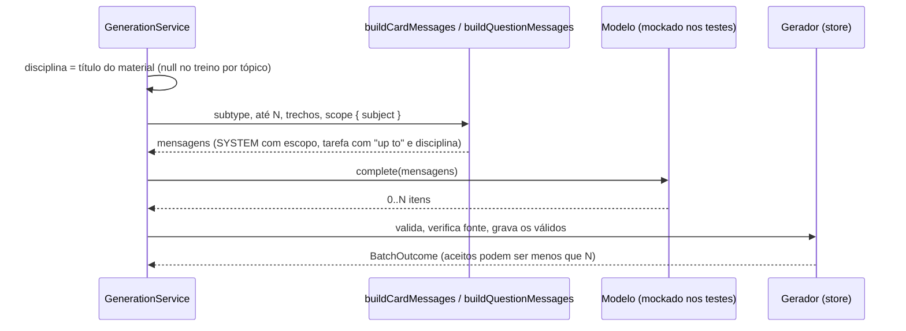

# Design — generation-relevance

## 1.6 Rough mockups

Arquivo: [`mockups/rough.html`](mockups/rough.html) (HTML autocontido com a paleta e os temas reais; abas por tela e estado; M-12). Só duas telas existentes mudam.

| Tela | Mudança | Estados mostrados |
|---|---|---|
| Biblioteca | A ação **"Definir disciplina…"** entra no menu ⋯ do material, ao lado de Renomear; o status mostra "Analisando" enquanto a classificação roda | menu aberto, analisando |
| Diálogo da disciplina | Campo opcional "Disciplina ou assunto" com a disciplina **inferida** ao lado; vazio usa a inferida, preenchido prevalece | vazio com inferida, informada, analisando, não identificada, falha na análise, sem provedor |
| Gerar | Linha "Disciplina: …" (inferida ou informada) com atalho **Alterar**; sem campo próprio. Gerar não espera a análise terminar | inferida, informada, analisando, sem disciplina, falha na análise |
| Resumo da execução | Explica por que vieram **menos itens** que o pedido e conta os descartados **fora do escopo** ao lado dos motivos de hoje | menos que o pedido, material quase só de questões |



### Assumptions & open questions
- A8 (1.6): a classificação começa depois da indexação (não bloqueia o uso do material) — confirmed: no
- A9 (1.6): "Alterar" na tela de gerar abre o mesmo diálogo da Biblioteca — confirmed: no
- Aberta: o texto exato de "fora do escopo" e a granularidade do resumo (por lote ou total) — decidir em 2.5.

## 2.1 Codebase analysis

Resumo; os detalhes estão em [`.aidlc/codekb/MIND/areas/generation.md`](../codekb/MIND/areas/generation.md) (revisado com o usuário em 2026-11-19; commit 0c425b9). `generation/` e `ingestion/` não mudaram desde o baseline 4e7cc4e; mudaram contratos, schema (migrations 0004 e 0005) e a UI.



**O que importa para o desenho.**
- Cards não têm juiz e gravam num `transaction` síncrono; o juízo de relevância exige um `await` entre a resposta do modelo e o `store`, como já ocorre nas questões. [src: cards.ts:98-130, questions.ts:120-165]
- Os prompts dizem "exatamente N", não conhecem a disciplina, e `self-contained.ts` incentiva reescrever enunciados de prova. [src: prompts.ts, self-contained.ts]
- `chunk` tem 1200 caracteres por alvo, com `ordinal` e `page`: base natural para classificar e agrupar em unidades. [src: chunker.ts, workspace-schema.ts]
- Descartes por motivo já existem em `generation_run`; "fora do escopo" vira mais um. [src: generation/service.ts]
- Modelos: geração haiku-5.5 e juiz sonnet-5.5 em Configurações; **decisão do usuário:** a classificação roda **automaticamente após indexar**, como job em segundo plano, **com o modelo do juiz**. [user]
- Baseline: `typecheck` exit 0; `vitest` do renderer (410) e de study, mix e IPC (119) passam. A suíte completa e o e2e serão reexecutados antes do primeiro commit da Construção (A10).

### Assumptions & open questions
- A10 (2.1): a suíte completa e o e2e rodam como baseline antes do primeiro commit de código da Construção — confirmed: no
- A11 (2.1): material já indexado antes da migration é classificado no primeiro acesso ou por ação do estudante; a decisão final fica para 2.6 — confirmed: no

## 2.2 Team practices

Levantadas das evidências do repositório e do intent anterior; as lacunas foram confirmadas com o usuário (Q1 a Q3 de 2.2).

| Área | Prática | Evidência | Situação |
|---|---|---|---|
| Ramificação | Trabalho direto na `main`, sem branch de feature | `git branch`; [mem: M-5] | Seguir |
| Commits | Convencionais, em inglês, atômicos, sem sessão ou ID; um ou mais por Unit verificada; sem `git push`, sem mexer na versão e sem tag | [mem: M-7, M-8]; [src: Q2] | Confirmada |
| Hook de pre-commit | `make install-hooks` ativa Prettier, ESLint e cabeçalhos nos arquivos em stage | `.githooks/pre-commit` | Seguir |
| Qualidade | `pnpm lint` (ESLint e cabeçalhos), `format:check`, `typecheck`; cobertura mínima de 80% | `package.json`; `vitest.config.ts` | Seguir |
| Testes | Vitest ao lado do código, relógio injetável, LLM sempre mockado | [mem: M-5] | Seguir |
| E2E | Playwright dirigindo o Electron; um spec do fluxo da disciplina (definir na Biblioteca e ver em Gerar), com LLM mockado; o resto em unidade e fixtures | [mem: M-14, M-15]; [src: Q3] | Confirmada |
| CI | GitHub Actions: `verify` (lint, formato, tipos, testes, e2e com xvfb) e `package` | `.github/workflows/ci.yml` | Seguir |
| Esquema do banco | Alteração no Drizzle e `pnpm db:generate`; migration aditiva, colunas anuláveis, sem perder dados | `package.json`; [mem: M-10] | Seguir |
| Contrato IPC | Esquema zod, nome do canal, handler e `useInvoke`; mudança incompatível sobe `CONTRACT_VERSION` | codekb `conventions.md`; [mem: M-9] | Seguir |
| Saídas do LLM | Validadas com zod; descartes contados por motivo em `generation_run` | `schemas.ts`; [mem: M-4] | Seguir |
| Fixtures de prompt | Os testes comparam o texto exato dos prompts de cards, questões e juiz com `fixtures/prompts.json` (congelado do Python). Nesta intent os prompts mudam de propósito: um **script TS regenera só essas entradas** a partir dos builders; `fixtures/README.md` ganha a nota de divergência; chat e demais fixtures seguem congeladas | `src/core/generation/prompts.test.ts`, `questions.test.ts`; [mem: M-11]; [src: Q1] | **Exceção confirmada à M-11** |
| Mockups | HTML autocontido com a paleta e os temas reais | [mem: M-12] | Seguir |
| Backlog | Ideias futuras em `.aidlc/backlog.md` (BL-7, BL-8, BL-9 criados) | [mem: M-16] | Seguir |

### Assumptions & open questions
- A12 (2.2): a nota de divergência dos prompts entra em `fixtures/README.md` junto com o script de regeneração, no mesmo commit da mudança dos prompts — confirmed: no
- Candidata à memória (propor no fim da Inception): emenda da M-11 permitindo regenerar `fixtures/prompts.json` por script quando os prompts mudam por decisão.

## 2.5 Refined mockups

Mockup refinado em HTML autocontido, com a paleta e os temas reais (botão de tema), 5 telas e 27 estados: [`mockups/refined.html`](mockups/refined.html). Substitui o rascunho de 1.6 (`mockups/rough.html`), que fica como histórico. [mem: M-12]

### O que mudou em relação a 1.6

| Tela | Mudança | Requisito |
|---|---|---|
| Biblioteca | Estados novos: analisado, falha, limite mensal e material antigo sem análise; "Analisar de novo" só no menu quando falhou ou está pausada; a disciplina vigente aparece sob o nome | FR-9, FR-14, FR-16 |
| Diálogo da disciplina | Estados de limite mensal e de sem provedor ou consentimento, com atalho às Configurações; "Analisar de novo" quando falhou, pausada ou não identificada | FR-9, FR-16, NFR-2 |
| Gerar | Banner "Gerando sem a análise do material" quando a análise não terminou, falhou, está pausada ou não existe; banner de material só de questões; estimativa passa a dizer que inclui a revisão de relevância | FR-12, FR-13, FR-16 |
| Resumo da execução | Linha da segunda rodada; estados "pedido atendido" e "parou no limite mensal"; sugestão de outro intervalo de páginas quando o material é quase só de questões | FR-3, FR-4, FR-15 |
| Revisar | Sem mudança de layout; o card nascido de um comentário do professor indica a origem | FR-5 |

### Interação e acessibilidade

- O diálogo da disciplina usa o `Dialog` existente: foco no campo, Esc fecha, Enter no campo salva (campo de uma linha, sem multiline).
- Os estados "Analisando" têm `role="status"` e a barra de progresso expõe o percentual como a de importação; falhas de execução usam `role="alert"`.
- Cores seguem os tokens do app (`--warn` para pausa e análise, `--danger` para falha, `--info` para avisos), legíveis nos dois temas.
- Os textos novos de tela ficam em `strings.ts`, em pt-BR (M-8).

### Assumptions & open questions
- A16 (2.5): o banner de "gerando sem a análise" aparece também quando o provedor não está configurado, porque a geração já falharia por outro motivo e o aviso explica o fallback — confirmed: no
- A17 (2.5): a linha da segunda rodada só aparece quando ela de fato rodou — confirmed: no

## 2.6 Domain & components

### Componentes

| Componente | Responsabilidade | Interfaces | Dados que possui |
|---|---|---|---|
| `analysis/` (novo) — `MaterialAnalyzer` | Classifica os trechos de um material em janelas e infere a disciplina; roda como job; cancelável e repetível | `start(materialId)`, `status(materialId)`; usa `llm` (modelo do juiz) e `JobQueue` | `chunk.role`, `chunk.starts_unit`, `chunk.unit`; `material.subject_inferred`, `analysis_job_id`, `analyzed_at` |
| `analysis/classifier` (novo, puro) | Monta o prompt de classificação, valida a saída com zod e junta as janelas | `buildClassifyMessages`, `classifyBatchSchema`, `mergeWindows` | — |
| `ingestion/` — `MaterialService` | Ganha o callback `onIndexed(materialId)`, chamado depois de `storeChunks`; ganha `setSubject` | `setSubject(id, text\|null)` | `material.subject_user` |
| `generation/planning.ts` | Monta lotes **por unidade**, com os papéis permitidos para o tipo, e anexa o contexto vizinho rotulado | `planBatchesByUnit(chunks, quantity, kind)` mantendo `planBatches` para o fallback | — |
| `generation/prompts.ts`, `question-prompts.ts`, `self-contained.ts` | Disciplina, teste de escopo, "até N", regra do comentário do professor | os builders ganham o parâmetro `scope` (`{ subject }`) | — |
| `generation/judge.ts` — `Judge` | Mantém o juiz de sustentação (questões) com o critério de relevância e ganha `judgeRelevance` para cards | `judgeRelevance(items, model)` | — |
| `generation/cards.ts`, `questions.ts` | Cards passam a ter `screen` → juiz de relevância (`await`) → `store`, como as questões; a citação só vale em trecho que não é contexto | `generateBatch` (mesma assinatura, `chunks` com `context?`) | — |
| `generation/service.ts` | Escolhe o modo (por unidade ou fallback), faz a segunda rodada, conta "fora do escopo" | `start`, `estimate` | `generation_run.discarded_out_of_scope` |
| `contracts` | Canais `material:setSubject`, `material:analyze`; `material:list` com `subject` e `analysis`; `generation:*` com o contador novo | esquemas zod | — |
| UI | Biblioteca (ação, diálogo, status), Gerar (linha, banners), resumo da execução | `useInvoke` | — |
| Avaliação | `src/core/test/relevance/` (fixtures) e `scripts/eval-generation.ts` | `pnpm eval:generation` | — |



### Fluxo de uma geração (por unidade)

```mermaid
sequenceDiagram
  participant S as Estudante
  participant G as GenerationService
  participant P as Planejamento
  participant C as CardGenerator
  participant M as Modelo de geração
  participant J as Juiz (modelo do juiz)
  participant D as Banco
  S->>G: gerar 20 cards
  G->>P: lotes por unidade (papéis permitidos)
  loop cada lote
    G->>C: generateBatch(disciplina, trechos, contexto)
    C->>M: prompt com disciplina e teste de escopo (até N)
    M-->>C: cards (podem ser menos)
    C->>C: screen: formato, fonte verbatim fora do contexto, duplicado
    C->>J: judgeRelevance(cards) 
    J-->>C: veredito por card
    C->>D: store dos aprovados; descarta fora do escopo e em dúvida
  end
  alt aceitos < pedido e há lotes novos
    G->>P: uma segunda rodada
  end
  G-->>S: resumo (gerados, fora do escopo, motivo de ser menos)
```

### Modelo de dados (delta; duas migrations aditivas e anuláveis: `0006_run_out_of_scope` com o contador e `0007_material_analysis` com a análise)



**Papéis permitidos como fonte e como lote**

| Papel | Cards | Questões | Observação |
|---|---|---|---|
| conceito | sim | sim | base de tudo |
| exemplo resolvido | sim | sim | a regra aplicada |
| questão de prova | não | sim (inspiração) | nunca copiada; dados novos |
| texto motivador | não | só como contexto | nunca fonte |
| gabarito/comentário | sim, se explica a regra | sim | reescrito sem depender da questão |
| outro | não | não | capa, índice, cabeçalho |

### Decisões (ADR)

**ADR-1 — A classificação fica em colunas anuláveis de `chunk` e `material`.** *Contexto:* o resultado é pequeno e sempre lido junto com o trecho. *Decisão:* colunas `role`, `starts_unit`, `unit` em `chunk` e `subject_user`, `subject_inferred`, `analysis_job_id`, `analyzed_at` em `material`. *Alternativas:* tabela `chunk_analysis` (mais joins, reprocessar é igual de simples); JSON em `material` (não consultável por papel). *Consequências:* migration trivial, sem perda de dados; "sem classificação" é `role IS NULL`. [src: FR-8, NFR-4; mem: M-10]

**ADR-2 — O estado da análise é derivado do job, não de uma coluna de status.** *Contexto:* o app pode fechar no meio do job. *Decisão:* `analyzed_at` preenchido = analisado; senão o estado vem do job (`analysis_job_id`): ativo = analisando, falho ou cancelado = falha, e o código `MONTHLY_LIMIT_REACHED` = pausada. `recoverInterrupted` já marca jobs interrompidos. *Alternativa:* coluna `analysis_status` (pode ficar "analisando" para sempre). *Consequências:* nunca fica preso; um clique em "Analisar de novo" cria um job novo. [src: FR-9, US-6; src/core/jobs/store.ts:79]

**ADR-3 — Janelas deslizantes com a fronteira de unidade decidida pelo app.** *Decisão:* janelas de cerca de 12 trechos com 2 de sobreposição; o modelo devolve por trecho `role` e `starts_unit`; o app numera as unidades de forma determinística (soma corrente de `starts_unit`) e, na sobreposição, vale o resultado da janela em que o trecho está mais ao centro. *Alternativa:* o modelo devolver ids de unidade (inconsistente entre janelas). *Consequências:* menos falhas de merge; o contexto de uma janela é pequeno, então a disciplina vem da primeira janela e é confirmada pelas seguintes. [src: A4, A5 de 1.3]

**ADR-4 — O juiz de relevância dos cards é uma chamada separada, em lote, com o modelo do juiz.** *Alternativas:* o gerador se auto-avaliar na mesma resposta (viés de confirmação); regras locais (frágeis em português). *Consequências:* um `await` novo antes do `store` (igual às questões), custo a mais por lote aceito pela decisão de qualidade acima de custo; em dúvida descarta e registra. Para questões o critério de relevância entra no juiz existente, sem chamada extra. [src: FR-6, FR-7, Q1 de 2.3]

**ADR-5 — Trecho "apenas contexto" entra no prompt mas fica de fora da verificação de fonte.** *Decisão:* `PromptChunk` e `SourceChunk` ganham `context`; o gerador monta `byId` só com os trechos que não são contexto, então uma citação num trecho de contexto cai em "sem fonte". [src: FR-10, FR-11; mem: M-1]

**ADR-6 — Prompts novos com fixtures regeneradas por script.** Os builders de cards, questões, cálculo e juiz mudam de propósito; `scripts/regen-prompt-fixtures.ts` reescreve só essas entradas de `fixtures/prompts.json` e `fixtures/README.md` registra a divergência. [src: FR-18, 2.2; mem: M-11 com a emenda C1]

**ADR-7 — Material anterior à migration é analisado ao abrir Gerar com ele.** Gerar dispara `material:analyze` uma vez, em segundo plano, e segue com o aviso (FR-12). Nada é enfileirado automaticamente para materiais não usados. [src: Q1 de 2.6]

**ADR-8 — A segunda rodada e o "até N" ficam no `GenerationService`.** O serviço guarda os lotes ainda não usados, roda no máximo uma rodada extra e deixa cada gerador devolver menos. [src: FR-3, FR-4]

### Assumptions & open questions
- A18 (2.6): janelas de ~12 trechos com 2 de sobreposição; ajuste fino na Construção com as fixtures — confirmed: no
- A19 (2.6): um lote por unidade pode passar de 6000 caracteres até um teto (9000); unidades maiores são divididas na fronteira de um trecho — confirmed: no
- A20 (2.6): a disciplina inferida vem da primeira janela e as seguintes só a confirmam; discordância não a muda — confirmed: no

## 2.7 Units of work

Sete Units em ordem topológica, a primeira como esqueleto (a menor fatia ponta a ponta: a geração real com os prompts novos e LLM mockado). A divisão da migration em duas (0006 e 0007) acompanha as Units que precisam de cada uma. [src: A18 a A20 de 2.6]

| Unit | Propósito e escopo | FR/NFR que entrega | Interfaces | Definição de pronto |
|---|---|---|---|---|
| UNIT-1 Prompts, escopo e "até N" (esqueleto) | Disciplina (do título, por ora) e teste de escopo nos prompts de cards, questões e cálculo; "até N" e lista menor aceita; regra do comentário do professor e fim da cópia de enunciado em `self-contained.ts`; script de regeneração das fixtures de prompt | FR-2, FR-3, FR-5, FR-18 | builders com `scope`; `schemas.ts`; `scripts/regen-prompt-fixtures.ts` | Testes de conteúdo dos builders; geração pelo `GenerationService` com LLM mockado aceita lista menor; `prompts.test.ts` e `questions.test.ts` passam com as fixtures regeneradas; `fixtures/README.md` com a nota |
| UNIT-2 Juiz de relevância, resumo e segunda rodada | Juiz de relevância para cards (`await` antes do `store`) e critério de relevância no juiz de questões; migration 0006 com `discarded_out_of_scope`; contador no resumo da execução e a frase de por que vieram menos; uma segunda rodada em lotes não usados; estimativa inclui o juiz de cards | FR-4, FR-6, FR-7, FR-15 (e a estimativa de FR-16), NFR-8 | `Judge.judgeRelevance`; `generation_run`; contratos `generation:*` e resumo na `GeneratePage` | Cards fora do escopo não viram rascunho e ficam no `discardLog`; contador persiste; no máximo uma rodada extra; contrato com zod; teste de migration |
| UNIT-3 Fixtures e script de avaliação | Conjunto de fixtures de relevância (conceito, exemplo, questão, motivador, comentário, outro) com resultado esperado, testes com LLM mockado e `pnpm eval:generation` (modelo real, fora do CI) | FR-17 | `src/core/test/relevance/`, `scripts/eval-generation.ts`, `package.json` | O script mede itens fora de escopo que passam e bons mantidos; testes automáticos passam; baseline registrado antes da análise de trechos |
| UNIT-4 Análise dos trechos | Migration 0007; `MaterialAnalyzer` (janelas, classificador puro, merge, disciplina inferida); job com `onIndexed`; estado derivado do job; `material:analyze`; consentimento, limite mensal e cancelamento | FR-8, FR-9, FR-16, NFR-2, NFR-3, NFR-4, NFR-5 | `analysis/`; `MaterialService.onIndexed`; contratos `material:*` | Material indexado fica classificado com disciplina inferida; falha não perde o já classificado; `MONTHLY_LIMIT_REACHED` pausa; migration testada com dados |
| UNIT-5 Lotes por unidade e papéis | `planBatchesByUnit` com papéis permitidos e contexto "apenas contexto"; citação fora do contexto; disciplina vigente (informada, senão inferida, senão título) nos prompts; fallback sem análise; material só de questões | FR-1, FR-10, FR-11, FR-12, FR-13 | `planning.ts`, `GenerationService`, geradores | Questão dividida em dois trechos cai no mesmo lote; citação em contexto é descartada; sem análise gera com as regras de prompt; só questões gera questões novas e cards do comentário |
| UNIT-6 Disciplina na tela | Ação "Definir disciplina…" e diálogo na Biblioteca; status da análise e "Analisar de novo"; linha da disciplina e "Alterar" em Gerar; banners de fallback e de material só de questões; Gerar dispara a análise de material antigo; `material:setSubject` | FR-14, NFR-7 | `LibraryPage`, `GeneratePage`, `strings.ts`, contratos `material:*` | Estados do mockup refinado implementados; testes de componente; diálogo acessível |
| UNIT-7 Verificação final | Spec e2e do fluxo da disciplina (Biblioteca para Gerar, LLM mockado); medição com o modelo real contra a meta; guia; memória C1; baseline completo | NFR-1, NFR-6, NFR-8 (fecho) | `tests/e2e/`, `docs/guides/study-guide.md` | Suíte completa e e2e passam; `eval:generation` atinge 0 fora de escopo e ≥ 80% dos bons, ou o desvio é registrado; guia atualizado |



Ordem topológica: UNIT-1, UNIT-2, UNIT-3, UNIT-4, UNIT-5, UNIT-6, UNIT-7. O grafo é acíclico; UNIT-3 e UNIT-4 não dependem uma da outra e podem trocar de ordem.

### Mapa história e requisito para Unit

| Item | Unit dona | Observação |
|---|---|---|
| FR-2, FR-3, FR-5, FR-18 | UNIT-1 | |
| FR-4, FR-6, FR-7, FR-15 | UNIT-2 | a estimativa do juiz de cards de FR-16 é entregue aqui |
| FR-17 | UNIT-3 | |
| FR-8, FR-9, FR-16 | UNIT-4 | a exibição do estado de FR-9 é entregue na UNIT-6 (US-6) |
| FR-1, FR-10, FR-11, FR-12, FR-13 | UNIT-5 | o banner de FR-12 e de FR-13 é entregue na UNIT-6 |
| FR-14 | UNIT-6 | |
| US-8 | UNIT-2 | usa FR-3 da UNIT-1 |
| US-9 | UNIT-3 | usa FR-18 da UNIT-1 |
| US-1, US-2, US-3, US-4 | UNIT-5 | fecham com FR-1, FR-10 e FR-11; dependem das UNIT-1, 2 e 4 |
| US-5, US-6, US-7 | UNIT-6 | US-6 usa FR-8, FR-9 e FR-16 da UNIT-4; US-7 usa FR-12 da UNIT-5 |

NFR nas Definições de pronto: NFR-1 (UNIT-7), NFR-2, 3, 4, 5 (UNIT-4), NFR-6 (todas, fecho na UNIT-7), NFR-7 (UNIT-6), NFR-8 (UNIT-2, UNIT-4, UNIT-6 e fecho na UNIT-7).

### Assumptions & open questions
- A21 (2.7): a migration é dividida em 0006 (contador, UNIT-2) e 0007 (análise, UNIT-4), em vez de uma só — confirmed: no
- A22 (2.7): FR-9 e FR-12/13 têm entrega partilhada com a UNIT-6 (exibição); a Unit dona é a do comportamento — confirmed: no
- A23 (2.7): UNIT-3 e UNIT-4 podem trocar de ordem — confirmed: no

## 2.8 Contracts

Mudanças **aditivas**: dois canais novos, campos novos nas saídas existentes e nenhuma entrada ficou incompatível. Por isso `CONTRACT_VERSION` continua em 2. [src: src/core/contracts/channels.ts:11] Os esquemas ficam em `channels.ts` (zod, `.strict()` nas entradas) e os nomes em `channel-names.ts` (M-4, M-9).

### Canais novos

| Canal | Entrada | Saída | Erros |
|---|---|---|---|
| `material:setSubject` | `{ workspaceId, id, subject: string (máx. 200) \| null }` | `materialInfo` com `subject` atualizado | `VALIDATION_ERROR` se o material não existe; `null` ou vazio limpa a informada |
| `material:analyze` | `{ workspaceId, id }` | `{ started: boolean, analysis: analysisInfo }` | `VALIDATION_ERROR` se o material não está indexado; `CONSENT_REQUIRED` e `PROVIDER_KEY_MISSING` de `ensureReady`; idempotente: com análise ativa devolve `started: false` |

### Campos novos nas saídas existentes

```ts
const analysisInfo = z.object({
  /** none: never analyzed; analyzing: job active; done; failed; paused: monthly limit reached. */
  state: z.enum(["none", "analyzing", "done", "failed", "paused"]),
  progress: z.number().nullable(), // 0 to 1 while analyzing
  errorCode: z.string().nullable(),
  errorDetail: z.string().nullable(),
  analyzedAt: z.string().nullable(),
});

const subjectInfo = z.object({
  /** The subject in force: informed, else inferred, else the title. */
  value: z.string(),
  source: z.enum(["informed", "inferred", "title"]),
  informed: z.string().nullable(),
  inferred: z.string().nullable(),
});

// materialInfo (used by material:list, :import, :importUrl, :rename, :setSubject) gains:
//   subject: subjectInfo, analysis: analysisInfo

// runInfo (generation:start, :list, :get) gains:
//   discardedOutOfScope: z.number().int(),
//   rounds: z.number().int(),        // 1, or 2 when the second round ran
//   withAnalysis: z.boolean(),       // the run used roles and units
```

O estado da análise é calculado no servidor a partir de `analyzed_at` e do job (ADR-2): `analyzed_at` preenchido = `done`; job ativo = `analyzing`; job falho ou cancelado = `failed`, e com `errorCode` `MONTHLY_LIMIT_REACHED` = `paused`; sem job = `none`.

### Banco (migrations aditivas, colunas anuláveis ou com padrão)

| Migration | Tabela | Colunas |
|---|---|---|
| `0006_run_out_of_scope` (UNIT-2) | `generation_run` | `discarded_out_of_scope integer not null default 0`, `rounds integer not null default 1`, `with_analysis integer not null default 0` |
| `0007_material_analysis` (UNIT-4) | `chunk` | `role text`, `starts_unit integer`, `unit integer` |
| `0007_material_analysis` (UNIT-4) | `material` | `subject_user text`, `subject_inferred text`, `analysis_job_id integer`, `analyzed_at text` |

### Saídas do modelo (zod)

```ts
// analysis/classifier.ts — one call per window of ~12 chunks
export const ROLES = ["concept", "example", "exam_question", "motivating_text", "commentary", "other"] as const;
export const classifyBatchSchema = z.object({
  /** The subject of the material, as a short phrase; only the first window's value is kept. */
  subject: z.string().nullable(),
  chunks: z.array(z.object({
    index: z.number().int().describe("Position of the excerpt in this window, from 0."),
    role: z.enum(ROLES),
    starts_unit: z.boolean().describe("True when the excerpt opens a new unit (a whole question, a concept)."),
  })),
});

// generation/judge.ts — relevance of cards (and of questions, in the existing judge)
export const relevanceBatchSchema = z.object({
  verdicts: z.array(z.object({
    index: z.number().int(),
    in_scope: z.boolean(),
    reason: z.string(),
  })),
});
```

`cardBatchSchema` e `questionBatchSchema` não mudam de forma: a lista pode ser menor ou vazia (FR-3). O juiz de questões mantém `judgeBatchSchema` e passa a incluir a relevância no critério de `supported`; o motivo de um descarte por relevância começa com `out_of_scope:` no `discardLog`.

### Assinaturas internas

```ts
export interface PromptScope { subject: string | null }
export interface PromptChunk { id: number; label: string; text: string; role?: Role; context?: boolean }
buildCardMessages(subtype, count, chunks, avoid, extra, scope?)
buildQuestionMessages(profile, count, chunks, avoid, extra, scope?)
Judge.judgeRelevance(items: { excerpt: string; text: string }[], model: string, subject: string | null): Promise<RelevanceResult>
planBatchesByUnit(chunks: SourceChunk[], quantity: number, kind: "card" | "question"): PlannedBatch[]
```

`SourceChunk` ganha `role`, `unit` e `context`; trechos sem classificação têm `role` nulo e o planejamento cai em `planBatches` (FR-12).

### Modelo de erros

Nenhum código novo. `MONTHLY_LIMIT_REACHED` pausa a análise (`paused`); `CONSENT_REQUIRED` e `PROVIDER_KEY_MISSING` deixam a análise em `failed` com o código, e a tela oferece o atalho às Configurações (como o editor de itens, `SETUP_ERRORS`).

### Eventos

Sem evento novo: a análise é um job do tipo `analysis` e reaproveita `job:progress` e `job:finished`.

### Assumptions & open questions
- A24 (2.8): as colunas `rounds` e `with_analysis` entram já na migration 0006, mesmo que `with_analysis` só seja gravada na UNIT-5 — confirmed: no
- A25 (2.8): `CONTRACT_VERSION` fica em 2, pois as mudanças são só aditivas — confirmed: no

## 3.1 Functional design

### UNIT-1 — Functional design (nota da Unit)

**Objetivo.** O esqueleto: a geração real (`GenerationService` → geradores → provedor mockado) com os prompts novos, aceitando lista menor, sem juiz novo e sem análise de trechos. A disciplina vem do **título do material** (interino até a UNIT-5).

**Texto novo dos prompts** (em inglês; a saída segue em pt-BR). O que está em itálico é acréscimo ao texto atual.

*Cards (`SYSTEM`):*

- *Cards teach the SUBJECT of the material (named in the task): its concepts, rules, exceptions, definitions and relations. Before writing a card, ask whether a teacher of that subject would list it as something to learn; if not, skip it.*
- *Never write cards about content that only serves as context: the motivating text of an exam question, a passage quoted as exercise material, the topic of an example sentence, or incidental facts. A fact about what an example says is not part of the subject.*
- *An exam question in the excerpts is not a card. A teacher's comment that explains the rule behind it may be: write the rule itself, never depending on the question.*
- *Return fewer cards than requested, or none, when the excerpts do not hold enough suitable content. Never fill the quota with weak or off-subject cards.*

*Questões (`QUESTION_SYSTEM`) e cálculo (`CALCULATION_SYSTEM`):*

- *Each question makes the student APPLY a rule, concept or procedure of the subject (named in the task) to a case. Do not test incidental content, such as the topic of a motivating text or the names and facts inside an example, unless that content is the subject itself.*
- *When an excerpt holds an exam question, do not copy it: write a new question that tests the same skill with new data. Motivating texts are context, never the thing being tested.*
- *Return fewer questions than requested, or none, when the excerpts do not hold enough suitable content.*

*Tarefa do usuário:* "Create exactly N …" passa a "Create up to N …", e, quando há disciplina, a linha "Subject of the material: X." antes dos trechos.

*`self-contained.ts`:* a frase "If the excerpt holds an exam question with its answer, write the question's own statement … inside the item, or skip it" vira "If the excerpt holds an exam question, do not reproduce it as an item: use it only as inspiration for a new, self-contained item that tests the same skill with new data, or skip it".



**Regras de negócio.** (1) Lista vazia ou menor é um resultado válido, não erro. (2) Sem material (treino por tópico) não há disciplina e a linha é omitida. (3) A chamada sem `scope` gera o mesmo texto de hoje na tarefa, exceto "up to", para que as fixtures regeneradas sejam estáveis. (4) `buildCardMessages` e `buildQuestionMessages` ganham `scope?` como último parâmetro, sem quebrar chamadores.

**NFR da Unit.** Testes de conteúdo dos prompts (não só do texto inteiro); fixtures regeneradas por script com a nota em `fixtures/README.md`; LLM mockado; sem mudança de contrato nem de migration (NFR-4, NFR-8 intactos).

**Plano de código (3.5a).** Modificar: `prompts.ts`, `question-prompts.ts`, `self-contained.ts`, `schemas.ts` (descrições), `cards.ts`, `questions.ts` (`scope` no pedido), `service.ts` (disciplina do título), `package.json` (script `fixtures:prompts`), `fixtures/prompts.json`, `fixtures/README.md`. Novos: `scripts/regen-prompt-fixtures.ts`. Testes: `prompts.test.ts`, `questions.test.ts`, `self-contained.test.ts`, `generation.test.ts`, testes dos geradores. Nada fora do escopo da Unit.

### Assumptions & open questions
- A26 (3.1, UNIT-1): o texto dos prompts acima é a base; o ajuste fino vem das fixtures de relevância (UNIT-3) e da avaliação real (UNIT-7) — confirmed: no
