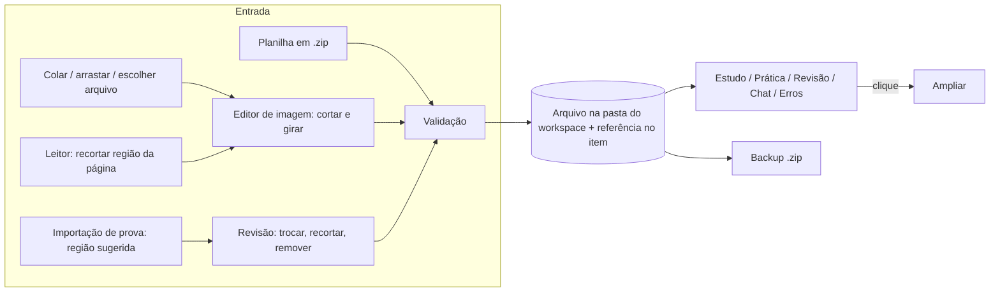
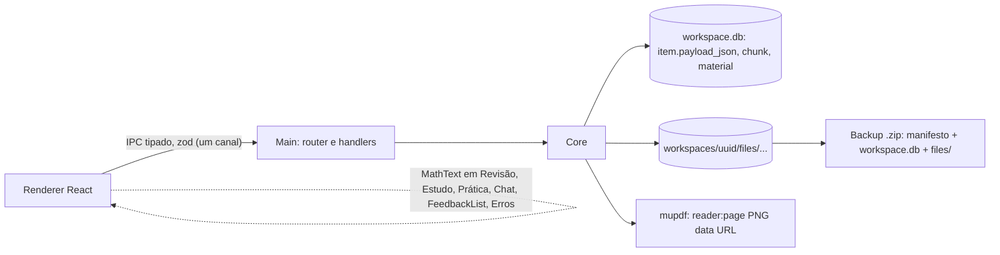
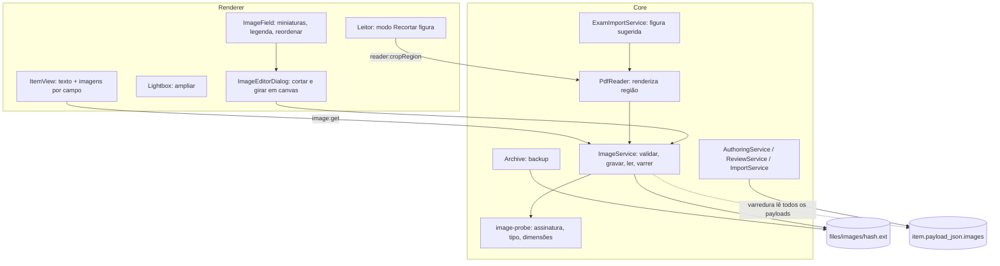
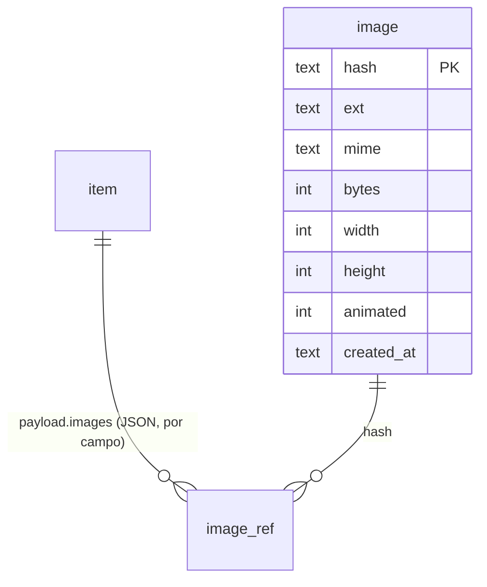
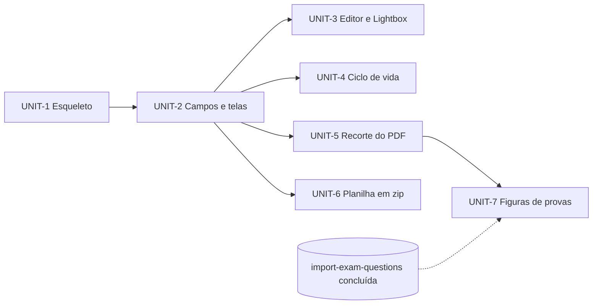
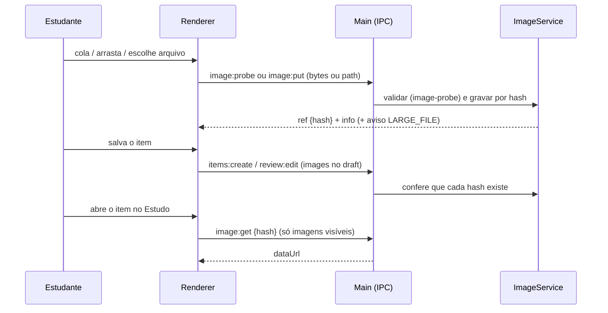
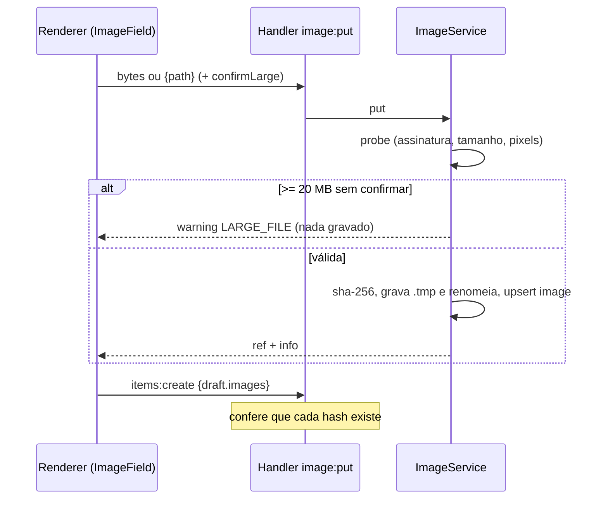

# Design — images-in-cards

## 1.6 Rough mockups

Mockup navegável (HTML autocontido, paleta e temas reais do app, valores fictícios): [`mockups/rough.html`](mockups/rough.html). Telas e estados: [mem: M-12]

| Tela | Estados cobertos |
|---|---|
| Editor de card | vazio, arrastando, com imagem (texto alternativo, tamanho, remover), formato recusado, arquivo enorme (aviso), ilegível |
| Editor de questão | imagem no enunciado, em alternativa (só imagem vale) e na explicação |
| Editor de imagem | cortar bordas e girar 90°; original preservado |
| Leitor (recorte) | sem seleção, região selecionada, criar item novo ou anexar a existente |
| Estudo | normal, ampliada, com descrição, arquivo ausente |
| Prática | alternativa só com imagem, explicação com figura |
| Revisão (prova) | figura sugerida (trocar, recortar, remover), figura não encontrada |
| Importar planilha | `.zip` com imagens, imagem faltando |
| Configurações | peso das imagens e limpeza de sobras |



**Decisões de interface (a validar no gate).**
- Cada campo de texto do item ganha "＋ Imagem", colar (Ctrl+V) e arrastar; uma alternativa pode ter só imagem.
- Tamanho grande avisa e deixa seguir (não há limite prático, Q1 de 1.3); formato fora da lista e arquivo ilegível recusam com mensagem.
- Arquivo ausente no estudo mostra aviso com "Substituir"; não esconde o item.
- Nunca vai imagem ao provedor (C-6). Dica na edição: evite legenda com a resposta dentro da imagem (I-1).

### Assumptions & open questions
- A9 (1.6): o recorte do leitor aplica-se à página renderizada a 200 dpi (como o OCR hoje); a qualidade segue a do PDF — confirmed: no
- A10 (1.6): a ampliação é uma sobreposição simples (sem zoom por gesto nem galeria) — confirmed: no

## 2.1 Codebase analysis

Base de conhecimento em dia com `fe5170d` (HEAD, v0.9.0): [`.aidlc/codekb/MIND/`](../codekb/MIND/README.md); nada foi regerado. Baseline de testes: ver `quality-and-risks.md` do codekb. O que importa para imagens: [src: codekb; código]



| Ponto | Hoje | Consequência para imagens |
|---|---|---|
| Conteúdo do item | `item.payload_json` com campos de texto simples: card `front`/`back`; questão `statement`, `options[].text`/`why`, `explanation`; `payload_version` (1) | Precisa de referência a imagem por campo sem quebrar versão 1; validação em `payloadProblem`/`draftProblem` exige texto não vazio |
| Origem do item | `origin` (`generated`, `manual`, `reader`, `import`, `error_note`; `document` vem da import-exam-questions), run sintética por origem | Imagem não muda a origem; o item segue a origem de quem o criou |
| Renderização | `MathText` (KaTeX) em 6 telas; CSP `img-src 'self' data:` | Um componente de campo com texto e imagens; imagens servidas como data URL por IPC (mesmo padrão de `reader:page`), sem mexer na CSP nem abrir protocolo novo |
| Arquivos | `workspaces/<uuid>/files/<...>`; `material.stored_path` relativo; remover material apaga a pasta | Pasta nova `files/images/` (ou equivalente) com nome por conteúdo (hash); remoção de arquivo por contagem de referências |
| Backup | zip com manifesto, snapshot do banco e **todo** `files/` (`archive.ts`) | Imagens entram no backup sem código novo; restaurar já devolve a pasta |
| Leitor de PDF | `reader:page` renderiza a página em PNG (mupdf), seleção por glifos | Recorte = renderizar a região numa escala e cortar; sem dependência nova |
| Importação de planilha | `importing/` lê CSV/XLSX; `zip.ts` já resume zips com limites de tamanho | Aceitar `.zip` com imagens reaproveita `summarizeZip` e seus limites |
| Importação de provas | intent 261120 (Inception pronta, Construction pendente): item `document`, `chunk_id`, `quote` | Figuras entram depois, como UNIT final, via contrato aditivo |
| Geração | só texto; `scriptedCardProvider` offline | Intocada (C-6) |

**Convenções a seguir.** TypeScript estrito, zod nas bordas, um canal IPC, strings de tela em `strings.ts`, spec e2e no Electron real para fluxos com arquivo ou seleção (M-14, M-15), cabeçalho de arquivo novo, commits convencionais. [mem: M-4, M-5, M-8, M-9, M-14, M-15]

**Lacunas para o design (2.6).** Onde mora a referência da imagem (no texto do campo ou em lista paralela); se a tabela `item` ganha tabela de imagens; como o hash de conteúdo evita duplicatas; como o editor de imagem recorta (canvas no renderer ou sharp/mupdf no núcleo).

### Assumptions & open questions
- A11 (2.1): o codekb de `fe5170d` não registra decodificação de imagem; qualquer biblioteca de imagem nova passa por licença AGPL (M-6) e tamanho do pacote — confirmed: no
- A12 (2.1): a UNIT de figuras de provas assume o contrato de item da import-exam-questions como está no design dela (ADR-1, ADR-4) — confirmed: no

## 2.2 Team practices

Herdadas da tabela de 2.2 da intent 261120-import-exam-questions e confirmadas pelo usuário (Q1 de 2.2); a prática de imagens é nova (Q2 de 2.2).

| Área | Prática | Evidência | Situação |
|---|---|---|---|
| Ramificação | Trabalho direto na `main` | [mem: M-5] | Seguir |
| Commits | Convencionais, em inglês, atômicos; sem sessão ou ID; um ou mais por Unit verificada; sem `git push`, sem mexer na versão e sem tag (o `/release` fica com o autor) | [mem: M-7, M-8]; [src: Q1] | Confirmada |
| Pre-commit | Prettier, ESLint e cabeçalhos nos arquivos em stage | `.githooks/pre-commit` | Seguir |
| Qualidade | `pnpm lint`, `format:check`, `typecheck`; cobertura mínima de 80% | `package.json`; `vitest.config.ts` | Seguir |
| Testes | Vitest ao lado do código; LLM mockado | [mem: M-5] | Seguir |
| E2E | Playwright no Electron para cada fluxo novo (anexar, recortar, estudar/praticar, backup) | [mem: M-14, M-15] | Seguir |
| Esquema do banco | Drizzle e `pnpm db:generate`; migração aditiva, colunas anuláveis | [mem: M-10] | Seguir |
| Contrato IPC | zod, um canal, `useInvoke`; mudança incompatível sobe `CONTRACT_VERSION` | [mem: M-9] | Seguir |
| Saídas do LLM | Esquema novo ganha resposta no provedor offline (esta intent não cria esquema de LLM, salvo se a UNIT de provas pedir) | [mem: M-18] | Seguir |
| Mockups | HTML autocontido, paleta e temas reais | [mem: M-12] | Seguir |
| Backlog | `.aidlc/backlog.md` (BL-12 em intent; BL-13 e BL-14 criados) | [mem: M-16] | Seguir |
| **Fixtures de imagem** | Imagens pequenas (poucos KB) versionadas: PNG, JPEG, GIF, WebP, uma corrompida e uma enorme em pixels com poucos bytes. Ficam **fora** de `fixtures/` da raiz (congelada, M-11), em pasta de teste própria definida em 2.6, com README do script que as gera | [src: Q2 de 2.2]; [mem: M-11] | Confirmada |
| **Biblioteca de imagem** | Preferir APIs já presentes (canvas no renderer, mupdf no núcleo); dependência nova só com ADR, licença compatível com AGPL (M-6) e verificação do empacotamento `.deb` | [mem: M-6] | Proposta |

### Assumptions & open questions
- A13 (2.2): a pasta de fixtures de imagem (ex.: `src/core/images/fixtures/`) é definida em 2.6, excluída do Prettier, e o hook de cabeçalho ignora binários — confirmed: no
- A14 (2.2): o e2e reutiliza as mesmas imagens por caminho — confirmed: no

## 2.5 Refined mockups

Arquivo: [`mockups/refined.html`](mockups/refined.html) (HTML autocontido, paleta e temas reais, botão de tema; 10 telas, 70 estados). Substitui o rascunho de 1.6 (`mockups/rough.html`), que fica como histórico. [mem: M-12]

**Mudanças em relação ao rascunho.**
- Campo com **várias imagens**: ordem numerada, ↑ ↓ para reordenar, Editar, **Substituir** e Remover por imagem; GIF avisa que cortar/girar usa só o primeiro quadro (FR-2, FR-7, A17, A18).
- Tela **Chat**: a imagem aparece ao estudante e um aviso diz que ela não vai ao modelo (FR-18).
- Dica contra resposta dentro da imagem fica visível no editor (FR-19).

**Especificação de interação.**
- **Anexar:** botão "＋ Imagem" abre o seletor de arquivo; Ctrl+V cola com o foco no campo; arrastar mostra "Solte a imagem aqui". Ao escolher ou colar, abre o **Editor de imagem** (cortar e girar) com "Usar imagem"; Esc cancela. Arquivo >20 MB: aviso com "Anexar mesmo assim"; >100 MB ou >100 MP, SVG ou ilegível: recusa com mensagem e nada é gravado (FR-4, FR-5).
- **Ampliar:** clique ou Enter na imagem abre a sobreposição; Esc, clique fora ou botão fecham; foco volta à imagem (NFR-7).
- **Arquivo ausente:** quadro de aviso com a legenda (se houver) e "Substituir" na edição; o item continua respondível (FR-11).
- **Recorte do PDF:** modo "Recortar figura" no leitor; arrastar desenha o retângulo; painel lateral com miniatura, legenda e "Novo card…", "Nova questão…" ou "Anexar a um item…" (FR-12).
- **Revisão de prova:** selo "Figura sugerida" (ou "Figura não encontrada"), com Trocar, Recortar do PDF…, Remover e Ver no PDF (FR-16).
- **Planilha em zip:** opção "Arquivo .zip com planilha e imagens" e contagem de imagens ligadas e faltantes (FR-15).
- **Configurações:** peso total e contagem das imagens; "Limpar agora" quando houver sobras (FR-17).

**Estados e acessibilidade.** Todos os estados do rascunho (vazio, arrastando, com imagem, formato recusado, arquivo enorme, ilegível, ampliada, com descrição, ausente) mais o de várias imagens; temas escuro e claro; cada imagem leva `alt` com a legenda ou "Imagem do item"; controles alcançáveis por teclado; miniaturas na lista da Revisão e carregamento sob demanda (NFR-3, NFR-7).

### Assumptions & open questions
- A20 (2.5): a ordem das imagens de um campo é a de anexação, reordenável; a mesma ordem vale em todas as telas — confirmed: no

## 2.6 Domain & components

### Componentes



| Componente | Responsabilidade | Interface | Dados |
|---|---|---|---|
| `ImageService` (`src/core/images/`) | Recebe bytes ou caminho, valida (`image-probe`), grava por hash, devolve `ImageRef` e dados para exibir, varre e apaga sem uso, estatísticas | `put`, `get`, `stats`, `sweep` | `files/images/<sha256>.<ext>` e metadados na tabela `image` |
| `image-probe` | Lê a assinatura e as dimensões de PNG, JPEG, GIF e WebP (código próprio, sem dependência), diz se é animado; recusa o resto | `probe(bytes) → {mime, ext, width, height, animated}` ou erro | — |
| Campos de item (`payload.images`) | Guardam as referências por campo, na ordem | zod `ImageRef`, `ItemImages` | `item.payload_json` |
| `ImageField` / `ImageEditorDialog` / `Lightbox` (renderer) | Anexar, colar, arrastar, cortar e girar em canvas, reordenar, ampliar | Usam `image:put`, `image:get` | — |
| `PdfReader.cropRegion` | Renderiza uma região de página a 200 dpi como PNG | `reader:cropRegion` | — |
| `ExamImportService` (UNIT final) | Sugere a região da figura da questão e grava via `ImageService` | interno | `payload.images.statement` |

### Modelo de dados



- `image` é metadado de arquivo, por hash (sha-256 em hex). `image_ref` não é tabela: é o objeto `{hash, source?, alt?}` dentro do `payload_json`.
- Migração aditiva `workspace/<próximo número>_item_images.sql` cria só a tabela `image` (o número é o próximo livre quando a Construction começar; a import-exam-questions usa a `0008`). Itens antigos não mudam.
- Chaves de campo em `payload.images`: `front`, `back`, `statement`, `explanation`, `option.A` a `option.E`, `option_why.A` a `option_why.E` (motivo da alternativa não leva imagem no MVP; reservado).

### Decisões (ADR)

#### ADR-1 Referência por mapa `images` no payload — Status: accepted
- **Contexto:** os campos do item são texto simples consumidos por prompts, `quote`, diff de palavras, normalização e conferência de duplicata. FR-2, FR-3 e FR-8 pedem ordem, legenda e item só com imagem. [src: FR-2, FR-3, FR-8; Q1 de 2.6]
- **Decisão:** `payload.images?: Record<FieldKey, ImageRef[]>` opcional, com `ImageRef = { hash, source?, alt? }` (`source` = hash do original quando houve corte ou giro). Sem mudar `payload_version`: o campo é opcional e versão 1 continua válida.
- **Alternativas:** marcador no texto (``), rejeitado porque contamina todo consumidor de texto e exige parser.
- **Consequências:** texto e imagem evoluem separados; `payloadProblem`/`draftProblem` aceitam texto vazio num campo quando há imagem (FR-3); a comparação de alternativas iguais inclui os hashes; o chat e o provedor leem só texto (FR-18). [src: NFR-5]

#### ADR-2 Arquivos por hash e varredura marca-e-limpa — Status: accepted
- **Contexto:** FR-6 e FR-13 pedem deduplicação e remoção sem uso; um contador pode dessincronizar. [src: FR-6, FR-13, NFR-4; Q2 de 2.6]
- **Decisão:** `files/images/<sha256>.<ext>`. `sweep()` junta os hashes (incluindo `source`) de todos os payloads, apaga os arquivos e as linhas de `image` fora do conjunto e ignora arquivos com menos de 1 h (rascunhos ainda não salvos). Roda após excluir item, editar campo, remover material, restaurar backup e em "Limpar agora" (que usa carência 0, com confirmação).
- **Alternativas:** contagem de referências em tabela.
- **Consequências:** custo linear nos itens (aceitável); correção por construção; uma imagem compartilhada por itens copiados (caderno de erros) nunca é apagada enquanto houver uso. [src: R-3]

#### ADR-3 O núcleo valida e guarda; o renderer edita e exibe — Status: accepted
- **Contexto:** a confiança fica no núcleo (M-9); o editor precisa de canvas, e a CSP já permite `data:`. [src: NFR-1, NFR-2; src/main/security.ts]
- **Decisão:** o renderer corta e gira em `canvas` e envia ao núcleo os bytes do original e do ajustado (PNG), ou só o original se não houve ajuste, via `image:put`; escolha por seletor nativo envia o caminho (o núcleo lê o arquivo). O núcleo valida pela assinatura (`image-probe`), recusa SVG e formatos fora da lista, >100 MB ou >100 MP, e devolve a referência. A exibição usa `image:get {hash}` → data URL com `mime` validado; imagens fora da tela só são pedidas quando visíveis (`IntersectionObserver`), e listas mostram só uma contagem até o item abrir (NFR-3).
- **Alternativas:** protocolo próprio `mind-file://` (muda a CSP e abre superfície); biblioteca `sharp` (nativa, empacotamento, M-6).
- **Consequências:** nenhuma dependência nova; GIF cortado ou girado vira PNG do primeiro quadro, com o original animado guardado (A17). [mem: M-6, M-9]

#### ADR-4 Recorte do PDF no núcleo, em coordenadas normalizadas — Status: accepted
- **Contexto:** o leitor já renderiza páginas em PNG com mupdf; FR-12 pede região em alta resolução. [src: FR-12; src/core/reader/pdf-reader.ts]
- **Decisão:** canal `reader:cropRegion {materialId, page, rect: {x, y, w, h} normalizado 0..1}` devolve a imagem renderizada a 200 dpi apenas da região (clip de pixmap), que o fluxo grava via `ImageService.put`. A caixa de seleção do renderer usa a mesma geometria da seleção de texto (rotação e escala).
- **Alternativas:** recortar no renderer a partir do PNG da página (resolução baixa, perde nitidez).
- **Consequências:** teste e2e real da seleção por arrasto (M-14). [mem: M-14]

#### ADR-5 Figuras de provas: região sugerida e sempre revisável — Status: accepted
- **Contexto:** muitas figuras de prova são desenhos vetoriais, que o mupdf não expõe como bloco de imagem; só blocos de imagem não bastam. [src: FR-16, R-4, A8]
- **Decisão:** a UNIT final procura, na faixa da questão na página, (1) blocos de imagem do texto estruturado e (2) vãos verticais grandes entre o enunciado e a primeira alternativa; une as regiões, renderiza a 200 dpi e grava como `payload.images.statement`. Sem achado, o rascunho entra sem figura e a revisão avisa e oferece o recorte (FR-16). Nunca descarta a questão por causa da figura.
- **Alternativas:** só blocos de imagem (perde vetoriais); pedir ao modelo a região (envia imagem ao provedor, contra C-6).
- **Consequências:** a heurística pode errar; por isso a revisão sempre mostra a figura com Trocar, Recortar e Remover. Depende do contrato de item da import-exam-questions (A12). [src: R-6]

#### ADR-6 Planilha com imagens em zip — Status: accepted
- **Contexto:** a importação manual lê CSV/XLSX com limite de 10 MB e `summarizeZip`; imagens não cabem nesse limite. [src: FR-15; src/core/importing/zip.ts]
- **Decisão:** novo modo ".zip com planilha e imagens": a planilha dentro do zip segue os limites atuais (10 MB); cada imagem segue o teto de 100 MB/100 MP; o total descompactado do zip tem teto de 1 GB; a leitura usa `yauzl` (já presente) com nomes sem `..` ou caminho absoluto. Colunas `imagem_frente`, `imagem_verso`, `imagem_enunciado`, `imagem_a` a `imagem_e`, `imagem_explicacao` aceitam vários nomes separados por `;`.
- **Alternativas:** URLs na planilha (contra C-1); só planilha (já existe).
- **Consequências:** linha com nome ausente entra sem imagem e com aviso (FR-15). [mem: M-9]

#### ADR-7 Exibir e editar com um componente de campo — Status: accepted
- **Contexto:** `MathText` aparece em 6 telas; todo campo de item tem hoje textarea e texto. [src: 2.1]
- **Decisão:** novo `ItemText` (`texto + imagens` de um campo) usado no lugar de `MathText` nas telas de exibição, e `ImageField` ao lado de cada campo nos editores (`EditItemDialog`, `ItemEditor`, criação manual, leitor). A ampliação (`Lightbox`) é um componente único com foco preso e Esc.
- **Consequências:** uma só regra de `alt`, de arquivo ausente (FR-11) e de teclado (NFR-7). [src: NFR-7]

#### ADR-8 Contrato IPC aditivo — Status: accepted
- **Decisão:** canais novos `image:put`, `image:get`, `image:stats`, `image:sweep` e `reader:cropRegion`; o payload do item ganha `images` opcional; `CONTRACT_VERSION` sobe de 2 para 3 só se um esquema existente mudar de forma incompatível (não deve ser o caso). [mem: M-9]

### Rastreio dos requisitos

| Requisito | Onde |
|---|---|
| FR-1, FR-4, FR-5, FR-6 | `ImageService`, `image-probe`, ADR-2, ADR-3 |
| FR-2, FR-3, FR-8 | ADR-1 |
| FR-7 | ADR-3 (canvas) |
| FR-9, FR-10, FR-11 | ADR-7 |
| FR-12 | ADR-4 |
| FR-13, FR-14, FR-17 | ADR-2 e backup existente (`files/`) |
| FR-15 | ADR-6 |
| FR-16 | ADR-5 |
| FR-18 | ADR-1 (imagens fora do texto) |
| FR-19 | ADR-7 |

### Assumptions & open questions
- A21 (2.6): `image-probe` cobre PNG, JPEG, GIF e WebP (incluindo VP8, VP8L e VP8X) e rejeita o resto pela assinatura; um teste cobre cada formato e cada rejeição — confirmed: no
- A22 (2.6): o campo `images` do payload é preservado por todas as operações que reescrevem payload (editar, melhorar proposta, caderno de erros copia as referências) — confirmed: no
- A23 (2.6): o backup restaurado reexecuta `sweep()` só com carência 0 em "Limpar agora", nunca automaticamente com carência 0 — confirmed: no

## 2.7 Units of work

### Units

| Unit | Propósito | FR | NFR (Definition of Done) | Histórias |
|---|---|---|---|---|
| UNIT-1 | **Esqueleto:** anexar uma imagem a qualquer campo pelo seletor, colar ou arrastar, validada e guardada por hash, e vê-la no Estudo | FR-1, FR-4, FR-5, FR-6 | NFR-1, NFR-2, NFR-5, NFR-6, NFR-8 | US-1 (parcial) |
| UNIT-2 | Todos os campos e telas: imagens na frente, no verso, no enunciado, nas alternativas e na explicação; várias por campo, ordem, legenda, ausência de arquivo; exibição em Revisão, Estudo, Prática, Chat, feedback e erros; imagens fora do chat | FR-2, FR-3, FR-8, FR-9, FR-11, FR-18, FR-19 | NFR-3, NFR-7 | US-1, US-3 |
| UNIT-3 | Editor de imagem (cortar e girar) e ampliação (Lightbox) | FR-7, FR-10 | NFR-7 | US-2, US-3 |
| UNIT-4 | Ciclo de vida: varredura marca-e-limpa, backup e restauração, peso e limpeza nas Configurações | FR-13, FR-14, FR-17 | NFR-4 | US-5 |
| UNIT-5 | Recorte de figura do PDF no leitor | FR-12 | NFR-1 | US-4 |
| UNIT-6 | Planilha em `.zip` com imagens | FR-15 | NFR-2 | US-6 |
| UNIT-7 | Figuras sugeridas na importação de provas (depende da import-exam-questions concluída) | FR-16 | NFR-9 | US-7 |

Escopo, interface e Definition of Done:

- **UNIT-1.** Escopo: `image-probe` (PNG, JPEG, GIF, WebP; recusa SVG e o resto; 100 MB e 100 MP; aviso de 20 MB), `ImageService.put/get`, tabela `image` (migração aditiva), esquema zod `ImageRef` e `payload.images`, canais `image:put` e `image:get`, `ImageField` mínimo (botão, colar, arrastar, aviso) no campo da frente do card manual, `ItemText` mínimo no Estudo, fixtures de imagem (PNG, JPEG, GIF, WebP, corrompida, enorme em pixels), spec e2e "anexar e estudar". DoD: verificação passa; a mesma imagem anexada duas vezes gera um arquivo; arquivo recusado não grava nada; `pnpm e2e` do fluxo passa no Electron real.
- **UNIT-2.** Escopo: `ImageField` em todos os campos dos editores (`EditItemDialog`, `ItemEditor`, criação manual, leitor), reordenar, remover, legenda, `ItemText` em Revisão, Estudo, Prática, Chat, FeedbackList e erros, aviso de arquivo ausente com "Substituir", texto vazio aceito com imagem, igualdade de alternativas por texto e hashes, dica contra resposta na imagem, imagens fora do chat e do provedor. DoD: testes de componente por tela; e2e de questão com imagem no enunciado e numa alternativa em Prática; carga sob demanda das imagens.
- **UNIT-3.** Escopo: `ImageEditorDialog` (canvas: cortar e girar 90°, restaurar), original em `source`, GIF vira PNG do primeiro quadro com aviso, `Lightbox` com foco preso e Esc. DoD: testes da transformação; e2e do diálogo.
- **UNIT-4.** Escopo: `sweep()` (marca-e-limpa, carência de 1 h), chamado após excluir, editar, remover material e restaurar; `image:stats` e `image:sweep`; seção "Armazenamento" nas Configurações com "Limpar agora". DoD: testes de exclusão, edição, cópia do caderno de erros e restauração; e2e de backup e restauração com imagem.
- **UNIT-5.** Escopo: `reader:cropRegion` (clip de pixmap a 200 dpi), modo "Recortar figura" no leitor com painel e ações "Novo card", "Nova questão" e "Anexar a um item". DoD: teste do núcleo com PDF de fixture; e2e do arrasto no Electron real.
- **UNIT-6.** Escopo: modo ".zip com planilha e imagens" no diálogo de importação, colunas `imagem_*`, limites do zip, aviso de imagem ausente. DoD: testes de importação com zip de fixture, nomes maliciosos (`..`) e imagem corrompida; e2e do fluxo.
- **UNIT-7.** Escopo: sugestão de região (blocos de imagem e vãos), gravação em `payload.images.statement`, revisão com Trocar, Recortar, Remover e aviso de ausência. DoD: fixtures de provas com figuras raster e vetoriais; e2e da revisão. Só inicia com a import-exam-questions concluída.

### Dependências



Ordem topológica: UNIT-1, UNIT-2, UNIT-3, UNIT-4, UNIT-5, UNIT-6, UNIT-7. O grafo é acíclico; UNIT-3 a UNIT-6 só dependem da UNIT-2 e podem andar em qualquer ordem.

### Mapa história → Unit

| História | Unit dona | Observação |
|---|---|---|
| US-1 | UNIT-2 | UNIT-1 entrega a fatia inicial (frente do card) |
| US-2 | UNIT-3 | |
| US-3 | UNIT-2 (exibir, ausência) e UNIT-3 (ampliar) | cada FR com um dono (FR-9, FR-11, FR-18 em UNIT-2; FR-10 em UNIT-3) |
| US-4 | UNIT-5 | |
| US-5 | UNIT-4 | |
| US-6 | UNIT-6 | |
| US-7 | UNIT-7 | |

Cada FR (1 a 19) tem uma só Unit dona: FR-1, 4, 5, 6 → UNIT-1; FR-2, 3, 8, 9, 11, 18, 19 → UNIT-2; FR-7, 10 → UNIT-3; FR-13, 14, 17 → UNIT-4; FR-12 → UNIT-5; FR-15 → UNIT-6; FR-16 → UNIT-7.

### Assumptions & open questions
- A24 (2.7): a US-1 e a US-3 atravessam duas Units e são verificadas pelos FR de cada uma; o aceite completo delas só vale quando UNIT-2 e UNIT-3 estiverem verificadas — confirmed: no
- A25 (2.7): as NFR-1, NFR-2, NFR-5 e NFR-6 são provadas na UNIT-1 e permanecem como regressão nas demais — confirmed: no

## 2.8 Contracts

Todos aditivos: nenhum esquema existente muda de forma incompatível, então `CONTRACT_VERSION` fica em 2 (ADR-8). Os esquemas moram em `src/core/contracts/channels.ts`; as respostas do provedor offline não mudam (nenhum esquema de LLM novo). [mem: M-9, M-18]

### Tipos compartilhados

```ts
const imageHash = z.string().regex(/^[0-9a-f]{64}$/);

/** A reference from an item field to a stored image. `source` is the original when the stored one was cut or rotated. */
const imageRef = z
  .object({
    hash: imageHash,
    source: imageHash.optional(),
    alt: z.string().max(300).optional(),
  })
  .strict();

const IMAGE_FIELDS = [
  "front", "back", "statement", "explanation",
  "option.A", "option.B", "option.C", "option.D", "option.E",
] as const;

/** Per field, in display order. Absent or empty means no image. Reserved: "option_why.A".."E". */
const itemImages = z.record(z.enum(IMAGE_FIELDS), z.array(imageRef)).default({});
```

Limites: `alt` até 300 caracteres; no máximo 200 imagens por campo (A15, só para defender o contrato); chaves fora de `IMAGE_FIELDS` são recusadas.

### Canais novos

| Canal | Entrada | Saída | Erros |
|---|---|---|---|
| `image:put` | `{workspaceId, original: bytes \| {path}, adjusted?: bytes (PNG), alt?}` | `{ref: imageRef, info: {mime, bytes, width, height, animated}, warning?: "LARGE_FILE"}` | `IMAGE_UNSUPPORTED`, `IMAGE_TOO_LARGE`, `IMAGE_CORRUPT`, `FILE_MISSING` |
| `image:get` | `{workspaceId, hash}` | `{dataUrl, mime, bytes, width, height}` | `IMAGE_NOT_FOUND` |
| `image:stats` | `{workspaceId}` | `{count, bytes, unusedCount, unusedBytes}` | — |
| `image:sweep` | `{workspaceId, now?: boolean}` | `{removed, freedBytes}` | — |
| `image:probe` | `{workspaceId, path}` (UNIT-1, só para o aviso antes de gravar) | `{mime, bytes, width, height, animated, warning?}` | os de `image:put` |
| `reader:cropRegion` | `{workspaceId, materialId, page, rect: {x, y, w, h}}` com 0 a 1 | `{ref, info}` (já gravada) | `FILE_MISSING`, `IMAGE_TOO_LARGE` |

- `bytes` é `Uint8Array` (clonagem estruturada do IPC); `{path}` vem de diálogo nativo do processo principal, nunca de texto digitado pelo renderer. O teto de entrada é 100 MB e 100 MP; o aviso `LARGE_FILE` vale acima de 20 MB e a gravação só ocorre quando o renderer confirma (chama `image:put` de novo com `confirmLarge: true`).
- `image:get` devolve `dataUrl` `data:image/{png|jpeg|gif|webp};base64,...` com `mime` validado pelo núcleo (nunca o declarado pelo renderer).
- `image:sweep` com `now: true` usa carência 0 ("Limpar agora", com confirmação no renderer).

### Canais existentes com campo aditivo

| Canal | Mudança |
|---|---|
| `items:create` (`draft` card e questão) | `images: itemImages` opcional no rascunho |
| `review:edit` | `images: itemImages` opcional (substitui o mapa inteiro quando presente) |
| `itemInfo` (saída de listas e detalhes) | `images: itemImages` e `imageCount` |
| `import:commit` (UNIT-6) | linhas ganham `images` por campo; novo modo `source: "zip"` no preview |
| `exam:*` (UNIT-7) | o rascunho gravado inclui `images.statement` sugerido; `exam:figure {itemId, rect?}` para trocar a figura |

Regras de validação (no serviço, com mensagem por campo, pt-BR): um campo com texto vazio é aceito se tiver ≥1 imagem (FR-3); o motivo da alternativa segue obrigatório; alternativas duplicadas comparam texto normalizado e hashes (A22); toda referência precisa existir em `image` (senão `IMAGE_NOT_FOUND` no campo).

### Erros novos (aditivos em `ERROR_CODES`)

| Código | Quando | Mensagem (pt-BR) |
|---|---|---|
| `IMAGE_UNSUPPORTED` | formato fora de PNG, JPEG, GIF, WebP (inclui SVG) | "Este formato de imagem não é aceito. Use PNG, JPEG, WebP ou GIF." |
| `IMAGE_TOO_LARGE` | acima de 100 MB ou 100 MP | "A imagem é grande demais para ser anexada." |
| `IMAGE_CORRUPT` | assinatura inválida, truncada ou ilegível | "Não foi possível ler esta imagem." |
| `IMAGE_NOT_FOUND` | hash sem arquivo | "A imagem não foi encontrada." |

### Arquivos e esquema

- Arquivo: `workspaces/<uuid>/files/images/<sha256>.<ext>` com `ext` em `png|jpg|gif|webp`; a versão ajustada e o original são arquivos distintos.
- Tabela `image` (migração aditiva, próximo número livre): `hash TEXT PRIMARY KEY`, `ext TEXT NOT NULL`, `mime TEXT NOT NULL`, `bytes INTEGER NOT NULL`, `width INTEGER NOT NULL`, `height INTEGER NOT NULL`, `animated INTEGER NOT NULL DEFAULT 0`, `created_at TEXT NOT NULL`.
- `item.payload_json`: `images` opcional; `payload_version` continua 1.
- Backup: sem mudança no manifesto (`files/` já vai inteiro); um backup sem a tabela `image` migra ao importar e os arquivos em `files/images/` são reindexados por `sweep` (a tabela é reconstruível a partir dos arquivos).

### Sequência do fluxo principal



### Assumptions & open questions
- A26 (2.8): bytes grandes pelo IPC (até 100 MB) cabem na clonagem estruturada do Electron; se a medição na UNIT-1 mostrar travamento, o fluxo passa a usar `{path}` mesmo para colagem (arquivo temporário do núcleo) — confirmed: no
- A27 (2.8): `image:probe` e o `warning: "LARGE_FILE"` com reenvio `confirmLarge` são o mecanismo do aviso de 20 MB (FR-5) — confirmed: no

## 3 Construction — notas por Unit (3.1 a 3.3; 3.4 pulada)

Cada Unit tem uma nota curta que cobre função (3.1), NFR (3.2) e mecanismos (3.3), aprovada junto do plano de código. [state: Q1 de 3]

### UNIT-1 — Esqueleto: anexar e estudar

**Função (3.1).**
- Entidades: `ImageRef {hash, source?, alt?}`, arquivo `files/images/<sha256>.<ext>`, linha `image` (hash, ext, mime, bytes, width, height, animated, created_at), `payload.images` por campo.
- Regras: o tipo vem da assinatura; PNG, JPEG, GIF e WebP passam; o resto (inclusive SVG) dá `IMAGE_UNSUPPORTED`; bytes truncados ou assinatura sem cabeçalho legível dão `IMAGE_CORRUPT`; >100 MB ou >100 MP dão `IMAGE_TOO_LARGE`; 20 MB ou mais devolvem `warning: "LARGE_FILE"` e só gravam com `confirmLarge: true`; a mesma imagem duas vezes é um arquivo só; escrita atômica (arquivo temporário e `rename`).
- O renderer lê o arquivo escolhido, colado ou arrastado como bytes (colar e arrastar) ou passa pelo seletor nativo (que devolve só um caminho); o item guarda só a referência.
- Escopo do esqueleto: `ImageField` com as três entradas e `ItemText` na frente do card do Estudo; as demais posições são da UNIT-2.



**NFR (3.2).** NFR-1: nenhuma mudança na CSP, sem rede, o renderer só recebe `dataUrl` com `mime` do núcleo. NFR-2: fixtures corrompida, truncada, enorme em pixels e SVG recusadas sem gravar. NFR-5: migração aditiva abre banco 0007 populado; item sem `images` segue igual. NFR-6: logs só com tamanhos e contagens. NFR-8: nenhuma dependência nova.

**Mecanismos (3.3).** Probe em código próprio sobre `Buffer` (PNG: IHDR; JPEG: marcadores SOF; GIF: logical screen e contagem de quadros; WebP: VP8/VP8L/VP8X e ANIM). Nome do arquivo derivado do hash, então não há colisão nem nome vindo do usuário (sem path traversal). `put` por caminho lê o arquivo com limite de tamanho antes de alocar (`stat` primeiro). O `ItemInfo` e o card do Estudo passam a levar `images`.

**Fora do esqueleto.** Reordenar, legenda, outras posições, editor, ampliar, varredura, backup extra, recorte e planilha.
