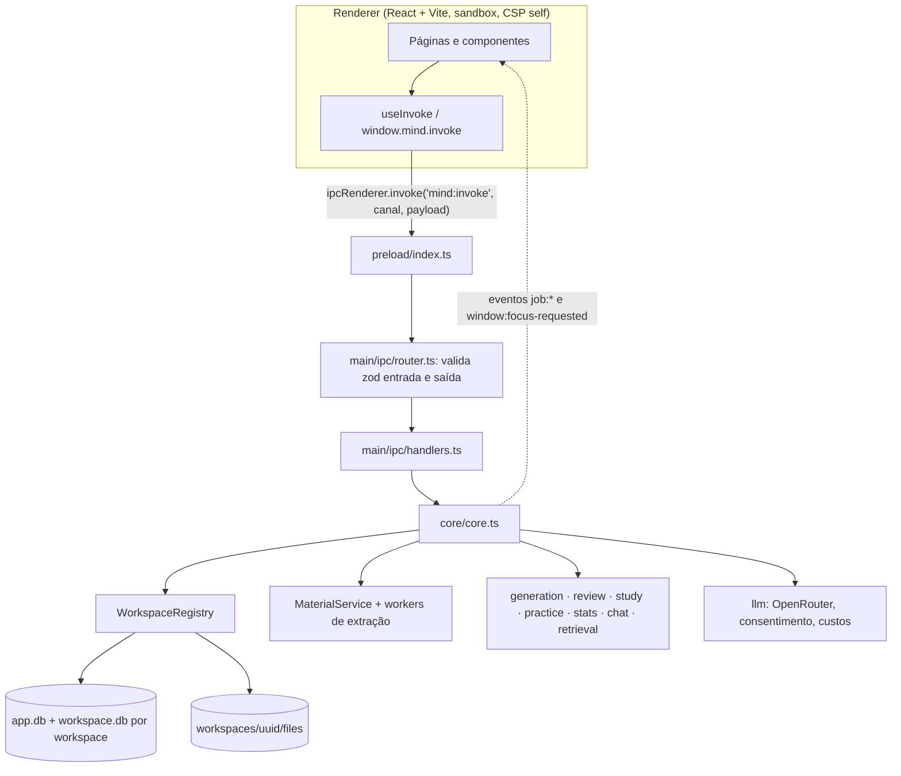

# Arquitetura

Status: human-reviewed (2026-11-14) · Confiança: alta

- **Um único canal IPC** (`mind:invoke`); o preload só repassa nomes de `CHANNEL_NAMES`. [src: src/preload/index.ts:15-25; mem: M-9]
- **Núcleo sem Electron**: diálogos nativos entram por `UiBridge`; o núcleo é testável em Vitest. [src: src/main/ipc/handlers.ts:46-55]
- **Uma `BrowserWindow`**: `setWindowOpenHandler` nega novas janelas e `will-navigate` bloqueia URLs fora do app. [src: src/main/index.ts:56-60]
- **Segurança**: `contextIsolation`, `sandbox`, sem `nodeIntegration`; CSP `default-src 'self'` sem `blob:`; permissões do Chromium negadas. [src: src/main/security.ts; src/main/index.ts:63-73]
- **Instância única** (`requestSingleInstanceLock`); ao fechar, o `core` fecha bancos e jobs antes de sair. [src: src/main/index.ts:76-95,170-184]
- **Jobs** em fila com eventos `job:progress` e `job:finished`; extração de PDF/DOCX em worker threads. [src: src/core/jobs; src/main/extract-worker.ts; src/core/ingestion/pdf.worker.ts]
