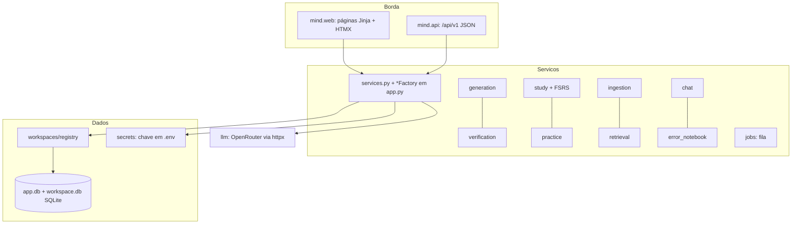

# Architecture — MIND
Status: human-reviewed (2026-11-14) · Confidence: high

**Estilo.** Monólito modular em Python: pacotes por domínio (ingestion, generation, study, practice, stats, chat, error_notebook), serviços sem HTTP, e duas camadas de borda sobre eles: páginas HTML (`mind.web`) e API JSON (`mind.api`). [src: src/mind/]

**Regras de dependência.** Web e API dependem dos serviços; os serviços não importam web nem api. As duas bordas são montadas em `create_app` (`/api` montado como sub-app). [src: src/mind/web/app.py:100-104]

**Transversais.**

- Segurança local: `TrustedHostMiddleware`, checagem de origem em métodos não seguros, CSP restritiva (`script-src 'self'`), `nosniff`. [src: src/mind/web/security.py:41-67]
- Erros: hierarquia `AppError` com tratador que renderiza `error.html`; a API usa problem+json. [src: src/mind/errors.py, src/mind/api/problems.py]
- Log com redação da chave. [src: src/mind/redaction.py, app.py:80]
- i18n: textos pt-BR em um dicionário único `T` e `SECTIONS`. [src: src/mind/web/strings.py:12-23]
- Config: variáveis `MIND_*` e `.env`. [src: src/mind/config.py]

**Decisões e motivos.** Sem autenticação por desenho (uso local; o Dockerfile avisa para publicar só em 127.0.0.1) [src: Dockerfile:5]. Demais motivos: ver `design.md` do intent `261114-mind-study-tool`.
