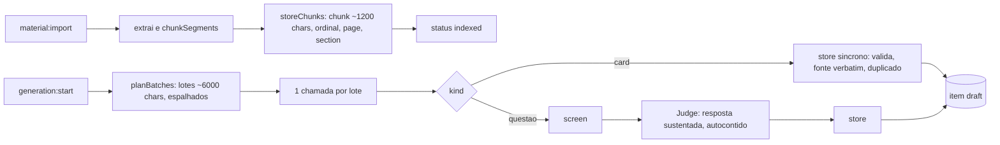

# Área: geração, juiz e ingestão de trechos

Status: human-reviewed (2026-11-19, confirmado pelo usuário no intent generation-relevance) · Confiança: alta · Commit: 0c425b9 (`generation/` e `ingestion/` inalterados desde 4e7cc4e)

## Fluxo atual

## Fatos [src]

- Os trechos nascem em `chunkSegments` (`TARGET_CHARS` 1200, `HARD_MAX_CHARS` 1500) e são gravados em `storeChunks` com `ordinal`, `page` e `section`; ao fim o material vira `indexed`. [src: src/core/ingestion/chunker.ts:9-10; src/core/ingestion/service.ts:305-340]
- `chunk` tem só `id, material_id, ordinal, page, section, text`; a última migração do workspace é `0005_item_runs_by_material`. [src: src/core/db/workspace-schema.ts:42-55; src/core/db/migrations/workspace]
- O planejamento agrupa trechos em lotes de até `BATCH_CHARS` = 6000 e distribui `CARDS_PER_BATCH` = 5 / `QUESTIONS_PER_BATCH` = 3 por lote; o pedido é dividido entre lotes espalhados pelo material. [src: src/core/generation/planning.ts:10-12,101-124]
- Os prompts dizem "Create exactly N" e "Use ONLY information found in the excerpts"; nenhum menciona a disciplina e nenhum permite devolver menos. [src: src/core/generation/prompts.ts:11-24,89-100; question-prompts.ts:60-70]
- `SELF_CONTAINED_RULES` manda escrever o enunciado de uma questão de prova dentro do item "ou pular". [src: src/core/generation/self-contained.ts:10-16]
- Cards não passam por juiz: `CardGenerator.generateBatch` chama o modelo e grava tudo num `transaction` síncrono (`store`), sem `await`. Questões fazem `screen` → `Judge.judge` (await) → `store`. [src: src/core/generation/cards.ts:98-130; questions.ts:120-165]
- Descartes são contados por motivo no `BatchOutcome` e somados em `generation_run` (`discardedNoSource`, `discardedInvalid`, `discardedDuplicate`, `discardedUnsupported`) com um `discardLog` limitado. [src: src/core/generation/service.ts:540-560]
- Modelos: geração `anthropic/claude-haiku-5.5`, juiz `anthropic/claude-sonnet-5.5`, configuráveis em Configurações; provedor único `openrouter`. [src: src/core/settings/service.ts:18-23]
- A estimativa de custo soma geração e juízo (`estimate` em `generation/service.ts`). [src: src/core/generation/service.ts:238-295]
- Os embeddings dos trechos são gerados sob demanda, não na importação. [src: src/core/retrieval/embeddings.ts]

## Decisões do usuário nesta passada [user]

- A classificação de trechos roda **automaticamente depois de indexar**, como job em segundo plano. [user]
- O modelo da classificação é o **modelo do juiz**, sem campo novo de configuração. [user]

## Pontos de encaixe do intent generation-relevance [inferred]

| Parte | Onde |
|---|---|
| A | `prompts.ts`, `question-prompts.ts` (inclui cálculo), `self-contained.ts`, `schemas.ts` ("até N") |
| B | `judge.ts` e um passo de juízo de cards entre a resposta do modelo e `store` (hoje síncrono) |
| C | migration em `chunk` (colunas anuláveis), job novo após `storeChunks`, `planning.ts` por unidade |
| Tela | `LibraryPage` (menu ⋯, diálogo), `GeneratePage` (linha da disciplina), contratos `material:*` e `generation:*` |
| Descartes | nova coluna/contador "fora do escopo" em `generation_run` e no `BatchOutcome` |

## Open questions
- Como tratar material já indexado antes da migration: classificar no primeiro acesso ou só ao pedir (decidir em 2.6). [inferred]
