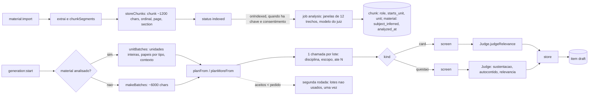

# Área: geração, juiz, análise e ingestão de trechos

Status: draft (reescrito em 2026-11-19, depois do intent generation-relevance; a versão anterior foi confirmada com o usuário no mesmo dia) · Confiança: alta · Commit: c69c420

## Fluxo atual

## Fatos [src]

- A análise é o job `analysis` (`MaterialAnalyzer`): lê os trechos em janelas de `WINDOW_SIZE` = 12 com `WINDOW_OVERLAP` = 2, com o modelo do juiz, e grava por janela `role` e `starts_unit`; ao fim junta as janelas (`mergeWindows`, vale o resultado da janela em que o trecho está mais ao centro), numera as `unit` e grava `subject_inferred` (da primeira janela) e `analyzed_at`. [src: src/core/analysis/analyzer.ts, classifier.ts]
- O estado da análise (`none`, `analyzing`, `done`, `failed`, `paused`) não é coluna: sai de `analyzed_at` e do job (`analysis_job_id`); `MONTHLY_LIMIT_REACHED` vira `paused` e um job cancelado vira `failed` com o código `CANCELLED`. [src: src/core/analysis/analyzer.ts:analysisOf]
- A análise começa sozinha depois da indexação (`MaterialService.onIndexed`, ligado em `core.ts`) com `automatic: true`, que fica quieto sem chave ou consentimento; Gerar chama `material:analyze` uma vez para um material que nunca foi analisado. [src: src/core/core.ts, src/core/ingestion/service.ts:notifyIndexed, src/renderer/src/pages/GeneratePage.tsx]
- A disciplina que os prompts nomeiam é `resolveSubject`: a informada (`subject_user`), senão a inferida, senão o título; o treino por tópico não tem disciplina. [src: src/core/analysis/subject.ts, src/core/generation/service.ts:subjectOf]
- Os lotes de um material analisado são `unitBatches`: unidades inteiras, só com os papéis permitidos (`SOURCE_ROLES`: cards usam conceito, exemplo e comentário; questões também a questão de prova), trecho sem papel conta como conteúdo, texto motivador e questão de prova entram só como `context` (rótulo `[context ...]`) e páginas `other` nunca vão; teto de 9000 caracteres por unidade. Sem análise vale o corte por tamanho (`makeBatches`, ~6000). [src: src/core/generation/planning.ts]
- Uma citação num trecho de contexto é descartada como `source_is_context`. [src: src/core/generation/cards.ts, questions.ts]
- Cards passam por `screen` → `Judge.judgeRelevance` (`RelevanceBatch`, `await`) → `store`; questões usam o juiz de sustentação com o critério de relevância e um motivo que começa com `out_of_scope:`. Em dúvida o juiz descarta. [src: src/core/generation/cards.ts, judge.ts, question-prompts.ts]
- Os prompts aceitam "até N", levam a disciplina e o teste de escopo; `fixtures/prompts.json` é regenerado por `pnpm fixtures:prompts`. [src: src/core/generation/prompts.ts, scripts/regen-prompt-fixtures.ts]
- A segunda rodada (`planMoreFrom`) roda no máximo uma vez, quando os aceitos ficam abaixo do pedido e há lotes não usados; `generation_run` guarda `discarded_out_of_scope`, `rounds` e `with_analysis`. [src: src/core/generation/service.ts]
- Modelos: geração `anthropic/claude-haiku-5.5`, juiz e análise `anthropic/claude-sonnet-5.5`; o custo da análise e do juiz de cards conta no limite mensal e a estimativa inclui o juiz. [src: src/core/settings/service.ts, src/core/generation/service.ts]
- As fixtures de relevância e a pontuação ficam em `src/core/test/relevance/`; `pnpm eval:generation` mede com o modelo real (manual, fora do CI). [src: scripts/eval-generation.ts]

## Open questions
- O baseline com o modelo real (`pnpm eval:generation`) ainda não foi medido; a meta é 0 itens fora de escopo e 80% do conteúdo coberto.
