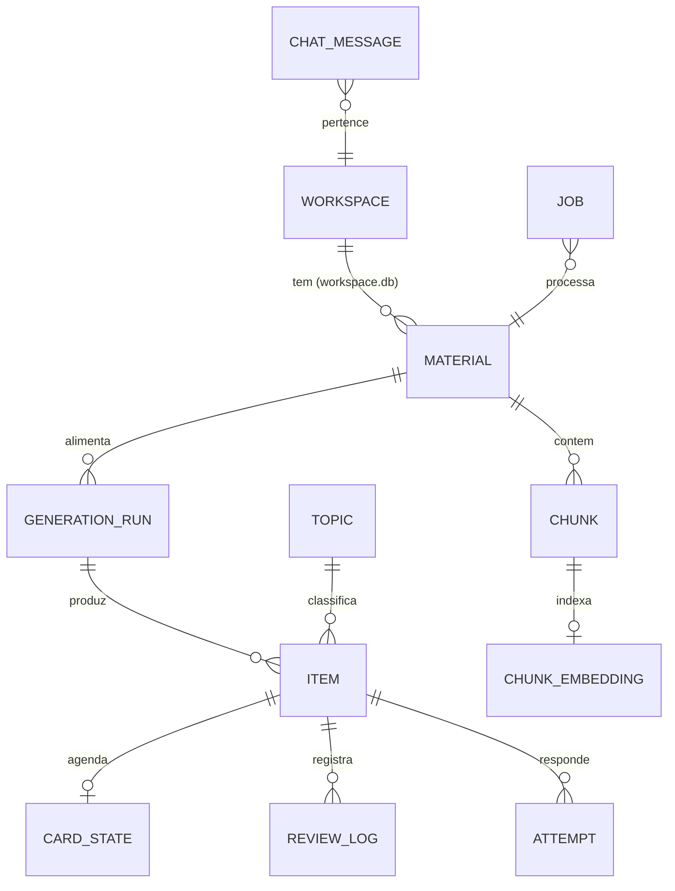

# Data model — MIND
Status: draft · Confidence: medium

**Armazenamento.** `app.db` (workspaces, configurações, consentimento, custos) e um `workspace.db` por workspace; migrações Alembic separadas (`migrations/app` e `migrations/workspace`). A chave da API fica em `.env` no diretório de dados, nunca na UI. [src: src/mind/config.py:30-37, src/mind/secrets.py]

Entidades: `Job, Material, Chunk, Topic, GenerationRun, Item, CardState, ReviewLog, Meta, Attempt, ChatMessage, ChunkEmbedding` por workspace; `Workspace, Setting, Consent, CostEntry, ModelPrice` no app. [src: src/mind/db/workspace_models.py, app_models.py]

**PII.** O conteúdo dos materiais é do usuário; só trechos usados na geração vão ao provedor, após consentimento. [src: README.md:7-8]

**Diretório de dados.** `platformdirs.user_data_dir("mind")`, ou `MIND_DATA_DIR`. [src: src/mind/config.py:63-67]
