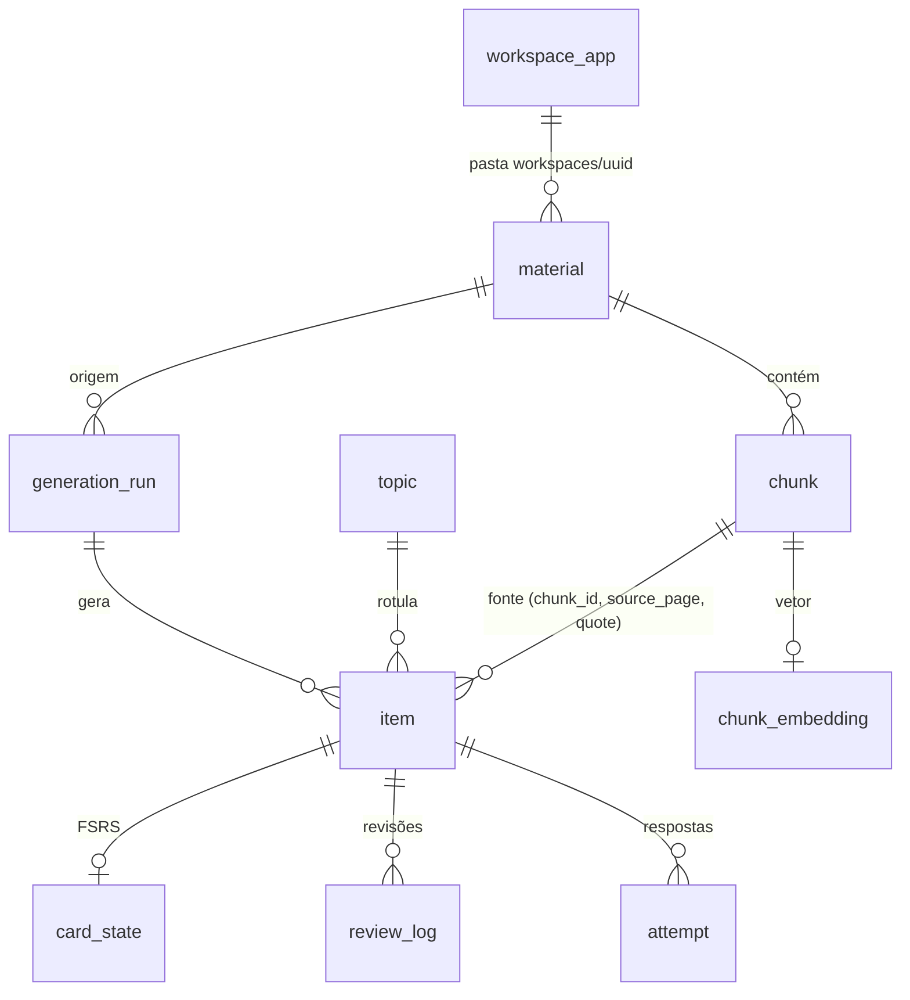

# Modelo de dados

Status: human-reviewed (2026-11-14) · Confiança: alta

- **`app.db`** (global): `workspace`, `setting`, `consent`, `cost_ledger`, `model_price`. [src: src/core/db/app-schema.ts]
- **`workspaces/<uuid>/workspace.db`**: `job`, `material`, `chunk` (+FTS), `topic`, `generation_run`, `item`, `card_state`, `review_log` (`duration_ms`, `day`), `attempt` (`seconds`, `day`), `meta` (chave/valor por workspace), `chat_message`, `chunk_embedding`. [src: src/core/db/workspace-schema.ts]
- **Arquivos**: `workspaces/<uuid>/files/<…>/<original>`; `material.stored_path` é relativo à raiz do workspace e a exclusão do material remove a pasta. [src: src/core/ingestion/service.ts:182,224,411]
- **Backup**: `.zip` com manifesto, snapshot do banco e `files/`. [src: src/core/workspaces/archive.ts:78-84]
- **Migrações**: Drizzle em `src/core/db/migrations/{app,workspace}` (workspace: 0000 init, 0001 índice de chunk, 0002 FTS). [src: db/migrations]
- `material` não tem `topic_id`; o tópico vem de `item` e `generation_run`. `day` é o dia local de estudo.
- Não existe hoje nenhuma tabela de sessões de estudo; a meta diária atual é em número de cartões (`study settings.dailyGoal`). [src: src/renderer/src/pages/TodayPage.tsx]

**Adições do intent study-time-pdf-viewer (2026-11-14).** Tabela `study_session` (migração `workspace/0003_study_session.sql`): `started_at`, `ended_at`, `seconds`, `source` (`cards|practice|reading|manual`), `day` (dia de estudo local), `material_id` e `topic_id` (ambos `ON DELETE SET NULL`); índices por `day` e `source`. Cada **intervalo** é uma linha (pausar fecha, retomar abre outro); o aberto é regravado a cada 30 s. Chaves novas em `meta`: `time.dailyGoalMin` (60), `time.idleSeconds` (120), `time.autoEnabled` (1) e `reader.lastPage.<materialId>`. O backup leva tudo (banco inteiro); backups sem a `0003` migram ao importar. [src: src/core/time/service.ts; src/core/reader/service.ts]

**Itens sem geração (verificado em 2026-11-16, commit 240ed43).** [user: sem certeza se a run sintética é o padrão certo; "se funcionar, pode seguir esse padrão" — decisão final em 2.6 (ADR)] `item.run_id` é `NOT NULL` e aponta para `generation_run`; o caderno de erros já cria itens sem geração usando uma **run sintética** única por workspace (`kind = "notebook"`, `subtype = "error_note"`, `model = "-"`, `requested = 0`, `status = "done"`) e `item.origin = "error_note"`, `origin_item_id` = questão de origem, `status = "approved"`, `approved_at` preenchido. [src: src/core/notebook/service.ts:16-17,86-106,149-165] `item.origin` tem padrão `"generated"`. O estado FSRS (`card_state`) **não** é criado na aprovação: a primeira avaliação em `StudyService.rate` insere a linha; cartão aprovado sem `card_state` já é servido como novo. [src: src/core/study/service.ts:477-505] Contadores de `generation_run` (`approved`, `approved_unedited`, `discarded_review`) só se movem em `ReviewService.review`; `catalog()` e `stats:materials` fazem `innerJoin` com `generation_run`. [src: src/core/review/service.ts:342-388,160; src/core/stats/service.ts:272-276]

**Migrações do workspace**: 0000 init, 0001 índice de chunk, 0002 FTS, 0003 `study_session`. Nada novo desde ced33fa. [src: src/core/db/migrations/workspace]

**Origens e runs sintéticas (verificado em 2026-11-16, intent manual-cards-import).** Decisão do ADR-1: itens criados fora da geração continuam com `run_id` obrigatório e apontam para uma run sintética por origem, criada na primeira vez (`kind` = `manual`, `reader` ou `import`, além de `notebook` do caderno de erros; `model = "-"`, `status = "done"`, contadores zerados). `item.origin` assume `generated`, `manual`, `reader`, `import` ou `error_note`. Itens manuais e importados nascem `approved` com `approved_at`, sem `chunk_id` e sem `quote`; os do leitor levam `chunk_id`, página, título e citação quando o trecho é achado no material. Nenhuma migração foi necessária (`workspace` continua em 0003). As listas de gerações ignoram essas runs; `stats:materials` só conta itens de runs com `material_id`, então itens manuais, do leitor e importados não aparecem por material. [src: src/core/authoring/service.ts; src/core/db/run-kinds.ts] [user: ADR-1 aprovado no gate 2.6]
