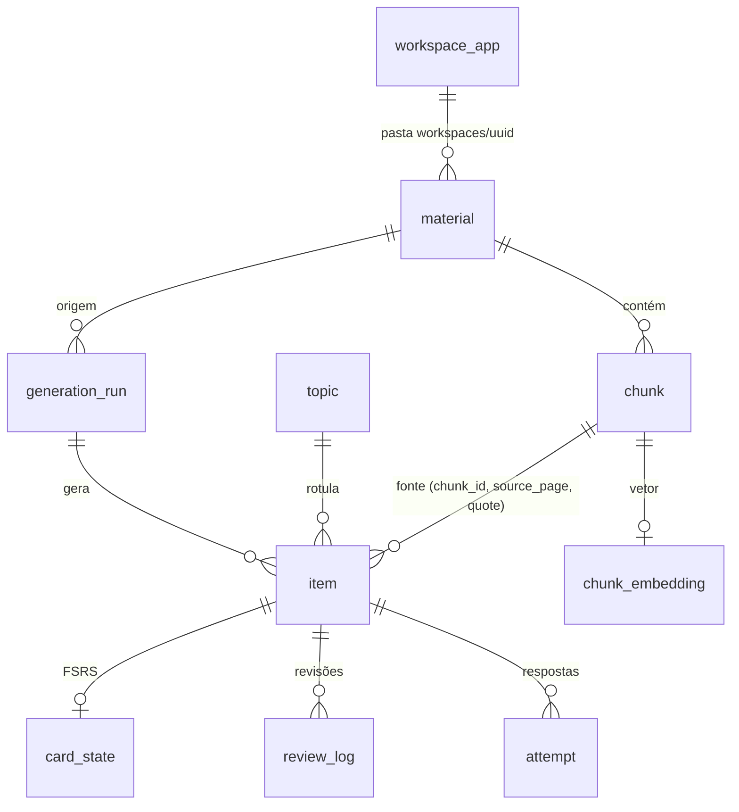

# Modelo de dados

Status: human-reviewed (2026-11-14) · Confiança: alta

- **`app.db`** (global): `workspace`, `setting`, `consent`, `cost_ledger`, `model_price`. [src: src/core/db/app-schema.ts]
- **`workspaces/<uuid>/workspace.db`**: `job`, `material`, `chunk` (+FTS), `topic`, `generation_run`, `item`, `card_state`, `review_log` (`duration_ms`, `day`), `attempt` (`seconds`, `day`), `meta` (chave/valor por workspace), `chat_message`, `chunk_embedding`. [src: src/core/db/workspace-schema.ts]
- **Arquivos**: `workspaces/<uuid>/files/<…>/<original>`; `material.stored_path` é relativo à raiz do workspace e a exclusão do material remove a pasta. [src: src/core/ingestion/service.ts:182,224,411]
- **Backup**: `.zip` com manifesto, snapshot do banco e `files/`. [src: src/core/workspaces/archive.ts:78-84]
- **Migrações**: Drizzle em `src/core/db/migrations/{app,workspace}` (workspace: 0000 init, 0001 índice de chunk, 0002 FTS). [src: db/migrations]
- `material` não tem `topic_id`; o tópico vem de `item` e `generation_run`. `day` é o dia local de estudo.
- Não existe hoje nenhuma tabela de sessões de estudo; a meta diária atual é em número de cartões (`study settings.dailyGoal`). [src: src/renderer/src/pages/TodayPage.tsx]

**Adições do intent study-time-pdf-viewer (2026-11-14).** Tabela `study_session` (migração `workspace/0003_study_session.sql`): `started_at`, `ended_at`, `seconds`, `source` (`cards|practice|reading|manual`), `day` (dia de estudo local), `material_id` e `topic_id` (ambos `ON DELETE SET NULL`); índices por `day` e `source`. Cada **intervalo** é uma linha (pausar fecha, retomar abre outro); o aberto é regravado a cada 30 s. Chaves novas em `meta`: `time.dailyGoalMin` (60), `time.idleSeconds` (120), `time.autoEnabled` (1) e `reader.lastPage.<materialId>`. O backup leva tudo (banco inteiro); backups sem a `0003` migram ao importar. [src: src/core/time/service.ts; src/core/reader/service.ts]
