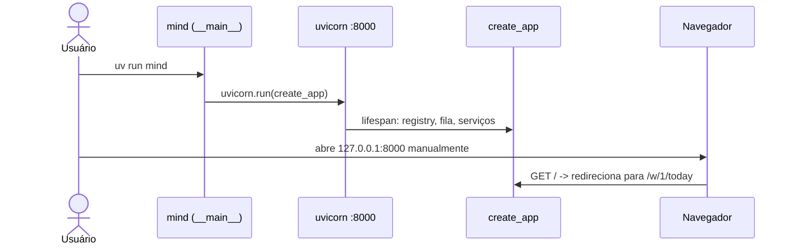
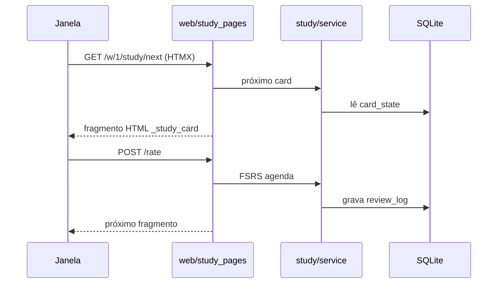

# Interactions — MIND
Status: draft · Confidence: medium

**Abertura hoje.**

**Fluxo de estudo.**

**Geração.** POST `/generate` cria um job; a fila executa com limite de concorrência; o provedor devolve JSON validado em Pydantic; cada citação é conferida pelo `source_checker` e o item sem fonte é descartado. [src: src/mind/jobs/queue.py, src/mind/verification/source_checker.py]
