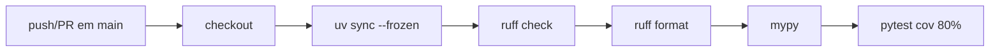

# Operations — MIND
Status: human-reviewed (2026-11-14) · Confidence: high

| Ação | Comando | Fonte |
|---|---|---|
| Instalar | `uv sync` | README.md |
| Rodar | `uv run mind` (abre servidor em 127.0.0.1:8000) | README.md, __main__.py |
| Lint | `uv run ruff check .` e `uv run ruff format --check .` | ci.yml |
| Tipos | `uv run mypy` | ci.yml |
| Testes | `uv run pytest --cov --cov-fail-under=80` | ci.yml |
| Docker | `docker build -t mind .` | Dockerfile (sai no escopo S-6) |

**Configuração.** Variáveis `MIND_HOST`, `MIND_PORT`, `MIND_DATA_DIR`, `MIND_LOG_LEVEL`, `MIND_MAX_JOBS`, `MIND_MAX_UPLOAD_MB`, `MIND_OCR_LANGS`; chave `OPENROUTER_API_KEY` no ambiente ou em `<data_dir>/.env`. Valores nunca são copiados. [src: src/mind/config.py:48-75, src/mind/secrets.py]

**Release.** Não há release nem pacote publicado ainda. **Observabilidade:** logs no stdout via `logging`, com redação da chave.

**Verification command proposto (herdado).** `uv run ruff check . && uv run ruff format --check . && uv run mypy && uv run pytest --cov --cov-fail-under=80` — mesmo do intent anterior, aprovado em 2026-11-14 [src: .aidlc/261114-mind-study-tool/state.md:7].
