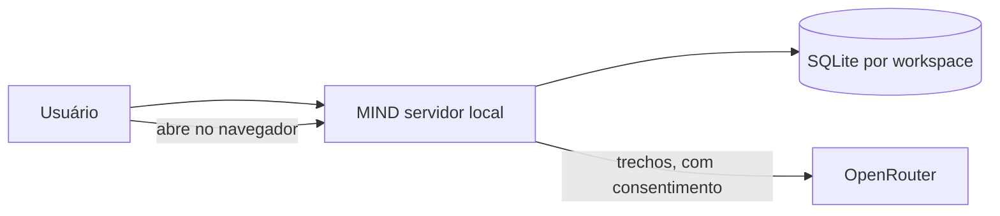

# Overview — MIND
Status: human-reviewed (2026-11-14) · Confidence: high

**Propósito.** Ferramenta de estudo local-first: importa materiais próprios (PDF, DOCX, Markdown, texto, páginas web) e gera flashcards e questões que citam o trecho de origem, com repetição espaçada (FSRS). [src: README.md:1-5]

**Usuários.** Pessoas que estudam com os próprios materiais (provas, cursos, certificações). Um único usuário por instalação, sem contas. [src: README.md:3] [inferred: sem login]

**Capacidades.** Biblioteca, Gerar, Revisar, Estudar, Praticar, Erros e estatísticas, Chat com citações, Backup `.zip`, API JSON em `/api/v1`. [src: README.md:12-22]

**Glossário.**

| Termo | Significado | Onde |
|---|---|---|
| Workspace | Espaço isolado com banco SQLite e materiais próprios | `src/mind/workspaces/registry.py` |
| Material | Arquivo ou página importada | `src/mind/db/workspace_models.py:33` |
| Chunk | Trecho indexado de um material | `src/mind/db/workspace_models.py:56` |
| Item | Card ou questão gerado | `src/mind/db/workspace_models.py:114` |
| Run de geração | Uma execução de geração com custo | `src/mind/db/workspace_models.py:76` |
| Job | Tarefa em segundo plano (importar, gerar) | `src/mind/jobs/queue.py` |

**Maturidade.** Primeira versão concluída (intent anterior), ainda sem release publicada. [src: .aidlc/261114-mind-study-tool/state.md]
