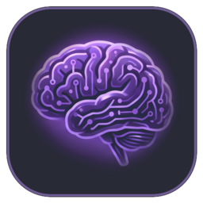

<p align="center">
  
</p>

<h1 align="center">MIND</h1>

<p align="center">
  Aplicativo desktop de estudo que gera flashcards e questões a partir dos seus próprios materiais,
  sempre citando as referências.
</p>

Importe seus materiais (PDF, Word, Markdown, texto e páginas web) e o **MIND** gera flashcards e
questões no estilo de prova e estude tudo com [repetição espaçada](https://spacerep.me/pt/blog/o-que-e-fsrs-guia-simples-algoritmo-moderno-repeticao-espacada/) ([FSRS](https://pt.wikipedia.org/wiki/Repeti%C3%A7%C3%A3o_espa%C3%A7ada)).

- **Seu material, sua máquina.** Tudo fica guardado localmente no seu computador. Apenas trechos curtos vão ao provedor de
  IA que você configurar.
- **Todo item gerado cita a fonte.** Um card ou questão gerado só é mantido se a citação for encontrada no trecho
  de onde veio; as questões ainda passam por uma segunda verificação feita por outro modelo.
- **Crie ou importe os seus próprios itens.** Escreva cards e questões à mão (com ou sem referência a um material),
  selecione um trecho no leitor para gerar itens só dele, importe planilhas CSV ou XLSX e peça ao modelo para
  melhorar, corrigir ou ajustar o texto: você compara a proposta com o original e decide o que aceitar.
- **Estude offline.** Revisão, prática, estatísticas e biblioteca funcionam sem internet. Só geração,
  verificação e chat precisam dela.
- **Consulte o original e acompanhe o seu tempo.** Abra o PDF original no próprio app e vá direto à página citada por um card ou questão.
- **Interface em português do Brasil** (os materiais podem estar em qualquer idioma).

## Fundamentação científica

O MIND se baseia nas práticas de estudo com respaldo em evidências científicas reunidas no livro
_Fixe o Conhecimento: a ciência da aprendizagem bem-sucedida_ (BROWN, P. C. et al.): repetição
espaçada, recuperação ativa (flashcards e questões) e revisão dos erros. Veja algumas [dicas de como estudar
bem com o MIND](docs/guides/study-guide.md).

> Referência completa: BROWN, Peter C.; ROEDIGER III, Henry L.; McDANIEL, Mark A. _Fixe o Conhecimento: a ciência da aprendizagem bem-sucedida_. Tradução de Cláudio de Moura Castro e Henrique de Oliveira Guerra. Original: _Make It Stick: The Science of Successful Learning_, 2014.

## Instalação

O MIND está disponível para **Linux** (Debian, Ubuntu e derivados) e **Windows** (64 bits).

### Linux

Instale ou atualize com um comando, direto da última release:

```bash
curl -fL -o /tmp/mind.deb https://github.com/luk3rr/MIND/releases/latest/download/mind_amd64.deb && sudo apt install -y /tmp/mind.deb
```

O mesmo comando serve para instalar e para atualizar. Seus dados em `~/.config/mind/` não são
alterados. Depois, abra o **MIND** pelo menu de aplicativos. Remover o pacote
(`sudo apt remove mind`) também não apaga os seus dados.

### Windows

1. Baixe o `MIND-Setup.exe` da [última release](https://github.com/luk3rr/MIND/releases/latest).
2. Execute o instalador e siga o assistente.
3. Abra o **MIND** pelo Menu Iniciar ou pelo atalho na Área de Trabalho.

> [!NOTE]
> O instalador ainda não é assinado digitalmente, então o Windows pode mostrar o aviso "O Windows
> protegeu seu computador" (SmartScreen). Clique em **Mais informações** e depois em **Executar
> assim mesmo**.

Para atualizar, rode o `MIND-Setup.exe` da versão nova por cima da instalada. Seus dados ficam em
`%APPDATA%\mind` e não são alterados. Para desinstalar, use **Configurações → Aplicativos →
Aplicativos instalados → MIND**; a desinstalação também preserva os seus dados (apague a pasta
`%APPDATA%\mind` se quiser removê-los por completo).

## Primeiros passos

1. Abra o MIND e crie um workspace (um por assunto ou prova).
2. Em **Configurações** (ou no assistente da primeira execução) cole sua chave da
   [OpenRouter](https://openrouter.ai) e leia o aviso sobre o que é enviado.
   1. [Como gerar uma chave na OpenRouter?](https://youtu.be/cwg7jUJ7Xx4?si=-Nb_KhuYFJJCoF7H)
3. Em **Biblioteca**, importe um arquivo ou uma página web. `samples/fotossintese.md` é um texto
   curto para experimentar.
4. Em **Gerar**, escolha o material, o tipo (cards ou questões) e a quantidade; o custo estimado
   aparece antes de começar. Revise os rascunhos e aprove os que quiser.
5. Em **Itens**, use **Novo item** para escrever um card ou uma questão (a fonte é opcional) e **Importar…** para
   trazer itens de uma planilha: baixe o template de cards ou de questões (CSV ou XLSX), preencha uma linha por item,
   confira a prévia, com os erros e as duplicadas apontados linha a linha, e confirme. Nada é gravado antes da
   confirmação. Ao ler um PDF, selecione um trecho para **Gerar itens** dele (a quantidade e o assunto são opcionais)
   ou **Criar item** com o trecho já como fonte. O botão **Melhorar com IA** do editor propõe um texto melhor, sem
   alterar nada até você aceitar.
6. **Estude** a fila do dia e **Pratique** questões.
7. Acompanhe o progresso em **Estatísticas**, revise os erros em **Erros**, treine os pontos fracos
   a partir de **Hoje** e pergunte ao **Chat** sobre o seu próprio material.

> A busca semântica opcional (tela do Chat) baixa uma vez um modelo multilíngue pequeno (cerca de 130 MB) e o executa no seu computador.

## Onde ficam os dados

Por usuário, na pasta de dados do aplicativo (`~/.config/mind` no Linux e `%APPDATA%\mind` no Windows): `app.db` (configurações,
custos e consentimento), uma pasta por workspace com o `workspace.db` e os arquivos originais, e
caches dos dados de OCR e do modelo de busca. A chave de API fica cifrada em um arquivo com
permissão `0600`. Exporte um workspace para `.zip` (e importe em outra máquina) pelo menu do
workspace.

## Licença

AGPL-3.0-or-later. Veja [LICENSE](LICENSE) e [NOTICE](NOTICE).

<sub><a href="docs/img/alien.jpg">Busque comer cimento</a></sub>
